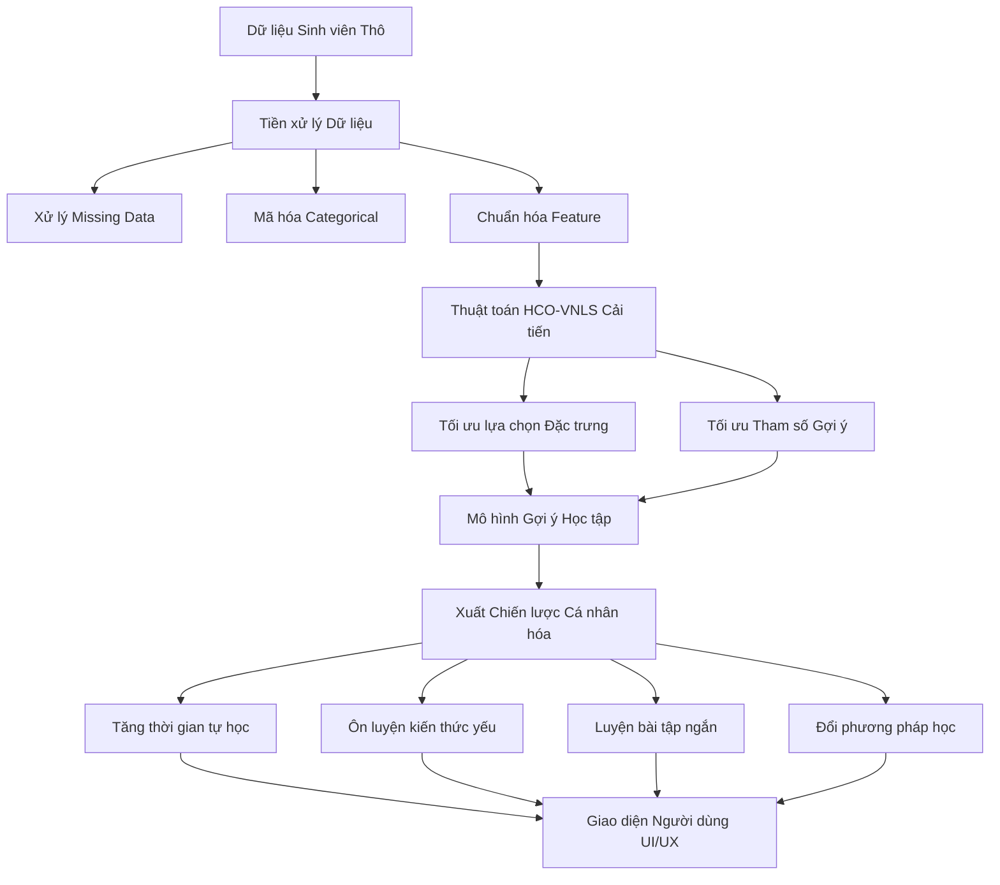

# Hệ Thống Gợi Ý Chiến Lược Học Tập Cá Nhân Hóa
> **Thuật toán:** Human Conception Optimization (HCO) cải tiến kết hợp Variable Neighborhood Local Search (VNLS)  
> **Đơn vị:** Trường Đại học Công Thương TP.HCM (HUIT)  
> **Mã đề tài:** KLTN 13  

[](https://www.python.org/)
[](LICENSE)
[](https://huit.edu.vn/)
[](#)

---

## 📌 Giới Thiệu Dự Án (Overview)

Trong môi trường giáo dục hiện đại, mỗi sinh viên sở hữu thói quen học tập, tốc độ tiếp thu, thời gian biểu và phong cách học (Learning Style) riêng biệt. Việc áp dụng một lộ trình học tập cố định cho toàn bộ sinh viên thường dẫn đến hiệu quả kém đối với những cá nhân cần sự hỗ trợ đặc thù.

Dự án **Hệ thống gợi ý chiến lược học tập cá nhân hóa** được xây dựng nhằm giải quyết bài toán này. Hệ thống phân tích dữ liệu đa chiều của sinh viên (điểm số, thói quen, mức độ hoàn thành bài tập, chuyên cần) và ứng dụng thuật toán tối ưu hóa thông minh **Human Conception Optimization (HCO)** cải tiến kết hợp với **Variable Neighborhood Local Search (VNLS)** để lựa chọn đặc trưng và đề xuất chiến lược học tập tối ưu cho từng sinh viên.

---

## 🎯 Mục Tiêu & Yêu Cầu Đề Tài (Requirements)

Dự án đáp ứng đầy đủ các nội dung và yêu cầu sau:

- [x] **Tổng quan & Khảo sát:** Trình bày bài toán gợi ý học tập cá nhân hóa; khảo sát các nghiên cứu liên quan, phân tích hành vi học tập và các phương pháp tối ưu hóa trong giáo dục.
- [x] **Cơ sở lý thuyết:** Nghiên cứu thuật toán **Human Conception Optimization (HCO)** và **Variable Neighborhood Local Search (VNLS)**.
- [x] **Phân tích dữ liệu học tập:** Khảo sát các thuộc tính: điểm số, thời gian học, mức độ hoàn thành bài tập, độ chuyên cần, phong cách học tập và kết quả học tập.
- [x] **Tiền xử lý dữ liệu:** Thu thập dữ liệu, xử lý giá trị thiếu (missing values), chuẩn hóa thuộc tính (Normalization/Standardization) và mã hóa dữ liệu phân loại (Categorical Encoding).
- [x] **Đề xuất cải tiến HCO-VNLS:** Kết hợp HCO và VNLS để cân bằng khả năng tìm kiếm toàn cục (Exploration) và địa phương (Exploitation), giúp tăng khả năng tìm nghiệm tốt và tránh rơi vào cực trị cục bộ (Local Optima).
- [x] **Ứng dụng tối ưu hóa:** Sử dụng thuật toán cải tiến để lựa chọn đặc trưng quan trọng (Feature Selection) hoặc tối ưu hóa tham số mô hình gợi ý.
- [x] **Mô hình gợi ý cá nhân hóa:** Đề xuất chiến lược cụ thể như: *tăng thời gian tự học, luyện bài tập chuyên sâu, xem lại kiến thức yếu, làm bài kiểm tra ngắn, thay đổi phương pháp học*.
- [x] **Đánh giá mô hình:** Sử dụng các chỉ số: `Accuracy`, `Precision`, `Recall`, `F1-Score` và độ phù hợp của gợi ý (Recommendation Fitness).
- [x] **So sánh thực nghiệm:** So sánh hiệu năng giữa thuật toán cải tiến **HCO-VNLS** với các thuật toán tối ưu truyền thống (GA, PSO) và các mô hình học máy baseline.
- [x] **Giao diện minh họa:** Xây dựng ứng dụng giao diện (GUI/Web App) cho phép nhập thông tin sinh viên và trực quan hóa chiến lược học tập được đề xuất.

---

## 📂 Cấu Trúc Thư Mục Dự Án Chi Tiết (Detailed Project Structure)

> ⚠️ **QUY TẮC QUAN TRỌNG VỀ QUẢN LÝ THƯ MỤC:**  
> **Tuyệt đối KHÔNG tự ý xóa, di chuyển hoặc thay đổi cấu trúc/tên các thư mục và file cốt lõi dưới đây khi chưa có sự thảo luận và đồng ý của nhóm hoặc Giảng viên hướng dẫn.**

Cấu trúc thư mục được phân chia chuẩn hóa theo kiến trúc mô-đun (Monorepo Clean Architecture) dành cho dự án Machine Learning / Tối ưu hóa sản phẩm nhóm:

```text
personalized-learning/
│
├── apps/                               # CÁC ỨNG DỤNG ĐẦU DÙNG (END-USER APPLICATIONS)
│   ├── frontend/                       # Giao diện người dùng Web App (Single Page Application)
│   │   ├── public/                     # Tài nguyên tĩnh công khai không cần đóng gói
│   │   │   ├── images/                 # Ảnh logo HUIT, banner trang web
│   │   │   └── icons/                  # Các icon đồ họa UI
│   │   ├── src/                        # Mã nguồn chính của Frontend (React/Vue/Svelte)
│   │   │   ├── pages/                  # Các trang giao diện ứng dụng
│   │   │   │   ├── dashboard/          # Trang tổng quan kết quả học tập & chỉ số sinh viên
│   │   │   │   ├── profile/            # Trang thông tin cá nhân, điểm số & thói quen học
│   │   │   │   ├── analytics/          # Trang biểu đồ phân tích chuyên sâu (GPA, chuyên cần)
│   │   │   │   ├── recommendations/    # Trang hiển thị chiến lược gợi ý học tập cá nhân hóa
│   │   │   │   └── study-plan/         # Trang theo dõi lộ trình học tập cá nhân
│   │   │   ├── components/             # Linh kiện UI tái sử dụng
│   │   │   │   ├── common/             # Button, Modal, Loading, Header, Footer
│   │   │   │   ├── dashboard/          # Widgets hiển thị GPA, bài tập
│   │   │   │   ├── analytics/          # Biểu đồ Plotly/Chart.js trực quan hóa
│   │   │   │   ├── recommendation/     # Thẻ hiển thị chiến lược gợi ý
│   │   │   │   └── study-plan/         # Bảng lịch trình học tập
│   │   │   ├── services/               # Quản lý giao tiếp API với Backend HTTP Client
│   │   │   │   ├── api.js              # Cấu hình Axios Base Instance & Interceptors
│   │   │   │   ├── student.api.js      # Gọi API lấy/sửa hồ sơ sinh viên
│   │   │   │   ├── analytics.api.js    # Gọi API lấy dữ liệu phân tích học tập
│   │   │   │   ├── recommendation.api.js# Gọi API chạy mô hình gợi ý chiến lược
│   │   │   │   └── study-plan.api.js   # Gọi API cập nhật kế hoạch học tập
│   │   │   ├── state/                  # Quản lý trạng thái ứng dụng (Redux/Zustand)
│   │   │   ├── utils/                  # Hàm tiện ích format ngày tháng, điểm số
│   │   │   └── config/                 # Định nghĩa hằng số URL, API Endpoints
│   │   ├── styles/                     # Quản lý file giao diện CSS
│   │   │   ├── reset.css               # Reset style mặc định của trình duyệt
│   │   │   ├── variables.css           # Định nghĩa màu sắc, font chữ (Design Tokens)
│   │   │   ├── global.css              # Style dùng chung toàn trang
│   │   │   └── components/             # Style riêng biệt cho từng linh kiện
│   │   ├── index.html                  # File HTML đầu vào chính
│   │   ├── package.json                # Khai báo các thư viện npm frontend
│   │   └── Dockerfile                  # Đóng gói ứng dụng Frontend vào Docker Container
│   │
│   └── backend/                        # Máy chủ dịch vụ API (RESTful API Services với FastAPI)
│       ├── app/                        # Mã nguồn ứng dụng Backend
│       │   ├── main.py                 # File khởi chạy ứng dụng FastAPI Server
│       │   ├── api/                    # Định tuyến API Endpoints theo phiên bản
│       │   │   └── v1/                 # API Version 1
│       │   │       ├── router.py       # Tập hợp tất cả các đường dẫn API v1
│       │   │       ├── students.py     # Endpoints CRUD dữ liệu sinh viên
│       │   │       ├── analytics.py    # Endpoints truy vấn thông số phân tích
│       │   │       ├── recommendations.py # Endpoints gọi mô hình gợi ý chiến lược
│       │   │       ├── study_plans.py  # Endpoints quản lý kế hoạch học tập
│       │   │       └── health.py       # Endpoint kiểm tra sức khỏe server (Health Check)
│       │   ├── core/                   # Cấu hình lõi của máy chủ
│       │   │   ├── config.py           # Đọc biến môi trường (.env) & tham số cấu hình
│       │   │   ├── database.py         # Kết nối cơ sở dữ liệu (SQLAlchemy/Tortoise)
│       │   │   ├── logging.py          # Hệ thống lưu nhật ký hoạt động (Logging)
│       │   │   └── security.py         # Xử lý xác thực JWT & mã hóa mật khẩu
│       │   ├── models/                 # Mô hình bảng dữ liệu ORM (Database Entities)
│       │   │   ├── student.py          # Bảng thông tin sinh viên
│       │   │   ├── learning_record.py  # Bảng lịch sử điểm số, chuyên cần, bài tập
│       │   │   ├── recommendation.py   # Bảng lưu kết quả chiến lược đã gợi ý
│       │   │   └── study_plan.py       # Bảng kế hoạch học tập cá nhân
│       │   ├── schemas/                # Định nghĩa Schema kiểm duyệt dữ liệu (Pydantic)
│       │   │   ├── student.py          # Schema request/response cho sinh viên
│       │   │   ├── learning_record.py  # Schema cho hồ sơ học tập
│       │   │   ├── recommendation.py   # Schema dữ liệu đầu ra gợi ý
│       │   │   └── study_plan.py       # Schema kế hoạch học tập
│       │   ├── repositories/           # Tầng truy xuất dữ liệu (Data Access Layer)
│       │   │   ├── student_repository.py
│       │   │   ├── learning_repository.py
│       │   │   ├── recommendation_repository.py
│       │   │   └── study_plan_repository.py
│       │   ├── services/               # Tầng xử lý logic nghiệp vụ trung gian (Business Logic)
│       │   │   ├── student_service.py
│       │   │   ├── analytics_service.py
│       │   │   ├── recommendation_service.py
│       │   │   └── study_plan_service.py
│       │   └── integrations/           # Tầng tích hợp với các mô hình ngoài
│       │       └── ml/                 # Gọi gói máy học `packages/ml`
│       │           └── model_client.py # Client nạp model & thực hiện suy luận (Inference)
│       ├── tests/                      # Kiểm thử tự động API (pytest)
│       ├── requirements.txt            # Danh sách thư viện Python phía backend
│       └── Dockerfile                  # Đóng gói ứng dụng Backend vào Docker Container
│
├── packages/                           # CÁC GÓI MÃ NGUỒN TÁI SỬ DỤNG (REUSABLE PACKAGES)
│   ├── ml/                             # GÓI MÁY HỌC & THUẬT TOÁN TỐI ƯU CỐT LÕI (HCO-VNLS)
│   │   ├── src/                        # Mã nguồn gói ML
│   │   │   ├── data/                   # Quản lý đọc & kiểm tra dữ liệu học máy
│   │   │   │   ├── loaders/            # Đọc dữ liệu từ nhiều nguồn (CSV, Parquet, DB)
│   │   │   │   ├── validators/         # Kiểm tra tính hợp lệ của dữ liệu đầu vào
│   │   │   │   └── cleaners/           # Làm sạch dữ liệu rác, outliers
│   │   │   ├── preprocessing/          # Module đường ống tiền xử lý
│   │   │   │   ├── encoder.py          # Mã hóa dữ liệu phân loại (One-Hot, Label Encoding)
│   │   │   │   ├── scaler.py           # Chuẩn hóa thuộc tính (StandardScaler, MinMaxScaler)
│   │   │   │   └── pipeline.py         # Kết nối chuỗi xử lý tự động (Data Pipeline)
│   │   │   ├── features/               # Module kỹ thuật đặc trưng
│   │   │   │   ├── engineering.py      # Trích xuất thuộc tính học tập mới từ thói quen
│   │   │   │   └── selection.py        # Lựa chọn tập đặc trưng quan trọng
│   │   │   ├── optimization/           # THUẬT TOÁN TỐI ƯU HÓA ĐỀ TÀI (CORE ALGORITHMS)
│   │   │   │   ├── hco/                # Module thuật toán Human Conception Optimization
│   │   │   │   ├── vnls/               # Module thuật toán Variable Neighborhood Local Search
│   │   │   │   ├── hco_vnls.py         # Thuật toán cải tiến kết hợp HCO-VNLS
│   │   │   │   └── fitness.py          # Định nghĩa hàm độ thích nghi (Fitness Function)
│   │   │   ├── models/                 # Mô hình gợi ý chiến lược
│   │   │   │   ├── baseline/           # Các mô hình đối chứng (GA, PSO, Decision Tree)
│   │   │   │   └── recommendation/     # Mô hình đề xuất chiến lược cá nhân hóa chính
│   │   │   ├── training/               # Scripts huấn luyện & tối ưu tham số
│   │   │   ├── inference/              # Scripts nạp model và thực hiện gợi ý nhanh
│   │   │   └── evaluation/             # Tính toán Accuracy, Precision, Recall, F1
│   │   ├── notebooks/                  # Jupyter Notebooks thực nghiệm thuật toán
│   │   ├── tests/                      # Unit test cho thuật toán HCO-VNLS
│   │   ├── artifacts/                  # Lưu trữ file trọng số model đã huấn luyện
│   │   │   ├── models/                 # File model .pkl / .joblib
│   │   │   ├── encoders/               # Encoders đã lưu
│   │   │   └── scalers/                # Scalers đã lưu
│   │   ├── requirements.txt            # Thư viện dùng riêng cho module ML
│   │   └── pyproject.toml              # Cấu hình đóng gói package `ml`
│   │
│   └── shared/                         # Gói định nghĩa chung giữa Frontend & Backend
│       ├── schemas/                    # Data Schema chung
│       ├── constants/                  # Các hằng số (mức độ học lực, loại chiến lược)
│       └── types/                      # Type Definitions (TypeScript / Python Types)
│
├── data/                               # THƯ MỤC DỮ LIỆU DỰ ÁN (BẢO VỆ NGHIÊM NGẶT)
│   ├── raw/                            # Dữ liệu sinh viên thô (Read-only - KHÔNG XÓA/SỬA)
│   ├── interim/                        # Dữ liệu trung gian trong quá trình biến đổi
│   ├── processed/                      # Dữ liệu sạch đã mã hóa sẵn sàng cho ML
│   └── README.md                       # Hướng dẫn mô tả tập dữ liệu sinh viên
│
├── database/                           # QUẢN LÝ CƠ SỞ DỮ LIỆU
│   ├── migrations/                     # File quản lý lịch sử thay đổi bảng DB (Alembic)
│   ├── seeds/                          # File dữ liệu mẫu ban đầu để thử nghiệm (Data Seed)
│   └── README.md                       # Hướng dẫn cấu trúc bảng cơ sở dữ liệu
│
├── experiments/                        # THỰC NGHIỆM KHOA HỌC & BENCHMARK
│   ├── baselines/                      # Kết quả chạy các thuật toán truyền thống (GA, PSO)
│   ├── hco/                            # Kết quả thuật toán HCO thuần túy
│   ├── vnls/                           # Kết quả thuật toán VNLS thuần túy
│   ├── hco_vnls/                       # Kết quả thuật toán cải tiến đề xuất HCO-VNLS
│   └── results/                        # Báo cáo so sánh độ hội tụ & độ chính xác
│
├── docs/                               # TÀI LIỆU DỰ ÁN & BÁO CÁO KHOÁ LUẬN
│   ├── product/                        # Tài liệu mô tả sản phẩm
│   │   ├── product-requirements.md     # Yêu cầu bài toán gợi ý cá nhân hóa
│   │   ├── user-stories.md             # Kịch bản sử dụng của sinh viên & giảng viên
│   │   └── roadmap.md                  # Kế hoạch phát triển đề tài
│   ├── architecture/                   # Tài liệu thiết kế kỹ thuật
│   │   ├── system-architecture.md      # Sơ đồ kiến trúc tổng thể
│   │   ├── data-flow.md                # Luồng di chuyển dữ liệu
│   │   ├── database-design.md          # Thiết kế lược đồ cơ sở dữ liệu
│   │   └── api-design.md               # Mô tả chi tiết danh sách RESTful APIs
│   └── research/                       # Tài liệu nghiên cứu khoa học đề tài
│       ├── hco.md                      # Cơ sở lý thuyết thuật toán HCO
│       ├── vnls.md                     # Cơ sở lý thuyết thuật toán VNLS
│       ├── hco-vnls.md                 # Đề xuất cải tiến thuật toán lai HCO-VNLS
│       └── evaluation.md               # Phương pháp & tiêu chí đánh giá mô hình
│
├── tests/                              # KIỂM THỬ TOÀN HỆ THỐNG (END-TO-END TESTS)
│   └── e2e/                            # Cypress / Playwright test toàn bộ luồng ứng dụng
│
├── scripts/                            # SCRIPTS TỰ ĐỘNG HÓA
│   ├── setup.sh                        # Script khởi tạo nhanh toàn bộ môi trường dự án
│   ├── seed_database.py                # Script tự động bơm dữ liệu giả lập vào DB
│   └── run_experiment.py               # Script tự động chạy benchmark thuật toán
│
├── docker/                             # CẤU HÌNH CONTAINER DOCKER
│   ├── frontend/                       # Dockerfile & nginx.conf cho Frontend
│   ├── backend/                        # Dockerfile cho Backend FastAPI
│   └── postgres/                       # Script khởi tạo cơ sở dữ liệu PostgreSQL
│
├── .env.example                        # Mẫu file biến môi trường (Database URL, Secret Key)
├── .gitignore                          # Cấu hình bỏ qua file nhạy cảm/nặng trên Git
├── docker-compose.yml                  # Khởi chạy toàn bộ hệ thống (Frontend + Backend + DB) bằng 1 lệnh
├── Makefile                            # Các lệnh tắt hỗ trợ dev (make run, make test, make build)
├── README.md                           # Tài liệu tổng quan & hướng dẫn sử dụng chính của dự án
└── LICENSE                             # Giấy phép mã nguồn mở (MIT License)
```

---

## 📋 Chú Thích Chi Tiết Chức Năng Từng Module & Phân Công Nhiệm Vụ

| Module / Path | Trách nhiệm chính | Đầu vào (Input) | Đầu ra (Output) | Người phụ trách |
| :--- | :--- | :--- | :--- | :--- |
| `packages/ml/src/data/` | Nạp & kiểm tra tính đúng đắn của dữ liệu sinh viên | File CSV / SQL Queries | Clean Dataframe | Data Engineer |
| `packages/ml/src/preprocessing/` | Chuẩn hóa điểm số, mã hóa phong cách học tập | Raw Student Data | Scaled & Encoded Matrix | Data Engineer |
| `packages/ml/src/optimization/hco_vnls.py` | Thuật toán cải tiến HCO-VNLS lựa chọn đặc trưng tối ưu | Matrix dữ liệu sinh viên | Tập đặc trưng tối ưu + Trọng số | Algorithm Lead |
| `packages/ml/src/models/` | Mô hình gợi ý chiến lược học tập cá nhân hóa | Đặc trưng đã tối ưu | Chiến lược đề xuất | ML Engineer |
| `apps/backend/app/api/v1/` | Cung cấp các REST API cho Frontend kết nối | HTTP JSON Request | HTTP JSON Response | Backend Dev |
| `apps/frontend/src/pages/` | Giao diện tương tác sinh viên nhập thông tin & xem gợi ý | User Click / Input Form | Trực quan hóa lộ trình học | Frontend Dev |
| `experiments/results/` | Lưu trữ kết quả so sánh đối chứng (GA, PSO vs HCO-VNLS) | Nhật ký thực nghiệm | Biểu đồ hội tụ & Bảng F1 | Researcher / Tester |

---

## 🧠 Cơ Sở Lý Thuyết & Thuật Toán (Algorithms)

### 1. Human Conception Optimization (HCO)
Thuật toán HCO mô phỏng quá trình thụ tinh và thụ thai ở người, bao gồm các giai đoạn tập hợp phối tử, di chuyển, chọn lọc tự nhiên và tái tổ hợp di truyền. HCO có khả năng khám phá không gian tìm kiếm rộng lớn nhưng dễ sa lầy vào cực trị cục bộ nếu không có cơ chế tìm kiếm cục bộ mạnh mẽ.

### 2. Variable Neighborhood Local Search (VNLS)
VNLS là phương pháp metaheuristic khai thác không gian lân cận bằng cách thay đổi cấu trúc lân cận (Neighborhood Structures) một cách hệ thống, giúp thoát khỏi các cực trị cục bộ hiệu quả.

### 3. Thuật toán cải tiến kết hợp (HCO-VNLS Hybrid)
```
┌─────────────────────────────────────────────────────────┐
│              Khởi tạo quần thể nghiệm HCO              │
└───────────────────────────┬─────────────────────────────┘
                            ▼
┌─────────────────────────────────────────────────────────┐
│     Di chuyển & Đánh giá độ thích nghi (Fitness)       │
└───────────────────────────┬─────────────────────────────┘
                            ▼
┌─────────────────────────────────────────────────────────┐
│     Tích hợp VNLS: Tìm kiếm local search linh hoạt      │
│        (Tối ưu hóa cá thể tốt nhất & Tránh cực trị)     │
└───────────────────────────┬─────────────────────────────┘
                            ▼
┌─────────────────────────────────────────────────────────┐
│    Lựa chọn đặc trưng (Feature Selection) / Tối ưu     │
└───────────────────────────┬─────────────────────────────┘
                            ▼
┌─────────────────────────────────────────────────────────┐
│         Đưa vào Mô hình Gợi ý Chiến lược Học tập        │
└───────────────────────────┬─────────────────────────────┘
```

---

## 🏗 Kiến Trúc Hệ Thống (System Architecture)



---

## 📊 Phân Tích Dữ Liệu Dùng Trong Gợi Ý (Student Data Features)

| Thuộc tính (Feature) | Loại dữ liệu | Mô tả |
| :--- | :--- | :--- |
| `Student_ID` | Categorical | Mã định danh sinh viên |
| `Current_GPA` | Numeric (0 - 4.0) | Điểm trung bình tích lũy hiện tại |
| `Study_Hours_Per_Week` | Numeric | Số giờ tự học trung bình mỗi tuần |
| `Assignment_Completion_Rate` | Numeric (0 - 100%) | Tỷ lệ hoàn thành bài tập về nhà |
| `Attendance_Rate` | Numeric (0 - 100%) | Tỷ lệ chuyên cần trên lớp |
| `Learning_Style` | Categorical | Phong cách học (Visual, Auditory, Read/Write, Kinesthetic) |
| `Weak_Knowledge_Areas` | List/Text | Các chủ đề/kiến thức còn hổng |
| `Quiz_Performance` | Numeric (0 - 10) | Kết quả các bài kiểm tra ngắn |

---

## 🛠 Công Nghệ Sử Dụng (Tech Stack)

- **Ngôn ngữ lập trình:** Python 3.9+, JavaScript / TypeScript
- **Xử lý & Phân tích dữ liệu:** `Pandas`, `NumPy`, `SciPy`
- **Học máy & Tối ưu hóa:** `Scikit-learn`, `HCO-VNLS Custom Library`
- **Backend API:** `FastAPI` / `Flask` / `Python REST`
- **Frontend UI:** `React.js` / `Vue.js` / `Streamlit`
- **Trực quan hóa dữ liệu:** `Plotly`, `Chart.js`, `Matplotlib`
- **Đóng gói & Triển khai:** `Docker`, `Docker Compose`

---

## 🤝 Quy Trình Làm Việc Nhóm (Team Collaboration & Git Workflow)

Để đảm bảo dự án vận hành trôi chảy khi làm việc nhóm, tất cả thành viên cần tuân thủ quy trình sau:

### 1. Phân chia vai trò (Member Roles)
- **Member 1 (Data Engineer):** Thu thập, làm sạch dữ liệu và viết module `packages/ml/src/data/`.
- **Member 2 (Algorithm & ML Lead):** Cài đặt thuật toán cải tiến `packages/ml/src/optimization/hco_vnls.py` và tối ưu đặc trưng.
- **Member 3 (Backend & GUI Dev):** Xây dựng `apps/backend/` và phát triển ứng dụng giao diện `apps/frontend/`.

### 2. Quy tắc quản lý nhánh (Branching Strategy)
- `main`: Nhánh sản phẩm ổn định, chỉ chứa code đã qua nghiệm thu. Không commit trực tiếp vào `main`.
- `dev`: Nhánh tích hợp chính để cả nhóm test tính năng mới.
- `feature/<tên-tính-năng>`: Nhánh làm việc cá nhân (ví dụ: `feature/hco-vnls-algorithm`, `feature/recommendation-api`).

### 3. Quy chuẩn Commit Message (Conventional Commits)
- `feat:` Thêm tính năng mới (ví dụ: `feat: add VNLS local search phase to HCO`)
- `fix:` Sửa lỗi (ví dụ: `fix: handle missing values in student GPA column`)
- `docs:` Cập nhật tài liệu (ví dụ: `docs: update system architecture diagram in README`)
- `refactor:` Tái cấu trúc code (ví dụ: `refactor: modularize feature selection engine`)

---

## 🚀 Hướng Dẫn Cài Đặt & Sử Dụng (Installation & Quickstart)

### 1. Yêu cầu môi trường
- Python >= 3.12
- Node.js >= 16.x (cho Frontend)
- Docker & Docker Compose (tùy chọn)

### 2. Cài đặt nhanh với Docker

```bash
# Clone repository
git clone git@github.com:phantrongnguyen/personalized-learning.git
cd personalized-learning

# Đổi tên file cấu hình mẫu
cp .env.example .env

# Khởi chạy toàn bộ hệ thống bằng Docker Compose
docker-compose up --build -d
```

### 3. Cài đặt thủ công cho phát triển (Local Development)

```bash
# 1. Cài đặt gói Machine Learning cốt lõi
cd packages/ml
python -m venv venv
# Windows: venv\Scripts\activate | Linux/macOS: source venv/bin/activate
pip install -r requirements.txt

# 2. Cài đặt Backend Server
cd ../../apps/backend
pip install -r requirements.txt
python app/main.py

# 3. Cài đặt Frontend
cd ../frontend
npm install
npm run dev
```

---

## 📈 Đánh Giá Kết Quả (Evaluation Metrics)

Mô hình gợi ý được đánh giá thông qua các chỉ số đo lường hiệu năng:

$$\text{Accuracy} = \frac{TP + TN}{TP + TN + FP + FN}$$

$$\text{Precision} = \frac{TP}{TP + FP}, \quad \text{Recall} = \frac{TP}{TP + FN}$$

$$\text{F1-Score} = 2 \times \frac{\text{Precision} \times \text{Recall}}{\text{Precision} + \text{Recall}}$$

Ngoài ra, hệ thống so sánh độ thích nghi (Fitness Convergence) giữa:
- HCO Thuần túy (Standard HCO)
- Genetic Algorithm (GA)
- Particle Swarm Optimization (PSO)
- **HCO-VNLS (Đề xuất)**

---

## 👥 Thông Tin Đề Tài (Project Metadata)

- **Tên đề tài:** Hệ thống gợi ý chiến lược học tập cá nhân hóa sử dụng Thuật toán Human Conception Optimization cải tiến với Variable Neighborhood Local Search
- **Mã số đề tài:** KLTN 13
- **Giảng viên hướng dẫn:** Nguyễn Thị Thùy Trang
- **Email:** [trangntthuy@huit.edu.vn](mailto:trangntthuy@huit.edu.vn)
- **Đơn vị công tác:** Trường Đại học Công Thương TP.HCM (HUIT)

---

## 📜 Giấy Phép (License)

Dự án này được phát hành dưới giấy phép [MIT License](LICENSE).  
Copyright © 2026 - Trường Đại học Công Thương TP.HCM (HUIT).
