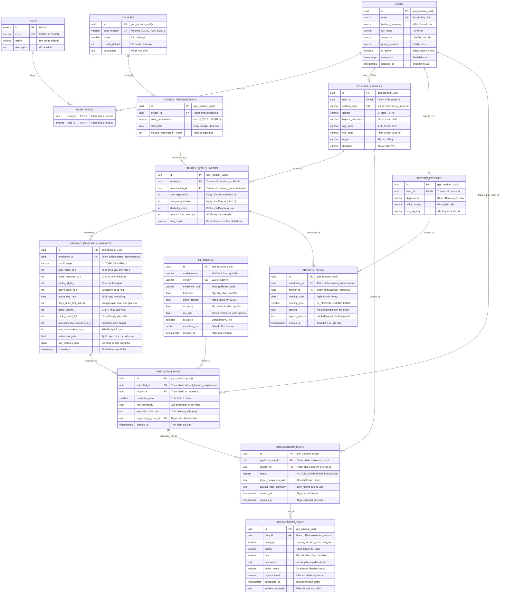

# KẾ HOẠCH THIẾT KẾ CƠ SỞ DỮ LIỆU (DATABASE DESIGN PLAN)
### Hệ Thống Gợi Ý Chiến Lược Học Tập Cá Nhân Hóa (KLTN 13 - HUIT)

> **Cơ quan chủ quản:** Trường Đại học Công Thương TP.HCM (HUIT) — Khoa Công Nghệ Thông Tin  
> **Mã đề tài:** KLTN 13  
> **Sinh viên thực hiện:** Phan Trọng Nguyên  
> **Hệ quản trị CSDL:** PostgreSQL 15  
> **ORM & Migration Framework:** SQLAlchemy 2.0 (Async) & Alembic  

---

## 📌 MỤC LỤC
1. [Tổng Quan & Mục Tiêu Thiết Kế](#1-tổng-quan--mục-tiêu-thiết-kế)
2. [Phân Vùng Các Phân Hệ Dữ Liệu (Schema Domains)](#2-phân-vùng-các-phân-hệ-dữ-liệu-schema-domains)
3. [Sơ Đồ Thực Thể Quan Hệ (ERD - Entity Relationship Diagram)](#3-sơ-đồ-thực-thể-quan-hệ-erd---entity-relationship-diagram)
   - 3.1. [Sơ Đồ Quan Hệ CSDL Mức Vật Lý Chi Tiết (Detailed Physical ERD)](#31-sơ-đồ-quan-hệ-csdl-mức-vật-lý-chi-tiết-detailed-physical-erd)
   - 3.2. [Ma Trận Quan Hệ Giữa Các Bảng (Relationship Matrix)](#32-ma-trận-quan-hệ-giữa-các-bảng-relationship-matrix)
   - 3.3. [Luồng Dữ Liệu Thực Thi Liên Bảng (Data Flow & Life-cycle)](#33-luồng-dữ-liệu-thực-thi-liên-bảng-data-flow--life-cycle)
4. [Đặc Tả Chi Tiết Các Bảng Dữ Liệu (Table Specifications)](#4-đặc-tả-chi-tiết-các-bảng-dữ-liệu-table-specifications)
   - 4.1. [Phân hệ 1: Xác Thực & Người Dùng (Auth & Identity)](#41-phân-hệ-1-xác-thực--người-dùng-auth--identity)
   - 4.2. [Phân hệ 2: Học Phần & Đào Tạo (Academic & Courses)](#42-phân-hệ-2-học-phần--đào-tạo-academic--courses)
   - 4.3. [Phân hệ 3: Đặc Trưng Hành Vi Học Tập (Feature Snapshots)](#43-phân-hệ-3-đặc-trưng-hành-vi-học-tập-feature-snapshots)
   - 4.4. [Phân hệ 4: Dự Báo Học Máy & Giám Sát Mô Hình (ML Models & Predictions)](#44-phân-hệ-4-dự-báo-học-máy--giám-sát-mô-hình-ml-models--predictions)
   - 4.5. [Phân hệ 5: Kế Hoạch Can Thiệp & Cố Vấn (Interventions & Advising)](#45-phân-hệ-5-kế-hoạch-can-thiệp--cố-vấn-interventions--advising)
5. [Thiết Lập Chỉ Mục & Tối Ưu Hóa Truy Vấn (Indexes & Performance)](#5-thiết-lập-chỉ-mục--tối-ưu-hóa-truy-vấn-indexes--performance)
6. [Kịch Bản SQL Khởi Tạo DDL (PostgreSQL Initial DDL Script)](#6-kịch-bản-sql-khởi-tạo-ddl-postgresql-initial-ddl-script)

---

## 1. Tổng Quan & Mục Tiêu Thiết Kế

Nhằm giải quyết triệt để hạn chế lưu trữ tạm thời (`localStorage`) ở Frontend và tính trạng thái "Stateless" của Backend hiện tại, cơ sở dữ liệu được thiết kế nhằm phục vụ 5 mục tiêu nghiệp vụ cốt lõi:

1. **Chuẩn hóa & Bảo toàn dữ liệu (Data Integrity)**: Thiết kế đạt chuẩn 3NF, bảo đảm tính toàn vẹn dữ liệu học thuật của sinh viên theo chuẩn bộ dữ liệu quốc tế Open University Learning Analytics Dataset (OULAD).
2. **Quản lý danh tính & Phân quyền đa cấp (RBAC)**: Tách bạch rõ vai trò giữa Quản trị viên (Admin), Cố vấn học tập (Advisor), Giảng viên bộ môn (Lecturer) và Sinh viên (Student).
3. **Lưu vết và kiểm toán học máy (ML Audit & Reproducibility)**: Lưu trữ đầy đủ vector đặc trưng đầu vào, kết quả dự báo nhị phân, điểm xác suất nguy cơ rủi ro (`risk_probability`), thời gian suy luận và phiên bản mô hình được kích hoạt.
4. **Theo dõi kế hoạch can thiệp cá nhân hóa (Prescriptive Tracking)**: Chuyển hóa các khuyến nghị sư phạm thành danh sách nhiệm vụ có thể giám sát trạng thái hoàn thành (`TODO`, `IN_PROGRESS`, `COMPLETED`), giúp sinh viên cải thiện kết quả học tập theo thời gian thực.
5. **Nhật ký tư vấn tương tác (Advisory Collaboration)**: Cho phép cố vấn học tập ghi chú biên bản các buổi gặp mặt hỗ trợ, đo lường sự tiến bộ của sinh viên giữa các mốc quan sát (Cutoff).

---

## 2. Phân Vùng Các Phân Hệ Dữ Liệu (Schema Domains)

Cơ sở dữ liệu được phân chia thành **5 phân hệ chức năng**:

```
┌────────────────────────────────────────────────────────────────────────────────────────┐
│                                 HỆ THỐNG CƠ SỞ DỮ LIỆU                                  │
├─────────────────────┬─────────────────────┬────────────────────────────────────────────┤
│ 1. Auth & Users     │ 2. Academic & LMS   │ 3. Feature Snapshots                       │
│ • users             │ • courses           │ • student_feature_snapshots                │
│ • roles             │ • presentations     │   (Lưu 17 đặc trưng OULAD tại Cutoff 75%)   │
│ • user_roles        │ • enrollments       │                                            │
│ • student_profiles  │                     │                                            │
│ • advisor_profiles  │                     │                                            │
├─────────────────────┴─────────────────────┼────────────────────────────────────────────┤
│ 4. Predictions & ML Models                │ 5. Interventions & Advisory                │
│ • ml_models                               │ • intervention_plans                       │
│ • prediction_runs                         │ • intervention_tasks                       │
│                                           │ • advising_notes                           │
└───────────────────────────────────────────┴────────────────────────────────────────────┘
```

---

## 3. Sơ Đồ Thực Thể Quan Hệ (ERD - Entity Relationship Diagram)

### 3.1. Sơ Đồ Quan Hệ CSDL Mức Vật Lý Chi Tiết (Detailed Physical ERD)
Sơ đồ dưới đây thể hiện chi tiết toàn bộ các thực thể, thuộc tính, kiểu dữ liệu, các ràng buộc Khóa chính (PK), Khóa ngoại (FK), Khóa duy nhất (UK) và bản số quan hệ (Cardinality: 1-1, 1-N, N-N) giữa 13 bảng trong hệ thống:



---

### 3.2. Ma Trận Quan Hệ Giữa Các Bảng (Relationship Matrix)

Bảng đối chiếu dưới đây mô tả chính xác mối quan hệ liên kết giữa các bảng, khóa ngoại sử dụng, bản số và hành vi ràng buộc toàn vẹn khi xóa dữ liệu:

| Bảng nguồn (Parent Table) | Bảng đích (Child Table) | Khóa liên kết (FK Field) | Loại quan hệ | Ràng buộc `ON DELETE` | Mục đích nghiệp vụ |
| :--- | :--- | :--- | :---: | :---: | :--- |
| `users` | `user_roles` | `user_id` $\rightarrow$ `users.id` | $1 : N$ | `CASCADE` | Gán nhiều vai trò cho 1 tài khoản |
| `roles` | `user_roles` | `role_id` $\rightarrow$ `roles.id` | $1 : N$ | `CASCADE` | Ánh xạ danh mục quyền hệ thống |
| `users` | `student_profiles` | `user_id` $\rightarrow$ `users.id` | $1 : 1$ | `CASCADE` | Mở rộng thông tin nhân khẩu cho sinh viên |
| `users` | `advisor_profiles` | `user_id` $\rightarrow$ `users.id` | $1 : 1$ | `CASCADE` | Mở rộng thông tin chuyên môn cho cố vấn |
| `courses` | `course_presentations` | `course_id` $\rightarrow$ `courses.id` | $1 : N$ | `CASCADE` | Một môn học có nhiều kỳ mở lớp |
| `student_profiles` | `student_enrollments` | `student_id` $\rightarrow$ `student_profiles.id` | $1 : N$ | `CASCADE` | Sinh viên đăng ký nhiều học phần |
| `course_presentations` | `student_enrollments` | `presentation_id` $\rightarrow$ `course_presentations.id` | $1 : N$ | `CASCADE` | Một kỳ mở lớp có nhiều sinh viên đăng ký |
| `student_enrollments` | `student_feature_snapshots` | `enrollment_id` $\rightarrow$ `student_enrollments.id` | $1 : N$ | `CASCADE` | Lưu vector 17 đặc trưng tại các mốc |
| `student_feature_snapshots` | `prediction_runs` | `snapshot_id` $\rightarrow$ `student_feature_snapshots.id` | $1 : N$ | `CASCADE` | Đầu vào dữ liệu chạy mô hình ML |
| `ml_models` | `prediction_runs` | `model_id` $\rightarrow$ `ml_models.id` | $1 : N$ | `RESTRICT` | Bảo vệ mô hình, không cho xóa mô hình đã có log |
| `users` | `prediction_runs` | `triggered_by_user_id` $\rightarrow$ `users.id` | $1 : N$ | `SET NULL` | Giữ lịch sử dự báo kể cả khi user bị xóa |
| `prediction_runs` | `intervention_plans` | `prediction_run_id` $\rightarrow$ `prediction_runs.id` | $1 : N$ | `CASCADE` | Mỗi dự báo rủi ro sinh ra kế hoạch can thiệp |
| `student_profiles` | `intervention_plans` | `student_id` $\rightarrow$ `student_profiles.id` | $1 : N$ | `CASCADE` | Gán kế hoạch can thiệp cho sinh viên |
| `intervention_plans` | `intervention_tasks` | `plan_id` $\rightarrow$ `intervention_plans.id` | $1 : N$ | `CASCADE` | Chi tiết các đầu việc hành động cần làm |
| `student_enrollments` | `advising_notes` | `enrollment_id` $\rightarrow$ `student_enrollments.id` | $1 : N$ | `CASCADE` | Nhật ký cố vấn gắn với lần học cụ thể |
| `advisor_profiles` | `advising_notes` | `advisor_id` $\rightarrow$ `advisor_profiles.id` | $1 : N$ | `CASCADE` | Xác định cố vấn nào là người tư vấn |

---

### 3.3. Luồng Dữ Liệu Thực Thi Liên Bảng (Data Flow & Life-cycle)

Chu trình tương tác dữ liệu giữa các bảng trong hệ thống diễn ra theo 4 bước liên hoàn:

1. **Giai đoạn Đăng ký & Tích lũy Hành vi**:
   * Khi sinh viên tham gia kỳ học $\rightarrow$ tạo bản ghi `student_enrollments`.
   * Hệ thống ghi nhận tương tác LMS/VLE và điểm kiểm tra. Khi đến mốc quan sát (vd: Cutoff 75% thời lượng môn học) $\rightarrow$ Trích xuất và lưu vào `student_feature_snapshots`.
2. **Giai đoạn Dự báo Nguy cơ (Inference Pipeline)**:
   * Backend lấy dữ liệu từ `student_feature_snapshots` đưa vào mô hình đang hoạt động trong `ml_models` (LightGBM).
   * Tạo bản ghi `prediction_runs` lưu nhãn `prediction_label` (0 hoặc 1), xác suất rủi ro `risk_probability` và thời gian thực thi `execution_time_ms`.
3. **Giai đoạn Kê đơn Can thiệp (Prescriptive Engine)**:
   * Nếu xác suất rủi ro cao $\rightarrow$ Hệ thống tự động sinh bản ghi `intervention_plans` liên kết với `prediction_runs.id`.
   * Thuật toán phân tích khoảng cách năng lực (Gap Analysis) bóc tách các điểm yếu (nộp trễ, ít tương tác tài nguyên, vắng mặt kéo dài) và chèn danh sách nhiệm vụ vào `intervention_tasks` với thứ tự ưu tiên (`HIGH`, `MEDIUM`, `LOW`).
4. **Giai đoạn Đồng hành & Đánh giá (Advising & Monitoring)**:
   * Sinh viên đăng nhập vào hệ thống, đánh dấu trạng thái `is_completed = TRUE` cho từng nhiệm vụ khi đã khắc phục.
   * Cố vấn học tập theo dõi tiến độ trên Dashboard và lưu biên bản trao đổi định kỳ vào `advising_notes`.

---

## 4. Đặc Tả Chi Tiết Các Bảng Dữ Liệu (Table Specifications)

### 4.1. Phân hệ 1: Xác Thực & Người Dùng (Auth & Identity)

#### Bảng `users` (Tài khoản người dùng hệ thống)
* Lưu trữ thông tin tài khoản đăng nhập, chứng thực bảo mật và thông tin liên hệ cơ bản.

| Tên trường | Kiểu dữ liệu | Ràng buộc | Mô tả |
| :--- | :--- | :--- | :--- |
| `id` | `UUID` | PRIMARY KEY, DEFAULT `gen_random_uuid()` | Định danh người dùng duy nhất |
| `email` | `VARCHAR(255)` | UNIQUE, NOT NULL | Địa chỉ email đăng nhập hệ thống |
| `hashed_password` | `VARCHAR(255)` | NOT NULL | Mật khẩu mã hóa bảo mật (Argon2 / Bcrypt) |
| `full_name` | `VARCHAR(150)` | NOT NULL | Họ và tên đầy đủ |
| `avatar_url` | `VARCHAR(500)` | NULL | Đường dẫn ảnh đại diện |
| `phone_number` | `VARCHAR(20)` | NULL | Số điện thoại liên lạc |
| `is_active` | `BOOLEAN` | NOT NULL, DEFAULT `TRUE` | Trạng thái hoạt động của tài khoản |
| `created_at` | `TIMESTAMPTZ` | NOT NULL, DEFAULT `NOW()` | Thời điểm tạo tài khoản |
| `updated_at` | `TIMESTAMPTZ` | NOT NULL, DEFAULT `NOW()` | Thời điểm cập nhật thông tin gần nhất |

#### Bảng `roles` (Danh mục vai trò)
* Định nghĩa các vai trò trong hệ thống: `ADMIN`, `ADVISOR`, `LECTURER`, `STUDENT`.

| Tên trường | Kiểu dữ liệu | Ràng buộc | Mô tả |
| :--- | :--- | :--- | :--- |
| `id` | `SMALLSERIAL` | PRIMARY KEY | Khóa chính tự tăng |
| `code` | `VARCHAR(30)` | UNIQUE, NOT NULL | Mã vai trò (vd: `ADMIN`, `ADVISOR`) |
| `name` | `VARCHAR(100)` | NOT NULL | Tên vai trò hiển thị (vd: Cố vấn học tập) |
| `description` | `TEXT` | NULL | Diễn giải trách nhiệm và phạm vi quyền hạn |

#### Bảng `user_roles` (Bảng trung gian phân quyền)
| Tên trường | Kiểu dữ liệu | Ràng buộc | Mô tả |
| :--- | :--- | :--- | :--- |
| `user_id` | `UUID` | FK(`users.id`), ON DELETE CASCADE | Khóa ngoại người dùng |
| `role_id` | `SMALLINT` | FK(`roles.id`), ON DELETE CASCADE | Khóa ngoại vai trò |
| PRIMARY KEY (`user_id`, `role_id`) | | | Khóa chính phức hợp |

#### Bảng `student_profiles` (Hồ sơ sinh viên mở rộng)
* Ánh xạ 1-1 với `users` khi người dùng là sinh viên. Chứa các biến nhân khẩu học tương thích OULAD.

| Tên trường | Kiểu dữ liệu | Ràng buộc | Mô tả |
| :--- | :--- | :--- | :--- |
| `id` | `UUID` | PRIMARY KEY, DEFAULT `gen_random_uuid()` | Khóa chính hồ sơ sinh viên |
| `user_id` | `UUID` | FK(`users.id`), UNIQUE, ON DELETE CASCADE | Liên kết tài khoản đăng nhập |
| `student_code` | `VARCHAR(50)` | UNIQUE, NOT NULL | Mã số sinh viên (MSSV / `id_student`) |
| `gender` | `VARCHAR(10)` | NOT NULL, CHECK in ('M', 'F') | Giới tính ('M': Nam, 'F': Nữ) |
| `highest_education`| `VARCHAR(100)` | NOT NULL | Bậc học cao nhất ('A Level', 'HE Qualification'...) |
| `age_band` | `VARCHAR(20)` | NOT NULL, CHECK in ('0-35', '35-55', '55<=') | Nhóm tuổi học viên |
| `imd_band` | `VARCHAR(50)` | NULL | Chỉ số thiếu thốn kinh tế xã hội (Index of Multiple Deprivation) |
| `region` | `VARCHAR(100)` | NULL | Khu vực địa lý cư trú |
| `disability` | `VARCHAR(10)` | NOT NULL, DEFAULT 'N' | Tình trạng khuyết tật ('Y', 'N') |

#### Bảng `advisor_profiles` (Hồ sơ cố vấn học tập / Giảng viên)
| Tên trường | Kiểu dữ liệu | Ràng buộc | Mô tả |
| :--- | :--- | :--- | :--- |
| `id` | `UUID` | PRIMARY KEY, DEFAULT `gen_random_uuid()` | Khóa chính hồ sơ cố vấn |
| `user_id` | `UUID` | FK(`users.id`), UNIQUE, ON DELETE CASCADE | Liên kết tài khoản đăng nhập |
| `department` | `VARCHAR(150)` | NOT NULL | Khoa / Ban chuyên môn phụ trách |
| `office_location` | `VARCHAR(255)` | NULL | Phòng làm việc |
| `lms_api_key` | `VARCHAR(255)` | NULL | Khóa API tích hợp LMS (đã mã hóa) |

---

### 4.2. Phân hệ 2: Học Phần & Đào Tạo (Academic & Courses)

#### Bảng `courses` (Danh mục môn học)
| Tên trường | Kiểu dữ liệu | Ràng buộc | Mô tả |
| :--- | :--- | :--- | :--- |
| `id` | `UUID` | PRIMARY KEY, DEFAULT `gen_random_uuid()` | Mã môn học hệ thống |
| `code_module` | `VARCHAR(20)` | UNIQUE, NOT NULL | Mã học phần OULAD (vd: 'AAA', 'BBB', 'CCC'...) |
| `name` | `VARCHAR(255)` | NOT NULL | Tên môn học hiển thị |
| `credits_default` | `INT` | NOT NULL, DEFAULT 30 | Số tín chỉ định mức |
| `description` | `TEXT` | NULL | Mô tả tóm tắt nội dung môn học |

#### Bảng `course_presentations` (Học kỳ / Đợt mở lớp môn học)
| Tên trường | Kiểu dữ liệu | Ràng buộc | Mô tả |
| :--- | :--- | :--- | :--- |
| `id` | `UUID` | PRIMARY KEY, DEFAULT `gen_random_uuid()` | Mã đợt mở môn |
| `course_id` | `UUID` | FK(`courses.id`), NOT NULL | Thuộc môn học nào |
| `code_presentation`| `VARCHAR(20)` | NOT NULL | Mã đợt mở (vd: '2013J', '2014B', '2014J') |
| `start_date` | `DATE` | NULL | Ngày khai giảng khóa học |
| `module_presentation_length` | `INT` | NOT NULL, DEFAULT 260 | Tổng số ngày kéo dài của học phần |
| UNIQUE (`course_id`, `code_presentation`) | | | Ràng buộc duy nhất theo đợt |

#### Bảng `student_enrollments` (Đăng ký học phần của sinh viên)
| Tên trường | Kiểu dữ liệu | Ràng buộc | Mô tả |
| :--- | :--- | :--- | :--- |
| `id` | `UUID` | PRIMARY KEY, DEFAULT `gen_random_uuid()` | Mã bản ghi đăng ký |
| `student_id` | `UUID` | FK(`student_profiles.id`), NOT NULL | Sinh viên tham gia học |
| `presentation_id` | `UUID` | FK(`course_presentations.id`), NOT NULL | Học kỳ mở môn |
| `date_registration`| `INT` | NOT NULL, DEFAULT -10 | Số ngày đăng ký trước/sau ngày bắt đầu học |
| `date_unregistration`| `INT` | NULL | Số ngày hủy đăng ký (nếu bỏ học giữa chừng) |
| `studied_credits` | `INT` | NOT NULL, DEFAULT 60 | Tổng số tín chỉ sinh viên đang học trong kỳ này |
| `num_of_prev_attempts`| `INT` | NOT NULL, DEFAULT 0 | Số lần đã học lại môn này trước đó |
| `final_result` | `VARCHAR(20)` | NULL | Kết quả thực tế cuối môn ('Pass', 'Distinction', 'Fail', 'Withdrawn') |
| UNIQUE (`student_id`, `presentation_id`) | | | Một sinh viên chỉ đăng ký 1 lần trong 1 kỳ môn |

---

### 4.3. Phân hệ 3: Đặc Trưng Hành Vi Học Tập (Feature Snapshots)

#### Bảng `student_feature_snapshots` (Chỉ số học tập tại các mốc thời gian)
* Lưu trữ chính xác vector 17 đặc trưng tại mốc **Cutoff 75%** theo đúng chuẩn Input của mô hình LightGBM đã huấn luyện.

| Tên trường | Kiểu dữ liệu | Ràng buộc | Mô tả tương ứng với Feature OULAD |
| :--- | :--- | :--- | :--- |
| `id` | `UUID` | PRIMARY KEY, DEFAULT `gen_random_uuid()` | Khóa chính bản ghi snapshot |
| `enrollment_id` | `UUID` | FK(`student_enrollments.id`), NOT NULL | Lần học của sinh viên |
| `cutoff_stage` | `VARCHAR(30)` | NOT NULL, DEFAULT 'CUTOFF_75' | Mốc quan sát ('CUTOFF_75', 'WEEK_4', 'WEEK_8') |
| `total_clicks_to_t` | `INT` | NOT NULL, DEFAULT 0 | Tổng lượt click VLE tích lũy đến mốc $t$ |
| `clicks_resource_to_t`| `INT` | NOT NULL, DEFAULT 0 | Lượt xem tài liệu phụ trợ (`resource`) |
| `clicks_url_to_t` | `INT` | NOT NULL, DEFAULT 0 | Lượt click liên kết ngoài (`url`) |
| `active_days_to_t` | `INT` | NOT NULL, DEFAULT 0 | Số ngày thực tế có đăng nhập học |
| `active_day_ratio` | `FLOAT` | NOT NULL, DEFAULT 0.0 | Tỷ lệ số ngày hoạt động trên thời gian học |
| `days_since_last_activity` | `INT` | NOT NULL, DEFAULT 0 | Số ngày gián đoạn kể từ phiên học gần nhất |
| `clicks_recent_7` | `INT` | NOT NULL, DEFAULT 0 | Lượt tương tác VLE trong 7 ngày gần đây |
| `clicks_recent_30` | `INT` | NOT NULL, DEFAULT 0 | Lượt tương tác VLE trong 30 ngày gần đây |
| `assessments_submitted_to_t` | `INT` | NOT NULL, DEFAULT 0 | Số lượng bài đánh giá đã nộp đến mốc $t$ |
| `late_submissions_to_t`| `INT` | NOT NULL, DEFAULT 0 | Số bài tập nộp sau hạn chót deadline |
| `submission_rate` | `FLOAT` | NOT NULL, DEFAULT 0.0 | Tỷ lệ nộp bài kiểm tra ($[0.0, 1.0]$) |
| `raw_features_json`| `JSONB` | NULL | Bản sao lưu định dạng JSON mở rộng cho các thuộc tính khác |
| `created_at` | `TIMESTAMPTZ` | NOT NULL, DEFAULT `NOW()` | Thời điểm tính toán & chụp dữ liệu |

---

### 4.4. Phân hệ 4: Dự Báo Học Máy & Giám Sát Mô Hình (ML Models & Predictions)

#### Bảng `ml_models` (Quản lý phiên bản mô hình Machine Learning)
| Tên trường | Kiểu dữ liệu | Ràng buộc | Mô tả |
| :--- | :--- | :--- | :--- |
| `id` | `UUID` | PRIMARY KEY, DEFAULT `gen_random_uuid()` | Khóa chính mô hình |
| `model_name` | `VARCHAR(150)` | NOT NULL | Tên mô hình (vd: `HCO-VNLS + LightGBM Cutoff 75%`) |
| `version` | `VARCHAR(30)` | UNIQUE, NOT NULL | Phiên bản (vd: `v1.0.0-cutoff75`) |
| `model_file_path` | `VARCHAR(500)` | NOT NULL | Đường dẫn file artifact (.joblib) |
| `threshold` | `FLOAT` | NOT NULL, DEFAULT 0.5 | Ngưỡng quyết định nhị phân |
| `cutoff_fraction` | `FLOAT` | NOT NULL, DEFAULT 0.75 | Tỷ lệ tiến độ học phần lúc huấn luyện (75%) |
| `accuracy` | `FLOAT` | NULL | Độ chính xác kiểm nghiệm trên tập Test (0.8741) |
| `roc_auc` | `FLOAT` | NULL | Chỉ số ROC-AUC kiểm nghiệm (0.8968) |
| `is_active` | `BOOLEAN` | NOT NULL, DEFAULT `TRUE` | Trạng thái mô hình đang phục vụ API |
| `metadata_json` | `JSONB` | NULL | Thông số siêu tham số, thư viện, thời gian fit |
| `created_at` | `TIMESTAMPTZ` | NOT NULL, DEFAULT `NOW()` | Ngày phát hành mô hình |

#### Bảng `prediction_runs` (Nhật ký thực thi dự báo)
| Tên trường | Kiểu dữ liệu | Ràng buộc | Mô tả |
| :--- | :--- | :--- | :--- |
| `id` | `UUID` | PRIMARY KEY, DEFAULT `gen_random_uuid()` | Khóa chính phiên dự đoán |
| `snapshot_id` | `UUID` | FK(`student_feature_snapshots.id`), NOT NULL | Bộ đặc trưng đầu vào |
| `model_id` | `UUID` | FK(`ml_models.id`), NOT NULL | Mô hình ML được triệu gọi |
| `prediction_label`| `SMALLINT` | NOT NULL, CHECK in (0, 1) | Kết quả nhị phân (1: Nguy cơ rớt, 0: An toàn) |
| `risk_probability`| `FLOAT` | NOT NULL | Xác suất rủi ro dự báo ($[0.0, 1.0]$) |
| `execution_time_ms`| `INT` | NULL | Thời gian phản hồi suy luận (mili-giây) |
| `triggered_by_user_id` | `UUID` | FK(`users.id`), NULL | Tài khoản thực hiện dự đoán (cố vấn hoặc sinh viên) |
| `created_at` | `TIMESTAMPTZ` | NOT NULL, DEFAULT `NOW()` | Thời điểm thực hiện dự báo |

---

### 4.5. Phân hệ 5: Kế Hoạch Can Thiệp & Cố Vấn (Interventions & Advising)

#### Bảng `intervention_plans` (Kế hoạch hành động tổng thể)
| Tên trường | Kiểu dữ liệu | Ràng buộc | Mô tả |
| :--- | :--- | :--- | :--- |
| `id` | `UUID` | PRIMARY KEY, DEFAULT `gen_random_uuid()` | Khóa chính kế hoạch |
| `prediction_run_id`| `UUID` | FK(`prediction_runs.id`), NOT NULL | Phiên dự báo kích hoạt kế hoạch |
| `student_id` | `UUID` | FK(`student_profiles.id`), NOT NULL | Sinh viên được can thiệp |
| `status` | `VARCHAR(30)` | NOT NULL, DEFAULT 'ACTIVE' | Trạng thái ('ACTIVE', 'COMPLETED', 'DISMISSED') |
| `target_completion_date` | `DATE` | NULL | Hạn chót hoàn thành các mục tiêu đề xuất |
| `advisor_note_summary` | `TEXT` | NULL | Tóm lược định hướng từ cố vấn học tập |
| `created_at` | `TIMESTAMPTZ` | NOT NULL, DEFAULT `NOW()` | Thời điểm khởi tạo kế hoạch |
| `updated_at` | `TIMESTAMPTZ` | NOT NULL, DEFAULT `NOW()` | Cập nhật tiến độ gần nhất |

#### Bảng `intervention_tasks` (Nhiệm vụ can thiệp cụ thể)
* Sinh ra từ thuật toán phân tích khoảng cách năng lực (Prescriptive Engine) hoặc do cố vấn bổ sung thủ công.

| Tên trường | Kiểu dữ liệu | Ràng buộc | Mô tả |
| :--- | :--- | :--- | :--- |
| `id` | `UUID` | PRIMARY KEY, DEFAULT `gen_random_uuid()` | Khóa chính nhiệm vụ |
| `plan_id` | `UUID` | FK(`intervention_plans.id`), ON DELETE CASCADE | Thuộc kế hoạch nào |
| `category` | `VARCHAR(50)` | NOT NULL | 'chuyen_can', 'hoc_thuat', 'tien_do', 'tam_ly' |
| `priority` | `VARCHAR(20)` | NOT NULL, CHECK in ('HIGH', 'MEDIUM', 'LOW') | Mức độ ưu tiên sư phạm |
| `title` | `VARCHAR(255)` | NOT NULL | Tiêu đề hành động ngắn gọn |
| `description` | `TEXT` | NOT NULL | Hướng dẫn chi tiết phương pháp học tập cải thiện |
| `target_metric`| `VARCHAR(255)` | NOT NULL | Chỉ số mục tiêu cần đạt (vd: Đăng nhập lại trong 24h) |
| `is_completed` | `BOOLEAN` | NOT NULL, DEFAULT `FALSE` | Trạng thái đã hoàn thành hay chưa |
| `completed_at` | `TIMESTAMPTZ` | NULL | Thời điểm sinh viên đánh dấu hoàn thành |
| `student_feedback` | `TEXT` | NULL | Phản hồi từ sinh viên về tính hiệu quả của nhiệm vụ |

#### Bảng `advising_notes` (Sổ tay ghi chú cố vấn)
| Tên trường | Kiểu dữ liệu | Ràng buộc | Mô tả |
| :--- | :--- | :--- | :--- |
| `id` | `UUID` | PRIMARY KEY, DEFAULT `gen_random_uuid()` | Khóa chính ghi chú |
| `enrollment_id` | `UUID` | FK(`student_enrollments.id`), NOT NULL | Lần học của sinh viên |
| `advisor_id` | `UUID` | FK(`advisor_profiles.id`), NOT NULL | Cố vấn thực hiện tư vấn |
| `meeting_date` | `DATE` | NOT NULL, DEFAULT `CURRENT_DATE` | Ngày gặp mặt trao đổi |
| `meeting_type` | `VARCHAR(50)` | NOT NULL, DEFAULT 'IN_PERSON' | Hình thức ('IN_PERSON', 'ONLINE', 'EMAIL') |
| `content` | `TEXT` | NOT NULL | Nội dung buổi trao đổi, nhận định tâm lý |
| `agreed_actions`| `TEXT` | NULL | Cam kết hành động giữa sinh viên và cố vấn |
| `created_at` | `TIMESTAMPTZ` | NOT NULL, DEFAULT `NOW()` | Thời điểm ghi nhận |

---

## 5. Thiết Lập Chỉ Mục & Tối Ưu Hóa Truy Vấn (Indexes & Performance)

Nhằm đáp ứng khả năng truy vấn thời gian thực trên giao diện Dashboard khi lượng sinh viên và bản ghi log tương tác tăng cao:

```sql
-- 1. Tối ưu tìm kiếm sinh viên và đăng ký môn học
CREATE INDEX idx_student_profiles_code ON student_profiles(student_code);
CREATE INDEX idx_enrollments_student ON student_enrollments(student_id);
CREATE INDEX idx_enrollments_presentation ON student_enrollments(presentation_id);

-- 2. Tối ưu tra cứu nhanh ảnh chụp đặc trưng theo lần học
CREATE INDEX idx_feature_snapshots_enrollment ON student_feature_snapshots(enrollment_id, cutoff_stage);

-- 3. Tối ưu sắp xếp lịch sử dự báo theo thời gian (giảm tải cho HistoryTable)
CREATE INDEX idx_predictions_created_at_desc ON prediction_runs(created_at DESC);
CREATE INDEX idx_predictions_snapshot ON prediction_runs(snapshot_id);

-- 4. Tối ưu bảng kế hoạch can thiệp và kiểm tra nhiệm vụ chưa hoàn thành
CREATE INDEX idx_intervention_plans_student ON intervention_plans(student_id, status);
CREATE INDEX idx_intervention_tasks_plan_status ON intervention_tasks(plan_id, is_completed);
```

---

## 6. Kịch Bản SQL Khởi Tạo DDL (PostgreSQL Initial DDL Script)

Đoạn mã SQL dưới đây có thể nạp trực tiếp vào file `docker/postgres/init.sql` hoặc sử dụng làm file tạo bảng ban đầu:

```sql
-- ==============================================================================
-- KHOA LUAN TOT NGHIEP KLTN 13 - HUIT
-- KICH BAN KHOI TAO CO SO DU LIEU: personalized_learning_db
-- ==============================================================================

CREATE EXTENSION IF NOT EXISTS "uuid-ossp";
CREATE EXTENSION IF NOT EXISTS "pgcrypto";

-- 1. BANG NGUOI DUNG VA PHAN QUYEN
CREATE TABLE users (
    id UUID PRIMARY KEY DEFAULT gen_random_uuid(),
    email VARCHAR(255) UNIQUE NOT NULL,
    hashed_password VARCHAR(255) NOT NULL,
    full_name VARCHAR(150) NOT NULL,
    avatar_url VARCHAR(500),
    phone_number VARCHAR(20),
    is_active BOOLEAN NOT NULL DEFAULT TRUE,
    created_at TIMESTAMPTZ NOT NULL DEFAULT NOW(),
    updated_at TIMESTAMPTZ NOT NULL DEFAULT NOW()
);

CREATE TABLE roles (
    id SMALLSERIAL PRIMARY KEY,
    code VARCHAR(30) UNIQUE NOT NULL,
    name VARCHAR(100) NOT NULL,
    description TEXT
);

CREATE TABLE user_roles (
    user_id UUID NOT NULL REFERENCES users(id) ON DELETE CASCADE,
    role_id SMALLINT NOT NULL REFERENCES roles(id) ON DELETE CASCADE,
    PRIMARY KEY (user_id, role_id)
);

CREATE TABLE student_profiles (
    id UUID PRIMARY KEY DEFAULT gen_random_uuid(),
    user_id UUID UNIQUE NOT NULL REFERENCES users(id) ON DELETE CASCADE,
    student_code VARCHAR(50) UNIQUE NOT NULL,
    gender VARCHAR(10) NOT NULL CHECK (gender IN ('M', 'F')),
    highest_education VARCHAR(100) NOT NULL,
    age_band VARCHAR(20) NOT NULL CHECK (age_band IN ('0-35', '35-55', '55<=')),
    imd_band VARCHAR(50),
    region VARCHAR(100),
    disability VARCHAR(10) NOT NULL DEFAULT 'N'
);

CREATE TABLE advisor_profiles (
    id UUID PRIMARY KEY DEFAULT gen_random_uuid(),
    user_id UUID UNIQUE NOT NULL REFERENCES users(id) ON DELETE CASCADE,
    department VARCHAR(150) NOT NULL,
    office_location VARCHAR(255),
    lms_api_key VARCHAR(255)
);

-- 2. BANG HOC PHAN VA DANG KY
CREATE TABLE courses (
    id UUID PRIMARY KEY DEFAULT gen_random_uuid(),
    code_module VARCHAR(20) UNIQUE NOT NULL,
    name VARCHAR(255) NOT NULL,
    credits_default INT NOT NULL DEFAULT 30,
    description TEXT
);

CREATE TABLE course_presentations (
    id UUID PRIMARY KEY DEFAULT gen_random_uuid(),
    course_id UUID NOT NULL REFERENCES courses(id) ON DELETE CASCADE,
    code_presentation VARCHAR(20) NOT NULL,
    start_date DATE,
    module_presentation_length INT NOT NULL DEFAULT 260,
    CONSTRAINT uq_course_presentation UNIQUE (course_id, code_presentation)
);

CREATE TABLE student_enrollments (
    id UUID PRIMARY KEY DEFAULT gen_random_uuid(),
    student_id UUID NOT NULL REFERENCES student_profiles(id) ON DELETE CASCADE,
    presentation_id UUID NOT NULL REFERENCES course_presentations(id) ON DELETE CASCADE,
    date_registration INT NOT NULL DEFAULT -10,
    date_unregistration INT,
    studied_credits INT NOT NULL DEFAULT 60,
    num_of_prev_attempts INT NOT NULL DEFAULT 0,
    final_result VARCHAR(20),
    CONSTRAINT uq_student_presentation UNIQUE (student_id, presentation_id)
);

-- 3. BANG DAC TRUNG HANH VI HOC TAP (OULAD 17 FEATURES AT CUTOFF 75%)
CREATE TABLE student_feature_snapshots (
    id UUID PRIMARY KEY DEFAULT gen_random_uuid(),
    enrollment_id UUID NOT NULL REFERENCES student_enrollments(id) ON DELETE CASCADE,
    cutoff_stage VARCHAR(30) NOT NULL DEFAULT 'CUTOFF_75',
    total_clicks_to_t INT NOT NULL DEFAULT 0,
    clicks_resource_to_t INT NOT NULL DEFAULT 0,
    clicks_url_to_t INT NOT NULL DEFAULT 0,
    active_days_to_t INT NOT NULL DEFAULT 0,
    active_day_ratio FLOAT NOT NULL DEFAULT 0.0,
    days_since_last_activity INT NOT NULL DEFAULT 0,
    clicks_recent_7 INT NOT NULL DEFAULT 0,
    clicks_recent_30 INT NOT NULL DEFAULT 0,
    assessments_submitted_to_t INT NOT NULL DEFAULT 0,
    late_submissions_to_t INT NOT NULL DEFAULT 0,
    submission_rate FLOAT NOT NULL DEFAULT 0.0,
    raw_features_json JSONB,
    created_at TIMESTAMPTZ NOT NULL DEFAULT NOW()
);

-- 4. BANG MO HINH ML VA LICH SU DU BAO
CREATE TABLE ml_models (
    id UUID PRIMARY KEY DEFAULT gen_random_uuid(),
    model_name VARCHAR(150) NOT NULL,
    version VARCHAR(30) UNIQUE NOT NULL,
    model_file_path VARCHAR(500) NOT NULL,
    threshold FLOAT NOT NULL DEFAULT 0.5,
    cutoff_fraction FLOAT NOT NULL DEFAULT 0.75,
    accuracy FLOAT,
    roc_auc FLOAT,
    is_active BOOLEAN NOT NULL DEFAULT TRUE,
    metadata_json JSONB,
    created_at TIMESTAMPTZ NOT NULL DEFAULT NOW()
);

CREATE TABLE prediction_runs (
    id UUID PRIMARY KEY DEFAULT gen_random_uuid(),
    snapshot_id UUID NOT NULL REFERENCES student_feature_snapshots(id) ON DELETE CASCADE,
    model_id UUID NOT NULL REFERENCES ml_models(id) ON DELETE RESTRICT,
    prediction_label SMALLINT NOT NULL CHECK (prediction_label IN (0, 1)),
    risk_probability FLOAT NOT NULL,
    execution_time_ms INT,
    triggered_by_user_id UUID REFERENCES users(id) ON DELETE SET NULL,
    created_at TIMESTAMPTZ NOT NULL DEFAULT NOW()
);

-- 5. BANG KE HOACH CAN THIEP VA GHI CHU CO VAN
CREATE TABLE intervention_plans (
    id UUID PRIMARY KEY DEFAULT gen_random_uuid(),
    prediction_run_id UUID NOT NULL REFERENCES prediction_runs(id) ON DELETE CASCADE,
    student_id UUID NOT NULL REFERENCES student_profiles(id) ON DELETE CASCADE,
    status VARCHAR(30) NOT NULL DEFAULT 'ACTIVE',
    target_completion_date DATE,
    advisor_note_summary TEXT,
    created_at TIMESTAMPTZ NOT NULL DEFAULT NOW(),
    updated_at TIMESTAMPTZ NOT NULL DEFAULT NOW()
);

CREATE TABLE intervention_tasks (
    id UUID PRIMARY KEY DEFAULT gen_random_uuid(),
    plan_id UUID NOT NULL REFERENCES intervention_plans(id) ON DELETE CASCADE,
    category VARCHAR(50) NOT NULL,
    priority VARCHAR(20) NOT NULL CHECK (priority IN ('HIGH', 'MEDIUM', 'LOW')),
    title VARCHAR(255) NOT NULL,
    description TEXT NOT NULL,
    target_metric VARCHAR(255) NOT NULL,
    is_completed BOOLEAN NOT NULL DEFAULT FALSE,
    completed_at TIMESTAMPTZ,
    student_feedback TEXT
);

CREATE TABLE advising_notes (
    id UUID PRIMARY KEY DEFAULT gen_random_uuid(),
    enrollment_id UUID NOT NULL REFERENCES student_enrollments(id) ON DELETE CASCADE,
    advisor_id UUID NOT NULL REFERENCES advisor_profiles(id) ON DELETE CASCADE,
    meeting_date DATE NOT NULL DEFAULT CURRENT_DATE,
    meeting_type VARCHAR(50) NOT NULL DEFAULT 'IN_PERSON',
    content TEXT NOT NULL,
    agreed_actions TEXT,
    created_at TIMESTAMPTZ NOT NULL DEFAULT NOW()
);

-- CHEN DU LIEU DANH MUC VAI TRO MAC DINH
INSERT INTO roles (code, name, description) VALUES
('ADMIN', 'Quản trị viên', 'Toàn quyền cấu hình hệ thống và quản lý tài khoản'),
('ADVISOR', 'Cố vấn học tập', 'Theo dõi nguy cơ học tập của sinh viên và kê đơn can thiệp'),
('LECTURER', 'Giảng viên bộ môn', 'Quản lý điểm số và nhật ký học phần phụ trách'),
('STUDENT', 'Sinh viên', 'Tra cứu rủi ro cá nhân và thực hiện kế hoạch can thiệp');
```
