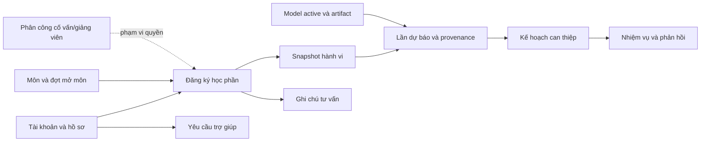
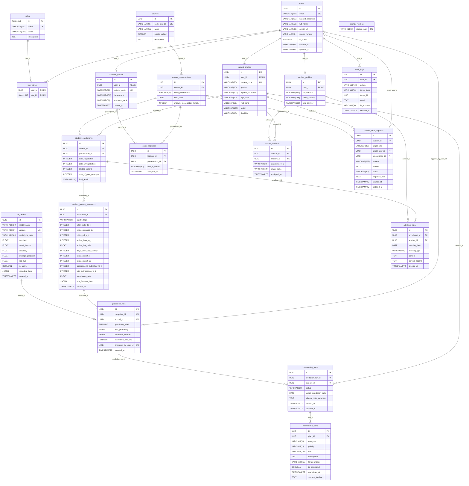
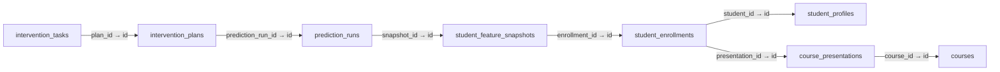

# THIẾT KẾ CƠ SỞ DỮ LIỆU HỆ THỐNG

### Hệ thống gợi ý chiến lược học tập cá nhân hóa — KLTN 13, HUIT

> **Sinh viên thực hiện:** Phan Trọng Nguyên<br>
> **Cập nhật:** 19/10/2026<br>
> **CSDL:** PostgreSQL 15 — personalized_learning_db, schema public<br>
> **ORM:** SQLAlchemy Async, driver asyncpg<br>
> **Revision schema:** 0002_normalize

Cập nhật nội dung theo schema và mã nguồn trong dự án. Tài liệu mô tả thiết kế đang triển khai, phân biệt ràng buộc DB với kiểm tra tại API/service và các giới hạn còn lại.

## 1. Phạm vi và nguồn đối chiếu

Hệ thống gồm **19 bảng nghiệp vụ** và bảng hạ tầng `alembic_version`. SQL khởi tạo và ORM đã được đối chiếu trên PostgreSQL, gồm kiểu/độ dài, nullability, default, PK, UNIQUE, CHECK, FK và index. Không có khác biệt được Alembic autogenerate phát hiện tại thời điểm xác minh.

- [SQL khởi tạo](../docker/postgres/init-scripts/01_init_schema.sql) được sinh từ metadata ORM đã rà soát bằng `scripts/prepare_schema_contract.py`.
- [ORM và ràng buộc dùng chung](../apps/backend/models/schema_contract.py) khai báo cả Python default và server default.
- [Migration bất biến](../apps/backend/migrations/versions/) giữ SQL baseline ngày 18/10 và revision nâng cấp độc lập với model hiện tại.
- [Hướng dẫn migration/khôi phục](../docs/database_migrations.md) mô tả baseline, backup, dữ liệu lỗi và vận hành.
- [Bằng chứng migration](../reports/test-results/task1-migrations.json) và [áp dụng local](../reports/test-results/task1-migration-apply.json).

UUID có server default `gen_random_uuid()`; các mốc tạo/sửa/phân công mặc định `now()`. `updated_at` được ORM cập nhật khi thay đổi, chưa có trigger cập nhật timestamp cho mọi câu SQL trực tiếp. Trigger provenance là thành phần bổ sung ngoài ORM: không dùng `Base.metadata.create_all()` thay cho Alembic.


| Nguồn đối chiếu | Nội dung sử dụng |
| --- | --- |
| [01_init_schema.sql](../docker/postgres/init-scripts/01_init_schema.sql) | Cấu trúc vật lý, default, khóa, CHECK và index canonical. |
| [02_seed_data.sql](../docker/postgres/init-scripts/02_seed_data.sql) | Danh mục, model và dữ liệu minh họa. |
| [03_prediction_integrity.sql](../docker/postgres/init-scripts/03_prediction_integrity.sql) | Trigger bất biến snapshot/context. |
| [04_schema_version.sql](../docker/postgres/init-scripts/04_schema_version.sql) | Marker revision trên database Docker mới. |
| [models](../apps/backend/models/) và [schema_contract.py](../apps/backend/models/schema_contract.py) | Mapping 19 bảng và ràng buộc dùng chung. |
| [database.py](../apps/backend/core/database.py) | Engine, session và rollback. |
| [prediction_service.py](../apps/backend/services/prediction_service.py), [risk_service.py](../apps/backend/services/risk_service.py), [model_registry.py](../apps/backend/services/model_registry.py) | Ghép đặc trưng, chọn dự báo hiện hành và chọn model active. |
| [endpoints](../apps/backend/api/v1/endpoints/) và [repositories](../apps/backend/repositories/) | Phân quyền, nghiệp vụ đọc/ghi, transaction và phạm vi học phần. |
| [migration](../apps/backend/migrations/) và [hướng dẫn vận hành](../docs/database_migrations.md) | Baseline, upgrade, backup/restore và xử lý dữ liệu cũ. |
| [Compose](../docker-compose.yml) và [requirements](../apps/backend/requirements.txt) | Kết nối, volume và dependency hiện tại. |

### 1.1. Quy ước đọc tài liệu

- **PK:** khóa chính; **FK:** khóa ngoại; **UK/UNIQUE:** không trùng giá trị. PK ghép và UNIQUE ghép chỉ duy nhất theo cả tổ hợp, không có nghĩa từng cột riêng lẻ là duy nhất.
- **NULL = Có:** được phép thiếu giá trị; dấu **—** ở mặc định nghĩa là không có server default, không phải giá trị NULL được tự tạo cho cột bắt buộc.
- **UUID:** định danh; **VARCHAR(n):** chuỗi tối đa n ký tự; **TEXT:** văn bản; **INTEGER/SMALLINT:** số nguyên; **FLOAT:** số thực dấu phẩy động, PostgreSQL ánh xạ FLOAT không khai báo độ chính xác thành DOUBLE PRECISION; **BOOLEAN:** true/false.
- **DATE:** ngày lịch; **TIMESTAMP WITH TIME ZONE / TIMESTAMPTZ:** thời điểm có xử lý múi giờ; **JSONB:** dữ liệu JSON có cấu trúc, không tự tạo FK cho các ID bên trong.
- Mô tả ý nghĩa thuộc tính giải thích đơn vị, phạm vi và cách sử dụng; các CHECK bên dưới từng bảng mới là ràng buộc miền thực sự được database thực thi.

## 2. Các phân hệ dữ liệu

| Phân hệ | Bảng | Vai trò trong hệ thống |
| --- | --- | --- |
| Danh tính và quyền (6) | users, roles, user_roles, student_profiles, advisor_profiles, lecturer_profiles | Đăng nhập, nhiều vai trò và hồ sơ chuyên biệt; phân biệt tài khoản với danh tính sinh viên/cố vấn/giảng viên. |
| Đào tạo (3) | courses, course_presentations, student_enrollments | Tổ chức môn học, đợt mở môn và đăng ký; làm gốc phân tách dữ liệu theo học phần. |
| Phân công (2) | course_lecturers, advisor_students | Xác định phạm vi giảng viên và cố vấn được đọc/ghi; liên kết nhiều–nhiều có UNIQUE ghép. |
| Đặc trưng (1) | student_feature_snapshots | Lưu 11 chỉ số hành vi tại mốc quan sát; tạo lịch sử snapshot thay cho sửa dữ liệu đã dùng dự báo. |
| ML và dự báo (2) | ml_models, prediction_runs | Chọn phiên bản mô hình, lưu xác suất/nhãn và provenance để truy vết lần suy luận. |
| Can thiệp và tư vấn (3) | intervention_plans, intervention_tasks, advising_notes | Chuyển kết quả dự báo thành kế hoạch, việc cần làm và ghi chú tư vấn trong phạm vi học phần. |
| Hỗ trợ và kiểm toán (2) | student_help_requests, audit_logs | Tiếp nhận khó khăn của sinh viên, phân công xử lý và ghi các sự kiện hệ thống. |
| Hạ tầng migration (1) | alembic_version | Ghi revision schema; không tính vào 19 bảng nghiệp vụ. |

Các phân hệ là nhóm nghiệp vụ trong schema PostgreSQL `public`, không phải các schema vật lý riêng. Phân quyền hiện được backend kiểm tra bằng JWT, trạng thái tài khoản, vai trò, hồ sơ và phân công; database chưa có Row Level Security.

### 2.1. Luồng liên kết dữ liệu chính



Sơ đồ trên mô tả liên kết nghiệp vụ; không hàm ý hệ thống tự động tạo kế hoạch/nhiệm vụ ngay sau dự báo. Đường FK vật lý và tính bắt buộc/tùy chọn được thể hiện riêng ở mục 3.

### 2.2. Danh mục bảng và chức năng

| Bảng | Tên nghiệp vụ | Chức năng |
| --- | --- | --- |
| [`users`](#table-users) | Tài khoản người dùng | Lưu thông tin đăng nhập và liên hệ dùng chung cho mọi vai trò. Một tài khoản có thể mang nhiều vai trò và có các hồ sơ chuyên biệt tương ứng. |
| [`roles`](#table-roles) | Danh mục vai trò | Danh mục quyền nghiệp vụ ADMIN, ADVISOR, LECTURER và STUDENT; gán cho tài khoản qua user_roles. |
| [`user_roles`](#table-user_roles) | Gán vai trò cho tài khoản | Bảng nối nhiều–nhiều giữa users và roles. Khóa chính ghép ngăn một tài khoản được gán cùng vai trò hai lần. |
| [`student_profiles`](#table-student_profiles) | Hồ sơ sinh viên | Thông tin định danh sinh viên và đặc trưng nhân khẩu học theo dữ liệu OULAD. Các mã danh mục cần được ánh xạ rõ khi sử dụng trong bối cảnh HUIT. |
| [`advisor_profiles`](#table-advisor_profiles) | Hồ sơ cố vấn học tập | Thông tin đơn vị và liên hệ công tác của cố vấn; phạm vi sinh viên phụ trách nằm trong advisor_students. |
| [`lecturer_profiles`](#table-lecturer_profiles) | Hồ sơ giảng viên | Thông tin giảng viên bộ môn; phạm vi học phần giảng dạy nằm trong course_lecturers. |
| [`courses`](#table-courses) | Danh mục môn học | Định nghĩa môn học dùng chung. Một môn có thể được mở nhiều đợt trong course_presentations; mã môn còn được dùng làm đặc trưng đầu vào mô hình. |
| [`course_presentations`](#table-course_presentations) | Đợt mở môn / lớp học phần | Một lần tổ chức giảng dạy của môn học, có mã đợt, ngày bắt đầu và thời lượng. Enrollment, phân công giảng viên và hỗ trợ theo môn tham chiếu bản ghi này. |
| [`student_enrollments`](#table-student_enrollments) | Đăng ký học phần | Liên kết sinh viên với một đợt mở môn; là gốc truy vết snapshot, dự báo và nhiệm vụ theo từng học phần. |
| [`course_lecturers`](#table-course_lecturers) | Phân công giảng dạy | Bảng nối giảng viên với đợt mở môn, xác định phạm vi truy cập dữ liệu học phần. Một đợt có thể có nhiều giảng viên. |
| [`advisor_students`](#table-advisor_students) | Phân công cố vấn–sinh viên | Bảng nối cố vấn với sinh viên, kèm lớp sinh hoạt và năm học. Schema cho phép nhiều cố vấn được phân công một sinh viên; không có UNIQUE chỉ trên student_id. |
| [`student_feature_snapshots`](#table-student_feature_snapshots) | Ảnh chụp đặc trưng học tập | Lưu 11 chỉ số hành vi tại một mốc quan sát của enrollment. Một đăng ký có nhiều snapshot; snapshot đã dùng trong dự báo không được cập nhật trực tiếp. |
| [`ml_models`](#table-ml_models) | Đăng ký phiên bản mô hình | Lưu vị trí artifact, phiên bản, cấu hình ngưỡng và chỉ số đánh giá. Partial UNIQUE bảo đảm tối đa một model active; registry kiểm tra yêu cầu có đúng một model khi suy luận. |
| [`prediction_runs`](#table-prediction_runs) | Lịch sử dự báo nguy cơ | Mỗi bản ghi là một lần suy luận của một model trên một snapshot. Một snapshot có thể được dự báo nhiều lần; context lưu đầu vào và danh tính model thực sự đã sử dụng. |
| [`intervention_plans`](#table-intervention_plans) | Kế hoạch can thiệp | Kế hoạch hỗ trợ sinh viên dựa trên một lần dự báo. Schema cho phép nhiều kế hoạch cùng ACTIVE và nhiều kế hoạch tham chiếu cùng dự báo. |
| [`intervention_tasks`](#table-intervention_tasks) | Nhiệm vụ can thiệp | Các việc cụ thể sinh viên cần hoàn thành trong kế hoạch. Phạm vi môn học được truy ra qua plan → prediction → snapshot → enrollment, không có cột môn học trực tiếp. |
| [`advising_notes`](#table-advising_notes) | Biên bản / ghi chú tư vấn | Ghi nhận buổi trao đổi giữa cố vấn và sinh viên trong phạm vi một enrollment, kèm nội dung và hành động đã thống nhất. |
| [`student_help_requests`](#table-student_help_requests) | Yêu cầu trợ giúp | Yêu cầu do sinh viên gửi đến cố vấn hoặc giảng viên. Người nhận có thể chưa được gán; presentation_id cho biết phạm vi học phần nếu có. |
| [`audit_logs`](#table-audit_logs) | Nhật ký thao tác hệ thống | Ghi nhận người thực hiện, loại thao tác và đối tượng liên quan. target_type/target_id là tham chiếu nghiệp vụ đa hình, không phải khóa ngoại đến một bảng cố định. |
| [`alembic_version`](#table-alembic_version) | Phiên bản schema | Bảng hạ tầng theo dõi revision Alembic, không chứa dữ liệu học tập. |

## 3. Sơ đồ thực thể và quan hệ

### 3.1. Sơ đồ thực thể–quan hệ (ERD)

Sơ đồ thể hiện đủ thuộc tính của 19 bảng nghiệp vụ và bảng phiên bản schema. Kiểu có độ dài/miền và ý nghĩa chi tiết được trình bày tại mục 4. Nhãn trên cạnh là cột FK của bảng con.

Ký hiệu: `||` = đúng một; `o|` hoặc `|o` = không hoặc một; `o{` = không hoặc nhiều. Mọi bảng cha có thể chưa có bản ghi con. Riêng hồ sơ có UNIQUE(user_id) nên một tài khoản có tối đa một hồ sơ của từng loại.



### 3.2. Ma trận 25 khóa ngoại và lực lượng quan hệ

Cột “Con/cha” ghi số bản ghi con có thể thuộc một cha; cột “Cha/con” ghi số cha được tham chiếu bởi một bản ghi con. Tính tùy chọn của FK và UNIQUE được lấy từ schema, không suy ra từ giả định nghiệp vụ.

| Bảng cha | Bảng con.FK | Con/cha | Cha/con | ON DELETE | Ý nghĩa liên kết |
| --- | --- | --- | --- | --- | --- |
| `roles` | `user_roles.role_id` → `id` | 0..N | 1 | `CASCADE` | Vai trò được gán; thành phần thứ hai của khóa chính ghép. |
| `users` | `user_roles.user_id` → `id` | 0..N | 1 | `CASCADE` | Tài khoản được gán vai trò; thành phần thứ nhất của khóa chính ghép. |
| `users` | `student_profiles.user_id` → `id` | 0..1 | 1 | `RESTRICT` | Tài khoản sở hữu hồ sơ sinh viên; UNIQUE bảo đảm tối đa một hồ sơ sinh viên cho mỗi tài khoản. |
| `users` | `advisor_profiles.user_id` → `id` | 0..1 | 1 | `RESTRICT` | Tài khoản sở hữu hồ sơ cố vấn; UNIQUE bảo đảm tối đa một hồ sơ cố vấn cho mỗi tài khoản. |
| `users` | `lecturer_profiles.user_id` → `id` | 0..1 | 1 | `RESTRICT` | Tài khoản sở hữu hồ sơ giảng viên; UNIQUE bảo đảm tối đa một hồ sơ giảng viên cho mỗi tài khoản. |
| `courses` | `course_presentations.course_id` → `id` | 0..N | 1 | `RESTRICT` | Môn học được tổ chức trong đợt này. |
| `course_presentations` | `student_enrollments.presentation_id` → `id` | 0..N | 1 | `RESTRICT` | Đợt mở môn mà sinh viên theo học; không phải ID danh mục môn courses. |
| `student_profiles` | `student_enrollments.student_id` → `id` | 0..N | 1 | `RESTRICT` | Sinh viên đăng ký học; không thể trùng cặp với presentation_id. |
| `lecturer_profiles` | `course_lecturers.lecturer_id` → `id` | 0..N | 1 | `CASCADE` | Giảng viên được phân công giảng dạy. |
| `course_presentations` | `course_lecturers.presentation_id` → `id` | 0..N | 1 | `CASCADE` | Đợt mở môn thuộc phạm vi giảng dạy của giảng viên. |
| `advisor_profiles` | `advisor_students.advisor_id` → `id` | 0..N | 1 | `CASCADE` | Cố vấn được giao theo dõi sinh viên. |
| `student_profiles` | `advisor_students.student_id` → `id` | 0..N | 1 | `CASCADE` | Sinh viên thuộc phạm vi phụ trách của cố vấn. |
| `student_enrollments` | `student_feature_snapshots.enrollment_id` → `id` | 0..N | 1 | `RESTRICT` | Đăng ký học phần mà các chỉ số trong snapshot mô tả. |
| `ml_models` | `prediction_runs.model_id` → `id` | 0..N | 1 | `RESTRICT` | Phiên bản registry đã thực hiện suy luận; RESTRICT không cho xóa model đang có lịch sử. |
| `student_feature_snapshots` | `prediction_runs.snapshot_id` → `id` | 0..N | 1 | `RESTRICT` | Snapshot đầu vào của lần suy luận; RESTRICT giữ snapshot khi có dự báo tham chiếu. |
| `users` | `prediction_runs.triggered_by_user_id` → `id` | 0..N | 0..1 | `SET NULL` | Tài khoản kích hoạt suy luận nếu có; NULL khi không xác định hoặc tài khoản bị xóa theo SET NULL. |
| `prediction_runs` | `intervention_plans.prediction_run_id` → `id` | 0..N | 1 | `RESTRICT` | Lần dự báo làm căn cứ lập kế hoạch; truy ra học phần qua snapshot và enrollment. |
| `student_profiles` | `intervention_plans.student_id` → `id` | 0..N | 1 | `RESTRICT` | Sinh viên nhận can thiệp. API/service phải xác minh trùng sinh viên trong enrollment của dự báo; hai FK độc lập chưa bảo đảm điều này tại DB. |
| `intervention_plans` | `intervention_tasks.plan_id` → `id` | 0..N | 1 | `RESTRICT` | Kế hoạch chứa nhiệm vụ; mỗi nhiệm vụ thuộc đúng một kế hoạch. |
| `advisor_profiles` | `advising_notes.advisor_id` → `id` | 0..N | 1 | `RESTRICT` | Cố vấn ghi biên bản; API kiểm tra sinh viên thuộc phạm vi được phân công. |
| `student_enrollments` | `advising_notes.enrollment_id` → `id` | 0..N | 1 | `RESTRICT` | Đăng ký học phần được trao đổi trong buổi tư vấn; từ đó xác định sinh viên và đợt học. |
| `course_presentations` | `student_help_requests.presentation_id` → `id` | 0..N | 0..1 | `SET NULL` | Đợt mở môn liên quan; NULL biểu diễn yêu cầu không gắn môn hoặc học phần bị xóa theo SET NULL. Yêu cầu tới giảng viên được service yêu cầu gắn học phần hợp lệ. |
| `student_profiles` | `student_help_requests.student_id` → `id` | 0..N | 1 | `RESTRICT` | Sinh viên tạo yêu cầu trợ giúp. |
| `users` | `student_help_requests.target_user_id` → `id` | 0..N | 0..1 | `SET NULL` | Tài khoản nhận xử lý cụ thể; NULL khi chưa phân công hoặc người nhận bị xóa. Service xác minh vai trò, trạng thái và phân công. |
| `users` | `audit_logs.user_id` → `id` | 0..N | 0..1 | `SET NULL` | Tài khoản thực hiện thao tác nếu xác định được; SET NULL giữ log khi tài khoản bị xóa. |

**Quan hệ nhiều–nhiều:** users ↔ roles qua user_roles; lecturers ↔ presentations qua course_lecturers; advisors ↔ students qua advisor_students; students ↔ presentations qua student_enrollments. Các tên rút gọn trong câu này tương ứng lecturer_profiles, course_presentations, advisor_profiles và student_profiles.

UNIQUE(user_id) ở ba bảng hồ sơ không buộc tài khoản phải có hồ sơ, không tự gán vai trò và không cấm một tài khoản có nhiều loại hồ sơ. UNIQUE(advisor_id, student_id) không bảo đảm mỗi sinh viên chỉ có một cố vấn hoặc lưu được nhiều năm cho cùng một cặp.

### 3.3. Chính sách xóa và bảo toàn lịch sử


Các quan hệ tài khoản → hồ sơ → đăng ký → snapshot → dự báo → kế hoạch → nhiệm vụ và ghi chú/yêu cầu hỗ trợ dùng RESTRICT để chặn xóa dây chuyền. Khóa tài khoản bằng `users.is_active=false`; hoàn tất/hủy kế hoạch bằng trạng thái. Không có chức năng purge lịch sử tự động. CASCADE chỉ còn ở liên kết vai trò/phân công; SET NULL giữ bản ghi audit và người thao tác/người nhận tùy chọn.

Trigger `protect_prediction_snapshot` chặn sửa snapshot đã được dự báo; `protect_prediction_context` chặn sửa đầu vào, danh tính model và kết quả dự báo. DELETE được bảo vệ bằng FK RESTRICT khi có bản ghi con; bản ghi lá không có phụ thuộc vẫn có thể xóa bằng SQL nếu tài khoản DB đủ quyền. Artifact archive phải được sao lưu cùng database.

### 3.4. Bảng tổng hợp mối quan hệ giữa các bảng

Bảng dưới đọc từ bảng A sang bảng B: 1–N nghĩa là một bản ghi A có thể liên kết nhiều bản ghi B; số bản ghi B tối thiểu đều là 0. Với quan hệ hồ sơ 1–1, mỗi tài khoản có tối đa một hồ sơ của từng loại, còn mỗi hồ sơ phải thuộc đúng một tài khoản. Cột tùy chọn áp dụng cho khóa ngoại ở bảng B. Chi tiết hành vi khi xóa nằm ở mục 3.2 và 3.3.

| Bảng A (được tham chiếu) | Bảng B (chứa khóa ngoại) | Loại quan hệ A → B | Khóa ngoại B → A.id | Tùy chọn của FK | Ý nghĩa nghiệp vụ |
| --- | --- | --- | --- | --- | --- |
| `roles` | `user_roles` | 1–N | `role_id` → `id` | Bắt buộc | Vai trò được gán; thành phần thứ hai của khóa chính ghép. |
| `users` | `user_roles` | 1–N | `user_id` → `id` | Bắt buộc | Tài khoản được gán vai trò; thành phần thứ nhất của khóa chính ghép. |
| `users` | `student_profiles` | 1–1 (tùy chọn ở phía hồ sơ) | `user_id` → `id` | Bắt buộc | Tài khoản sở hữu hồ sơ sinh viên; UNIQUE bảo đảm tối đa một hồ sơ sinh viên cho mỗi tài khoản. |
| `users` | `advisor_profiles` | 1–1 (tùy chọn ở phía hồ sơ) | `user_id` → `id` | Bắt buộc | Tài khoản sở hữu hồ sơ cố vấn; UNIQUE bảo đảm tối đa một hồ sơ cố vấn cho mỗi tài khoản. |
| `users` | `lecturer_profiles` | 1–1 (tùy chọn ở phía hồ sơ) | `user_id` → `id` | Bắt buộc | Tài khoản sở hữu hồ sơ giảng viên; UNIQUE bảo đảm tối đa một hồ sơ giảng viên cho mỗi tài khoản. |
| `courses` | `course_presentations` | 1–N | `course_id` → `id` | Bắt buộc | Môn học được tổ chức trong đợt này. |
| `course_presentations` | `student_enrollments` | 1–N | `presentation_id` → `id` | Bắt buộc | Đợt mở môn mà sinh viên theo học; không phải ID danh mục môn courses. |
| `student_profiles` | `student_enrollments` | 1–N | `student_id` → `id` | Bắt buộc | Sinh viên đăng ký học; không thể trùng cặp với presentation_id. |
| `lecturer_profiles` | `course_lecturers` | 1–N | `lecturer_id` → `id` | Bắt buộc | Giảng viên được phân công giảng dạy. |
| `course_presentations` | `course_lecturers` | 1–N | `presentation_id` → `id` | Bắt buộc | Đợt mở môn thuộc phạm vi giảng dạy của giảng viên. |
| `advisor_profiles` | `advisor_students` | 1–N | `advisor_id` → `id` | Bắt buộc | Cố vấn được giao theo dõi sinh viên. |
| `student_profiles` | `advisor_students` | 1–N | `student_id` → `id` | Bắt buộc | Sinh viên thuộc phạm vi phụ trách của cố vấn. |
| `student_enrollments` | `student_feature_snapshots` | 1–N | `enrollment_id` → `id` | Bắt buộc | Đăng ký học phần mà các chỉ số trong snapshot mô tả. |
| `ml_models` | `prediction_runs` | 1–N | `model_id` → `id` | Bắt buộc | Phiên bản registry đã thực hiện suy luận; RESTRICT không cho xóa model đang có lịch sử. |
| `student_feature_snapshots` | `prediction_runs` | 1–N | `snapshot_id` → `id` | Bắt buộc | Snapshot đầu vào của lần suy luận; RESTRICT giữ snapshot khi có dự báo tham chiếu. |
| `users` | `prediction_runs` | 1–N | `triggered_by_user_id` → `id` | Có thể NULL | Tài khoản kích hoạt suy luận nếu có; NULL khi không xác định hoặc tài khoản bị xóa theo SET NULL. |
| `prediction_runs` | `intervention_plans` | 1–N | `prediction_run_id` → `id` | Bắt buộc | Lần dự báo làm căn cứ lập kế hoạch; truy ra học phần qua snapshot và enrollment. |
| `student_profiles` | `intervention_plans` | 1–N | `student_id` → `id` | Bắt buộc | Sinh viên nhận can thiệp. API/service phải xác minh trùng sinh viên trong enrollment của dự báo; hai FK độc lập chưa bảo đảm điều này tại DB. |
| `intervention_plans` | `intervention_tasks` | 1–N | `plan_id` → `id` | Bắt buộc | Kế hoạch chứa nhiệm vụ; mỗi nhiệm vụ thuộc đúng một kế hoạch. |
| `advisor_profiles` | `advising_notes` | 1–N | `advisor_id` → `id` | Bắt buộc | Cố vấn ghi biên bản; API kiểm tra sinh viên thuộc phạm vi được phân công. |
| `student_enrollments` | `advising_notes` | 1–N | `enrollment_id` → `id` | Bắt buộc | Đăng ký học phần được trao đổi trong buổi tư vấn; từ đó xác định sinh viên và đợt học. |
| `course_presentations` | `student_help_requests` | 1–N | `presentation_id` → `id` | Có thể NULL | Đợt mở môn liên quan; NULL biểu diễn yêu cầu không gắn môn hoặc học phần bị xóa theo SET NULL. Yêu cầu tới giảng viên được service yêu cầu gắn học phần hợp lệ. |
| `student_profiles` | `student_help_requests` | 1–N | `student_id` → `id` | Bắt buộc | Sinh viên tạo yêu cầu trợ giúp. |
| `users` | `student_help_requests` | 1–N | `target_user_id` → `id` | Có thể NULL | Tài khoản nhận xử lý cụ thể; NULL khi chưa phân công hoặc người nhận bị xóa. Service xác minh vai trò, trạng thái và phân công. |
| `users` | `audit_logs` | 1–N | `user_id` → `id` | Có thể NULL | Tài khoản thực hiện thao tác nếu xác định được; SET NULL giữ log khi tài khoản bị xóa. |

**Quan hệ nhiều–nhiều qua bảng liên kết**

| Bảng A | Bảng B | Loại quan hệ | Bảng liên kết và cặp khóa ngoại | Ý nghĩa và ràng buộc |
| --- | --- | --- | --- | --- |
| `users` | `roles` | N–N | `user_roles(user_id, role_id)` | Một tài khoản có nhiều vai trò; một vai trò được gán cho nhiều tài khoản. Khóa chính ghép ngăn gán trùng. |
| `student_profiles` | `course_presentations` | N–N | `student_enrollments(student_id, presentation_id)` | Sinh viên học nhiều đợt mở môn; mỗi đợt có nhiều sinh viên. UNIQUE cặp khóa ngoại ngăn đăng ký trùng; bảng còn lưu kết quả và thông tin đăng ký. |
| `lecturer_profiles` | `course_presentations` | N–N | `course_lecturers(lecturer_id, presentation_id)` | Giảng viên dạy nhiều đợt mở môn và một đợt có thể có nhiều giảng viên. UNIQUE cặp khóa ngoại ngăn phân công trùng. |
| `advisor_profiles` | `student_profiles` | N–N | `advisor_students(advisor_id, student_id)` | Cố vấn phụ trách nhiều sinh viên; schema cho phép sinh viên có nhiều cố vấn. UNIQUE cặp khóa ngoại không bao gồm academic_year, nên không lưu nhiều dòng theo năm cho cùng cặp. |

Các quan hệ N–N được thực hiện bằng hai FK 1–N tại bảng liên kết, không phải FK trực tiếp giữa hai bảng đầu cuối. `audit_logs.target_type` và `target_id` là tham chiếu đa hình do ứng dụng quản lý, không phải FK. `alembic_version` là bảng hạ tầng độc lập, không có quan hệ FK với các bảng nghiệp vụ.

## 4. Đặc tả chi tiết 19 bảng và bảng hạ tầng

<a id="table-users"></a>

### 4.1. `users` — Tài khoản người dùng

Lưu thông tin đăng nhập và liên hệ dùng chung cho mọi vai trò. Một tài khoản có thể mang nhiều vai trò và có các hồ sơ chuyên biệt tương ứng.

| Thuộc tính | Kiểu PostgreSQL | Khóa / tham chiếu | NULL | Server default | Ý nghĩa thuộc tính |
| --- | --- | --- | --- | --- | --- |
| `id` | `UUID` | PK | Không | `gen_random_uuid()` | Định danh UUID duy nhất của bản ghi tài khoản người dùng; sinh tự động khi không được cung cấp. |
| `email` | `VARCHAR(255)` | UNIQUE | Không | `—` | Địa chỉ email đăng nhập và liên hệ; duy nhất trong hệ thống. |
| `hashed_password` | `VARCHAR(255)` | — | Không | `—` | Chuỗi băm mật khẩu, không phải mật khẩu dạng rõ; dùng xác minh khi đăng nhập. |
| `full_name` | `VARCHAR(150)` | — | Không | `—` | Họ tên hiển thị của người dùng. |
| `avatar_url` | `VARCHAR(500)` | — | Có | `—` | Đường dẫn hoặc URL ảnh đại diện; NULL khi chưa khai báo. |
| `phone_number` | `VARCHAR(20)` | — | Có | `—` | Số điện thoại liên hệ; lưu chuỗi để giữ số 0 đầu và mã quốc gia. |
| `is_active` | `BOOLEAN` | — | Không | `true` | Trạng thái tài khoản: true cho phép hoạt động, false bị khóa; dịch vụ xác thực kiểm tra khi sử dụng token. |
| `created_at` | `TIMESTAMP WITH TIME ZONE` | — | Không | `now()` | Thời điểm tạo bản ghi, lưu kèm múi giờ; mặc định theo đồng hồ PostgreSQL. |
| `updated_at` | `TIMESTAMP WITH TIME ZONE` | — | Không | `now()` | Thời điểm cập nhật gần nhất. ORM tự cập nhật khi sửa; SQL trực tiếp phải tự gán nếu cần, vì chưa có trigger cập nhật chung. |

**Khóa chính:** `id`.

- UNIQUE: `email`.


**Quan hệ đi ra:**

Không có khóa ngoại đi ra; đây là bảng cha/danh mục trong các quan hệ bên dưới.

**Được tham chiếu bởi:**

- [`user_roles.user_id`](#table-user_roles) tham chiếu `users.id`; ON DELETE CASCADE.
- [`student_profiles.user_id`](#table-student_profiles) tham chiếu `users.id`; ON DELETE RESTRICT.
- [`advisor_profiles.user_id`](#table-advisor_profiles) tham chiếu `users.id`; ON DELETE RESTRICT.
- [`lecturer_profiles.user_id`](#table-lecturer_profiles) tham chiếu `users.id`; ON DELETE RESTRICT.
- [`prediction_runs.triggered_by_user_id`](#table-prediction_runs) tham chiếu `users.id`; ON DELETE SET NULL.
- [`student_help_requests.target_user_id`](#table-student_help_requests) tham chiếu `users.id`; ON DELETE SET NULL.
- [`audit_logs.user_id`](#table-audit_logs) tham chiếu `users.id`; ON DELETE SET NULL.

**Sử dụng và lưu ý nghiệp vụ:** Luồng sử dụng: quản trị tạo/cập nhật tài khoản; đăng nhập tra email hoặc mã sinh viên qua student_profiles. Khóa tài khoản bằng is_active thay cho xóa khi đã có hồ sơ/lịch sử. Lưu hash mật khẩu không có nghĩa đổi mật khẩu đã thu hồi mọi JWT cũ; schema hiện chưa có token_version/bảng revocation.

<a id="table-roles"></a>

### 4.2. `roles` — Danh mục vai trò

Danh mục quyền nghiệp vụ ADMIN, ADVISOR, LECTURER và STUDENT; gán cho tài khoản qua user_roles.

| Thuộc tính | Kiểu PostgreSQL | Khóa / tham chiếu | NULL | Server default | Ý nghĩa thuộc tính |
| --- | --- | --- | --- | --- | --- |
| `id` | `SMALLINT` | PK | Không | `sequence SMALLSERIAL` | Mã số vai trò tự tăng bằng sequence SMALLSERIAL; là khóa chính kiểu SMALLINT. |
| `code` | `VARCHAR(50)` | UNIQUE | Không | `—` | Mã vai trò duy nhất, hiện sử dụng ADMIN, ADVISOR, LECTURER, STUDENT. Đây là danh mục seed, không phải CHECK giới hạn bốn giá trị. |
| `name` | `VARCHAR(100)` | — | Không | `—` | Tên vai trò hiển thị bằng ngôn ngữ nghiệp vụ. |
| `description` | `TEXT` | — | Có | `—` | Mô tả phạm vi và trách nhiệm của vai trò. |

**Khóa chính:** `id`.

- UNIQUE: `code`.


**Quan hệ đi ra:**

Không có khóa ngoại đi ra; đây là bảng cha/danh mục trong các quan hệ bên dưới.

**Được tham chiếu bởi:**

- [`user_roles.role_id`](#table-user_roles) tham chiếu `roles.id`; ON DELETE CASCADE.

**Sử dụng và lưu ý nghiệp vụ:** Gán hoặc gỡ vai trò thay đổi các dòng user_roles; việc gán vai trò không tự bảo đảm đã có hồ sơ tương ứng. Kiểm tra vai trò và kiểm tra phạm vi dữ liệu là hai bước riêng tại backend.

<a id="table-user_roles"></a>

### 4.3. `user_roles` — Gán vai trò cho tài khoản

Bảng nối nhiều–nhiều giữa users và roles. Khóa chính ghép ngăn một tài khoản được gán cùng vai trò hai lần.

| Thuộc tính | Kiểu PostgreSQL | Khóa / tham chiếu | NULL | Server default | Ý nghĩa thuộc tính |
| --- | --- | --- | --- | --- | --- |
| `user_id` | `UUID` | PK (ghép); FK → `users.id` (CASCADE) | Không | `—` | Tài khoản được gán vai trò; thành phần thứ nhất của khóa chính ghép. |
| `role_id` | `SMALLINT` | PK (ghép); FK → `roles.id` (CASCADE) | Không | `—` | Vai trò được gán; thành phần thứ hai của khóa chính ghép. |

**Khóa chính:** `user_id`, `role_id`.


**Quan hệ đi ra:**

- `user_roles.role_id` → [`roles.id`](#table-roles); bắt buộc, ON DELETE CASCADE.
- `user_roles.user_id` → [`users.id`](#table-users); bắt buộc, ON DELETE CASCADE.

**Được tham chiếu bởi:**

Không có bảng nghiệp vụ khác khai báo FK trực tiếp tới bảng này trong schema hiện tại.

**Sử dụng và lưu ý nghiệp vụ:** Mỗi dòng biểu diễn một lần gán vai trò, không có cột id riêng. Cùng user_id có thể xuất hiện nhiều lần với role_id khác nhau; cùng role_id có thể được gán cho nhiều người. CASCADE chỉ xóa liên kết khi cha bị xóa, không xóa tài khoản từ phía vai trò.

<a id="table-student_profiles"></a>

### 4.4. `student_profiles` — Hồ sơ sinh viên

Thông tin định danh sinh viên và đặc trưng nhân khẩu học theo dữ liệu OULAD. Các mã danh mục cần được ánh xạ rõ khi sử dụng trong bối cảnh HUIT.

| Thuộc tính | Kiểu PostgreSQL | Khóa / tham chiếu | NULL | Server default | Ý nghĩa thuộc tính |
| --- | --- | --- | --- | --- | --- |
| `id` | `UUID` | PK | Không | `gen_random_uuid()` | Định danh UUID duy nhất của bản ghi hồ sơ sinh viên; sinh tự động khi không được cung cấp. |
| `user_id` | `UUID` | FK → `users.id` (RESTRICT); UNIQUE | Không | `—` | Tài khoản sở hữu hồ sơ sinh viên; UNIQUE bảo đảm tối đa một hồ sơ sinh viên cho mỗi tài khoản. |
| `student_code` | `VARCHAR(50)` | UNIQUE | Không | `—` | Mã số sinh viên duy nhất; có thể dùng làm định danh đăng nhập thay email theo API hiện tại. |
| `gender` | `VARCHAR(10)` | — | Không | `—` | Mã giới tính theo OULAD: M hoặc F; không tự diễn giải các nhóm ngoài danh mục mô hình. |
| `highest_education` | `VARCHAR(100)` | — | Không | `—` | Nhóm trình độ học vấn cao nhất trước khóa học theo danh mục OULAD; là một đầu vào mô hình. |
| `age_band` | `VARCHAR(20)` | — | Không | `—` | Nhóm tuổi OULAD: 0-35, 35-55, 55<=; giữ nguyên chuỗi mã của dữ liệu nguồn. |
| `imd_band` | `VARCHAR(50)` | — | Có | `—` | Nhóm chỉ số thiếu hụt kinh tế–xã hội IMD của dữ liệu OULAD; không phải thu nhập cá nhân. Không nằm trong 17 đầu vào hiện tại. |
| `region` | `VARCHAR(100)` | — | Có | `—` | Khu vực địa lý của sinh viên theo dữ liệu nguồn; không nằm trong 17 đầu vào hiện tại. |
| `disability` | `VARCHAR(10)` | — | Không | `'N'` | Cờ khai báo khuyết tật theo dữ liệu nguồn: N hoặc Y; không nằm trong 17 đầu vào hiện tại. |

**Khóa chính:** `id`.

- UNIQUE: `user_id`.
- CHECK `student_profiles_age_band_check`: `age_band IN ('0-35', '35-55', '55<=')`.
- CHECK `student_profiles_disability_check`: `disability IN ('N', 'Y')`.
- CHECK `student_profiles_gender_check`: `gender IN ('M', 'F')`.
- UNIQUE: `student_code`.


**Quan hệ đi ra:**

- `student_profiles.user_id` → [`users.id`](#table-users); bắt buộc, ON DELETE RESTRICT.

**Được tham chiếu bởi:**

- [`student_enrollments.student_id`](#table-student_enrollments) tham chiếu `student_profiles.id`; ON DELETE RESTRICT.
- [`advisor_students.student_id`](#table-advisor_students) tham chiếu `student_profiles.id`; ON DELETE CASCADE.
- [`intervention_plans.student_id`](#table-intervention_plans) tham chiếu `student_profiles.id`; ON DELETE RESTRICT.
- [`student_help_requests.student_id`](#table-student_help_requests) tham chiếu `student_profiles.id`; ON DELETE RESTRICT.

**Sử dụng và lưu ý nghiệp vụ:** Hồ sơ nhân khẩu học có thể được cập nhật, vì vậy không dùng giá trị hiện tại để tái dựng đầu vào của dự báo cũ. Snapshot chỉ cố định hành vi; bộ 17 đặc trưng của lần suy luận phải lấy từ prediction_runs.inference_context.

<a id="table-advisor_profiles"></a>

### 4.5. `advisor_profiles` — Hồ sơ cố vấn học tập

Thông tin đơn vị và liên hệ công tác của cố vấn; phạm vi sinh viên phụ trách nằm trong advisor_students.

| Thuộc tính | Kiểu PostgreSQL | Khóa / tham chiếu | NULL | Server default | Ý nghĩa thuộc tính |
| --- | --- | --- | --- | --- | --- |
| `id` | `UUID` | PK | Không | `gen_random_uuid()` | Định danh UUID duy nhất của bản ghi hồ sơ cố vấn học tập; sinh tự động khi không được cung cấp. |
| `user_id` | `UUID` | FK → `users.id` (RESTRICT); UNIQUE | Không | `—` | Tài khoản sở hữu hồ sơ cố vấn; UNIQUE bảo đảm tối đa một hồ sơ cố vấn cho mỗi tài khoản. |
| `department` | `VARCHAR(150)` | — | Không | `—` | Khoa, bộ môn hoặc đơn vị công tác của cố vấn. |
| `office_location` | `VARCHAR(255)` | — | Có | `—` | Phòng hoặc địa điểm làm việc để liên hệ tư vấn. |
| `lms_api_key` | `VARCHAR(255)` | — | Có | `—` | Khóa tích hợp LMS nếu được cấu hình. Cột tồn tại không đồng nghĩa hệ thống đã triển khai đồng bộ LMS; không đưa giá trị thật vào báo cáo. |

**Khóa chính:** `id`.

- UNIQUE: `user_id`.


**Quan hệ đi ra:**

- `advisor_profiles.user_id` → [`users.id`](#table-users); bắt buộc, ON DELETE RESTRICT.

**Được tham chiếu bởi:**

- [`advisor_students.advisor_id`](#table-advisor_students) tham chiếu `advisor_profiles.id`; ON DELETE CASCADE.
- [`advising_notes.advisor_id`](#table-advising_notes) tham chiếu `advisor_profiles.id`; ON DELETE RESTRICT.

**Sử dụng và lưu ý nghiệp vụ:** Một cố vấn có thể theo dõi nhiều sinh viên thông qua advisor_students. Khi tạo ghi chú/kế hoạch hoặc xem tổng quan, API phải xác minh hồ sơ cố vấn và phân công của chính người gọi. Có profile không tự động cấp vai trò ADVISOR.

<a id="table-lecturer_profiles"></a>

### 4.6. `lecturer_profiles` — Hồ sơ giảng viên

Thông tin giảng viên bộ môn; phạm vi học phần giảng dạy nằm trong course_lecturers.

| Thuộc tính | Kiểu PostgreSQL | Khóa / tham chiếu | NULL | Server default | Ý nghĩa thuộc tính |
| --- | --- | --- | --- | --- | --- |
| `id` | `UUID` | PK | Không | `gen_random_uuid()` | Định danh UUID duy nhất của bản ghi hồ sơ giảng viên; sinh tự động khi không được cung cấp. |
| `user_id` | `UUID` | FK → `users.id` (RESTRICT); UNIQUE | Không | `—` | Tài khoản sở hữu hồ sơ giảng viên; UNIQUE bảo đảm tối đa một hồ sơ giảng viên cho mỗi tài khoản. |
| `lecturer_code` | `VARCHAR(50)` | UNIQUE | Không | `—` | Mã giảng viên duy nhất trong hệ thống. |
| `department` | `VARCHAR(150)` | — | Không | `—` | Khoa, bộ môn hoặc đơn vị công tác của giảng viên. |
| `academic_rank` | `VARCHAR(50)` | — | Không | `'Giảng viên'` | Chức danh/học hàm mô tả của giảng viên; mặc định Giảng viên, không phải danh mục ENUM tại database. |
| `created_at` | `TIMESTAMP WITH TIME ZONE` | — | Không | `now()` | Thời điểm tạo bản ghi, lưu kèm múi giờ; mặc định theo đồng hồ PostgreSQL. |

**Khóa chính:** `id`.

- UNIQUE: `user_id`.
- UNIQUE: `lecturer_code`.


**Quan hệ đi ra:**

- `lecturer_profiles.user_id` → [`users.id`](#table-users); bắt buộc, ON DELETE RESTRICT.

**Được tham chiếu bởi:**

- [`course_lecturers.lecturer_id`](#table-course_lecturers) tham chiếu `lecturer_profiles.id`; ON DELETE CASCADE.

**Sử dụng và lưu ý nghiệp vụ:** Một giảng viên có thể được phân công nhiều đợt mở môn; chỉ các course_presentations được nối qua course_lecturers mới thuộc phạm vi xử lý. Có vai trò LECTURER nhưng thiếu hồ sơ không được suy ra hồ sơ của người khác.

<a id="table-courses"></a>

### 4.7. `courses` — Danh mục môn học

Định nghĩa môn học dùng chung. Một môn có thể được mở nhiều đợt trong course_presentations; mã môn còn được dùng làm đặc trưng đầu vào mô hình.

| Thuộc tính | Kiểu PostgreSQL | Khóa / tham chiếu | NULL | Server default | Ý nghĩa thuộc tính |
| --- | --- | --- | --- | --- | --- |
| `id` | `UUID` | PK | Không | `gen_random_uuid()` | Định danh UUID duy nhất của bản ghi danh mục môn học; sinh tự động khi không được cung cấp. |
| `code_module` | `VARCHAR(20)` | UNIQUE | Không | `—` | Mã môn học duy nhất; với artifact hiện tại cần thuộc danh mục OULAD được schema suy luận hỗ trợ. |
| `name` | `VARCHAR(255)` | — | Không | `—` | Tên đầy đủ của môn học. |
| `credits_default` | `INTEGER` | — | Không | `30` | Số tín chỉ mặc định của môn, phải dương. Đơn vị nguồn OULAD cần được quy đổi rõ nếu áp dụng cho tín chỉ HUIT. |
| `description` | `TEXT` | — | Có | `—` | Mô tả nội dung hoặc thông tin bổ sung về môn học. |

**Khóa chính:** `id`.

- UNIQUE: `code_module`.
- CHECK `courses_credits_default_check`: `credits_default > 0`.


**Quan hệ đi ra:**

Không có khóa ngoại đi ra; đây là bảng cha/danh mục trong các quan hệ bên dưới.

**Được tham chiếu bởi:**

- [`course_presentations.course_id`](#table-course_presentations) tham chiếu `courses.id`; ON DELETE RESTRICT.

**Sử dụng và lưu ý nghiệp vụ:** Phân biệt môn học với lần mở môn: tên và mã dùng chung ở courses; lịch mở môn nằm trong course_presentations. Mã tùy ý được lưu trong DB không đồng nghĩa artifact OULAD hiện tại có thể suy luận mã đó; schema đầu vào ML kiểm tra danh mục riêng.

<a id="table-course_presentations"></a>

### 4.8. `course_presentations` — Đợt mở môn / lớp học phần

Một lần tổ chức giảng dạy của môn học, có mã đợt, ngày bắt đầu và thời lượng. Enrollment, phân công giảng viên và hỗ trợ theo môn tham chiếu bản ghi này.

| Thuộc tính | Kiểu PostgreSQL | Khóa / tham chiếu | NULL | Server default | Ý nghĩa thuộc tính |
| --- | --- | --- | --- | --- | --- |
| `id` | `UUID` | PK | Không | `gen_random_uuid()` | Định danh UUID duy nhất của bản ghi đợt mở môn / lớp học phần; sinh tự động khi không được cung cấp. |
| `course_id` | `UUID` | FK → `courses.id` (RESTRICT) | Không | `—` | Môn học được tổ chức trong đợt này. |
| `code_presentation` | `VARCHAR(20)` | — | Không | `—` | Mã đợt mở môn, ví dụ 2013J; duy nhất trong cùng môn theo UNIQUE ghép, không duy nhất toàn hệ thống. |
| `start_date` | `DATE` | — | Có | `—` | Ngày bắt đầu đợt học; có thể chưa xác định. Là mốc diễn giải các ngày tương đối trong dữ liệu học tập. |
| `module_presentation_length` | `INTEGER` | — | Không | `260` | Thời lượng đợt học tính bằng ngày, phải lớn hơn 0; phục vụ diễn giải mốc cutoff. |

**Khóa chính:** `id`.

- CHECK `course_presentations_module_presentation_length_check`: `module_presentation_length > 0`.
- UNIQUE: `course_id`, `code_presentation`.
- Index: `CREATE INDEX ix_course_presentations_code_presentation ON course_presentations (code_presentation)`.


**Quan hệ đi ra:**

- `course_presentations.course_id` → [`courses.id`](#table-courses); bắt buộc, ON DELETE RESTRICT.

**Được tham chiếu bởi:**

- [`student_enrollments.presentation_id`](#table-student_enrollments) tham chiếu `course_presentations.id`; ON DELETE RESTRICT.
- [`course_lecturers.presentation_id`](#table-course_lecturers) tham chiếu `course_presentations.id`; ON DELETE CASCADE.
- [`student_help_requests.presentation_id`](#table-student_help_requests) tham chiếu `course_presentations.id`; ON DELETE SET NULL.

**Sử dụng và lưu ý nghiệp vụ:** Cặp (course_id, code_presentation) xác định duy nhất một đợt mở môn. Hai môn khác nhau có thể dùng cùng code_presentation. Xóa đợt có enrollment bị RESTRICT; các phân công vẫn là quan hệ phụ và dùng CASCADE khi việc xóa cha được phép.

<a id="table-student_enrollments"></a>

### 4.9. `student_enrollments` — Đăng ký học phần

Liên kết sinh viên với một đợt mở môn; là gốc truy vết snapshot, dự báo và nhiệm vụ theo từng học phần.

| Thuộc tính | Kiểu PostgreSQL | Khóa / tham chiếu | NULL | Server default | Ý nghĩa thuộc tính |
| --- | --- | --- | --- | --- | --- |
| `id` | `UUID` | PK | Không | `gen_random_uuid()` | Định danh UUID duy nhất của bản ghi đăng ký học phần; sinh tự động khi không được cung cấp. |
| `student_id` | `UUID` | FK → `student_profiles.id` (RESTRICT) | Không | `—` | Sinh viên đăng ký học; không thể trùng cặp với presentation_id. |
| `presentation_id` | `UUID` | FK → `course_presentations.id` (RESTRICT) | Không | `—` | Đợt mở môn mà sinh viên theo học; không phải ID danh mục môn courses. |
| `date_registration` | `INTEGER` | — | Không | `-10` | Ngày đăng ký tương đối so với ngày bắt đầu đợt học; số âm là đăng ký trước ngày bắt đầu, mặc định -10. Là đầu vào mô hình. |
| `date_unregistration` | `INTEGER` | — | Có | `—` | Ngày rút/hủy đăng ký tương đối so với đầu đợt học; NULL khi chưa có thông tin rút học, không tự coi là đã hoàn thành. |
| `studied_credits` | `INTEGER` | — | Không | `60` | Tổng tải tín chỉ đang học theo định nghĩa đặc trưng OULAD, phải dương; không mặc định đồng nhất với credits_default của riêng môn. Là đầu vào mô hình. |
| `num_of_prev_attempts` | `INTEGER` | — | Không | `0` | Số lần đã học/thử môn trước lần đăng ký này, số nguyên không âm; không nằm trong 17 đầu vào hiện tại. |
| `final_result` | `VARCHAR(20)` | — | Có | `—` | Kết quả cuối kỳ: PASS/FAIL/WITHDRAWN/DISTINCTION hoặc dạng nhãn gốc Pass/Fail/Withdrawn/Distinction. NULL khi chưa biết; không dùng làm đầu vào dự báo. |

**Khóa chính:** `id`.

- CHECK `student_enrollments_final_result_check`: `final_result IN ('PASS', 'FAIL', 'WITHDRAWN', 'DISTINCTION', 'Pass', 'Fail', 'Withdrawn', 'Distinction')`.
- CHECK `student_enrollments_num_of_prev_attempts_check`: `num_of_prev_attempts >= 0`.
- CHECK `student_enrollments_studied_credits_check`: `studied_credits > 0`.
- UNIQUE: `student_id`, `presentation_id`.
- Index: `CREATE INDEX idx_enrollments_presentation ON student_enrollments (presentation_id)`.
- Index: `CREATE INDEX idx_enrollments_student ON student_enrollments (student_id)`.


**Quan hệ đi ra:**

- `student_enrollments.presentation_id` → [`course_presentations.id`](#table-course_presentations); bắt buộc, ON DELETE RESTRICT.
- `student_enrollments.student_id` → [`student_profiles.id`](#table-student_profiles); bắt buộc, ON DELETE RESTRICT.

**Được tham chiếu bởi:**

- [`student_feature_snapshots.enrollment_id`](#table-student_feature_snapshots) tham chiếu `student_enrollments.id`; ON DELETE RESTRICT.
- [`advising_notes.enrollment_id`](#table-advising_notes) tham chiếu `student_enrollments.id`; ON DELETE RESTRICT.

**Sử dụng và lưu ý nghiệp vụ:** Đây là đơn vị phân tách học tập theo môn: một sinh viên học nhiều đợt tạo nhiều enrollment. Không ghép trực tiếp một prediction với student_id mà bỏ qua enrollment, vì sẽ trộn nguy cơ và nhiệm vụ giữa các môn. Cập nhật final_result đơn thuần không tự tạo snapshot mới.

<a id="table-course_lecturers"></a>

### 4.10. `course_lecturers` — Phân công giảng dạy

Bảng nối giảng viên với đợt mở môn, xác định phạm vi truy cập dữ liệu học phần. Một đợt có thể có nhiều giảng viên.

| Thuộc tính | Kiểu PostgreSQL | Khóa / tham chiếu | NULL | Server default | Ý nghĩa thuộc tính |
| --- | --- | --- | --- | --- | --- |
| `id` | `UUID` | PK | Không | `gen_random_uuid()` | Định danh UUID duy nhất của bản ghi phân công giảng dạy; sinh tự động khi không được cung cấp. |
| `lecturer_id` | `UUID` | FK → `lecturer_profiles.id` (CASCADE) | Không | `—` | Giảng viên được phân công giảng dạy. |
| `presentation_id` | `UUID` | FK → `course_presentations.id` (CASCADE) | Không | `—` | Đợt mở môn thuộc phạm vi giảng dạy của giảng viên. |
| `role_in_course` | `VARCHAR(50)` | — | Không | `'GIANG_VIEN_CHINH'` | Vai trò trong học phần, mặc định GIANG_VIEN_CHINH; database chưa CHECK danh mục vai trò này. |
| `assigned_at` | `TIMESTAMP WITH TIME ZONE` | — | Không | `now()` | Thời điểm tạo phân công, lưu kèm múi giờ. |

**Khóa chính:** `id`.

- UNIQUE: `lecturer_id`, `presentation_id`.
- Index: `CREATE INDEX idx_course_lecturers_presentation ON course_lecturers (presentation_id)`.


**Quan hệ đi ra:**

- `course_lecturers.lecturer_id` → [`lecturer_profiles.id`](#table-lecturer_profiles); bắt buộc, ON DELETE CASCADE.
- `course_lecturers.presentation_id` → [`course_presentations.id`](#table-course_presentations); bắt buộc, ON DELETE CASCADE.

**Được tham chiếu bởi:**

Không có bảng nghiệp vụ khác khai báo FK trực tiếp tới bảng này trong schema hiện tại.

**Sử dụng và lưu ý nghiệp vụ:** UNIQUE(lecturer_id, presentation_id) ngăn phân công lặp cùng cặp, nhưng không cấm một học phần có nhiều giảng viên. Vai trò trong học phần là nhãn nghiệp vụ, không thay cho việc kiểm tra roles.code của tài khoản.

<a id="table-advisor_students"></a>

### 4.11. `advisor_students` — Phân công cố vấn–sinh viên

Bảng nối cố vấn với sinh viên, kèm lớp sinh hoạt và năm học. Schema cho phép nhiều cố vấn được phân công một sinh viên; không có UNIQUE chỉ trên student_id.

| Thuộc tính | Kiểu PostgreSQL | Khóa / tham chiếu | NULL | Server default | Ý nghĩa thuộc tính |
| --- | --- | --- | --- | --- | --- |
| `id` | `UUID` | PK | Không | `gen_random_uuid()` | Định danh UUID duy nhất của bản ghi phân công cố vấn–sinh viên; sinh tự động khi không được cung cấp. |
| `advisor_id` | `UUID` | FK → `advisor_profiles.id` (CASCADE) | Không | `—` | Cố vấn được giao theo dõi sinh viên. |
| `student_id` | `UUID` | FK → `student_profiles.id` (CASCADE) | Không | `—` | Sinh viên thuộc phạm vi phụ trách của cố vấn. |
| `academic_year` | `VARCHAR(20)` | — | Không | `—` | Nhãn năm học của phân công, ví dụ 2026-2027; không phải kiểu DATE và không thuộc UNIQUE ghép hiện tại. |
| `class_name` | `VARCHAR(100)` | — | Không | `—` | Tên/mã lớp sinh hoạt của sinh viên trong phân công; dùng lọc danh sách và tổng hợp thống kê lớp. |
| `assigned_at` | `TIMESTAMP WITH TIME ZONE` | — | Không | `now()` | Thời điểm tạo phân công, lưu kèm múi giờ. |

**Khóa chính:** `id`.

- UNIQUE: `advisor_id`, `student_id`.
- Index: `CREATE INDEX idx_advisor_class ON advisor_students (advisor_id, class_name, academic_year)`.
- Index: `CREATE INDEX idx_advisor_students_student ON advisor_students (student_id)`.


**Quan hệ đi ra:**

- `advisor_students.advisor_id` → [`advisor_profiles.id`](#table-advisor_profiles); bắt buộc, ON DELETE CASCADE.
- `advisor_students.student_id` → [`student_profiles.id`](#table-student_profiles); bắt buộc, ON DELETE CASCADE.

**Được tham chiếu bởi:**

Không có bảng nghiệp vụ khác khai báo FK trực tiếp tới bảng này trong schema hiện tại.

**Sử dụng và lưu ý nghiệp vụ:** Cặp (advisor_id, student_id) duy nhất trên mọi năm học trong schema hiện tại. Đổi academic_year không tạo lịch sử nhiều năm cho cùng cặp; muốn quản lý lịch sử phân công theo năm cần thay đổi mô hình và migration riêng. Không có ràng buộc mỗi sinh viên chỉ thuộc một cố vấn.

<a id="table-student_feature_snapshots"></a>

### 4.12. `student_feature_snapshots` — Ảnh chụp đặc trưng học tập

Lưu 11 chỉ số hành vi tại một mốc quan sát của enrollment. Một đăng ký có nhiều snapshot; snapshot đã dùng trong dự báo không được cập nhật trực tiếp.

| Thuộc tính | Kiểu PostgreSQL | Khóa / tham chiếu | NULL | Server default | Ý nghĩa thuộc tính |
| --- | --- | --- | --- | --- | --- |
| `id` | `UUID` | PK | Không | `gen_random_uuid()` | Định danh UUID duy nhất của bản ghi ảnh chụp đặc trưng học tập; sinh tự động khi không được cung cấp. |
| `enrollment_id` | `UUID` | FK → `student_enrollments.id` (RESTRICT) | Không | `—` | Đăng ký học phần mà các chỉ số trong snapshot mô tả. |
| `cutoff_stage` | `VARCHAR(30)` | — | Không | `'CUTOFF_75'` | Mã mốc quan sát, mặc định CUTOFF_75. Dịch vụ batch hiện chỉ chấp nhận mốc này; database chưa CHECK chỉ cho phép một mã. |
| `total_clicks_to_t` | `INTEGER` | — | Không | `0` | Tổng lượt click/tương tác VLE ghi nhận từ đầu đợt học đến mốc quan sát t; đơn vị lượt, không âm. |
| `clicks_resource_to_t` | `INTEGER` | — | Không | `0` | Lượt click vào loại tài nguyên resource đến t; đơn vị lượt, không âm. |
| `clicks_url_to_t` | `INTEGER` | — | Không | `0` | Lượt click vào loại tài nguyên URL/liên kết đến t; đơn vị lượt, không âm. |
| `active_days_to_t` | `INTEGER` | — | Không | `0` | Số ngày khác nhau có hoạt động học tập đến t; đơn vị ngày, không âm. |
| `active_day_ratio` | `FLOAT` | — | Không | `0.0` | Tỷ lệ ngày hoạt động trong khoảng quan sát theo quy trình trích xuất; lưu từ 0 đến 1, không lưu phần trăm 0–100. Database không tự tính tỷ lệ. |
| `days_since_last_activity` | `INTEGER` | — | Không | `0` | Số ngày từ lần hoạt động gần nhất tới mốc quan sát t; đơn vị ngày, không âm. |
| `clicks_recent_7` | `INTEGER` | — | Không | `0` | Lượt click trong cửa sổ 7 ngày gần mốc quan sát t theo dữ liệu nguồn; không phải 7 ngày trước thời điểm đọc API. |
| `clicks_recent_30` | `INTEGER` | — | Không | `0` | Lượt click trong cửa sổ 30 ngày gần mốc quan sát t theo dữ liệu nguồn; đơn vị lượt, không âm. |
| `assessments_submitted_to_t` | `INTEGER` | — | Không | `0` | Số bài đánh giá đã nộp tính đến t theo dữ liệu nguồn; đơn vị bài, không âm. |
| `late_submissions_to_t` | `INTEGER` | — | Không | `0` | Số bài nộp trễ hạn tính đến t theo dữ liệu nguồn; đơn vị bài, không âm. |
| `submission_rate` | `FLOAT` | — | Không | `0.0` | Tỷ lệ nộp/hoàn thành bài đánh giá theo quy trình trích xuất tại t; lưu 0–1. Mẫu số/phạm vi bài phải được nguồn ETL định nghĩa, database không tự suy ra. |
| `raw_features_json` | `JSONB` | — | Có | `—` | Dữ liệu/metadata mở rộng của snapshot. Cập nhật từ giảng viên ghi snapshot_metadata gồm source, previous_snapshot_id, observed_at và updated_by_user_id; các ID trong JSON không phải FK. |
| `created_at` | `TIMESTAMP WITH TIME ZONE` | — | Không | `now()` | Thời điểm ghi snapshot vào database; không tự đồng nghĩa thời điểm quan sát nghiệp vụ. Kết quả hiện hành chọn created_at DESC rồi id DESC. |

**Khóa chính:** `id`.

- CHECK `student_feature_snapshots_active_day_ratio_check`: `active_day_ratio >= 0 AND active_day_ratio <= 1`.
- CHECK `student_feature_snapshots_active_days_to_t_check`: `active_days_to_t >= 0`.
- CHECK `student_feature_snapshots_assessments_submitted_to_t_check`: `assessments_submitted_to_t >= 0`.
- CHECK `student_feature_snapshots_clicks_recent_30_check`: `clicks_recent_30 >= 0`.
- CHECK `student_feature_snapshots_clicks_recent_7_check`: `clicks_recent_7 >= 0`.
- CHECK `student_feature_snapshots_clicks_resource_to_t_check`: `clicks_resource_to_t >= 0`.
- CHECK `student_feature_snapshots_clicks_url_to_t_check`: `clicks_url_to_t >= 0`.
- CHECK `student_feature_snapshots_days_since_last_activity_check`: `days_since_last_activity >= 0`.
- CHECK `student_feature_snapshots_late_submissions_to_t_check`: `late_submissions_to_t >= 0`.
- CHECK `student_feature_snapshots_submission_rate_check`: `submission_rate >= 0 AND submission_rate <= 1`.
- CHECK `student_feature_snapshots_total_clicks_to_t_check`: `total_clicks_to_t >= 0`.
- Index: `CREATE INDEX idx_snapshots_latest ON student_feature_snapshots (enrollment_id, created_at, id)`.


**Quan hệ đi ra:**

- `student_feature_snapshots.enrollment_id` → [`student_enrollments.id`](#table-student_enrollments); bắt buộc, ON DELETE RESTRICT.

**Được tham chiếu bởi:**

- [`prediction_runs.snapshot_id`](#table-prediction_runs) tham chiếu `student_feature_snapshots.id`; ON DELETE RESTRICT.

**Sử dụng và lưu ý nghiệp vụ:** Khi giảng viên sửa chỉ số, repository sao chép các chỉ số nền, áp dụng phần thay đổi và tạo dòng mới kèm snapshot_metadata. Thiếu snapshot nền trả lỗi thay vì tự dựng toàn bộ bằng 0. Trigger từ chối UPDATE snapshot đã có prediction; số 0 mặc định khi INSERT không tự chứng minh dữ liệu đã được quan sát đầy đủ.

<a id="table-ml_models"></a>

### 4.13. `ml_models` — Đăng ký phiên bản mô hình

Lưu vị trí artifact, phiên bản, cấu hình ngưỡng và chỉ số đánh giá. Partial UNIQUE bảo đảm tối đa một model active; registry kiểm tra yêu cầu có đúng một model khi suy luận.

| Thuộc tính | Kiểu PostgreSQL | Khóa / tham chiếu | NULL | Server default | Ý nghĩa thuộc tính |
| --- | --- | --- | --- | --- | --- |
| `id` | `UUID` | PK | Không | `gen_random_uuid()` | Định danh UUID duy nhất của bản ghi đăng ký phiên bản mô hình; sinh tự động khi không được cung cấp. |
| `model_name` | `VARCHAR(150)` | — | Không | `—` | Tên hiển thị/nhóm thuật toán của mô hình. |
| `version` | `VARCHAR(30)` | UNIQUE | Không | `—` | Chuỗi phiên bản mô hình duy nhất trong registry, ví dụ v1.0.0-cutoff75. |
| `model_file_path` | `VARCHAR(500)` | — | Không | `—` | Đường dẫn artifact mô hình mà backend có thể nạp; không chứa byte artifact trong database. |
| `threshold` | `FLOAT` | — | Không | `0.5` | Ngưỡng quyết định nhãn nguy cơ theo hợp đồng suy luận, trong [0,1]; provenance của từng lần chạy giữ ngưỡng thực tế đã dùng. |
| `cutoff_fraction` | `FLOAT` | — | Không | `0.75` | Tỷ phần thời lượng quan sát của mô hình, trong (0,1]; 0.75 biểu diễn mốc 75%. |
| `accuracy` | `FLOAT` | — | Có | `—` | Tỷ lệ phân loại đúng trên tập đánh giá được ghi trong nguồn/metadata; NULL khi chưa có số liệu. Không tự suy ra đây là kết quả test độc lập. |
| `average_precision` | `FLOAT` | — | Có | `—` | Average precision (AP) của lớp nguy cơ; độc lập ROC-AUC và không mặc định bằng diện tích PR tính theo mọi cách tích phân. NULL khi chưa có số liệu. |
| `roc_auc` | `FLOAT` | — | Có | `—` | Diện tích dưới đường ROC trên tập đánh giá đã xác định; NULL khi nguồn không cung cấp. Không điền AP thay thế. |
| `is_active` | `BOOLEAN` | — | Không | `false` | true khi phiên bản đang được chọn cho suy luận; partial UNIQUE chỉ cho tối đa một dòng true, mặc định false khi thêm model. |
| `metadata_json` | `JSONB` | — | Có | `—` | Metadata mở rộng như thuật toán, nguồn metric, hợp đồng đặc trưng và thông tin runtime đã xác minh; không thay thế provenance bất biến trong từng prediction_run. |
| `created_at` | `TIMESTAMP WITH TIME ZONE` | — | Không | `now()` | Thời điểm tạo bản ghi, lưu kèm múi giờ; mặc định theo đồng hồ PostgreSQL. |

**Khóa chính:** `id`.

- CHECK `ml_models_accuracy_check`: `accuracy >= 0 AND accuracy <= 1`.
- CHECK `ml_models_average_precision_check`: `average_precision >= 0 AND average_precision <= 1`.
- CHECK `ml_models_cutoff_fraction_check`: `cutoff_fraction > 0 AND cutoff_fraction <= 1`.
- CHECK `ml_models_roc_auc_check`: `roc_auc >= 0 AND roc_auc <= 1`.
- CHECK `ml_models_threshold_check`: `threshold >= 0 AND threshold <= 1`.
- UNIQUE: `version`.
- Index: `CREATE UNIQUE INDEX uq_ml_models_one_active ON ml_models (is_active) WHERE is_active`.


**Quan hệ đi ra:**

Không có khóa ngoại đi ra; đây là bảng cha/danh mục trong các quan hệ bên dưới.

**Được tham chiếu bởi:**

- [`prediction_runs.model_id`](#table-prediction_runs) tham chiếu `ml_models.id`; ON DELETE RESTRICT.

**Sử dụng và lưu ý nghiệp vụ:** Registry dùng database để chọn model active cho dashboard, batch và CLI. Kích hoạt kiểm tra artifact/metadata/schema/checksum và suy luận thử trước khi commit cùng audit; cache phân biệt theo danh tính/hash. Artifact gốc và archive theo SHA-256 nằm ngoài DB, phải được lưu và sao lưu để replay.

<a id="table-prediction_runs"></a>

### 4.14. `prediction_runs` — Lịch sử dự báo nguy cơ

Mỗi bản ghi là một lần suy luận của một model trên một snapshot. Một snapshot có thể được dự báo nhiều lần; context lưu đầu vào và danh tính model thực sự đã sử dụng.

| Thuộc tính | Kiểu PostgreSQL | Khóa / tham chiếu | NULL | Server default | Ý nghĩa thuộc tính |
| --- | --- | --- | --- | --- | --- |
| `id` | `UUID` | PK | Không | `gen_random_uuid()` | Định danh UUID duy nhất của bản ghi lịch sử dự báo nguy cơ; sinh tự động khi không được cung cấp. |
| `snapshot_id` | `UUID` | FK → `student_feature_snapshots.id` (RESTRICT) | Không | `—` | Snapshot đầu vào của lần suy luận; RESTRICT giữ snapshot khi có dự báo tham chiếu. |
| `model_id` | `UUID` | FK → `ml_models.id` (RESTRICT) | Không | `—` | Phiên bản registry đã thực hiện suy luận; RESTRICT không cho xóa model đang có lịch sử. |
| `prediction_label` | `SMALLINT` | — | Không | `—` | Nhãn đã lưu: 1 là nguy cơ, 0 là an toàn theo mô hình/ngưỡng của lần chạy. Giao diện dùng nhãn này, không phân loại lại bằng ngưỡng cố định 0.5. |
| `risk_probability` | `FLOAT` | — | Không | `—` | Xác suất thuộc lớp nguy cơ (positive label 1), trong [0,1]; không phải xác suất của nhãn bất kỳ được chọn. |
| `inference_context` | `JSONB` | — | Có | `—` | Provenance JSONB: đủ 17 đầu vào thực tế, model_version, threshold, model_sha256 và các thông tin danh tính đi kèm. NULL đánh dấu lịch sử cũ chưa đủ dữ liệu xác minh; không backfill bằng hồ sơ hiện tại. |
| `execution_time_ms` | `INTEGER` | — | Có | `—` | Thời gian thực hiện suy luận tính bằng mili giây, không âm; NULL khi lần chạy không ghi thời gian. |
| `triggered_by_user_id` | `UUID` | FK → `users.id` (SET NULL) | Có | `—` | Tài khoản kích hoạt suy luận nếu có; NULL khi không xác định hoặc tài khoản bị xóa theo SET NULL. |
| `created_at` | `TIMESTAMP WITH TIME ZONE` | — | Không | `now()` | Thời điểm lưu lần dự báo; dùng created_at DESC, id DESC để chọn lần chạy mới nhất của snapshot hiện hành. |

**Khóa chính:** `id`.

- CHECK `prediction_runs_execution_time_ms_check`: `execution_time_ms >= 0`.
- CHECK `prediction_runs_prediction_label_check`: `prediction_label IN (0, 1)`.
- CHECK `prediction_runs_risk_probability_check`: `risk_probability >= 0 AND risk_probability <= 1`.
- Index: `CREATE INDEX idx_predictions_latest ON prediction_runs (snapshot_id, created_at, id)`.
- Index: `CREATE INDEX idx_predictions_model ON prediction_runs (model_id)`.


**Quan hệ đi ra:**

- `prediction_runs.model_id` → [`ml_models.id`](#table-ml_models); bắt buộc, ON DELETE RESTRICT.
- `prediction_runs.snapshot_id` → [`student_feature_snapshots.id`](#table-student_feature_snapshots); bắt buộc, ON DELETE RESTRICT.
- `prediction_runs.triggered_by_user_id` → [`users.id`](#table-users); không bắt buộc, ON DELETE SET NULL.

**Được tham chiếu bởi:**

- [`intervention_plans.prediction_run_id`](#table-intervention_plans) tham chiếu `prediction_runs.id`; ON DELETE RESTRICT.

**Sử dụng và lưu ý nghiệp vụ:** Chạy batch lại tạo dòng lịch sử mới, không ghi đè kết quả trước. Trigger bảo vệ snapshot_id, model_id, prediction_label, risk_probability, created_at và inference_context. Dự báo mới có context để replay; bản cũ thiếu context được giữ và trả trạng thái truy vết LEGACY_UNVERIFIED thay vì suy đoán dữ liệu.

<a id="table-intervention_plans"></a>

### 4.15. `intervention_plans` — Kế hoạch can thiệp

Kế hoạch hỗ trợ sinh viên dựa trên một lần dự báo. Schema cho phép nhiều kế hoạch cùng ACTIVE và nhiều kế hoạch tham chiếu cùng dự báo.

| Thuộc tính | Kiểu PostgreSQL | Khóa / tham chiếu | NULL | Server default | Ý nghĩa thuộc tính |
| --- | --- | --- | --- | --- | --- |
| `id` | `UUID` | PK | Không | `gen_random_uuid()` | Định danh UUID duy nhất của bản ghi kế hoạch can thiệp; sinh tự động khi không được cung cấp. |
| `prediction_run_id` | `UUID` | FK → `prediction_runs.id` (RESTRICT) | Không | `—` | Lần dự báo làm căn cứ lập kế hoạch; truy ra học phần qua snapshot và enrollment. |
| `student_id` | `UUID` | FK → `student_profiles.id` (RESTRICT) | Không | `—` | Sinh viên nhận can thiệp. API/service phải xác minh trùng sinh viên trong enrollment của dự báo; hai FK độc lập chưa bảo đảm điều này tại DB. |
| `status` | `VARCHAR(30)` | — | Không | `'ACTIVE'` | Trạng thái kế hoạch: ACTIVE đang thực hiện, COMPLETED hoàn tất, CANCELLED đã hủy; mặc định ACTIVE. |
| `target_completion_date` | `DATE` | — | Có | `—` | Ngày dự kiến hoàn thành kế hoạch; NULL khi chưa đặt hạn. |
| `advisor_note_summary` | `TEXT` | — | Có | `—` | Tóm tắt nhận định hoặc định hướng can thiệp của người lập kế hoạch. |
| `created_at` | `TIMESTAMP WITH TIME ZONE` | — | Không | `now()` | Thời điểm tạo bản ghi, lưu kèm múi giờ; mặc định theo đồng hồ PostgreSQL. |
| `updated_at` | `TIMESTAMP WITH TIME ZONE` | — | Không | `now()` | Thời điểm cập nhật gần nhất. ORM tự cập nhật khi sửa; SQL trực tiếp phải tự gán nếu cần, vì chưa có trigger cập nhật chung. |

**Khóa chính:** `id`.

- CHECK `intervention_plans_status_check`: `status IN ('ACTIVE', 'COMPLETED', 'CANCELLED')`.
- Index: `CREATE INDEX idx_intervention_plans_student ON intervention_plans (student_id, status)`.
- Index: `CREATE INDEX idx_plans_prediction ON intervention_plans (prediction_run_id)`.


**Quan hệ đi ra:**

- `intervention_plans.prediction_run_id` → [`prediction_runs.id`](#table-prediction_runs); bắt buộc, ON DELETE RESTRICT.
- `intervention_plans.student_id` → [`student_profiles.id`](#table-student_profiles); bắt buộc, ON DELETE RESTRICT.

**Được tham chiếu bởi:**

- [`intervention_tasks.plan_id`](#table-intervention_tasks) tham chiếu `intervention_plans.id`; ON DELETE RESTRICT.

**Sử dụng và lưu ý nghiệp vụ:** Lập kế hoạch phải dùng dự báo của snapshot hiện hành trong đúng enrollment. Snapshot mới chưa dự báo khiến API từ chối dùng dự báo cũ để lập kế hoạch mới; các kế hoạch đã có vẫn được giữ. Hoàn thành mọi nhiệm vụ không tự đổi status của kế hoạch bằng trigger.

<a id="table-intervention_tasks"></a>

### 4.16. `intervention_tasks` — Nhiệm vụ can thiệp

Các việc cụ thể sinh viên cần hoàn thành trong kế hoạch. Phạm vi môn học được truy ra qua plan → prediction → snapshot → enrollment, không có cột môn học trực tiếp.

| Thuộc tính | Kiểu PostgreSQL | Khóa / tham chiếu | NULL | Server default | Ý nghĩa thuộc tính |
| --- | --- | --- | --- | --- | --- |
| `id` | `UUID` | PK | Không | `gen_random_uuid()` | Định danh UUID duy nhất của bản ghi nhiệm vụ can thiệp; sinh tự động khi không được cung cấp. |
| `plan_id` | `UUID` | FK → `intervention_plans.id` (RESTRICT) | Không | `—` | Kế hoạch chứa nhiệm vụ; mỗi nhiệm vụ thuộc đúng một kế hoạch. |
| `category` | `VARCHAR(50)` | — | Không | `—` | Nhóm nhiệm vụ, ví dụ CHUYEN_CAN, HOC_THUAT, TIEN_DO, TAM_LY; database chưa CHECK danh mục này. |
| `priority` | `VARCHAR(20)` | — | Không | `'MEDIUM'` | Mức ưu tiên HIGH/MEDIUM/LOW; mặc định MEDIUM. |
| `title` | `VARCHAR(255)` | — | Không | `—` | Tiêu đề ngắn gọn của nhiệm vụ. |
| `description` | `TEXT` | — | Không | `—` | Hướng dẫn chi tiết về việc sinh viên cần thực hiện. |
| `target_metric` | `VARCHAR(255)` | — | Không | `—` | Mục tiêu/chỉ tiêu hoàn thành dạng văn bản; không phải giá trị số tự đo hoặc công thức do DB tính. |
| `is_completed` | `BOOLEAN` | — | Không | `false` | Cờ hoàn thành nhiệm vụ; false khi chưa hoàn thành, true khi đã hoàn thành. |
| `completed_at` | `TIMESTAMP WITH TIME ZONE` | — | Có | `—` | Thời điểm hoàn thành nếu có. Database chưa có CHECK ràng buộc tương đương giữa trường này và is_completed. |
| `student_feedback` | `TEXT` | — | Có | `—` | Phản hồi của sinh viên về việc thực hiện nhiệm vụ. |

**Khóa chính:** `id`.

- CHECK `intervention_tasks_priority_check`: `priority IN ('HIGH', 'MEDIUM', 'LOW')`.
- Index: `CREATE INDEX idx_intervention_tasks_plan_status ON intervention_tasks (plan_id, is_completed)`.


**Quan hệ đi ra:**

- `intervention_tasks.plan_id` → [`intervention_plans.id`](#table-intervention_plans); bắt buộc, ON DELETE RESTRICT.

**Được tham chiếu bởi:**

Không có bảng nghiệp vụ khác khai báo FK trực tiếp tới bảng này trong schema hiện tại.

**Sử dụng và lưu ý nghiệp vụ:** Khi sinh viên hoàn thành nhiệm vụ, service ghi is_completed, completed_at và phản hồi nếu có. Thống kê việc còn lại tổng hợp nhiệm vụ chưa hoàn thành của các kế hoạch ACTIVE. Việc gán môn được truy qua chuỗi FK, không suy từ title, category hoặc target_metric.

<a id="table-advising_notes"></a>

### 4.17. `advising_notes` — Biên bản / ghi chú tư vấn

Ghi nhận buổi trao đổi giữa cố vấn và sinh viên trong phạm vi một enrollment, kèm nội dung và hành động đã thống nhất.

| Thuộc tính | Kiểu PostgreSQL | Khóa / tham chiếu | NULL | Server default | Ý nghĩa thuộc tính |
| --- | --- | --- | --- | --- | --- |
| `id` | `UUID` | PK | Không | `gen_random_uuid()` | Định danh UUID duy nhất của bản ghi biên bản / ghi chú tư vấn; sinh tự động khi không được cung cấp. |
| `enrollment_id` | `UUID` | FK → `student_enrollments.id` (RESTRICT) | Không | `—` | Đăng ký học phần được trao đổi trong buổi tư vấn; từ đó xác định sinh viên và đợt học. |
| `advisor_id` | `UUID` | FK → `advisor_profiles.id` (RESTRICT) | Không | `—` | Cố vấn ghi biên bản; API kiểm tra sinh viên thuộc phạm vi được phân công. |
| `meeting_date` | `DATE` | — | Không | `CURRENT_DATE` | Ngày diễn ra buổi trao đổi; mặc định ngày hiện tại của database nếu INSERT không truyền giá trị. |
| `meeting_type` | `VARCHAR(50)` | — | Không | `'ONLINE'` | Hình thức trao đổi như ONLINE/IN_PERSON/EMAIL; mặc định ONLINE, database chưa CHECK danh mục. |
| `content` | `TEXT` | — | Không | `—` | Nội dung nhận xét và trao đổi của buổi tư vấn. |
| `agreed_actions` | `TEXT` | — | Có | `—` | Các hành động đã thống nhất sau tư vấn; là văn bản, không tự sinh nhiệm vụ can thiệp. |
| `created_at` | `TIMESTAMP WITH TIME ZONE` | — | Không | `now()` | Thời điểm tạo bản ghi, lưu kèm múi giờ; mặc định theo đồng hồ PostgreSQL. |

**Khóa chính:** `id`.

- Index: `CREATE INDEX idx_notes_advisor ON advising_notes (advisor_id)`.
- Index: `CREATE INDEX idx_notes_enrollment ON advising_notes (enrollment_id)`.


**Quan hệ đi ra:**

- `advising_notes.advisor_id` → [`advisor_profiles.id`](#table-advisor_profiles); bắt buộc, ON DELETE RESTRICT.
- `advising_notes.enrollment_id` → [`student_enrollments.id`](#table-student_enrollments); bắt buộc, ON DELETE RESTRICT.

**Được tham chiếu bởi:**

Không có bảng nghiệp vụ khác khai báo FK trực tiếp tới bảng này trong schema hiện tại.

**Sử dụng và lưu ý nghiệp vụ:** Từ enrollment_id, API xác định sinh viên rồi kiểm tra cố vấn được phân công trước khi ghi. Biên bản là dữ liệu tư vấn độc lập; agreed_actions không tự đồng bộ thành intervention_tasks. RESTRICT giữ ghi chú khi cố xóa enrollment hoặc hồ sơ cố vấn được tham chiếu.

<a id="table-student_help_requests"></a>

### 4.18. `student_help_requests` — Yêu cầu trợ giúp

Yêu cầu do sinh viên gửi đến cố vấn hoặc giảng viên. Người nhận có thể chưa được gán; presentation_id cho biết phạm vi học phần nếu có.

| Thuộc tính | Kiểu PostgreSQL | Khóa / tham chiếu | NULL | Server default | Ý nghĩa thuộc tính |
| --- | --- | --- | --- | --- | --- |
| `id` | `UUID` | PK | Không | `gen_random_uuid()` | Định danh UUID duy nhất của bản ghi yêu cầu trợ giúp; sinh tự động khi không được cung cấp. |
| `student_id` | `UUID` | FK → `student_profiles.id` (RESTRICT) | Không | `—` | Sinh viên tạo yêu cầu trợ giúp. |
| `target_role` | `VARCHAR(20)` | — | Không | `—` | Nhóm người nhận mong muốn: ADVISOR hoặc LECTURER. |
| `target_user_id` | `UUID` | FK → `users.id` (SET NULL) | Có | `—` | Tài khoản nhận xử lý cụ thể; NULL khi chưa phân công hoặc người nhận bị xóa. Service xác minh vai trò, trạng thái và phân công. |
| `presentation_id` | `UUID` | FK → `course_presentations.id` (SET NULL) | Có | `—` | Đợt mở môn liên quan; NULL biểu diễn yêu cầu không gắn môn hoặc học phần bị xóa theo SET NULL. Yêu cầu tới giảng viên được service yêu cầu gắn học phần hợp lệ. |
| `subject` | `VARCHAR(255)` | — | Không | `—` | Tiêu đề yêu cầu hỗ trợ. |
| `content` | `TEXT` | — | Không | `—` | Nội dung khó khăn/vấn đề cần trợ giúp. |
| `status` | `VARCHAR(30)` | — | Không | `'PENDING'` | PENDING chờ xử lý, IN_PROGRESS đang xử lý, RESOLVED đã giải quyết; mặc định PENDING. |
| `response_note` | `TEXT` | — | Có | `—` | Nội dung phản hồi hoặc kết quả xử lý của người phụ trách. |
| `created_at` | `TIMESTAMP WITH TIME ZONE` | — | Không | `now()` | Thời điểm tạo bản ghi, lưu kèm múi giờ; mặc định theo đồng hồ PostgreSQL. |
| `updated_at` | `TIMESTAMP WITH TIME ZONE` | — | Không | `now()` | Thời điểm cập nhật gần nhất. ORM tự cập nhật khi sửa; SQL trực tiếp phải tự gán nếu cần, vì chưa có trigger cập nhật chung. |

**Khóa chính:** `id`.

- CHECK `student_help_requests_status_check`: `status IN ('PENDING', 'IN_PROGRESS', 'RESOLVED')`.
- CHECK `student_help_requests_target_role_check`: `target_role IN ('ADVISOR', 'LECTURER')`.
- Index: `CREATE INDEX idx_help_student ON student_help_requests (student_id)`.
- Index: `CREATE INDEX idx_help_target_status ON student_help_requests (target_user_id, status)`.


**Quan hệ đi ra:**

- `student_help_requests.presentation_id` → [`course_presentations.id`](#table-course_presentations); không bắt buộc, ON DELETE SET NULL.
- `student_help_requests.student_id` → [`student_profiles.id`](#table-student_profiles); bắt buộc, ON DELETE RESTRICT.
- `student_help_requests.target_user_id` → [`users.id`](#table-users); không bắt buộc, ON DELETE SET NULL.

**Được tham chiếu bởi:**

Không có bảng nghiệp vụ khác khai báo FK trực tiếp tới bảng này trong schema hiện tại.

**Sử dụng và lưu ý nghiệp vụ:** Service chỉ chọn người nhận đang hoạt động, có vai trò phù hợp và được phân công. Nếu chỉ định người nhận không hợp lệ thì từ chối; nếu không chỉ định và chưa có phân công hợp lệ thì giữ yêu cầu chưa gán. Một yêu cầu có presentation_id NULL không được coi là yêu cầu của mọi môn.

<a id="table-audit_logs"></a>

### 4.19. `audit_logs` — Nhật ký thao tác hệ thống

Ghi nhận người thực hiện, loại thao tác và đối tượng liên quan. target_type/target_id là tham chiếu nghiệp vụ đa hình, không phải khóa ngoại đến một bảng cố định.

| Thuộc tính | Kiểu PostgreSQL | Khóa / tham chiếu | NULL | Server default | Ý nghĩa thuộc tính |
| --- | --- | --- | --- | --- | --- |
| `id` | `UUID` | PK | Không | `gen_random_uuid()` | Định danh UUID duy nhất của bản ghi nhật ký thao tác hệ thống; sinh tự động khi không được cung cấp. |
| `user_id` | `UUID` | FK → `users.id` (SET NULL) | Có | `—` | Tài khoản thực hiện thao tác nếu xác định được; SET NULL giữ log khi tài khoản bị xóa. |
| `action` | `VARCHAR(100)` | — | Không | `—` | Mã thao tác nghiệp vụ được ứng dụng ghi, dùng tra cứu/lọc nhật ký; không có CHECK danh mục mã. |
| `target_type` | `VARCHAR(50)` | — | Có | `—` | Tên loại đối tượng được tác động, diễn giải cùng target_id; không phải tên bảng được DB kiểm chứng. |
| `target_id` | `UUID` | — | Có | `—` | UUID đối tượng nghiệp vụ được tác động; không có FK vì có thể trỏ tới nhiều loại đối tượng. |
| `detail` | `TEXT` | — | Có | `—` | Mô tả bổ sung về thao tác/kết quả; lưu TEXT, không bắt buộc JSON hợp lệ. |
| `ip_address` | `VARCHAR(50)` | — | Có | `—` | Địa chỉ IP dưới dạng chuỗi do ứng dụng cung cấp; không phải kiểu PostgreSQL INET. |
| `created_at` | `TIMESTAMP WITH TIME ZONE` | — | Không | `now()` | Thời điểm tạo bản ghi, lưu kèm múi giờ; mặc định theo đồng hồ PostgreSQL. |

**Khóa chính:** `id`.

- Index: `CREATE INDEX ix_audit_logs_action ON audit_logs (action)`.


**Quan hệ đi ra:**

- `audit_logs.user_id` → [`users.id`](#table-users); không bắt buộc, ON DELETE SET NULL.

**Được tham chiếu bởi:**

Không có bảng nghiệp vụ khác khai báo FK trực tiếp tới bảng này trong schema hiện tại.

**Sử dụng và lưu ý nghiệp vụ:** Ứng dụng chủ động gọi write_audit_log cho các đường thao tác đã triển khai; không có trigger audit toàn bộ SQL. Một số đường commit nghiệp vụ và audit riêng, nên không mặc định mọi thao tác đều có log nguyên tử. Log dùng truy vết sự kiện, không thay thế lịch sử đầu vào dự báo.

<a id="table-alembic_version"></a>

### 4.20. `alembic_version` — Phiên bản schema (hạ tầng)

Bảng do Alembic quản lý, không được ánh xạ thành model nghiệp vụ và không có FK với 19 bảng trên.

| Thuộc tính | Kiểu PostgreSQL | Khóa / tham chiếu | NULL | Server default | Ý nghĩa thuộc tính |
| --- | --- | --- | --- | --- | --- |
| `version_num` | `VARCHAR(32)` | PK | Không | `—` | ID revision schema đã áp dụng; hiện là 0002_normalize. Alembic quản lý dòng version khi nâng/hạ cấp. |

## 5. Đặc trưng ML và luồng dữ liệu

### 5.1. Nguồn ghép 17 đặc trưng mô hình

| Nguồn | Thuộc tính | Số lượng |
| --- | --- | --- |
| courses | code_module | 1 |
| student_profiles | gender, highest_education, age_band | 3 |
| student_enrollments | studied_credits, date_registration | 2 |
| student_feature_snapshots | total_clicks_to_t, clicks_resource_to_t, clicks_url_to_t, active_days_to_t, active_day_ratio, days_since_last_activity, clicks_recent_7, clicks_recent_30, assessments_submitted_to_t, late_submissions_to_t, submission_rate | 11 |

Tổng cộng 17 đầu vào được dựng tại `services/prediction_service.py::database_features`. final_result, imd_band, region, disability và num_of_prev_attempts không thuộc bộ đầu vào hiện tại. Các tỷ lệ phải có định nghĩa ETL/nguồn dữ liệu; schema chỉ lưu và kiểm tra miền giá trị, không có bảng raw LMS/assessment để tự tính toàn bộ chỉ số.


Predictor chọn đúng feature_columns của artifact và lấy xác suất lớp 1. raw_features_json không được tự dùng thay cột dữ liệu đã định nghĩa. Giá trị cuối kỳ final_result không tham gia bộ đầu vào hiện tại.

### 5.2. Luồng thực thi theo nghiệp vụ

1. **Tài khoản và hồ sơ:** tạo users, gán user_roles, tạo hồ sơ tương ứng. Đăng nhập bằng email hoặc mã sinh viên; backend kiểm tra trạng thái tài khoản và vai trò hiện hành. Chưa có hồ sơ thì không mượn hồ sơ tài khoản khác.
2. **Đào tạo và phân công:** tạo courses, course_presentations, student_enrollments. Gán giảng viên qua course_lecturers và cố vấn qua advisor_students trước khi cho xử lý dữ liệu thuộc phạm vi đó.
3. **Thu nhận chỉ số:** tạo student_feature_snapshots từ nguồn nhập/đồng bộ đã xác định. Schema hiện không có bảng VLE log thô hoặc bảng assessment để tự tính toàn bộ 11 chỉ số. Nhãn demo/nguồn dữ liệu phải được giữ rõ trong metadata nếu có.
4. **Cập nhật tiến độ:** khi sửa chỉ số, tạo snapshot mới và ghi nguồn, người cập nhật, observed_at, previous_snapshot_id. Chỉ sửa final_result thì không tạo snapshot. Snapshot mới chưa có dự báo không dùng lại kết quả của snapshot cũ.
5. **Suy luận trực tiếp:** POST /api/v1/predictions/ yêu cầu tài khoản hoạt động và token hợp lệ; lấy model active qua registry, suy luận trên 17 giá trị payload và trả provenance. Endpoint này không tự tạo enrollment, snapshot, prediction_run hoặc kế hoạch; lịch sử trình duyệt được lưu riêng theo tài khoản/API server.
6. **Suy luận từ database:** batch hoặc CLI chọn snapshot mới nhất của enrollment, ghép đủ 17 đầu vào, kiểm tra CUTOFF_75 và hợp đồng model. Tất cả suy luận phải thành công trước khi thêm các prediction_runs. Endpoint batch lưu kết quả cùng audit BATCH_PREDICT trong một transaction; lỗi không sinh kết quả fallback hoặc lưu lô dở dang.
7. **Lập kế hoạch:** cố vấn chọn sinh viên và enrollment thuộc phân công; API lấy dự báo hiện hành của đúng enrollment. Tạo intervention_plans và các intervention_tasks nếu được yêu cầu. Giảng viên giao nhiệm vụ vào plan ACTIVE của đúng sinh viên/học phần được phân công.
8. **Thực hiện và theo dõi:** sinh viên xem nhiệm vụ theo enrollment và đánh dấu hoàn thành. Thống kê/nhắc nhở tổng hợp theo kế hoạch ACTIVE và nhiệm vụ chưa hoàn thành; không coi việc hoàn thành task tự động chứng minh hiệu quả học tập.
9. **Tư vấn/hỗ trợ:** lưu advising_notes theo enrollment; student_help_requests có vai trò đích, người nhận hợp lệ nếu có, phạm vi học phần, trạng thái và phản hồi.
10. **Kiểm toán:** các đường xử lý có gọi write_audit_log ghi action, actor và đối tượng. Không có cơ chế tự động ghi audit cho mọi UPDATE/DELETE SQL trực tiếp.

### 5.3. Quy tắc chọn dữ liệu hiện hành và tổng hợp nguy cơ

| Tình huống | Cách hệ thống diễn giải |
| --- | --- |
| Nhiều snapshot của một enrollment | Chọn created_at DESC, id DESC; không dùng cutoff_stage làm định danh duy nhất. |
| Nhiều dự báo của snapshot hiện hành | Chọn prediction_runs.created_at DESC, id DESC. |
| Thiếu snapshot hoặc snapshot mới chưa dự báo | Xác suất NULL, trạng thái API NOT_PREDICTED; không tự ghi thêm nhãn này vào prediction_label SMALLINT. |
| Có ít nhất một môn nhãn 1 | Sinh viên có nguy cơ; chọn xác suất lớn nhất trong các môn có nhãn 1 làm giá trị đại diện. |
| Mọi môn đã được dự báo và đều nhãn 0 | SAFE; xác suất đại diện là giá trị lớn nhất trong các môn đã dự báo. |
| Không có môn nguy cơ nhưng còn môn chưa dự báo | NOT_PREDICTED, không kết luận an toàn khi chưa đủ dữ liệu. |

Nhãn lấy từ prediction_label đã lưu theo threshold của lần chạy, không phân loại lại toàn bộ lịch sử bằng 0.5. API kèm total_courses, predicted_courses, unpredicted_courses, high_risk_courses; các trường tổng hợp này được tính từ dữ liệu, không phải cột vật lý trong student_profiles.

### 5.4. Giao dịch, thời gian và truy vết

`core/database.py` cung cấp AsyncSession: rollback khi có ngoại lệ và đóng session ở finally; commit do endpoint/repository quyết định. Engine dùng pool_pre_ping=True, pool_size=10, max_overflow=20; session expire_on_commit=False, autoflush=False. Các thông số này là cấu hình runtime hiện tại, không phải ràng buộc dữ liệu.

`write_audit_log()` flush để caller quyết định commit. Batch và activate/reload model đã có transaction gắn với audit; một số luồng quản trị khác vẫn commit nghiệp vụ và log riêng. Không suy ra tính nguyên tử của toàn hệ thống chỉ từ việc có bảng audit_logs.

Các thời điểm dùng TIMESTAMPTZ; ORM tạo thời gian UTC, PostgreSQL hiển thị theo timezone session. Kiểu này lưu một thời điểm và không giữ nguyên tên múi giờ nhập vào. DATE dùng cho ngày tư vấn, ngày bắt đầu và hạn hoàn thành. Ngày đăng ký/rút học là INTEGER tương đối, có thể âm, không phải DATE. updated_at mặc định NOW() nhưng không có trigger chung tự thay đổi khi UPDATE bằng SQL trực tiếp.

Replay dùng inference_context và đúng artifact trong archive theo SHA-256. Thay hồ sơ sinh viên, tín chỉ hoặc model registry sau đó không được thay đầu vào lịch sử. Bản ghi cũ không đủ context phải được giữ là chưa xác minh, không backfill bằng dữ liệu hiện tại.

### 5.5. Nội dung JSON và quan hệ không được bảo đảm bằng FK

| Cột JSONB / tham chiếu | Nội dung có ý nghĩa | Cách diễn giải |
| --- | --- | --- |
| student_feature_snapshots.raw_features_json.snapshot_metadata | source, previous_snapshot_id, observed_at, updated_by_user_id | Nguồn/thời điểm quan sát, snapshot trước và người cập nhật. ID trong JSON không được kiểm tra bởi FK. |
| prediction_runs.inference_context | features (17 đặc trưng), model_id, model_version, threshold, model_sha256, cutoff_fraction, positive_label | Đầu vào/danh tính của lần suy luận đã lưu; trường tùy chọn phụ thuộc phiên bản context. NULL là lịch sử cũ chưa đủ provenance. |
| ml_models.metadata_json | Thông tin thuật toán, nguồn metric, hợp đồng/runtime, dấu hiệu chỉnh metric | Cấu trúc mở do ứng dụng xác minh; có thể thay đổi theo phiên bản registry. |
| audit_logs.target_type + target_id | Loại đối tượng và UUID được thao tác | Tham chiếu đa hình, không có đường FK trên ERD và không tự CASCADE theo đối tượng đích. |

## 6. Chỉ mục, ràng buộc và tối ưu truy vấn

### 6.1. Index khai báo tường minh trong schema hiện tại

| Tên index | Bảng / cột và điều kiện | Mục đích chính |
| --- | --- | --- |
| `ix_course_presentations_code_presentation` | `course_presentations(code_presentation)` | Tra mã đợt mở môn. |
| `idx_enrollments_presentation` | `student_enrollments(presentation_id)` | Tra enrollment theo sinh viên hoặc đợt mở môn. |
| `idx_enrollments_student` | `student_enrollments(student_id)` | Tra enrollment theo sinh viên hoặc đợt mở môn. |
| `idx_course_lecturers_presentation` | `course_lecturers(presentation_id)` | Tra giảng viên được phân công học phần. |
| `idx_advisor_class` | `advisor_students(advisor_id, class_name, academic_year)` | Kiểm tra phân công/lọc lớp–năm học và tìm cố vấn theo sinh viên. |
| `idx_advisor_students_student` | `advisor_students(student_id)` | Kiểm tra phân công/lọc lớp–năm học và tìm cố vấn theo sinh viên. |
| `idx_snapshots_latest` | `student_feature_snapshots(enrollment_id, created_at, id)` | Tra snapshot của enrollment và hỗ trợ thứ tự thời gian/UUID; B-tree có thể quét ngược. |
| `uq_ml_models_one_active` | `ml_models(is_active)`; UNIQUE WHERE `is_active` | UNIQUE có điều kiện bảo đảm tối đa một model active. |
| `idx_predictions_latest` | `prediction_runs(snapshot_id, created_at, id)` | Tra lần chạy theo snapshot/thời gian/UUID hoặc model được tham chiếu. |
| `idx_predictions_model` | `prediction_runs(model_id)` | Tra lần chạy theo snapshot/thời gian/UUID hoặc model được tham chiếu. |
| `idx_intervention_plans_student` | `intervention_plans(student_id, status)` | Lọc kế hoạch theo sinh viên/trạng thái hoặc theo dự báo nguồn. |
| `idx_plans_prediction` | `intervention_plans(prediction_run_id)` | Lọc kế hoạch theo sinh viên/trạng thái hoặc theo dự báo nguồn. |
| `idx_intervention_tasks_plan_status` | `intervention_tasks(plan_id, is_completed)` | Đếm/lọc nhiệm vụ theo plan và cờ hoàn thành. |
| `idx_notes_advisor` | `advising_notes(advisor_id)` | Tra ghi chú theo enrollment hoặc cố vấn. |
| `idx_notes_enrollment` | `advising_notes(enrollment_id)` | Tra ghi chú theo enrollment hoặc cố vấn. |
| `idx_help_student` | `student_help_requests(student_id)` | Tra yêu cầu theo sinh viên hoặc người nhận/trạng thái. |
| `idx_help_target_status` | `student_help_requests(target_user_id, status)` | Tra yêu cầu theo sinh viên hoặc người nhận/trạng thái. |
| `ix_audit_logs_action` | `audit_logs(action)` | Lọc nhật ký theo mã thao tác. |

PK và UNIQUE còn tạo các index hỗ trợ riêng; không tính chúng như index tường minh ở bảng trên. PostgreSQL không tự tạo index cho mọi FK. Index đơn student_code trùng UNIQUE đã bỏ; các index legacy local được chuẩn hóa bởi migration, không giữ như những cấu trúc ngoài SQL canonical.

```sql
CREATE INDEX ix_course_presentations_code_presentation ON course_presentations (code_presentation);
CREATE INDEX idx_enrollments_presentation ON student_enrollments (presentation_id);
CREATE INDEX idx_enrollments_student ON student_enrollments (student_id);
CREATE INDEX idx_course_lecturers_presentation ON course_lecturers (presentation_id);
CREATE INDEX idx_advisor_class ON advisor_students (advisor_id, class_name, academic_year);
CREATE INDEX idx_advisor_students_student ON advisor_students (student_id);
CREATE INDEX idx_snapshots_latest ON student_feature_snapshots (enrollment_id, created_at, id);
CREATE UNIQUE INDEX uq_ml_models_one_active ON ml_models (is_active) WHERE is_active;
CREATE INDEX idx_predictions_latest ON prediction_runs (snapshot_id, created_at, id);
CREATE INDEX idx_predictions_model ON prediction_runs (model_id);
CREATE INDEX idx_intervention_plans_student ON intervention_plans (student_id, status);
CREATE INDEX idx_plans_prediction ON intervention_plans (prediction_run_id);
CREATE INDEX idx_intervention_tasks_plan_status ON intervention_tasks (plan_id, is_completed);
CREATE INDEX idx_notes_advisor ON advising_notes (advisor_id);
CREATE INDEX idx_notes_enrollment ON advising_notes (enrollment_id);
CREATE INDEX idx_help_student ON student_help_requests (student_id);
CREATE INDEX idx_help_target_status ON student_help_requests (target_user_id, status);
CREATE INDEX ix_audit_logs_action ON audit_logs (action);
```

### 6.2. Ràng buộc miền giá trị và tính duy nhất

| Nhóm | Ràng buộc vật lý hiện có | Ý nghĩa và giới hạn |
| --- | --- | --- |
| Nhận diện | PK UUID; roles.id SMALLSERIAL; user_roles PK ghép | Không trùng định danh. Sequence có thể tăng dù transaction rollback; không dùng ID để đòi hỏi chuỗi số liên tiếp. |
| Tài khoản/hồ sơ | UNIQUE email, mã sinh viên, mã giảng viên; UNIQUE user_id từng bảng hồ sơ | Một tài khoản có tối đa một hồ sơ mỗi loại, có thể có nhiều loại hồ sơ. |
| Đào tạo/phân công | UNIQUE(course_id,code_presentation), UNIQUE(student_id,presentation_id), UNIQUE(lecturer_id,presentation_id), UNIQUE(advisor_id,student_id) | Ngăn trùng cặp, không áp duy nhất riêng từng thành phần. |
| Số lượng | Các count hành vi và num_of_prev_attempts ≥ 0; tín chỉ/thời lượng > 0 | Không áp ràng buộc không âm cho ngày tương đối. Không tự tính hoặc sửa số liệu. |
| Tỷ lệ/xác suất/metric | active_day_ratio, submission_rate, risk_probability, threshold, accuracy, average_precision, roc_auc trong [0,1] | CHECK float từ chối NaN/vô cực; metric nullable để biểu diễn chưa có số liệu. |
| Cutoff | cutoff_fraction trong (0,1] | Dịch vụ batch hiện kiểm tra cutoff_stage=CUTOFF_75; database chưa khóa danh mục cutoff_stage. |
| Nhãn và trạng thái | prediction_label 0/1; plan ACTIVE/COMPLETED/CANCELLED; help PENDING/IN_PROGRESS/RESOLVED; priority HIGH/MEDIUM/LOW | NOT_PREDICTED là trạng thái API khi không có dự báo hiện hành, không phải giá trị lưu trong prediction_label. |
| Nhân khẩu học/kết quả | CHECK gender, age_band, disability và final_result | highest_education và mã môn còn được schema suy luận kiểm tra riêng theo artifact. |
| Model active | Partial UNIQUE trên is_active WHERE is_active | Tối đa một active ở DB; điều kiện phải có đúng một active được registry kiểm tra. |

### 6.3. Bảo vệ lịch sử và model active

RESTRICT chặn xóa cha đang có dữ liệu phụ thuộc trong chuỗi hồ sơ → enrollment → snapshot → prediction → plan → task và các ghi chú/hỗ trợ liên quan. CASCADE chỉ còn ở liên kết vai trò/phân công; SET NULL giữ dữ liệu audit/người thao tác/người nhận tùy chọn. Bản ghi lá không có phụ thuộc vẫn có thể bị xóa bởi tài khoản SQL đủ quyền; đây không phải cơ chế cấm mọi DELETE.

Trigger `protect_prediction_snapshot` chặn thay đổi snapshot đã được dùng dự báo. Trigger `protect_prediction_context` chặn sửa đầu vào, model, kết quả, thời điểm tạo và context của prediction. Không có trigger tự hoàn tất kế hoạch hoặc tự tạo nhiệm vụ từ nhãn nguy cơ.

Registry kiểm tra artifact, metadata, danh sách/thứ tự 17 đặc trưng, threshold, positive label, cutoff và checksum. Khi activate, tắt model active cũ rồi bật phiên bản mới trong transaction có advisory lock; worker đọc model active ở request tiếp theo, cache theo danh tính/hash. Không dùng partial UNIQUE để suy luận rằng luôn tồn tại một active.

### 6.4. Quy tắc còn thuộc API/service

- Kiểm tra người gọi có vai trò, hồ sơ và phân công tương ứng trước khi đọc/ghi; ADMIN không tự được bỏ qua mọi phạm vi trong portal chuyên biệt.
- Xác minh student_id trong plan trùng sinh viên của enrollment được dự báo; các FK độc lập chưa tạo ràng buộc chéo này.
- Kiểm tra người nhận hỗ trợ đang hoạt động, đúng vai trò/phân công và môn sinh viên theo học; FK target_user_id chỉ bảo đảm tài khoản tồn tại.
- Quy định lịch sử phân công theo năm học, danh mục category/meeting_type/role_in_course và tính nhất quán is_completed/completed_at chưa có CHECK đầy đủ tại DB.
- Cơ chế thu hồi mọi JWT sau đổi/đặt lại mật khẩu, Row Level Security và audit tự động mọi câu SQL chưa được triển khai chỉ bằng schema này.

### 6.5. Truy vấn danh sách và phân trang

Danh sách cố vấn gom enrollment và dùng row_number() để chọn snapshot/prediction hiện hành; GROUP BY đếm kế hoạch ACTIVE và nhiệm vụ chưa hoàn thành. Bảng nguy cơ/danh sách học phần lấy snapshot/dự báo theo lô; sĩ số các học phần được tổng hợp trong truy vấn gom nhóm.

Ba API `/advisor/students`, `/lecturer/courses/{id}/students`, `/lecturer/courses/{id}/risk-board` nhận limit mặc định 100, tối đa 500, offset không âm và sắp xếp ổn định. Frontend đọc lần lượt đủ trang, giữ bộ lọc và không ghép kết quả của hai tài khoản; export/thống kê nội bộ vẫn cần đủ dữ liệu thuộc phạm vi quyền.

Bằng chứng đã ghi nhận 8 SELECT cho trang 1 sinh viên và 8 SELECT cho trang 4 sinh viên. EXPLAIN trên bảng local nhỏ vẫn có thể chọn Seq Scan + Sort; đây là kiểm tra số truy vấn và cấu trúc index, chưa phải cam kết tăng tốc trên dữ liệu lớn hoặc kiểm thử tải nhiều máy.

## 7. Khởi tạo, dữ liệu mẫu, migration và kiểm tra

### 7.1. Kết nối và môi trường

| Thành phần | Host/cổng mặc định theo Compose | Ghi chú |
| --- | --- | --- |
| PostgreSQL từ host | localhost:5433 | Cổng cấu hình bằng POSTGRES_HOST_PORT; giá trị thực lấy từ môi trường. |
| PostgreSQL từ container backend | postgres:5432 | Sử dụng mạng Compose, không dùng localhost của container. |
| pgAdmin từ host | localhost:5050 | Cấu hình PGADMIN_PORT; đây là giao diện quản trị, không phải cổng PostgreSQL. |

Database mặc định personalized_learning_db, schema public; tài khoản/mật khẩu và SECRET_KEY lấy từ cấu hình môi trường. Không đưa URL chứa mật khẩu hoặc dữ liệu backup vào tài liệu/Git. PostgreSQL 15 và asyncpg là nền tảng hiện đã kiểm thử; backend dùng SQLAlchemy asyncio theo requirements được khóa phiên bản.

### 7.2. Database mới và seed

Docker mount docker/postgres/init-scripts vào /docker-entrypoint-initdb.d và chỉ chạy khi data directory còn trống:

1. `01_init_schema.sql`: 19 bảng, PK/UNIQUE/CHECK/FK/index và extensions uuid-ossp, pgcrypto; UUID mặc định gen_random_uuid().
2. `02_seed_data.sql`: bốn vai trò, tài khoản/dữ liệu minh họa, danh mục học phần và model seed.
3. `03_prediction_integrity.sql`: cột provenance tương thích và hai trigger bảo vệ UPDATE lịch sử.
4. `04_schema_version.sql`: marker Alembic cho schema canonical vừa được tạo; không chạy riêng để stamp database cũ.

Volume postgres_data giữ dữ liệu bền vững; restart container hoặc CREATE TABLE IF NOT EXISTS không cập nhật định nghĩa bảng đã tồn tại. Backend không gọi Base.metadata.create_all() để nâng schema và không tự chạy migration trong startup.

Seed model v1.0.0-cutoff75 có threshold 0.5, cutoff_fraction 0.75. AP 0.8967566497124569 là tham chiếu validation từ metadata artifact, ROC-AUC để NULL vì nguồn đó không cung cấp; không trình bày AP thành ROC-AUC hay kết quả test mới. Seed không bật thêm model nếu đã có model active. Dữ liệu seed/demo không chứng minh đã có ETL hoặc dữ liệu LMS thực tế.

### 7.3. Nâng cấp database đã có dữ liệu

Alembic `0001_baseline` tạo schema trên DB trống hoặc kiểm tra schema cũ trước khi nhận baseline. `0002_normalize` kiểm tra dữ liệu, bổ sung ràng buộc/default/index, đổi chính sách giữ lịch sử và thêm average_precision. SQL baseline/revision được đóng băng; các thay đổi tiếp theo phải có revision mới.

Baseline chỉ chấp nhận cấu trúc đã xác định và đúng các biến thể index legacy đã kiểm tra; schema lệch làm dừng. Preflight báo số dòng sai miền, academic_rank NULL hoặc active trùng; không tự clamp, chọn model hoặc xóa dữ liệu để vượt ràng buộc. DDL/correction chạy trong transaction có advisory lock và lock timeout.

Tạo backup, khôi phục vào database riêng rồi thử nâng cấp trước khi áp dụng nguồn. Helper local còn khóa bảng, kiểm tra backup vẫn khớp và xác minh dữ liệu trước commit. Chi tiết xử lý lỗi/downgrade/khôi phục tại [database_migrations.md](../docs/database_migrations.md).

```powershell
# Chạy từ gốc repository sau khi cấu hình môi trường.
.venv/Scripts/python.exe -m alembic current
.venv/Scripts/python.exe scripts/verify_migrations.py
# Backup và thử khôi phục, chưa sửa nguồn:
.venv/Scripts/python.exe scripts/migrate_database.py --container kltn13_postgres
# Áp dụng có backup/restore lại trước khi ghi nguồn:
.venv/Scripts/python.exe scripts/migrate_database.py --container kltn13_postgres --apply
.venv/Scripts/python.exe -m alembic check
.venv/Scripts/python.exe scripts/run_backend_tests.py -q
```

Các lệnh trên là hướng dẫn tái lập, không phải yêu cầu chạy lại trong lần viết tài liệu này. Runner/test dùng database riêng hậu tố _test, fixture rollback và kiểm tra hash dữ liệu. Database trống nâng bằng Alembic chỉ có schema/trigger, không tự nạp tài khoản demo; nếu cần seed, nạp sau khi schema ở head.

### 7.4. Câu SQL chỉ đọc để kiểm tra

```sql
-- 19 bảng nghiệp vụ và bảng hạ tầng Alembic.
SELECT table_name FROM information_schema.tables
WHERE table_schema = 'public' AND table_type = 'BASE TABLE'
ORDER BY table_name;

SELECT version_num FROM alembic_version;

SELECT tablename, indexname, indexdef FROM pg_indexes
WHERE schemaname = 'public' ORDER BY tablename, indexname;

SELECT conrelid::regclass AS table_name, conname,
       pg_get_constraintdef(oid) AS definition
FROM pg_constraint WHERE connamespace = 'public'::regnamespace
ORDER BY conrelid::regclass::text, conname;

SELECT version, is_active, threshold, cutoff_fraction,
       accuracy, average_precision, roc_auc
FROM ml_models ORDER BY created_at;
```

### 7.5. Bằng chứng và giới hạn xác nhận

Kết quả ngày 19/10 được lưu trong [báo cáo daily](../reports/dailys/19-10-2026.md): 121 test backend và 48 subtest đạt; 10 test frontend đạt, build thành công; schema SQL mới và schema nâng cấp khớp 19 bảng. Có bảng alembic_version nên fingerprint suite kiểm tra 20 bảng.

[task1-migrations.json](../reports/test-results/task1-migrations.json) ghi kiểm tra upgrade/downgrade/re-upgrade, clone dữ liệu, drift và ràng buộc; [task1-migration-apply.json](../reports/test-results/task1-migration-apply.json) ghi backup/restore và áp dụng local. Khi áp dụng, 18 bảng giữ nguyên hash; model chỉ thêm AP nullable và hiệu chỉnh đúng seed đã xác minh. Backup chứa dữ liệu cá nhân nằm trong .cache/database-backups được Git ignore, phải sao lưu an toàn cùng artifact archive.

Đây là bằng chứng đã thực thi ở phiên triển khai được dẫn nguồn; lần biên soạn lại tài liệu chỉ đối chiếu mã/DDL/báo cáo. Không suy ra schema của mọi môi trường từ kết quả local và không xem kiểm thử phần mềm là bằng chứng hiệu quả can thiệp học tập.

## 8. Đối chiếu thiết kế cũ và schema đã cập nhật

Tài liệu tham khảo ngày 18/10 ghi trạng thái trước chuẩn hóa. Bảng dưới giải thích thay đổi đã triển khai, thay cho việc giữ các khác biệt SQL/ORM cũ như công việc còn tồn tại.

| Nội dung | Bản thiết kế cũ / trạng thái trước chuẩn hóa | Hiện trạng cập nhật |
| --- | --- | --- |
| Quản lý schema | Chưa có Alembic | Có alembic.ini, env asyncpg, baseline 0001, revision 0002 và alembic_version. |
| UUID/timestamp/default | Chủ yếu default PostgreSQL trong SQL; Python default khác nhau | ORM có server default tương ứng SQL; Python default vẫn dùng khi phù hợp. updated_at chưa có trigger UPDATE chung. |
| office_location | SQL VARCHAR(255), ORM String(100) | Cùng VARCHAR(255). |
| academic_rank | SQL cho NULL, ORM bắt buộc | Cùng NOT NULL DEFAULT Giảng viên; dữ liệu cũ NULL phải được xử lý rõ trước nâng cấp. |
| Thời lượng / ngày đăng ký | ORM thiếu default 260; date_registration ORM 0 so với SQL -10 | ORM/SQL thống nhất server default; ngày tương đối vẫn được phép âm. |
| UNIQUE đợt mở môn/đăng ký | SQL có UNIQUE ghép, ORM thiếu | ORM và SQL đều có đủ UNIQUE ghép tương ứng; hai bảng phân công giữ UNIQUE cặp. |
| cutoff_stage | SQL VARCHAR(30), ORM String(50) | Cùng VARCHAR(30). |
| model_name / version / model_file_path | Độ dài SQL/ORM khác nhau; ORM thiếu UNIQUE version | Thống nhất 150 / 30 / 500; version duy nhất. |
| is_active của model | Default SQL TRUE khác ORM FALSE; không có unique active | Default FALSE, partial UNIQUE tối đa một active; registry yêu cầu đúng một khi sử dụng. |
| model_id FK | SQL RESTRICT, ORM CASCADE | Cùng RESTRICT; model có prediction không thể bị xóa. |
| Lịch sử dự báo/can thiệp | CASCADE từ nhiều cha có thể xóa snapshot/prediction/plan/task | Chuỗi quan hệ lịch sử chuyển RESTRICT; ORM không delete-orphan để xóa con trước FK. |
| Miền số/trạng thái | Chỉ có một phần CHECK | CHECK số đếm, tín chỉ, tỷ lệ, xác suất, metric, trạng thái và kết quả; giữ giới hạn tầng nghiệp vụ ở mục 6.4. |
| priority / target_metric | SQL không default priority; độ dài target_metric khác ORM | Cùng default MEDIUM và VARCHAR(255); priority chỉ HIGH/MEDIUM/LOW. |
| Ngày/hình thức tư vấn | ORM thiếu default ngày, meeting_type khác SQL | Server default CURRENT_DATE và ONLINE; API vẫn có hợp đồng request riêng. |
| Chỉ số model | Seed dùng AP khoảng 0.8968 ở roc_auc | Thêm average_precision; ROC-AUC chưa xác định để NULL, có correction nguồn seed. |
| Chỉ mục/truy vấn | 8 index SQL gốc, một số index local ngoài script; truy vấn lặp theo sinh viên | Index canonical ở mục 6.1; gom nhóm/window function và phân trang. Index trùng UNIQUE student_code được bỏ. |
| Provenance/bất biến | Đã có inference_context/trigger từ nâng cấp trước | Tiếp tục giữ trigger, bổ sung bảo vệ DELETE bằng FK và quản lý nâng cấp qua Alembic. |

Schema mới và ORM đã được kiểm tra không có thay đổi autogenerate tại mốc triển khai. Điều đó không có nghĩa mọi quy tắc nghiệp vụ đều trở thành CHECK/FK; các giới hạn như RLS, lịch sử phân công theo năm và token revocation vẫn được ghi rõ.

## 9. Phạm vi học phần của can thiệp, tư vấn và trợ giúp

### 9.1. Chuỗi truy vết nhiệm vụ



Task không có presentation_id trực tiếp. API truy ngược chuỗi này, xác minh student_id của enrollment và quyền của người gọi; plan.student_id còn là FK riêng nên service phải bảo đảm nhất quán với chuỗi dự báo. Một plan thuộc một dự báo của một enrollment, không mặc định bao phủ mọi môn của sinh viên.

### 9.2. Quy tắc đọc và ghi theo vai trò

| Vai trò/luồng | Cách xác định phạm vi | Hành vi cần giữ |
| --- | --- | --- |
| Sinh viên xem task/nhắc nhở | Tài khoản → student_profiles → enrollment đang chọn → chuỗi plan/prediction/snapshot | Chỉ dữ liệu của chính sinh viên và học phần; không trộn task giữa các enrollment. |
| Cố vấn lập kế hoạch | advisor_profiles → advisor_students → sinh viên → enrollment chọn → dự báo hiện hành | Có phân công và prediction của snapshot mới nhất; nhiều enrollment thì phải chỉ rõ học phần. |
| Giảng viên giao nhiệm vụ | lecturer_profiles → course_lecturers → presentation → enrollment của sinh viên → plan ACTIVE | Chọn plan đúng môn, không lấy một plan ACTIVE bất kỳ của sinh viên. |
| Cố vấn ghi biên bản | advising_notes.enrollment_id → student_id, đối chiếu advisor_students | Chỉ tạo khi kiểm tra quyền thành công; advisor_id là hồ sơ cố vấn, không phải users.id. |
| Sinh viên gửi yêu cầu | Xác minh enrollment sở hữu, gán presentation_id tương ứng, kiểm tra người nhận | Không chấp nhận enrollment của người khác hoặc presentation_id mâu thuẫn; giảng viên đích phải được phân công học phần. |
| Giảng viên cảnh báo cố vấn | Kiểm tra phân công môn và sinh viên thuộc môn, sau đó chọn cố vấn nhận hợp lệ | Yêu cầu gắn presentation_id, không gửi tới tài khoản bất kỳ ngoài phân công. |

### 9.3. Yêu cầu chung và dữ liệu cũ

student_help_requests.presentation_id có thể NULL, biểu diễn yêu cầu không gắn môn hoặc liên kết đã được SET NULL khi xóa cha được phép. Khi API lọc theo enrollment, yêu cầu chung không tự xuất hiện trong mọi môn. target_user_id NULL là chưa gán người nhận, không có nghĩa mọi giảng viên/cố vấn đều được đọc.

Dữ liệu cũ không có provenance hoặc học phần liên quan được giữ nguyên và diễn giải theo liên kết thực có. Không suy đoán môn từ tiêu đề nhiệm vụ, không dựng feature cũ từ hồ sơ mới, không coi thiếu prediction là SAFE. Mọi mở rộng lưu lịch sử hoặc quy tắc phân công cần migration và kiểm thử tương ứng.
