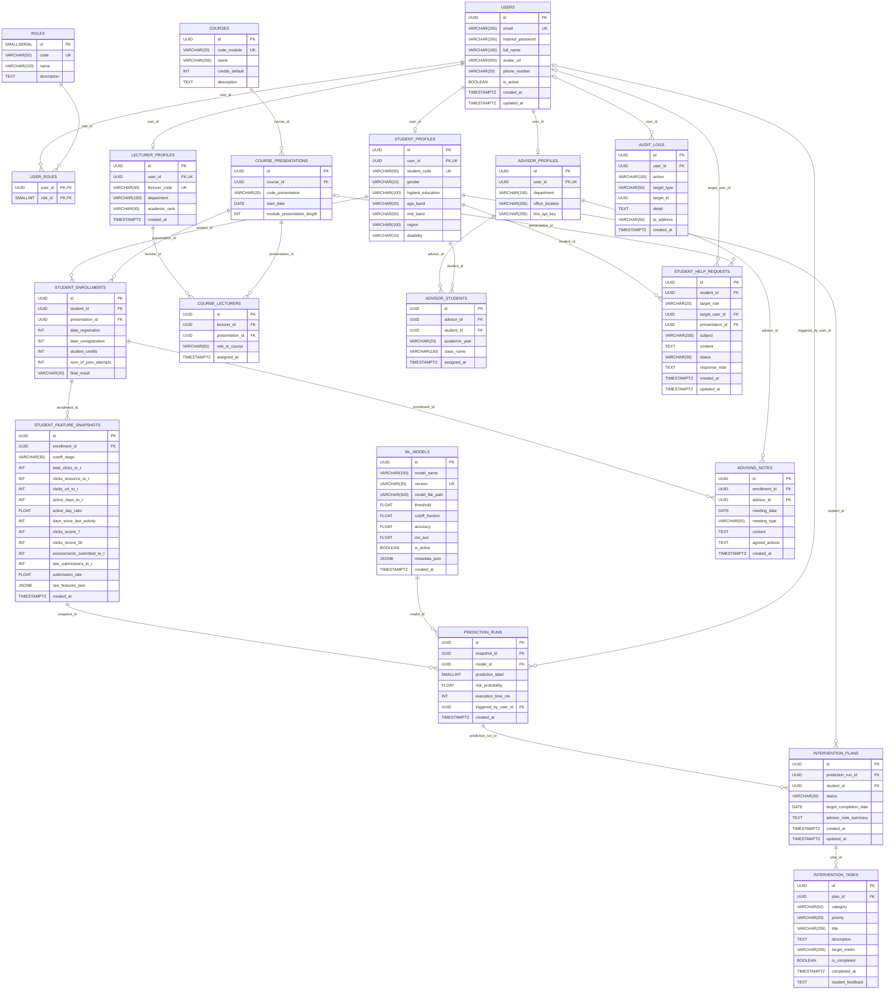

# THIẾT KẾ CƠ SỞ DỮ LIỆU HỆ THỐNG

### Hệ thống gợi ý chiến lược học tập cá nhân hóa — KLTN 13, HUIT

> **Sinh viên thực hiện:** Phan Trọng Nguyên<br>
> **Cập nhật:** 14/10/2026<br>
> **CSDL:** PostgreSQL 15 — `personalized_learning_db`, schema `public`<br>
> **ORM:** SQLAlchemy 2.0 Async, driver `asyncpg`

## 1. Phạm vi và nguồn đối chiếu

Tài liệu mô tả **19 bảng** hiện có trong SQL khởi tạo và ORM. Đặc tả vật lý ở mục 4 lấy **SQL khởi tạo** làm chuẩn; các khác biệt với ORM được ghi riêng ở mục 8. Đây là đối chiếu mã nguồn repository, chưa phải kiểm tra schema của database đang chạy.

| Nguồn | Vai trò |
| :--- | :--- |
| [01_init_schema.sql](../docker/postgres/init-scripts/01_init_schema.sql) | DDL, khóa, CHECK, UNIQUE, mặc định và index |
| [02_seed_data.sql](../docker/postgres/init-scripts/02_seed_data.sql) | Vai trò, tài khoản, mô hình và dữ liệu minh họa |
| [models](../apps/backend/models/) | Ánh xạ ORM của 19 bảng |
| [database.py](../apps/backend/core/database.py) | Async engine, session và rollback khi có lỗi |
| [endpoints](../apps/backend/api/v1/endpoints/) | Hành vi đọc/ghi, kiểm tra phạm vi quyền |
| [prediction.py](../apps/backend/schemas/prediction.py) | Hợp đồng 17 đặc trưng đầu vào ML |
| [docker-compose.yml](../docker-compose.yml) | PostgreSQL 15, volume và khởi tạo |

Repository chưa có cấu hình/revision Alembic; backend không gọi `Base.metadata.create_all()` trong vòng đời khởi động. Alembic chưa phải cơ chế migration đã triển khai.

## 2. Các phân hệ dữ liệu

| Phân hệ | Bảng | Mục đích |
| :--- | :--- | :--- |
| Danh tính và quyền (6) | users, roles, user_roles, student_profiles, advisor_profiles, lecturer_profiles | Tài khoản, nhiều vai trò và hồ sơ |
| Đào tạo (3) | courses, course_presentations, student_enrollments | Môn, đợt mở môn và đăng ký |
| Đặc trưng (1) | student_feature_snapshots | 11 chỉ số hành vi tại mốc quan sát |
| ML và dự báo (2) | ml_models, prediction_runs | Phiên bản và lịch sử dự báo |
| Can thiệp/tư vấn (3) | intervention_plans, intervention_tasks, advising_notes | Kế hoạch, nhiệm vụ, biên bản |
| Phân công (2) | course_lecturers, advisor_students | Phạm vi giảng viên/cố vấn |
| Hỗ trợ/kiểm toán (2) | student_help_requests, audit_logs | Yêu cầu và lịch sử thao tác |

Các phân hệ là nhóm nghiệp vụ, không phải các PostgreSQL schema riêng. Quyền được kiểm tra tại backend bằng vai trò và phân công; DDL chưa có chính sách Row Level Security.

## 3. Sơ đồ thực thể và quan hệ

### 3.1. ERD vật lý

PK: khóa chính; FK: khóa ngoại; UK: duy nhất đơn cột. UNIQUE ghép ghi tại mục 4. Quan hệ cha tùy chọn tương ứng FK cho phép NULL.



### 3.2. Ma trận khóa ngoại

| Bảng cha | Bảng con | FK → cột cha | Quan hệ | FK cho phép NULL | ON DELETE |
| :--- | :--- | :--- | :--- | :--- | :--- |
| `users` | `user_roles` | `user_id → id` | 1 : N | Không | `CASCADE` |
| `roles` | `user_roles` | `role_id → id` | 1 : N | Không | `CASCADE` |
| `users` | `student_profiles` | `user_id → id` | 1 : 0..1 | Không | `CASCADE` |
| `users` | `advisor_profiles` | `user_id → id` | 1 : 0..1 | Không | `CASCADE` |
| `courses` | `course_presentations` | `course_id → id` | 1 : N | Không | `CASCADE` |
| `student_profiles` | `student_enrollments` | `student_id → id` | 1 : N | Không | `CASCADE` |
| `course_presentations` | `student_enrollments` | `presentation_id → id` | 1 : N | Không | `CASCADE` |
| `student_enrollments` | `student_feature_snapshots` | `enrollment_id → id` | 1 : N | Không | `CASCADE` |
| `student_feature_snapshots` | `prediction_runs` | `snapshot_id → id` | 1 : N | Không | `CASCADE` |
| `ml_models` | `prediction_runs` | `model_id → id` | 1 : N | Không | `RESTRICT` |
| `users` | `prediction_runs` | `triggered_by_user_id → id` | 1 : N | Có | `SET NULL` |
| `prediction_runs` | `intervention_plans` | `prediction_run_id → id` | 1 : N | Không | `CASCADE` |
| `student_profiles` | `intervention_plans` | `student_id → id` | 1 : N | Không | `CASCADE` |
| `intervention_plans` | `intervention_tasks` | `plan_id → id` | 1 : N | Không | `CASCADE` |
| `student_enrollments` | `advising_notes` | `enrollment_id → id` | 1 : N | Không | `CASCADE` |
| `advisor_profiles` | `advising_notes` | `advisor_id → id` | 1 : N | Không | `CASCADE` |
| `users` | `lecturer_profiles` | `user_id → id` | 1 : 0..1 | Không | `CASCADE` |
| `lecturer_profiles` | `course_lecturers` | `lecturer_id → id` | 1 : N | Không | `CASCADE` |
| `course_presentations` | `course_lecturers` | `presentation_id → id` | 1 : N | Không | `CASCADE` |
| `advisor_profiles` | `advisor_students` | `advisor_id → id` | 1 : N | Không | `CASCADE` |
| `student_profiles` | `advisor_students` | `student_id → id` | 1 : N | Không | `CASCADE` |
| `student_profiles` | `student_help_requests` | `student_id → id` | 1 : N | Không | `CASCADE` |
| `users` | `student_help_requests` | `target_user_id → id` | 1 : N | Có | `SET NULL` |
| `course_presentations` | `student_help_requests` | `presentation_id → id` | 1 : N | Có | `SET NULL` |
| `users` | `audit_logs` | `user_id → id` | 1 : N | Có | `SET NULL` |

CASCADE có thể xóa dây chuyền từ tài khoản/hồ sơ/đăng ký tới snapshot, dự báo và kế hoạch. SET NULL giữ bản ghi con khi mất người thao tác/người nhận/học phần tùy chọn. RESTRICT ở prediction_runs.model_id theo DDL bảo vệ mô hình đã có lịch sử.

## 4. Đặc tả chi tiết 19 bảng

Kiểu và ràng buộc dưới đây lấy từ DDL. Cột không có NOT NULL hoặc PRIMARY KEY cho phép NULL. Mặc định là mặc định phía PostgreSQL; mặc định phía Python có thể khác (mục 8). UUID id có DEFAULT gen_random_uuid(); roles.id dùng SMALLSERIAL.

### 4.1. `users`

Tài khoản dùng chung; mật khẩu lưu dạng hash. Đăng nhập bằng email hoặc mã sinh viên qua student_profiles với vai trò STUDENT. is_active dùng để khóa/kích hoạt tài khoản.

| Cột | Kiểu PostgreSQL | Ràng buộc / mặc định |
| :--- | :--- | :--- |
| `id` | `UUID` | `PRIMARY KEY DEFAULT gen_random_uuid()` |
| `email` | `VARCHAR(255)` | `UNIQUE NOT NULL` |
| `hashed_password` | `VARCHAR(255)` | `NOT NULL` |
| `full_name` | `VARCHAR(150)` | `NOT NULL` |
| `avatar_url` | `VARCHAR(500)` | Cho phép NULL; không có mặc định |
| `phone_number` | `VARCHAR(20)` | Cho phép NULL; không có mặc định |
| `is_active` | `BOOLEAN` | `NOT NULL DEFAULT TRUE` |
| `created_at` | `TIMESTAMPTZ` | `NOT NULL DEFAULT NOW()` |
| `updated_at` | `TIMESTAMPTZ` | `NOT NULL DEFAULT NOW()` |

### 4.2. `roles`

Danh mục ADMIN, ADVISOR, LECTURER, STUDENT. Gán vai trò không tự tạo hồ sơ chuyên biệt.

| Cột | Kiểu PostgreSQL | Ràng buộc / mặc định |
| :--- | :--- | :--- |
| `id` | `SMALLSERIAL` | `PRIMARY KEY` |
| `code` | `VARCHAR(50)` | `UNIQUE NOT NULL` |
| `name` | `VARCHAR(100)` | `NOT NULL` |
| `description` | `TEXT` | Cho phép NULL; không có mặc định |

### 4.3. `user_roles`

Liên kết N–N tài khoản–vai trò; khóa chính ghép ngăn gán trùng vai trò.

| Cột | Kiểu PostgreSQL | Ràng buộc / mặc định |
| :--- | :--- | :--- |
| `user_id` | `UUID` | `NOT NULL REFERENCES users(id) ON DELETE CASCADE` |
| `role_id` | `SMALLINT` | `NOT NULL REFERENCES roles(id) ON DELETE CASCADE` |
| *(Ràng buộc bảng)* | — | `PRIMARY KEY (user_id, role_id)` |

### 4.4. `student_profiles`

Hồ sơ sinh viên theo OULAD; một hồ sơ cho mỗi tài khoản, mã sinh viên duy nhất.

| Cột | Kiểu PostgreSQL | Ràng buộc / mặc định |
| :--- | :--- | :--- |
| `id` | `UUID` | `PRIMARY KEY DEFAULT gen_random_uuid()` |
| `user_id` | `UUID` | `UNIQUE NOT NULL REFERENCES users(id) ON DELETE CASCADE` |
| `student_code` | `VARCHAR(50)` | `UNIQUE NOT NULL` |
| `gender` | `VARCHAR(10)` | `NOT NULL CHECK (gender IN ('M', 'F'))` |
| `highest_education` | `VARCHAR(100)` | `NOT NULL` |
| `age_band` | `VARCHAR(20)` | `NOT NULL CHECK (age_band IN ('0-35', '35-55', '55<='))` |
| `imd_band` | `VARCHAR(50)` | Cho phép NULL; không có mặc định |
| `region` | `VARCHAR(100)` | Cho phép NULL; không có mặc định |
| `disability` | `VARCHAR(10)` | `NOT NULL DEFAULT 'N'` |

### 4.5. `advisor_profiles`

Hồ sơ cố vấn, khoa, phòng làm việc và trường kết nối LMS tùy chọn.

| Cột | Kiểu PostgreSQL | Ràng buộc / mặc định |
| :--- | :--- | :--- |
| `id` | `UUID` | `PRIMARY KEY DEFAULT gen_random_uuid()` |
| `user_id` | `UUID` | `UNIQUE NOT NULL REFERENCES users(id) ON DELETE CASCADE` |
| `department` | `VARCHAR(150)` | `NOT NULL` |
| `office_location` | `VARCHAR(255)` | Cho phép NULL; không có mặc định |
| `lms_api_key` | `VARCHAR(255)` | Cho phép NULL; không có mặc định |

### 4.6. `courses`

Danh mục môn học; code_module là mã môn dùng trong dữ liệu và mô hình.

| Cột | Kiểu PostgreSQL | Ràng buộc / mặc định |
| :--- | :--- | :--- |
| `id` | `UUID` | `PRIMARY KEY DEFAULT gen_random_uuid()` |
| `code_module` | `VARCHAR(20)` | `UNIQUE NOT NULL` |
| `name` | `VARCHAR(255)` | `NOT NULL` |
| `credits_default` | `INT` | `NOT NULL DEFAULT 30` |
| `description` | `TEXT` | Cho phép NULL; không có mặc định |

### 4.7. `course_presentations`

Đợt mở môn/học kỳ; mã đợt chỉ duy nhất trong một môn. Thời lượng đo bằng ngày.

| Cột | Kiểu PostgreSQL | Ràng buộc / mặc định |
| :--- | :--- | :--- |
| `id` | `UUID` | `PRIMARY KEY DEFAULT gen_random_uuid()` |
| `course_id` | `UUID` | `NOT NULL REFERENCES courses(id) ON DELETE CASCADE` |
| `code_presentation` | `VARCHAR(20)` | `NOT NULL` |
| `start_date` | `DATE` | Cho phép NULL; không có mặc định |
| `module_presentation_length` | `INT` | `NOT NULL DEFAULT 260` |
| *(Ràng buộc bảng)* | — | `CONSTRAINT uq_course_presentation UNIQUE (course_id, code_presentation)` |

### 4.8. `student_enrollments`

Đăng ký sinh viên–đợt mở môn. date_registration và date_unregistration là số ngày tương đối so với đầu kỳ, không phải DATE. final_result có thể NULL; các nhãn Pass, Distinction, Fail, Withdrawn không được CHECK tại DB.

| Cột | Kiểu PostgreSQL | Ràng buộc / mặc định |
| :--- | :--- | :--- |
| `id` | `UUID` | `PRIMARY KEY DEFAULT gen_random_uuid()` |
| `student_id` | `UUID` | `NOT NULL REFERENCES student_profiles(id) ON DELETE CASCADE` |
| `presentation_id` | `UUID` | `NOT NULL REFERENCES course_presentations(id) ON DELETE CASCADE` |
| `date_registration` | `INT` | `NOT NULL DEFAULT -10` |
| `date_unregistration` | `INT` | Cho phép NULL; không có mặc định |
| `studied_credits` | `INT` | `NOT NULL DEFAULT 60` |
| `num_of_prev_attempts` | `INT` | `NOT NULL DEFAULT 0` |
| `final_result` | `VARCHAR(20)` | Cho phép NULL; không có mặc định |
| *(Ràng buộc bảng)* | — | `CONSTRAINT uq_student_presentation UNIQUE (student_id, presentation_id)` |

### 4.9. `student_feature_snapshots`

Snapshot 11 chỉ số hành vi, thường tại CUTOFF_75. Cho phép nhiều snapshot cùng enrollment và cutoff_stage. raw_features_json là dữ liệu mở rộng tùy chọn, chưa có schema JSON được DB kiểm tra.

| Cột | Kiểu PostgreSQL | Ràng buộc / mặc định |
| :--- | :--- | :--- |
| `id` | `UUID` | `PRIMARY KEY DEFAULT gen_random_uuid()` |
| `enrollment_id` | `UUID` | `NOT NULL REFERENCES student_enrollments(id) ON DELETE CASCADE` |
| `cutoff_stage` | `VARCHAR(30)` | `NOT NULL DEFAULT 'CUTOFF_75'` |
| `total_clicks_to_t` | `INT` | `NOT NULL DEFAULT 0` |
| `clicks_resource_to_t` | `INT` | `NOT NULL DEFAULT 0` |
| `clicks_url_to_t` | `INT` | `NOT NULL DEFAULT 0` |
| `active_days_to_t` | `INT` | `NOT NULL DEFAULT 0` |
| `active_day_ratio` | `FLOAT` | `NOT NULL DEFAULT 0.0` |
| `days_since_last_activity` | `INT` | `NOT NULL DEFAULT 0` |
| `clicks_recent_7` | `INT` | `NOT NULL DEFAULT 0` |
| `clicks_recent_30` | `INT` | `NOT NULL DEFAULT 0` |
| `assessments_submitted_to_t` | `INT` | `NOT NULL DEFAULT 0` |
| `late_submissions_to_t` | `INT` | `NOT NULL DEFAULT 0` |
| `submission_rate` | `FLOAT` | `NOT NULL DEFAULT 0.0` |
| `raw_features_json` | `JSONB` | Cho phép NULL; không có mặc định |
| `created_at` | `TIMESTAMPTZ` | `NOT NULL DEFAULT NOW()` |

### 4.10. `ml_models`

Đăng ký phiên bản mô hình, artifact, ngưỡng, cutoff và chỉ số đánh giá. DB chưa ngăn nhiều mô hình cùng active. Chỉ số trong seed là số liệu được cung cấp, chưa đánh giá lại trong lần cập nhật tài liệu.

| Cột | Kiểu PostgreSQL | Ràng buộc / mặc định |
| :--- | :--- | :--- |
| `id` | `UUID` | `PRIMARY KEY DEFAULT gen_random_uuid()` |
| `model_name` | `VARCHAR(150)` | `NOT NULL` |
| `version` | `VARCHAR(30)` | `UNIQUE NOT NULL` |
| `model_file_path` | `VARCHAR(500)` | `NOT NULL` |
| `threshold` | `FLOAT` | `NOT NULL DEFAULT 0.5` |
| `cutoff_fraction` | `FLOAT` | `NOT NULL DEFAULT 0.75` |
| `accuracy` | `FLOAT` | Cho phép NULL; không có mặc định |
| `roc_auc` | `FLOAT` | Cho phép NULL; không có mặc định |
| `is_active` | `BOOLEAN` | `NOT NULL DEFAULT TRUE` |
| `metadata_json` | `JSONB` | Cho phép NULL; không có mặc định |
| `created_at` | `TIMESTAMPTZ` | `NOT NULL DEFAULT NOW()` |

### 4.11. `prediction_runs`

Lịch sử dự báo theo snapshot và mô hình. Nhãn 1: nguy cơ; 0: an toàn theo quy ước mô hình. DB chưa CHECK risk_probability trong khoảng [0,1].

| Cột | Kiểu PostgreSQL | Ràng buộc / mặc định |
| :--- | :--- | :--- |
| `id` | `UUID` | `PRIMARY KEY DEFAULT gen_random_uuid()` |
| `snapshot_id` | `UUID` | `NOT NULL REFERENCES student_feature_snapshots(id) ON DELETE CASCADE` |
| `model_id` | `UUID` | `NOT NULL REFERENCES ml_models(id) ON DELETE RESTRICT` |
| `prediction_label` | `SMALLINT` | `NOT NULL CHECK (prediction_label IN (0, 1))` |
| `risk_probability` | `FLOAT` | `NOT NULL` |
| `execution_time_ms` | `INT` | Cho phép NULL; không có mặc định |
| `triggered_by_user_id` | `UUID` | `REFERENCES users(id) ON DELETE SET NULL` |
| `created_at` | `TIMESTAMPTZ` | `NOT NULL DEFAULT NOW()` |

### 4.12. `intervention_plans`

Kế hoạch gắn với dự báo và sinh viên. ACTIVE, COMPLETED, DISMISSED là quy ước chưa có CHECK. Không có UNIQUE giới hạn một kế hoạch/dự báo; chưa kiểm tra student_id trùng sinh viên của snapshot.

| Cột | Kiểu PostgreSQL | Ràng buộc / mặc định |
| :--- | :--- | :--- |
| `id` | `UUID` | `PRIMARY KEY DEFAULT gen_random_uuid()` |
| `prediction_run_id` | `UUID` | `NOT NULL REFERENCES prediction_runs(id) ON DELETE CASCADE` |
| `student_id` | `UUID` | `NOT NULL REFERENCES student_profiles(id) ON DELETE CASCADE` |
| `status` | `VARCHAR(30)` | `NOT NULL DEFAULT 'ACTIVE'` |
| `target_completion_date` | `DATE` | Cho phép NULL; không có mặc định |
| `advisor_note_summary` | `TEXT` | Cho phép NULL; không có mặc định |
| `created_at` | `TIMESTAMPTZ` | `NOT NULL DEFAULT NOW()` |
| `updated_at` | `TIMESTAMPTZ` | `NOT NULL DEFAULT NOW()` |

### 4.13. `intervention_tasks`

Nhiệm vụ có nhóm, ưu tiên, mô tả và mục tiêu. Tiến độ lưu bằng is_completed, completed_at; không có cột trạng thái TODO/IN_PROGRESS/COMPLETED. DB chưa buộc thời điểm hoàn thành nhất quán với cờ hoàn thành.

| Cột | Kiểu PostgreSQL | Ràng buộc / mặc định |
| :--- | :--- | :--- |
| `id` | `UUID` | `PRIMARY KEY DEFAULT gen_random_uuid()` |
| `plan_id` | `UUID` | `NOT NULL REFERENCES intervention_plans(id) ON DELETE CASCADE` |
| `category` | `VARCHAR(50)` | `NOT NULL` |
| `priority` | `VARCHAR(20)` | `NOT NULL CHECK (priority IN ('HIGH', 'MEDIUM', 'LOW'))` |
| `title` | `VARCHAR(255)` | `NOT NULL` |
| `description` | `TEXT` | `NOT NULL` |
| `target_metric` | `VARCHAR(255)` | `NOT NULL` |
| `is_completed` | `BOOLEAN` | `NOT NULL DEFAULT FALSE` |
| `completed_at` | `TIMESTAMPTZ` | Cho phép NULL; không có mặc định |
| `student_feedback` | `TEXT` | Cho phép NULL; không có mặc định |

### 4.14. `advising_notes`

Biên bản cố vấn cho enrollment. IN_PERSON, ONLINE, EMAIL là quy ước chưa có CHECK. DB không kiểm tra cố vấn đã được phân công sinh viên này.

| Cột | Kiểu PostgreSQL | Ràng buộc / mặc định |
| :--- | :--- | :--- |
| `id` | `UUID` | `PRIMARY KEY DEFAULT gen_random_uuid()` |
| `enrollment_id` | `UUID` | `NOT NULL REFERENCES student_enrollments(id) ON DELETE CASCADE` |
| `advisor_id` | `UUID` | `NOT NULL REFERENCES advisor_profiles(id) ON DELETE CASCADE` |
| `meeting_date` | `DATE` | `NOT NULL DEFAULT CURRENT_DATE` |
| `meeting_type` | `VARCHAR(50)` | `NOT NULL DEFAULT 'IN_PERSON'` |
| `content` | `TEXT` | `NOT NULL` |
| `agreed_actions` | `TEXT` | Cho phép NULL; không có mặc định |
| `created_at` | `TIMESTAMPTZ` | `NOT NULL DEFAULT NOW()` |

### 4.15. `lecturer_profiles`

Hồ sơ giảng viên, mã giảng viên duy nhất, khoa và chức danh.

| Cột | Kiểu PostgreSQL | Ràng buộc / mặc định |
| :--- | :--- | :--- |
| `id` | `UUID` | `PRIMARY KEY DEFAULT gen_random_uuid()` |
| `user_id` | `UUID` | `UNIQUE NOT NULL REFERENCES users(id) ON DELETE CASCADE` |
| `lecturer_code` | `VARCHAR(50)` | `UNIQUE NOT NULL` |
| `department` | `VARCHAR(150)` | `NOT NULL` |
| `academic_rank` | `VARCHAR(50)` | `DEFAULT 'Giảng viên'` |
| `created_at` | `TIMESTAMPTZ` | `NOT NULL DEFAULT NOW()` |

### 4.16. `course_lecturers`

Phân công giảng viên–đợt mở môn; UNIQUE ghép ngăn trùng cặp, không giới hạn số giảng viên chính.

| Cột | Kiểu PostgreSQL | Ràng buộc / mặc định |
| :--- | :--- | :--- |
| `id` | `UUID` | `PRIMARY KEY DEFAULT gen_random_uuid()` |
| `lecturer_id` | `UUID` | `NOT NULL REFERENCES lecturer_profiles(id) ON DELETE CASCADE` |
| `presentation_id` | `UUID` | `NOT NULL REFERENCES course_presentations(id) ON DELETE CASCADE` |
| `role_in_course` | `VARCHAR(50)` | `NOT NULL DEFAULT 'GIANG_VIEN_CHINH'` |
| `assigned_at` | `TIMESTAMPTZ` | `NOT NULL DEFAULT NOW()` |
| *(Ràng buộc bảng)* | — | `CONSTRAINT uq_lecturer_presentation UNIQUE (lecturer_id, presentation_id)` |

### 4.17. `advisor_students`

Phân công cố vấn–sinh viên kèm năm học và lớp. UNIQUE chỉ gồm advisor_id, student_id nên không lưu được nhiều bản ghi cùng cặp qua các năm; sinh viên vẫn có thể có nhiều cố vấn khác nhau.

| Cột | Kiểu PostgreSQL | Ràng buộc / mặc định |
| :--- | :--- | :--- |
| `id` | `UUID` | `PRIMARY KEY DEFAULT gen_random_uuid()` |
| `advisor_id` | `UUID` | `NOT NULL REFERENCES advisor_profiles(id) ON DELETE CASCADE` |
| `student_id` | `UUID` | `NOT NULL REFERENCES student_profiles(id) ON DELETE CASCADE` |
| `academic_year` | `VARCHAR(20)` | `NOT NULL` |
| `class_name` | `VARCHAR(100)` | `NOT NULL` |
| `assigned_at` | `TIMESTAMPTZ` | `NOT NULL DEFAULT NOW()` |
| *(Ràng buộc bảng)* | — | `CONSTRAINT uq_advisor_student UNIQUE (advisor_id, student_id)` |

### 4.18. `student_help_requests`

Yêu cầu gửi ADVISOR/LECTURER, tùy chọn người nhận và học phần. Phản hồi nằm ở response_note, chưa có bảng hội thoại. DB không kiểm tra vai trò thực tế của người nhận.

| Cột | Kiểu PostgreSQL | Ràng buộc / mặc định |
| :--- | :--- | :--- |
| `id` | `UUID` | `PRIMARY KEY DEFAULT gen_random_uuid()` |
| `student_id` | `UUID` | `NOT NULL REFERENCES student_profiles(id) ON DELETE CASCADE` |
| `target_role` | `VARCHAR(20)` | `NOT NULL CHECK (target_role IN ('ADVISOR', 'LECTURER'))` |
| `target_user_id` | `UUID` | `REFERENCES users(id) ON DELETE SET NULL` |
| `presentation_id` | `UUID` | `REFERENCES course_presentations(id) ON DELETE SET NULL` |
| `subject` | `VARCHAR(255)` | `NOT NULL` |
| `content` | `TEXT` | `NOT NULL` |
| `status` | `VARCHAR(30)` | `NOT NULL DEFAULT 'PENDING' CHECK (status IN ('PENDING', 'IN_PROGRESS', 'RESOLVED'))` |
| `response_note` | `TEXT` | Cho phép NULL; không có mặc định |
| `created_at` | `TIMESTAMPTZ` | `NOT NULL DEFAULT NOW()` |
| `updated_at` | `TIMESTAMPTZ` | `NOT NULL DEFAULT NOW()` |

### 4.19. `audit_logs`

Nhật ký thao tác. target_id là UUID tham chiếu logic theo target_type, không phải FK. Xóa đối tượng không tự xóa log; chưa có trigger tự ghi hoặc cơ chế bất biến cho audit.

| Cột | Kiểu PostgreSQL | Ràng buộc / mặc định |
| :--- | :--- | :--- |
| `id` | `UUID` | `PRIMARY KEY DEFAULT gen_random_uuid()` |
| `user_id` | `UUID` | `REFERENCES users(id) ON DELETE SET NULL` |
| `action` | `VARCHAR(100)` | `NOT NULL` |
| `target_type` | `VARCHAR(50)` | Cho phép NULL; không có mặc định |
| `target_id` | `UUID` | Cho phép NULL; không có mặc định |
| `detail` | `TEXT` | Cho phép NULL; không có mặc định |
| `ip_address` | `VARCHAR(50)` | Cho phép NULL; không có mặc định |
| `created_at` | `TIMESTAMPTZ` | `NOT NULL DEFAULT NOW()` |

## 5. Đặc trưng ML và luồng dữ liệu

### 5.1. Nguồn của 17 đặc trưng đầu vào

Snapshot chỉ có **11 cột hành vi**, không chứa toàn bộ 17 đặc trưng trong hợp đồng `StudentFeatures`:

| Nguồn | Đặc trưng | Số lượng |
| :--- | :--- | :---: |
| `courses` qua presentation/enrollment | `code_module` | 1 |
| `student_profiles` | `gender`, `highest_education`, `age_band` | 3 |
| `student_enrollments` | `studied_credits`, `date_registration` | 2 |
| `student_feature_snapshots` | `total_clicks_to_t`, `clicks_resource_to_t`, `clicks_url_to_t`, `active_days_to_t`, `assessments_submitted_to_t`, `late_submissions_to_t`, `active_day_ratio`, `submission_rate`, `days_since_last_activity`, `clicks_recent_7`, `clicks_recent_30` | 11 |

`num_of_prev_attempts`, `imd_band`, `region`, `disability` được lưu cho nghiệp vụ nhưng không nằm trong 17 trường của `StudentFeatures` hiện tại. Predictor dùng `feature_columns` trong artifact để chọn cột và tính xác suất của lớp 1; `confidence` trong response là xác suất nguy cơ, không phải xác suất của nhãn bất kỳ được chọn. `raw_features_json` không được predictor tự đọc.

### 5.2. Luồng thực thi hiện tại

1. **Danh tính:** tạo `users`, gán `user_roles` và hồ sơ theo vai trò. Đăng nhập tra cứu email hoặc mã sinh viên; backend kiểm tra tài khoản hoạt động và vai trò.
2. **Đào tạo và phân công:** tạo môn, đợt mở môn, đăng ký; `course_lecturers` và `advisor_students` xác định phạm vi dữ liệu giảng viên/cố vấn được xử lý.
3. **Snapshot:** dữ liệu chỉ số được nạp vào `student_feature_snapshots`. DDL không có bảng log VLE thô, bảng assessment hoặc pipeline ETL tự động trích xuất chỉ số.
4. **Dự báo trực tiếp:** `POST /api/v1/predictions/` suy luận trên payload bằng mô hình trong bộ nhớ và trả kết quả; endpoint này không ghi `prediction_runs` hoặc tạo kế hoạch.
5. **Dự báo của admin:** lấy snapshot mới nhất của mỗi enrollment, hoặc một enrollment được chỉ định; ghép đủ 17 đặc trưng từ DB và suy luận bằng artifact của mô hình active. Lưu `prediction_runs` và audit `BATCH_PREDICT` trong cùng transaction. Chạy lại tạo thêm lịch sử; chưa tự tạo `intervention_plans`/`intervention_tasks`.
6. **Can thiệp:** kế hoạch và nhiệm vụ đã được lưu được hiển thị theo phạm vi sinh viên/phân công; cố vấn cập nhật kế hoạch, thêm nhiệm vụ. Khi sinh viên hoàn thành nhiệm vụ, backend ghi `is_completed=True`, `completed_at` và phản hồi tùy chọn. Không có trigger tự hoàn tất kế hoạch khi mọi task hoàn thành.
7. **Tư vấn và hỗ trợ:** cố vấn lưu ghi chú theo enrollment; yêu cầu hỗ trợ lưu trạng thái và phản hồi trong `student_help_requests`.
8. **Kiểm toán:** backend gọi `write_audit_log()` cho các thao tác được triển khai, gồm tạo/sửa/xóa/khóa tài khoản, đổi vai trò, đặt lại mật khẩu, nạp/kích hoạt mô hình và dự báo hàng loạt. Không phải mọi thay đổi DB đều tự có audit.

**Kiểm tra luồng dự báo:** yêu cầu đúng một mô hình active, threshold DB khớp artifact và snapshot ở CUTOFF_75. Chỉ số phải hữu hạn, không âm, tỷ lệ trong [0,1]. Lỗi suy luận rollback, không lưu fallback; execution_time_ms được đo thực tế. Có thể chạy riêng bằng query enrollment_id hoặc scripts/predict_enrollment.py. Nguồn dữ liệu minh họa được đánh dấu synthetic_demo và hiển thị trên trang sinh viên.

### 5.3. Giao dịch và thời gian

`get_db()` cung cấp AsyncSession, rollback khi có ngoại lệ và đóng session; việc commit do endpoint/repository thực hiện. Engine dùng `pool_pre_ping=True`, `pool_size=10`, `max_overflow=20`. `write_audit_log()` chỉ flush để caller quyết định commit; một số luồng hiện commit dữ liệu và audit riêng, nên chưa bảo đảm toàn bộ thao tác và log luôn nguyên tử.

DDL dùng `TIMESTAMPTZ DEFAULT NOW()`. ORM tạo thời gian theo UTC và có `onupdate` cho `users`, `intervention_plans`, `student_help_requests`. SQL chưa có trigger tự cập nhật `updated_at`: UPDATE trực tiếp bằng SQL phải chủ động gán trường này. Ngày buổi tư vấn/hạn hoàn thành dùng DATE.

## 6. Chỉ mục và ràng buộc

### 6.1. Index khai báo trong SQL khởi tạo

```sql
CREATE INDEX IF NOT EXISTS idx_student_profiles_code ON student_profiles(student_code);
CREATE INDEX IF NOT EXISTS idx_enrollments_student ON student_enrollments(student_id);
CREATE INDEX IF NOT EXISTS idx_enrollments_presentation ON student_enrollments(presentation_id);
CREATE INDEX IF NOT EXISTS idx_feature_snapshots_enrollment ON student_feature_snapshots(enrollment_id, cutoff_stage);
CREATE INDEX IF NOT EXISTS idx_predictions_created_at_desc ON prediction_runs(created_at DESC);
CREATE INDEX IF NOT EXISTS idx_predictions_snapshot ON prediction_runs(snapshot_id);
CREATE INDEX IF NOT EXISTS idx_intervention_plans_student ON intervention_plans(student_id, status);
CREATE INDEX IF NOT EXISTS idx_intervention_tasks_plan_status ON intervention_tasks(plan_id, is_completed);
```

PK và UNIQUE tạo index hỗ trợ tương ứng. `idx_student_profiles_code` trùng cột với UNIQUE `student_code`. PostgreSQL không tự tạo index cho mọi FK; các bảng phân công, yêu cầu hỗ trợ và audit chưa có index riêng trong script ngoài index từ PK/UNIQUE. ORM còn khai báo index ở email, roles.code, courses.code_module, course_presentations.code_presentation, lecturer_profiles.lecturer_code, audit_logs.action; chúng không tự xuất hiện trong database được tạo chỉ bằng SQL init.

### 6.2. Những quy tắc chưa được ràng buộc tại DB

Các cải tiến dưới đây là đề xuất, chưa có trong schema: CHECK xác suất/tỷ lệ trong [0,1] và số đếm không âm; thống nhất trạng thái và miền giá trị; bảo đảm chỉ một mô hình active; xác minh sinh viên của kế hoạch tương ứng dự báo; kiểm tra người nhận hỗ trợ đúng vai trò/phân công; quy định lịch sử phân công theo năm học; bổ sung index sau khi đo truy vấn thực tế. Không giả định các quy tắc này đã được DB bảo đảm.

## 7. Khởi tạo, dữ liệu mẫu và kiểm tra

Nguồn DDL thực thi là [01_init_schema.sql](../docker/postgres/init-scripts/01_init_schema.sql), gồm 19 bảng, 25 FK, 8 CREATE INDEX và extensions `uuid-ossp`, `pgcrypto`. UUID mặc định dùng `gen_random_uuid()`; script hiện vẫn bật cả hai extensions.

```powershell
docker compose up -d postgres pgadmin
docker exec -it kltn13_postgres psql -U postgres -d personalized_learning_db
```

Docker mount `docker/postgres/init-scripts/` vào `/docker-entrypoint-initdb.d/`: chạy `01_init_schema.sql` rồi `02_seed_data.sql` khi thư mục dữ liệu PostgreSQL được khởi tạo lần đầu. Volume `postgres_data` lưu dữ liệu bền vững; sửa script hoặc restart container không cập nhật schema của volume đã tồn tại. `CREATE TABLE IF NOT EXISTS` cũng không sửa định nghĩa bảng cũ. Thay đổi schema đang sử dụng cần migration có kiểm soát.

| Kết nối | Host | Cổng mặc định |
| :--- | :--- | :--- |
| Từ máy host | localhost | 5433 (`POSTGRES_HOST_PORT`) |
| Từ backend/pgAdmin trong Docker | postgres | 5432 |
| Giao diện pgAdmin | localhost | 5050 (`PGADMIN_PORT`) |

Thông tin đăng nhập/kết nối lấy từ biến môi trường; hướng dẫn chi tiết tại [database_setup_guide.md](../docs/database_setup_guide.md). Số bảng ghi trong hướng dẫn cũ chưa phản ánh schema 19 bảng hiện tại.

Seed gồm 4 vai trò, tài khoản minh họa, học phần/đợt mở môn và mô hình `v1.0.0-cutoff75`, threshold 0.5, cutoff_fraction 0.75. Dữ liệu seed phục vụ demo, không đồng nghĩa có nguồn LMS hoặc ETL thực tế. [demo_student_2045230069_ccc.sql](demo_student_2045230069_ccc.sql) bổ sung snapshot minh họa cho môn CCC của sinh viên 2045230069; script không tạo enrollment và không ghi đè snapshot hiện có.

Các truy vấn chỉ đọc để kiểm tra database đang chạy:

```sql
SELECT table_name
FROM information_schema.tables
WHERE table_schema = 'public' AND table_type = 'BASE TABLE'
ORDER BY table_name;

SELECT tablename, indexname, indexdef
FROM pg_indexes
WHERE schemaname = 'public'
ORDER BY tablename, indexname;

SELECT conrelid::regclass AS table_name, conname,
       pg_get_constraintdef(oid) AS definition
FROM pg_constraint
WHERE connamespace = 'public'::regnamespace
ORDER BY conrelid::regclass::text, conname;

SELECT version, is_active, threshold, cutoff_fraction FROM ml_models;
```

## 8. Khác biệt giữa SQL khởi tạo và ORM

Bảng dưới đây ghi nhận khác biệt từ mã nguồn; không khẳng định schema của database đã triển khai giống hoàn toàn một trong hai nguồn. Default của ORM là phía Python, không tự trở thành DEFAULT ở DB.

| Thành phần | SQL khởi tạo | ORM hiện tại |
| :--- | :--- | :--- |
| UUID id | DEFAULT gen_random_uuid() | default=uuid.uuid4 phía Python |
| Timestamp tạo/sửa | DEFAULT NOW(); không có trigger update | default UTC phía Python; một số updated_at có onupdate |
| advisor_profiles.office_location | VARCHAR(255) | String(100) |
| lecturer_profiles.academic_rank | Cho phép NULL, DEFAULT 'Giảng viên' | nullable=False, default 'Giảng viên' |
| course_presentations.module_presentation_length | DEFAULT 260 | Không khai báo default |
| course_presentations | UNIQUE(course_id, code_presentation) | Không khai báo UNIQUE ghép |
| student_enrollments.date_registration | DEFAULT -10 | default 0 |
| student_enrollments | UNIQUE(student_id, presentation_id) | Không khai báo UNIQUE ghép |
| student_feature_snapshots.cutoff_stage | VARCHAR(30) | String(50) |
| ml_models.model_name | VARCHAR(150) | String(100) |
| ml_models.version | VARCHAR(30), UNIQUE | String(50), không unique |
| ml_models.model_file_path | VARCHAR(500) | String(255) |
| ml_models.is_active | DEFAULT TRUE | default False |
| prediction_runs.model_id | ON DELETE RESTRICT | ON DELETE CASCADE |
| intervention_tasks.priority | CHECK HIGH/MEDIUM/LOW; không default | default MEDIUM; không CheckConstraint |
| intervention_tasks.target_metric | VARCHAR(255) | String(100) |
| advising_notes.meeting_date | DEFAULT CURRENT_DATE | Không khai báo default |
| advising_notes.meeting_type | DEFAULT IN_PERSON | default ONLINE |
| CHECK miền giá trị | gender, age_band, prediction_label, priority, target_role, help request status | Không khai báo các CheckConstraint tương ứng |
| Index | 8 index tường minh trong mục 6 | Các index=True khác danh sách SQL |

Đặc biệt, tạo DB bằng ORM thuần sẽ không có UNIQUE phiên bản mô hình để hỗ trợ `ON CONFLICT (version)` trong seed và có hành vi xóa mô hình khác SQL init. Cần thống nhất DDL/ORM và xây dựng migration trước khi thay đổi phương thức tạo database. Lần cập nhật này chỉ sửa tài liệu, không thay đổi schema, model hoặc dữ liệu đang chạy.

## 9. Phạm vi học phần của nhiệm vụ và yêu cầu trợ giúp

Trang sinh viên truyền enrollment_id của môn đang chọn khi đọc task/help. Task liên kết học phần qua intervention_tasks → intervention_plans → prediction_runs → student_feature_snapshots → student_enrollments. Yêu cầu trợ giúp dùng student_help_requests.presentation_id khớp presentation của enrollment. Backend kiểm tra quyền sở hữu enrollment; yêu cầu chung có presentation_id NULL không được coi là yêu cầu của mọi môn.

Tạo yêu cầu trợ giúp có enrollment_id sẽ tự gán presentation_id từ DB; backend từ chối enrollment của sinh viên khác hoặc presentation_id không khớp. Cố vấn chọn enrollment khi lập kế hoạch, prediction được chọn trong phạm vi enrollment đó. Giảng viên giao task chỉ vào plan ACTIVE của đúng sinh viên và presentation được phân công. Cảnh báo học phần mới lưu presentation_id và chọn cố vấn nhận từ bảng phân công.

Không bổ sung cột/bảng hoặc sửa schema trong thay đổi này. Dữ liệu cũ chưa gắn học phần được giữ nguyên; task/help hiển thị dựa trên liên kết dữ liệu, không suy đoán theo tiêu đề.
