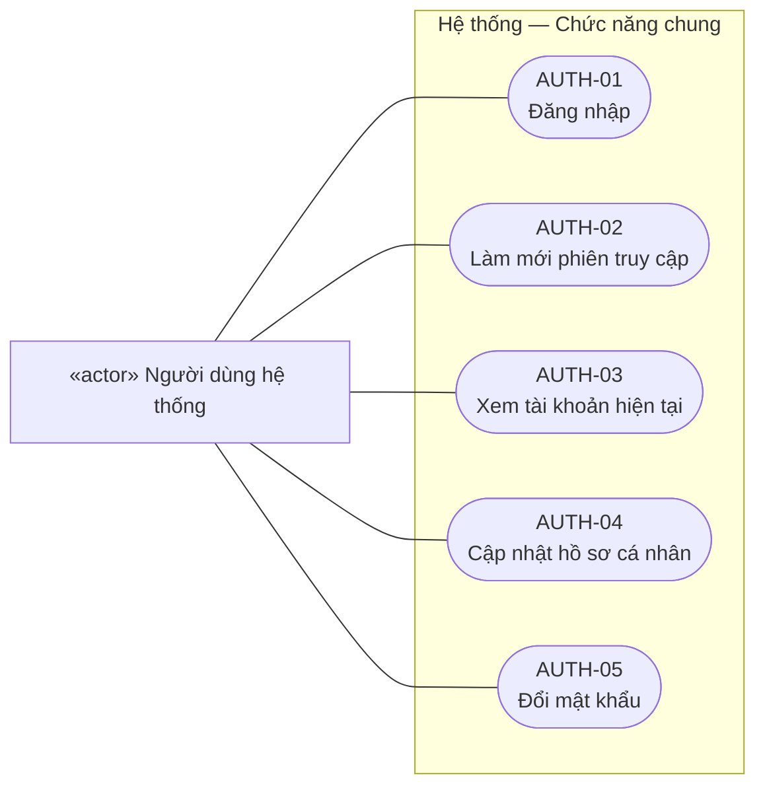
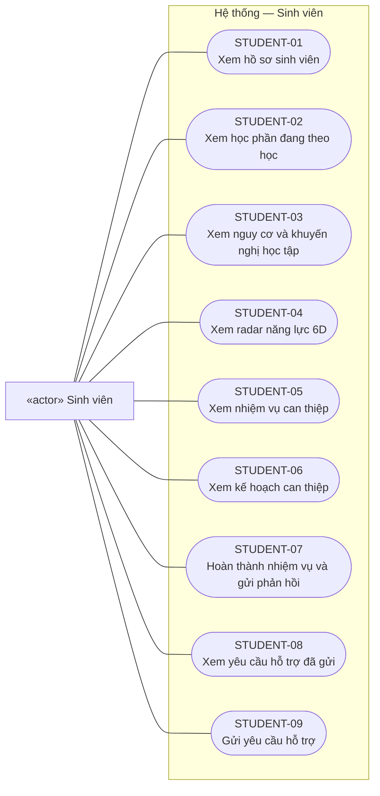
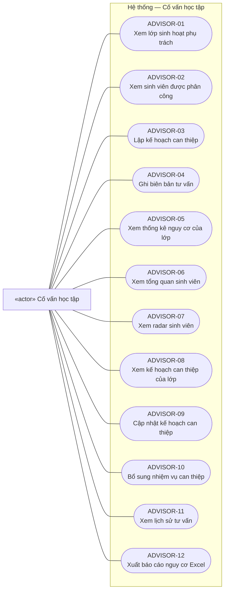
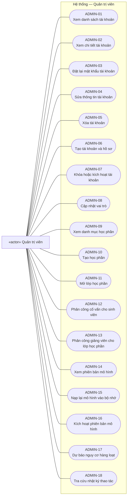
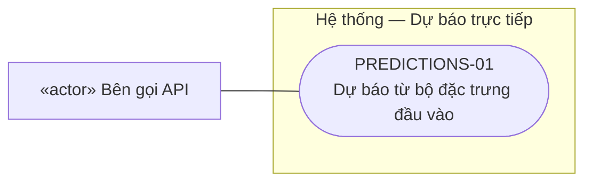
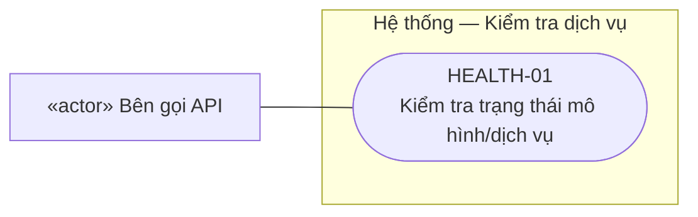

# BIỂU ĐỒ USE CASE HỆ THỐNG

**Hệ thống gợi ý chiến lược học tập cá nhân hóa — KLTN 13, HUIT**
**Ngày đối chiếu:** 14/10/2026

## 1. Phạm vi và quy ước

Biểu đồ được xây dựng từ [backend API](../apps/backend/api/v1/endpoints/), [phân quyền](../apps/backend/core/permissions.py), [repository](../apps/backend/repositories/) và [schema database](../docker/postgres/init-scripts/01_init_schema.sql). Đặc tả dữ liệu liên quan nằm trong [database_design_plan.md](database_design_plan.md).

Use case biểu diễn mục tiêu người dùng thực hiện qua backend hiện tại. Database, mô hình LightGBM và các service nội bộ nằm trong ranh giới hệ thống, không được xem là actor bên ngoài. Bên gọi API là người hoặc ứng dụng gọi các endpoint công khai; chưa giả định có hệ thống LMS tích hợp.

Biểu đồ phản ánh workingtree ngày 14/10/2026; chức năng đặt lại mật khẩu thuộc thay đổi quản lý tài khoản đang phát triển riêng, ngoài phạm vi commit dự báo.

Bản tổng quan dùng ký pháp UML PlantUML chuẩn (actor, use case, ranh giới hệ thống, kế thừa actor). Các sơ đồ Mermaid bên dưới hiển thị trực tiếp trong trình xem Markdown có hỗ trợ Mermaid, dùng nút dạng bầu dục cho use case và hình chữ nhật cho actor vì Mermaid không có cú pháp use case UML riêng. Đường liền là liên kết actor–use case, không biểu thị thứ tự thao tác.

Đăng nhập hợp lệ là **điều kiện trước** của chức năng được bảo vệ, không phải quan hệ `include` bắt buộc thực hiện lại ở mỗi thao tác. Không dùng `extend` để biểu diễn đơn thuần việc thao tác này xảy ra sau thao tác khác.

## 2. Các tác nhân

| Tác nhân | Vai trò và phạm vi |
| :--- | :--- |
| Người dùng hệ thống | Actor tổng quát của bốn vai trò; đăng nhập, xem/sửa hồ sơ và đổi mật khẩu |
| Sinh viên — STUDENT | Theo dõi dữ liệu học tập của bản thân, nguy cơ, radar, kế hoạch/nhiệm vụ và gửi yêu cầu hỗ trợ |
| Cố vấn học tập — ADVISOR | Theo dõi lớp/sinh viên được phân công, tư vấn, lập và theo dõi kế hoạch can thiệp |
| Giảng viên bộ môn — LECTURER | Theo dõi lớp học phần, cập nhật tiến độ đánh giá, giao nhiệm vụ bổ trợ và tạo cảnh báo học vụ |
| Quản trị viên — ADMIN | Quản lý tài khoản, đào tạo, phân công, phiên bản mô hình, chạy batch và xem audit |
| Bên gọi API công khai | Gọi dự báo trực tiếp hoặc kiểm tra trạng thái dịch vụ; các endpoint này hiện không yêu cầu token |

ADMIN được `RequireRoles` cho qua kiểm tra vai trò ở các nhóm sinh viên/cố vấn/giảng viên. Điều này không đồng nghĩa mọi truy vấn tự trả toàn bộ dữ liệu: một số endpoint vẫn yêu cầu hồ sơ chuyên biệt và phân công. Sơ đồ thể hiện mục tiêu nghiệp vụ chính của từng vai trò, không vẽ ADMIN kế thừa toàn bộ vai trò khác.

## 3. Biểu đồ tổng quan UML

Các use case dưới đây là nhóm mục tiêu tổng quan; thao tác cụ thể và API được phân rã ở mục 4–5. Khối này có thể dựng bằng công cụ PlantUML.

```plantuml
@startuml
left to right direction
skinparam shadowing false
skinparam packageStyle rectangle
actor "Người dùng hệ thống" as User
actor "Sinh viên" as Student
actor "Cố vấn học tập" as Advisor
actor "Giảng viên bộ môn" as Lecturer
actor "Quản trị viên" as Admin
actor "Bên gọi API công khai" as Caller
Student --|> User
Advisor --|> User
Lecturer --|> User
Admin --|> User
rectangle "Hệ thống gợi ý chiến lược học tập cá nhân hóa" {
  usecase "Đăng nhập và quản lý
thông tin cá nhân" as Account
  usecase "Theo dõi học tập, nguy cơ
và khuyến nghị cá nhân" as Learning
  usecase "Theo dõi kế hoạch và
hoàn thành nhiệm vụ" as Tasks
  usecase "Gửi và theo dõi
yêu cầu hỗ trợ" as Help
  usecase "Theo dõi lớp chủ nhiệm
và phân tích sinh viên" as AdvMonitor
  usecase "Lập, cập nhật kế hoạch
và ghi biên bản tư vấn" as Intervention
  usecase "Xuất báo cáo nguy cơ" as Export
  usecase "Theo dõi lớp học phần
và cập nhật đánh giá" as CourseMonitor
  usecase "Giao nhiệm vụ bổ trợ
và tạo cảnh báo học vụ" as CourseHelp
  usecase "Quản lý tài khoản
và vai trò" as Users
  usecase "Quản lý học phần
và phân công" as Academic
  usecase "Quản lý mô hình và
dự báo hàng loạt" as ML
  usecase "Tra cứu nhật ký thao tác" as Audit
  usecase "Dự báo trực tiếp
từ đặc trưng đầu vào" as Predict
  usecase "Kiểm tra trạng thái dịch vụ" as Health
}
User -- Account
Student -- Learning
Student -- Tasks
Student -- Help
Advisor -- AdvMonitor
Advisor -- Intervention
Advisor -- Export
Lecturer -- CourseMonitor
Lecturer -- CourseHelp
Admin -- Users
Admin -- Academic
Admin -- ML
Admin -- Audit
Caller -- Predict
Caller -- Health
@enduml
```

## 4. Biểu đồ chi tiết theo tác nhân

### 4.1. Chức năng chung



### 4.2. Sinh viên



### 4.3. Cố vấn học tập



### 4.4. Giảng viên bộ môn


### 4.5. Quản trị viên



### 4.6. Dự báo trực tiếp



### 4.7. Kiểm tra dịch vụ



## 5. Đối chiếu use case với API và database

Mọi đường dẫn bên dưới có tiền tố `/api/v1`. Cột dữ liệu mô tả dữ liệu chính được dùng, không phải danh sách SQL đầy đủ. Sơ đồ có tổng cộng **52 use case cụ thể**, đối chiếu 52 endpoint của bảy module (không tính endpoint `/` và trang tài liệu API).

### Chức năng chung

| Mã | Use case | API | Dữ liệu chính |
| :--- | :--- | :--- | :--- |
| AUTH-01 | Đăng nhập | `POST /auth/login` | users, roles, user_roles, student_profiles |
| AUTH-02 | Làm mới phiên truy cập | `POST /auth/refresh` | users; JWT, không có bảng phiên |
| AUTH-03 | Xem tài khoản hiện tại | `GET /auth/me` | users, roles, user_roles và hồ sơ |
| AUTH-04 | Cập nhật hồ sơ cá nhân | `PUT /auth/profile` | users |
| AUTH-05 | Đổi mật khẩu | `PUT /auth/change-password` | users.hashed_password |

### Sinh viên

| Mã | Use case | API | Dữ liệu chính |
| :--- | :--- | :--- | :--- |
| STUDENT-01 | Xem hồ sơ sinh viên | `GET /student/profile` | users, student_profiles, student_enrollments |
| STUDENT-02 | Xem học phần đang theo học | `GET /student/courses` | student_enrollments, course_presentations, courses, snapshots, prediction_runs |
| STUDENT-03 | Xem nguy cơ và khuyến nghị học tập | `GET /student/courses/{enrollment_id}/risk-prediction` | enrollments, snapshots, prediction_runs, ml_models |
| STUDENT-04 | Xem radar năng lực 6D | `GET /student/courses/{enrollment_id}/radar` | enrollments, courses, snapshots; radar tính bởi service |
| STUDENT-05 | Xem nhiệm vụ can thiệp | `GET /student/tasks` | intervention_plans, intervention_tasks |
| STUDENT-06 | Xem kế hoạch can thiệp | `GET /student/intervention-plans` | intervention_plans, intervention_tasks |
| STUDENT-07 | Hoàn thành nhiệm vụ và gửi phản hồi | `PATCH /student/tasks/{task_id}/complete` | intervention_tasks, intervention_plans |
| STUDENT-08 | Xem yêu cầu hỗ trợ đã gửi | `GET /student/help-requests` | student_help_requests |
| STUDENT-09 | Gửi yêu cầu hỗ trợ | `POST /student/help-requests` | student_help_requests |

### Cố vấn học tập

| Mã | Use case | API | Dữ liệu chính |
| :--- | :--- | :--- | :--- |
| ADVISOR-01 | Xem lớp sinh hoạt phụ trách | `GET /advisor/classes` | advisor_profiles, advisor_students |
| ADVISOR-02 | Xem sinh viên được phân công | `GET /advisor/students` | advisor_students, student_profiles, users, enrollments, snapshots, prediction_runs, plans/tasks |
| ADVISOR-03 | Lập kế hoạch can thiệp | `POST /advisor/interventions` | prediction_runs, snapshots, enrollments, intervention_plans, intervention_tasks |
| ADVISOR-04 | Ghi biên bản tư vấn | `POST /advisor/advising-notes` | advisor_profiles, advising_notes |
| ADVISOR-05 | Xem thống kê nguy cơ của lớp | `GET /advisor/classes/{class_name}/statistics` | advisor_students, profiles, enrollments, snapshots, prediction_runs |
| ADVISOR-06 | Xem tổng quan sinh viên | `GET /advisor/students/{student_id}/overview` | advisor_students, profiles, users, enrollments, snapshots, prediction_runs, plans/tasks |
| ADVISOR-07 | Xem radar sinh viên | `GET /advisor/students/{student_id}/radar` | advisor_students, enrollments, courses, snapshots |
| ADVISOR-08 | Xem kế hoạch can thiệp của lớp | `GET /advisor/interventions` | advisor_students, intervention_plans, intervention_tasks |
| ADVISOR-09 | Cập nhật kế hoạch can thiệp | `PUT /advisor/interventions/{plan_id}` | advisor_students, intervention_plans |
| ADVISOR-10 | Bổ sung nhiệm vụ can thiệp | `POST /advisor/interventions/{plan_id}/tasks` | advisor_students, intervention_plans, intervention_tasks |
| ADVISOR-11 | Xem lịch sử tư vấn | `GET /advisor/students/{student_id}/notes` | advisor_students, advising_notes |
| ADVISOR-12 | Xuất báo cáo nguy cơ Excel | `GET /advisor/export/risk-report` | advisor_students, users, student_profiles, snapshots, prediction_runs, plans/tasks; workbook tạo trong bộ nhớ |

### Giảng viên bộ môn

| Mã | Use case | API | Dữ liệu chính |
| :--- | :--- | :--- | :--- |
| LECTURER-01 | Xem lớp học phần giảng dạy | `GET /lecturer/courses` | lecturer_profiles, course_lecturers, courses, presentations |
| LECTURER-02 | Xem bảng cảnh báo nguy cơ | `GET /lecturer/courses/{presentation_id}/risk-board` | course_lecturers, enrollments, profiles, users, snapshots, prediction_runs |
| LECTURER-03 | Xem sinh viên lớp học phần | `GET /lecturer/courses/{presentation_id}/students` | course_lecturers, enrollments, profiles, users, snapshots |
| LECTURER-04 | Cập nhật tiến độ đánh giá và kết quả học phần | `PUT /lecturer/courses/{presentation_id}/students/{student_id}/assessment` | course_lecturers, student_enrollments, student_feature_snapshots |
| LECTURER-05 | Giao nhiệm vụ bổ trợ | `POST /lecturer/courses/{presentation_id}/tasks` | intervention_plans, intervention_tasks |
| LECTURER-06 | Tạo cảnh báo học vụ cho cố vấn | `POST /lecturer/students/{student_id}/alert-advisor` | student_help_requests |

### Quản trị viên

| Mã | Use case | API | Dữ liệu chính |
| :--- | :--- | :--- | :--- |
| ADMIN-01 | Xem danh sách tài khoản | `GET /admin/users` | users, roles, user_roles, hồ sơ |
| ADMIN-02 | Xem chi tiết tài khoản | `GET /admin/users/{user_id}` | users, roles, user_roles, hồ sơ |
| ADMIN-03 | Đặt lại mật khẩu tài khoản | `PUT /admin/users/{user_id}/reset-password` | users, audit_logs |
| ADMIN-04 | Sửa thông tin tài khoản | `PUT /admin/users/{user_id}` | users, hồ sơ, audit_logs |
| ADMIN-05 | Xóa tài khoản | `DELETE /admin/users/{user_id}` | users và hồ sơ/dữ liệu theo cascade; audit_logs |
| ADMIN-06 | Tạo tài khoản và hồ sơ | `POST /admin/users` | users, user_roles, hồ sơ, audit_logs |
| ADMIN-07 | Khóa hoặc kích hoạt tài khoản | `PUT /admin/users/{user_id}/status` | users, audit_logs |
| ADMIN-08 | Cập nhật vai trò | `POST /admin/users/{user_id}/roles` | user_roles, roles, audit_logs |
| ADMIN-09 | Xem danh mục học phần | `GET /admin/academic/courses` | courses |
| ADMIN-10 | Tạo học phần | `POST /admin/academic/courses` | courses |
| ADMIN-11 | Mở lớp học phần | `POST /admin/academic/presentations` | course_presentations |
| ADMIN-12 | Phân công cố vấn cho sinh viên | `POST /admin/academic/assign-advisor` | advisor_students |
| ADMIN-13 | Phân công giảng viên cho lớp học phần | `POST /admin/academic/assign-lecturer` | course_lecturers |
| ADMIN-14 | Xem phiên bản mô hình | `GET /admin/ml/models` | ml_models |
| ADMIN-15 | Nạp lại mô hình vào bộ nhớ | `POST /admin/ml/reload` | artifact theo cấu hình, mô hình trong RAM, audit_logs |
| ADMIN-16 | Kích hoạt phiên bản mô hình | `POST /admin/ml/models/activate` | ml_models, audit_logs |
| ADMIN-17 | Dự báo nguy cơ hàng loạt | `POST /admin/ml/batch-predict` | snapshots, ml_models, prediction_runs, audit_logs |
| ADMIN-18 | Tra cứu nhật ký thao tác | `GET /admin/system/audit-logs` | audit_logs, users |

### Dự báo trực tiếp

| Mã | Use case | API | Dữ liệu chính |
| :--- | :--- | :--- | :--- |
| PREDICTIONS-01 | Dự báo từ bộ đặc trưng đầu vào | `POST /predictions/` | artifact trong RAM; không ghi prediction_runs |

### Kiểm tra dịch vụ

| Mã | Use case | API | Dữ liệu chính |
| :--- | :--- | :--- | :--- |
| HEALTH-01 | Kiểm tra trạng thái mô hình/dịch vụ | `GET /health` | trạng thái app.state.model; không truy vấn DB |

## 6. Điều kiện và giới hạn triển khai

| Use case | Điều kiện / hành vi đã đối chiếu |
| :--- | :--- |
| Đăng nhập | Tài khoản hoạt động; dùng email hoặc mã sinh viên và mật khẩu; mã sinh viên phải gắn vai trò STUDENT |
| Xem nguy cơ cá nhân | Đọc kết quả đã lưu theo enrollment thuộc sinh viên; không tự suy luận hoặc ghi dự báo mới |
| Lập kế hoạch can thiệp | Sinh viên đã có prediction_run; backend chọn bản dự báo gần nhất và tạo kế hoạch cùng danh sách nhiệm vụ được cung cấp |
| Giao nhiệm vụ bổ trợ | Sinh viên đã có kế hoạch ACTIVE; API thêm task vào kế hoạch này, không tự tạo kế hoạch mới |
| Hoàn thành nhiệm vụ | Task thuộc kế hoạch của sinh viên; ghi is_completed, completed_at và student_feedback tùy chọn; chưa tự hoàn tất kế hoạch |
| Cập nhật đánh giá | Kiểm tra giảng viên được phân công lớp; cập nhật số bài đã nộp, số bài trễ, tỷ lệ nộp vào snapshot mới nhất nếu có và final_result vào enrollment; chưa có bảng điểm từng bài |
| Dự báo batch | Có đúng một mô hình active; xử lý snapshot mới nhất hoặc enrollment_id chỉ định, lưu prediction_runs cùng audit; không tự lập kế hoạch |
| Dự báo trực tiếp | Có mô hình trong RAM và payload phù hợp; trả prediction/confidence, không lưu lịch sử DB |
| Kích hoạt mô hình | Chuyển cờ active trong DB; endpoint này chưa tự nạp artifact tương ứng vào RAM. Nạp lại là use case riêng |
| Xuất báo cáo | Lấy sinh viên theo cố vấn/lớp, tạo file .xlsx trả về; không lưu báo cáo thành bảng DB |

Những điểm cần phân biệt khi dùng sơ đồ trong báo cáo:

- Bảng `student_help_requests` có status/response_note nhưng backend hiện chưa có API cho cố vấn/giảng viên nhận danh sách, trả lời hoặc giải quyết yêu cầu. Không vẽ use case “Xử lý yêu cầu hỗ trợ” như chức năng đã triển khai.
- “Tạo cảnh báo học vụ” hiện chỉ tạo bản ghi yêu cầu hỗ trợ với target_role=ADVISOR; target_user_id lại được gán ID giảng viên đang gọi. Chưa có cơ chế gửi email/thông báo hoặc xác định đúng cố vấn nhận cảnh báo.
- Kiểm tra phạm vi chưa đồng nhất: tạo kế hoạch và ghi tư vấn của cố vấn chưa kiểm tra ownership như các API đọc/cập nhật chi tiết; giao task và tạo cảnh báo của giảng viên chưa gọi kiểm tra phân công lớp/sinh viên. Sơ đồ mô tả chức năng có API, không khẳng định mọi đường ghi đã thực thi đầy đủ giới hạn quyền.
- Batch lấy đủ đặc trưng từ DB, dùng artifact của mô hình active và đo thời gian. Lỗi suy luận không lưu fallback; kết quả trên snapshot synthetic_demo được ghi rõ là dữ liệu minh họa.
- Chưa có API tự đăng ký tài khoản, đăng ký học phần, import LMS, huấn luyện mô hình, tải lên artifact, quản lý điểm từng bài hoặc thu hồi phiên đăng nhập. Không suy ra các use case này chỉ từ việc database có bảng liên quan.
- Đăng xuất phía giao diện không có endpoint backend riêng; refresh token là JWT, chưa có bảng quản lý phiên trong schema hiện tại.

## 7. Nguồn mã để truy vết

- [auth.py](../apps/backend/api/v1/endpoints/auth.py): tài khoản cá nhân và JWT.
- [student.py](../apps/backend/api/v1/endpoints/student.py): học tập cá nhân, kế hoạch/nhiệm vụ, yêu cầu hỗ trợ.
- [advisor.py](../apps/backend/api/v1/endpoints/advisor.py): lớp chủ nhiệm, phân tích, tư vấn, can thiệp, báo cáo.
- [lecturer.py](../apps/backend/api/v1/endpoints/lecturer.py): lớp học phần, tiến độ đánh giá, nhiệm vụ bổ trợ, cảnh báo.
- [admin.py](../apps/backend/api/v1/endpoints/admin.py): tài khoản, đào tạo, phân công, mô hình, batch, audit.
- [predictions.py](../apps/backend/api/v1/endpoints/predictions.py), [health.py](../apps/backend/api/v1/endpoints/health.py): dự báo trực tiếp và trạng thái dịch vụ.
- [router.py](../apps/backend/api/router.py), [main.py](../apps/backend/main.py): tiền tố đường dẫn và khởi động mô hình.
- [academic_repo.py](../apps/backend/repositories/academic_repo.py), [student_repo.py](../apps/backend/repositories/student_repo.py): truy vấn theo phân công/quyền sở hữu và cập nhật dữ liệu.
