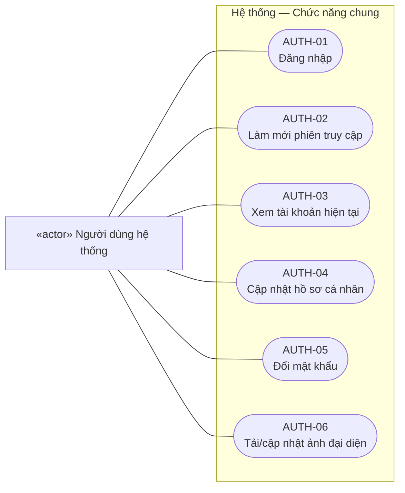
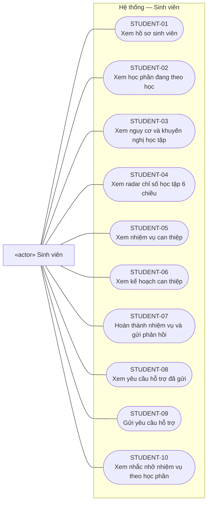
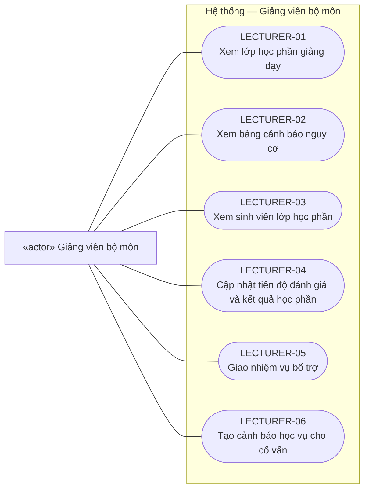
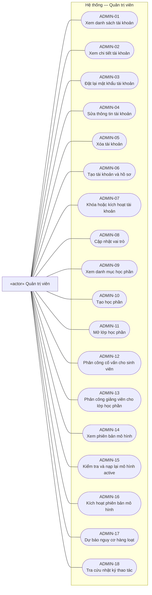
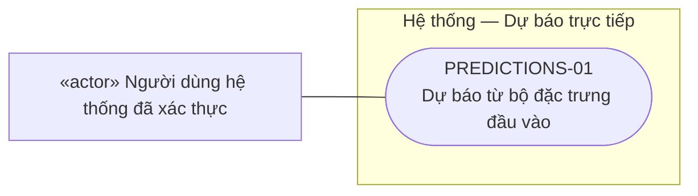
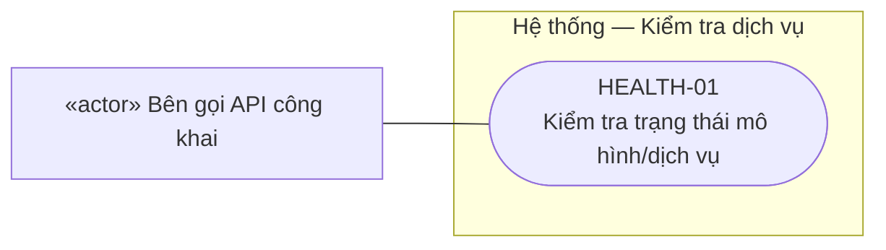

# BIỂU ĐỒ USE CASE HỆ THỐNG

**Hệ thống gợi ý chiến lược học tập cá nhân hóa — KLTN 13, HUIT**
**Ngày đối chiếu:** 19/10/2026 — schema `0002_normalize` và backend hiện tại.

## 1. Phạm vi và quy ước

Biểu đồ được xây dựng từ [backend API](../apps/backend/api/v1/endpoints/), [phân quyền](../apps/backend/core/permissions.py), [repository](../apps/backend/repositories/) và [schema database](../docker/postgres/init-scripts/01_init_schema.sql). Đặc tả dữ liệu liên quan nằm trong [database_design_plan.md](database_design_plan.md).

Use case biểu diễn mục tiêu người dùng thực hiện qua backend hiện tại. Database, mô hình LightGBM và các service nội bộ nằm trong ranh giới hệ thống, không được xem là actor bên ngoài. Bên gọi API công khai trong tài liệu này chỉ kiểm tra trạng thái dịch vụ; dự báo trực tiếp yêu cầu người dùng đã xác thực. Chưa giả định có hệ thống LMS tích hợp.

Bản tổng quan dùng ký pháp UML PlantUML chuẩn (actor, use case, ranh giới hệ thống, kế thừa actor). Các sơ đồ Mermaid bên dưới hiển thị trực tiếp trong trình xem Markdown có hỗ trợ Mermaid, dùng nút dạng bầu dục cho use case và hình chữ nhật cho actor vì Mermaid không có cú pháp use case UML riêng. Đường liền là liên kết actor–use case, không biểu thị thứ tự thao tác.

Đăng nhập hợp lệ là **điều kiện trước** của chức năng được bảo vệ, không phải quan hệ `include` bắt buộc thực hiện lại ở mỗi thao tác. Không dùng `extend` để biểu diễn đơn thuần việc thao tác này xảy ra sau thao tác khác.

Danh mục chi tiết hiện ánh xạ **54 use case/thao tác** với 54 endpoint của bảy module. Đây là quy ước truy vết của tài liệu, không phải quy tắc UML bắt buộc mỗi endpoint tương ứng một mục tiêu người dùng độc lập. AUTH-06 và STUDENT-10 được bổ sung; mã của 52 mục đã có được giữ nguyên. Phân trang, CHECK/UNIQUE, provenance, index và migration được mô tả bằng điều kiện/hậu điều kiện hoặc thiết kế kỹ thuật, không tạo thêm actor hay use case nghiệp vụ.

## 2. Các tác nhân

| Tác nhân | Vai trò và phạm vi |
| :--- | :--- |
| Người dùng hệ thống | Actor tổng quát của bốn vai trò; đăng nhập, xem/sửa hồ sơ, tải ảnh đại diện, đổi mật khẩu và dự báo trực tiếp khi đã xác thực |
| Sinh viên — STUDENT | Theo dõi dữ liệu học tập của bản thân, nguy cơ, radar, kế hoạch/nhiệm vụ, nhắc nhở học phần và gửi yêu cầu hỗ trợ |
| Cố vấn học tập — ADVISOR | Theo dõi lớp/sinh viên được phân công, tư vấn, lập và theo dõi kế hoạch can thiệp |
| Giảng viên bộ môn — LECTURER | Theo dõi lớp học phần, cập nhật tiến độ đánh giá, giao nhiệm vụ bổ trợ và tạo cảnh báo học vụ |
| Quản trị viên — ADMIN | Quản lý tài khoản, đào tạo, phân công, phiên bản mô hình, chạy batch và xem audit |
| Bên gọi API công khai | Kiểm tra trạng thái dịch vụ qua GET /health không cần token; không được dự báo ẩn danh |

ADMIN được `RequireRoles` cho qua kiểm tra vai trò ở các nhóm sinh viên/cố vấn/giảng viên, nhưng portal vẫn kiểm tra hồ sơ và phân công của chính tài khoản. Quyền quản trị toàn hệ thống nằm ở các API /admin. Sơ đồ thể hiện mục tiêu nghiệp vụ chính của từng vai trò, không vẽ ADMIN kế thừa toàn bộ vai trò khác. Đối với dự báo trực tiếp, người dùng thuộc bất kỳ vai trò nào được gọi khi token hợp lệ và tài khoản đang hoạt động; không cần phân công học phần cho payload suy luận thủ công.

## 3. Biểu đồ tổng quan UML

Các use case dưới đây là nhóm mục tiêu tổng quan; thao tác cụ thể và API được phân rã ở mục 4–5. Khối này có thể dựng bằng công cụ PlantUML.

```plantuml
@startuml
left to right direction
skinparam shadowing false
skinparam packageStyle rectangle
actor "Người dùng hệ thống" as User
actor "Sinh viên" as Student
actor "Cố vấn học tập" as Advisor
actor "Giảng viên bộ môn" as Lecturer
actor "Quản trị viên" as Admin
actor "Bên gọi API công khai" as Caller
Student --|> User
Advisor --|> User
Lecturer --|> User
Admin --|> User
rectangle "Hệ thống gợi ý chiến lược học tập cá nhân hóa" {
  usecase "Đăng nhập và quản lý
thông tin cá nhân" as Account
  usecase "Theo dõi học tập, nguy cơ
và khuyến nghị cá nhân" as Learning
  usecase "Theo dõi kế hoạch và
hoàn thành nhiệm vụ" as Tasks
  usecase "Xem nhắc nhở nhiệm vụ
theo học phần" as Reminders
  usecase "Tải ảnh đại diện cá nhân" as Avatar
  usecase "Gửi và theo dõi
yêu cầu hỗ trợ" as Help
  usecase "Theo dõi lớp chủ nhiệm
và phân tích sinh viên" as AdvMonitor
  usecase "Lập, cập nhật kế hoạch
và ghi biên bản tư vấn" as Intervention
  usecase "Xuất báo cáo nguy cơ" as Export
  usecase "Theo dõi lớp học phần
và cập nhật đánh giá" as CourseMonitor
  usecase "Giao nhiệm vụ bổ trợ
và tạo cảnh báo học vụ" as CourseHelp
  usecase "Quản lý tài khoản
và vai trò" as Users
  usecase "Quản lý học phần
và phân công" as Academic
  usecase "Quản lý mô hình và
dự báo hàng loạt" as ML
  usecase "Tra cứu nhật ký thao tác" as Audit
  usecase "Dự báo trực tiếp
từ đặc trưng đầu vào" as Predict
  usecase "Kiểm tra trạng thái dịch vụ" as Health
}
User -- Account
User -- Avatar
User -- Predict
Student -- Learning
Student -- Tasks
Student -- Reminders
Student -- Help
Advisor -- AdvMonitor
Advisor -- Intervention
Advisor -- Export
Lecturer -- CourseMonitor
Lecturer -- CourseHelp
Admin -- Users
Admin -- Academic
Admin -- ML
Admin -- Audit
Caller -- Health
@enduml
```

## 4. Biểu đồ chi tiết theo tác nhân

### 4.1. Chức năng chung



### 4.2. Sinh viên



### 4.3. Cố vấn học tập


### 4.4. Giảng viên bộ môn



### 4.5. Quản trị viên



### 4.6. Dự báo trực tiếp

Actor là người dùng hệ thống đã xác thực; bốn vai trò kế thừa khả năng này. Nhập 17 đặc trưng thủ công không tự cấp quyền đọc/ghi dữ liệu sinh viên trong database.



### 4.7. Kiểm tra dịch vụ

Đây là mục tiêu vận hành của bên gọi API công khai. Health kiểm tra model active qua database/registry và có thể trả 503; không chỉ kiểm tra một biến mô hình trong RAM.



## 5. Đối chiếu use case với API và database

Mọi đường dẫn bên dưới có tiền tố `/api/v1`. GET /student/tasks và /student/help-requests nhận query enrollment_id để lọc môn; form trợ giúp, hoàn thành task và lập kế hoạch cũng có enrollment_id tùy chọn trong payload. Khi sinh viên có nhiều enrollment, lập kế hoạch phải chỉ rõ môn; cảnh báo của giảng viên bắt buộc có presentation_id. Cột dữ liệu mô tả dữ liệu chính được dùng, không phải danh sách SQL đầy đủ.

Danh mục gồm **54 mục**: 6 AUTH, 10 STUDENT, 12 ADVISOR, 6 LECTURER, 18 ADMIN, 1 PREDICTIONS và 1 HEALTH; đối chiếu 54 endpoint, không tính endpoint `/`, static media và trang tài liệu API. Bảng phiên bản Alembic và việc thêm cột AP không tự làm tăng số use case.

### Chức năng chung

| Mã | Use case | API | Dữ liệu chính |
| :--- | :--- | :--- | :--- |
| AUTH-01 | Đăng nhập | `POST /auth/login` | users, roles, user_roles, student_profiles |
| AUTH-02 | Làm mới phiên truy cập | `POST /auth/refresh` | users; JWT, không có bảng phiên |
| AUTH-03 | Xem tài khoản hiện tại | `GET /auth/me` | users, roles, user_roles và hồ sơ |
| AUTH-04 | Cập nhật hồ sơ cá nhân | `PUT /auth/profile` | users |
| AUTH-05 | Đổi mật khẩu | `PUT /auth/change-password` | users.hashed_password |
| AUTH-06 | Tải/cập nhật ảnh đại diện | `POST /auth/profile/avatar` | users.avatar_url; file ảnh lưu ngoài database |

### Sinh viên

| Mã | Use case | API | Dữ liệu chính |
| :--- | :--- | :--- | :--- |
| STUDENT-01 | Xem hồ sơ sinh viên | `GET /student/profile` | users, student_profiles, student_enrollments |
| STUDENT-02 | Xem học phần đang theo học | `GET /student/courses` | student_enrollments, course_presentations, courses, snapshots, prediction_runs |
| STUDENT-03 | Xem nguy cơ và khuyến nghị học tập | `GET /student/courses/{enrollment_id}/risk-prediction` | enrollments, snapshots, prediction_runs, ml_models |
| STUDENT-04 | Xem radar chỉ số học tập 6 chiều | `GET /student/courses/{enrollment_id}/radar` | enrollments, courses, snapshots; radar tính bởi service |
| STUDENT-05 | Xem nhiệm vụ can thiệp | `GET /student/tasks` | intervention_plans, intervention_tasks |
| STUDENT-06 | Xem kế hoạch can thiệp | `GET /student/intervention-plans` | intervention_plans, intervention_tasks |
| STUDENT-07 | Hoàn thành nhiệm vụ và gửi phản hồi | `PATCH /student/tasks/{task_id}/complete` | intervention_tasks, intervention_plans |
| STUDENT-08 | Xem yêu cầu hỗ trợ đã gửi | `GET /student/help-requests` | student_help_requests |
| STUDENT-09 | Gửi yêu cầu hỗ trợ | `POST /student/help-requests` | student_help_requests |
| STUDENT-10 | Xem nhắc nhở nhiệm vụ theo học phần | `GET /student/reminders` | plans/tasks → prediction_runs → snapshots → enrollments → presentations/courses; nhắc nhở tính khi đọc |

### Cố vấn học tập

| Mã | Use case | API | Dữ liệu chính |
| :--- | :--- | :--- | :--- |
| ADVISOR-01 | Xem lớp sinh hoạt phụ trách | `GET /advisor/classes` | advisor_profiles, advisor_students |
| ADVISOR-02 | Xem sinh viên được phân công | `GET /advisor/students` | advisor_students, student_profiles, users, enrollments, snapshots, prediction_runs, plans/tasks |
| ADVISOR-03 | Lập kế hoạch can thiệp | `POST /advisor/interventions` | prediction_runs, snapshots, enrollments, intervention_plans, intervention_tasks |
| ADVISOR-04 | Ghi biên bản tư vấn | `POST /advisor/advising-notes` | advisor_profiles, advising_notes |
| ADVISOR-05 | Xem thống kê nguy cơ của lớp | `GET /advisor/classes/{class_name}/statistics` | advisor_students, profiles, enrollments, snapshots, prediction_runs |
| ADVISOR-06 | Xem tổng quan sinh viên | `GET /advisor/students/{student_id}/overview` | advisor_students, profiles, users, enrollments, snapshots, prediction_runs, plans/tasks |
| ADVISOR-07 | Xem radar sinh viên | `GET /advisor/students/{student_id}/radar` | advisor_students, enrollments, courses, snapshots |
| ADVISOR-08 | Xem kế hoạch can thiệp của lớp | `GET /advisor/interventions` | advisor_students, intervention_plans, intervention_tasks |
| ADVISOR-09 | Cập nhật kế hoạch can thiệp | `PUT /advisor/interventions/{plan_id}` | advisor_students, intervention_plans |
| ADVISOR-10 | Bổ sung nhiệm vụ can thiệp | `POST /advisor/interventions/{plan_id}/tasks` | advisor_students, intervention_plans, intervention_tasks |
| ADVISOR-11 | Xem lịch sử tư vấn | `GET /advisor/students/{student_id}/notes` | advisor_students, advising_notes |
| ADVISOR-12 | Xuất báo cáo nguy cơ Excel | `GET /advisor/export/risk-report` | advisor_students, users, student_profiles, snapshots, prediction_runs, plans/tasks; workbook tạo trong bộ nhớ |

### Giảng viên bộ môn

| Mã | Use case | API | Dữ liệu chính |
| :--- | :--- | :--- | :--- |
| LECTURER-01 | Xem lớp học phần giảng dạy | `GET /lecturer/courses` | lecturer_profiles, course_lecturers, courses, presentations |
| LECTURER-02 | Xem bảng cảnh báo nguy cơ | `GET /lecturer/courses/{presentation_id}/risk-board` | course_lecturers, enrollments, profiles, users, snapshots, prediction_runs |
| LECTURER-03 | Xem sinh viên lớp học phần | `GET /lecturer/courses/{presentation_id}/students` | course_lecturers, enrollments, profiles, users, snapshots |
| LECTURER-04 | Cập nhật tiến độ đánh giá và kết quả học phần | `PUT /lecturer/courses/{presentation_id}/students/{student_id}/assessment` | course_lecturers, student_enrollments, student_feature_snapshots |
| LECTURER-05 | Giao nhiệm vụ bổ trợ | `POST /lecturer/courses/{presentation_id}/tasks` | intervention_plans, intervention_tasks |
| LECTURER-06 | Tạo cảnh báo học vụ cho cố vấn | `POST /lecturer/students/{student_id}/alert-advisor` | student_help_requests |

### Quản trị viên

| Mã | Use case | API | Dữ liệu chính |
| :--- | :--- | :--- | :--- |
| ADMIN-01 | Xem danh sách tài khoản | `GET /admin/users` | users, roles, user_roles, hồ sơ |
| ADMIN-02 | Xem chi tiết tài khoản | `GET /admin/users/{user_id}` | users, roles, user_roles, hồ sơ |
| ADMIN-03 | Đặt lại mật khẩu tài khoản | `PUT /admin/users/{user_id}/reset-password` | users, audit_logs |
| ADMIN-04 | Sửa thông tin tài khoản | `PUT /admin/users/{user_id}` | users, hồ sơ, audit_logs |
| ADMIN-05 | Xóa tài khoản | `DELETE /admin/users/{user_id}` | users, user_roles, audit_logs; dữ liệu liên kết được bảo vệ bằng FK RESTRICT |
| ADMIN-06 | Tạo tài khoản và hồ sơ | `POST /admin/users` | users, user_roles, hồ sơ, audit_logs |
| ADMIN-07 | Khóa hoặc kích hoạt tài khoản | `PUT /admin/users/{user_id}/status` | users, audit_logs |
| ADMIN-08 | Cập nhật vai trò | `POST /admin/users/{user_id}/roles` | user_roles, roles, audit_logs |
| ADMIN-09 | Xem danh mục học phần | `GET /admin/academic/courses` | courses |
| ADMIN-10 | Tạo học phần | `POST /admin/academic/courses` | courses |
| ADMIN-11 | Mở lớp học phần | `POST /admin/academic/presentations` | course_presentations |
| ADMIN-12 | Phân công cố vấn cho sinh viên | `POST /admin/academic/assign-advisor` | advisor_students |
| ADMIN-13 | Phân công giảng viên cho lớp học phần | `POST /admin/academic/assign-lecturer` | course_lecturers |
| ADMIN-14 | Xem phiên bản mô hình | `GET /admin/ml/models` | ml_models; accuracy, average_precision và roc_auc là các trường riêng |
| ADMIN-15 | Kiểm tra và nạp lại mô hình active | `POST /admin/ml/reload` | ml_models active, registry/artifact/runtime đã xác minh, audit_logs |
| ADMIN-16 | Kích hoạt phiên bản mô hình | `POST /admin/ml/models/activate` | ml_models, artifact/metadata được kiểm tra, registry và audit_logs |
| ADMIN-17 | Dự báo nguy cơ hàng loạt | `POST /admin/ml/batch-predict` | snapshots, ml_models, prediction_runs, audit_logs |
| ADMIN-18 | Tra cứu nhật ký thao tác | `GET /admin/system/audit-logs` | audit_logs, users |

### Dự báo trực tiếp

| Mã | Use case | API | Dữ liệu chính |
| :--- | :--- | :--- | :--- |
| PREDICTIONS-01 | Dự báo từ bộ đặc trưng đầu vào | `POST /predictions/` | xác thực users; ml_models active, artifact/cache registry; trả provenance, không ghi prediction_runs |

### Kiểm tra dịch vụ

| Mã | Use case | API | Dữ liệu chính |
| :--- | :--- | :--- | :--- |
| HEALTH-01 | Kiểm tra trạng thái mô hình/dịch vụ | `GET /health` | ml_models active và artifact/registry; trả 200 hoặc 503, không cần token |

## 6. Điều kiện và giới hạn triển khai

### 6.1. Điều kiện trước, kết quả và luồng ngoại lệ

| Use case | Điều kiện / hành vi đã đối chiếu |
| :--- | :--- |
| Đăng nhập | Tài khoản hoạt động; dùng email hoặc mã sinh viên và mật khẩu; mã sinh viên phải gắn vai trò STUDENT |
| Làm mới phiên — AUTH-02 | Refresh token hợp lệ và tài khoản đang hoạt động; frontend refresh một lần khi access token hết hạn, không coi lỗi mạng/5xx là lý do tự xóa phiên. Chuyển tài khoản/đăng xuất ngăn request cũ khôi phục phiên |
| Tải ảnh đại diện — AUTH-06 | Người dùng đã xác thực; nhận ảnh JPG/PNG/WebP hợp lệ, tối đa 5 MiB và 20 triệu pixel; chuẩn hóa JPEG 512×512, lưu file và cập nhật users.avatar_url. 413 khi quá dung lượng, 415 khi sai định dạng, 422 khi ảnh rỗng/hỏng/quá giới hạn pixel |
| Xem nguy cơ cá nhân — STUDENT-03 | Đọc dự báo mới nhất của snapshot hiện hành trong enrollment thuộc sinh viên, không tự suy luận. Thiếu snapshot/dự báo trả xác suất null và NOT_PREDICTED; truy cập enrollment không thuộc quyền bị từ chối |
| Xem thống kê/tổng quan/báo cáo | Tách dữ liệu chưa dự báo khỏi SAFE; sinh viên có môn nguy cơ cao được cảnh báo, chỉ SAFE khi tất cả môn có kết quả hiện hành và đều nhãn 0. Nhãn dùng prediction_label đã lưu, không phân loại lại bằng ngưỡng cứng 0.5 |
| Lập kế hoạch — ADVISOR-03 | Chọn enrollment của sinh viên thuộc phân công. Lấy dự báo của snapshot mới nhất; snapshot mới chưa dự báo thì từ chối dùng kết quả cũ để tạo plan mới. Nếu không chỉ rõ enrollment, chỉ tự chọn khi sinh viên có đúng một đăng ký |
| Ghi biên bản — ADVISOR-04 | enrollment tồn tại và sinh viên thuộc phân công cố vấn; chỉ tạo sau khi kiểm tra thành công. Enrollment không tồn tại trả 404, ngoài phân công trả 403 |
| Giao nhiệm vụ bổ trợ | Giảng viên được phân công presentation; sinh viên có plan ACTIVE liên kết đúng presentation; API thêm task vào plan này |
| Hoàn thành nhiệm vụ | Task thuộc kế hoạch của sinh viên; ghi is_completed, completed_at và student_feedback tùy chọn; chưa tự hoàn tất kế hoạch |
| Nhắc nhở — STUDENT-10 | Người dùng STUDENT hoặc ADMIN phải có hồ sơ sinh viên của chính mình; chỉ tính nhiệm vụ chưa hoàn thành trong plan ACTIVE và đúng enrollment. Phân nhóm quá hạn/sắp đến hạn/còn việc; không có việc phù hợp hoặc thiếu hồ sơ thì danh sách rỗng |
| Cập nhật đánh giá — LECTURER-04 | Kiểm tra phân công môn và sinh viên thuộc môn. Thay đổi chỉ số tạo snapshot mới, sao chép chỉ số không đổi và ghi nguồn/người cập nhật/snapshot trước; không sửa snapshot cũ. Thiếu snapshot nền khi sửa chỉ số trả 409. Chỉ sửa final_result thì không tạo snapshot; chưa có bảng điểm từng bài |
| Cảnh báo học vụ — LECTURER-06 | Bắt buộc presentation_id; kiểm tra hồ sơ, phân công giảng dạy và sinh viên thuộc học phần trước khi tạo yêu cầu gửi cố vấn hợp lệ. Chưa có gửi email/push ra ngoài |
| Gửi yêu cầu trợ giúp — STUDENT-09 | target_role là ADVISOR/LECTURER. Service xác minh người nhận đang hoạt động, có vai trò và phân công phù hợp; yêu cầu tới giảng viên cần học phần hợp lệ. Không chỉ định và chưa có người phụ trách thì giữ chưa gán, không chọn tài khoản bất kỳ |
| Xóa tài khoản — ADMIN-05 | Không được xóa chính tài khoản đang dùng. Nếu hồ sơ/dữ liệu liên kết bị FK RESTRICT bảo vệ thì rollback, trả 409 và hướng dẫn khóa tài khoản bằng ADMIN-07. Chỉ xóa khi các ràng buộc cho phép; không xóa dây chuyền lịch sử học tập |
| Nạp lại model — ADMIN-15 | Lấy model active từ database, kiểm tra và nạp artifact tương ứng; cập nhật runtime/provenance và audit trong transaction. Lỗi rollback, không quay về MODEL_PATH hoặc model mặc định trong RAM |
| Kích hoạt model — ADMIN-16 | Chuẩn bị artifact, đối chiếu metadata/schema/thứ tự đặc trưng/checksum/threshold/cutoff/positive label và chạy thử trước khi chuyển active trong transaction có lock. Lỗi giữ trạng thái cũ; các worker nhận danh tính model mới ở request tiếp theo, không cần người dùng gọi reload riêng để hoàn tất activate |
| Dự báo batch — ADMIN-17 | Có đúng một model active hợp lệ; xử lý snapshot mới nhất ở CUTOFF_75 hoặc enrollment_id chỉ định. Lưu 17 đầu vào thực tế, danh tính model/threshold/SHA-256 trong inference_context và audit cùng transaction. Lỗi không lưu lô dở dang/fallback; không tự lập plan/task |
| Dự báo trực tiếp — PREDICTIONS-01 | Token truy cập hợp lệ, tài khoản hoạt động, model active qua registry và 17 đầu vào hợp lệ. Trả prediction, confidence (xác suất lớp nguy cơ 1) và provenance; không tạo prediction_run/enrollment/snapshot hoặc plan. Anonymous, refresh token dùng sai mục đích và tài khoản khóa không được suy luận |
| Kiểm tra dịch vụ — HEALTH-01 | Không cần token; truy vấn registry/model active và kiểm tra artifact. 200 khi sử dụng được; 503 khi DB/model/artifact không đáp ứng, không chỉ dựa vào việc RAM còn một model |
| Xuất báo cáo — ADVISOR-12 | Lấy đủ sinh viên theo cố vấn/lớp, tạo .xlsx trong bộ nhớ; chưa dự báo thì ô xác suất trống, ghi trạng thái và số môn chưa dự báo. Không lưu báo cáo thành bảng DB |

### 6.2. Đặc tả hai use case bổ sung

**AUTH-06 — Tải/cập nhật ảnh đại diện**

- **Actor:** người dùng hệ thống; cần token và tài khoản hoạt động, không yêu cầu vai trò chuyên biệt.
- **Mục tiêu:** thay ảnh đại diện cá nhân bằng tệp ảnh tải lên.
- **Luồng chính:** chọn tệp → frontend gửi multipart tới POST /auth/profile/avatar → backend kiểm tra và chuẩn hóa ảnh → lưu file mới → cập nhật URL trong users và commit → trả hồ sơ đã cập nhật. File ảnh cũ do chính người dùng sở hữu được dọn sau khi lưu thành công.
- **Hậu điều kiện:** hồ sơ trỏ tới ảnh mới; byte ảnh nằm ngoài DB. Nếu ghi file/DB thất bại thì rollback và dọn file mới khi có thể, tránh cập nhật hồ sơ dở dang.
- **Quan hệ UML:** có thể nhóm dưới mục tiêu quản lý thông tin cá nhân; không bắt buộc mọi lần sửa hồ sơ đều tải ảnh nên không gán include tùy tiện. Mã AUTH-06 được giữ riêng trong danh mục để truy vết endpoint.

**STUDENT-10 — Xem nhắc nhở nhiệm vụ theo học phần**

- **Actor:** sinh viên, trong phạm vi dữ liệu cá nhân.
- **Mục tiêu:** biết môn nào còn nhiệm vụ, hạn kế hoạch gần nhất và mức độ cần chú ý.
- **Luồng chính:** mở khu vực nhắc nhở → gọi GET /student/reminders → truy task chưa hoàn thành của plan ACTIVE theo chuỗi prediction/snapshot/enrollment thuộc sinh viên → gom theo enrollment → lấy hạn gần nhất nếu có → trả số việc và trạng thái.
- **Quy tắc:** quá hạn khi còn số ngày âm; sắp đến hạn khi từ 0 đến 3 ngày; còn việc khi chưa đến khoảng sắp hạn hoặc không có hạn. Ngày hiện tại dùng múi giờ UTC+7 trong service.
- **Hậu điều kiện:** chỉ trả dữ liệu nhắc nhở được tính tại lúc đọc; không tạo bảng notification, không tự hoàn thành task và không gửi email/push. Không có nhiệm vụ phù hợp thì trả danh sách rỗng.

### 6.3. Phạm vi, giới hạn và quy tắc mô hình hóa

Những điểm cần phân biệt khi dùng sơ đồ trong báo cáo:

- Bảng `student_help_requests` có status/response_note nhưng backend hiện chưa có API cho cố vấn/giảng viên nhận danh sách, trả lời hoặc giải quyết yêu cầu. Không vẽ use case “Xử lý yêu cầu hỗ trợ” như chức năng đã triển khai.
- “Tạo cảnh báo học vụ” tạo yêu cầu hỗ trợ ADVISOR gắn presentation_id được chọn và user cố vấn theo phân công; chưa có cơ chế gửi email/thông báo bên ngoài.
- Ghi tư vấn, tạo kế hoạch, giao task và cảnh báo đều có kiểm tra quyền theo hồ sơ/phân công. Không còn coi ghi tư vấn ngoài phạm vi hoặc cảnh báo giảng viên không chọn môn là hành vi hợp lệ.
- Batch lấy đủ đặc trưng từ DB, dùng artifact của mô hình active và đo thời gian. Lỗi suy luận không lưu fallback; kết quả trên snapshot synthetic_demo được ghi rõ là dữ liệu minh họa.
- Chưa có API tự đăng ký tài khoản, đăng ký học phần, import LMS, huấn luyện mô hình, tải lên artifact, quản lý điểm từng bài hoặc thu hồi phiên đăng nhập. Không suy ra các use case này chỉ từ việc database có bảng liên quan.
- Đăng xuất phía giao diện không có endpoint backend riêng; refresh token là JWT, chưa có bảng quản lý phiên trong schema hiện tại.
- Lịch sử dự báo thủ công phía trình duyệt được tách theo UUID tài khoản và API server; đây là hành vi giao diện trong luồng dự báo, không phải API tra cứu prediction_runs. Replay lịch sử bằng script là công cụ vận hành, chưa được vẽ thành chức năng portal.
- Radar hiển thị sáu chỉ số học tập theo benchmark trong service; tên đã được làm rõ để không mặc định coi đây là phép đo năng lực đã được kiểm chứng. Quy tắc khuyến nghị và hiệu quả can thiệp còn cần đánh giá học thuật riêng.
- Phân trang limit/offset, index, CHECK/UNIQUE, Alembic và sao lưu là chi tiết thiết kế/ràng buộc kỹ thuật trong phạm vi tài liệu này. Không thêm actor Database, LightGBM hay Alembic; không tự tạo use case migration cho ADMIN portal khi chưa có giao diện/API.
- Không nối include/extend giữa activate và reload chỉ vì cùng xử lý artifact; không nối dự báo với tạo kế hoạch như bước tự động bắt buộc. Điều kiện và luồng ngoại lệ tại mục 6.1 giải thích quan hệ nghiệp vụ thực tế.

### 6.4. Tóm tắt đối chiếu bản 14/10 với bản cập nhật 19/10

| Nhóm thay đổi | Cập nhật trong tài liệu |
| --- | --- |
| Actor và bảo vệ API | Dự báo trực tiếp chuyển từ Caller công khai sang User đã xác thực; Caller chỉ nối Health. Giữ bốn vai trò nghiệp vụ và giới hạn ADMIN portal |
| Chức năng còn thiếu | Thêm AUTH-06 và STUDENT-10 vào sơ đồ tổng quan/chi tiết, bảng API và đặc tả |
| Hành vi đã thay đổi | Cập nhật RESTRICT khi xóa tài khoản, tạo snapshot mới, lập plan theo snapshot hiện hành, quyền ghi tư vấn/cảnh báo và model registry dùng chung |
| Dữ liệu trả về | Làm rõ NOT_PREDICTED, provenance, metric AP khác ROC-AUC và health kiểm tra database/registry |
| Phạm vi thống kê | 54 mục chi tiết đối chiếu 54 endpoint; không đổi mã của 52 mục cũ và không khẳng định đây là số mục tiêu UML bắt buộc |
| Cơ sở đối chiếu | Đọc mã/schema hiện tại và bằng chứng ngày 18–19/10; lần cập nhật tài liệu không chạy lại toàn bộ kiểm thử hệ thống |

## 7. Nguồn mã để truy vết

- [auth.py](../apps/backend/api/v1/endpoints/auth.py), [avatar_service.py](../apps/backend/services/avatar_service.py): tài khoản cá nhân, JWT và ảnh đại diện.
- [student.py](../apps/backend/api/v1/endpoints/student.py), [reminder_service.py](../apps/backend/services/reminder_service.py): học tập cá nhân, kế hoạch/nhiệm vụ, nhắc nhở và yêu cầu hỗ trợ.
- [advisor.py](../apps/backend/api/v1/endpoints/advisor.py): lớp chủ nhiệm, phân tích, tư vấn, can thiệp, báo cáo.
- [lecturer.py](../apps/backend/api/v1/endpoints/lecturer.py): lớp học phần, tiến độ đánh giá, nhiệm vụ bổ trợ, cảnh báo.
- [admin.py](../apps/backend/api/v1/endpoints/admin.py): tài khoản, đào tạo, phân công, mô hình, batch, audit.
- [predictions.py](../apps/backend/api/v1/endpoints/predictions.py), [health.py](../apps/backend/api/v1/endpoints/health.py): dự báo trực tiếp và trạng thái dịch vụ.
- [router.py](../apps/backend/api/router.py), [main.py](../apps/backend/main.py): tiền tố đường dẫn và khởi động mô hình.
- [academic_repo.py](../apps/backend/repositories/academic_repo.py), [student_repo.py](../apps/backend/repositories/student_repo.py): truy vấn theo phân công/quyền sở hữu và cập nhật dữ liệu.
- [model_registry.py](../apps/backend/services/model_registry.py), [prediction_service.py](../apps/backend/services/prediction_service.py), [risk_service.py](../apps/backend/services/risk_service.py): chọn model, provenance và snapshot/dự báo hiện hành.
- [help_request_service.py](../apps/backend/services/help_request_service.py): kiểm tra người nhận theo vai trò, trạng thái và phân công.
- [Báo cáo 18/10](../reports/dailys/18-10-2026.md), [báo cáo 19/10](../reports/dailys/19-10-2026.md): bằng chứng triển khai/kiểm thử và giới hạn còn lại.
