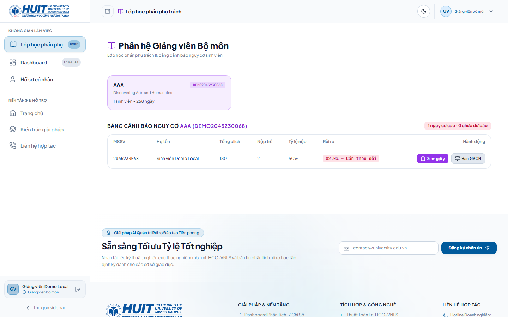
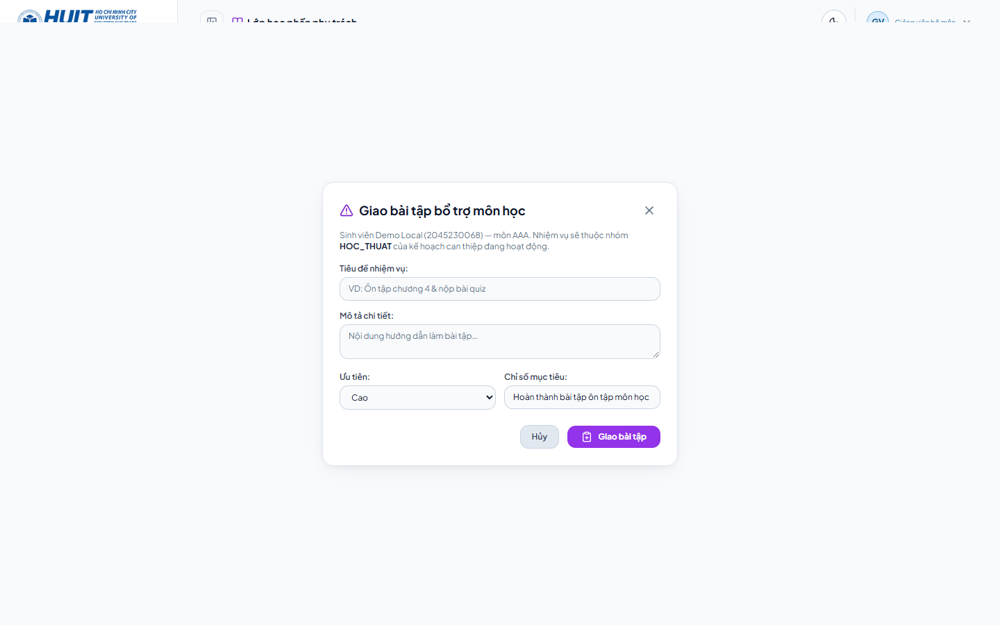
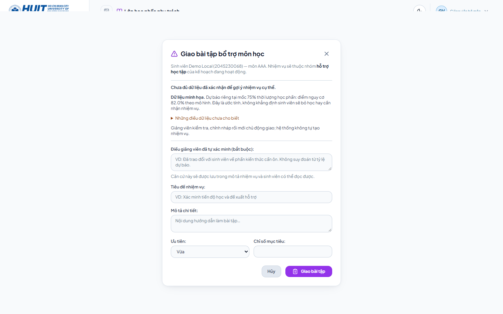
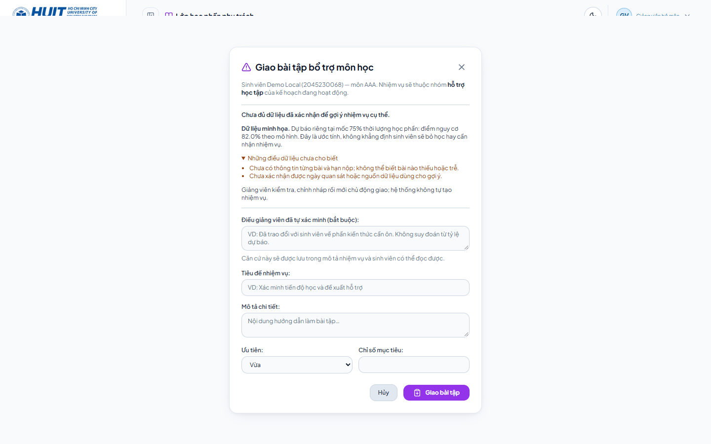
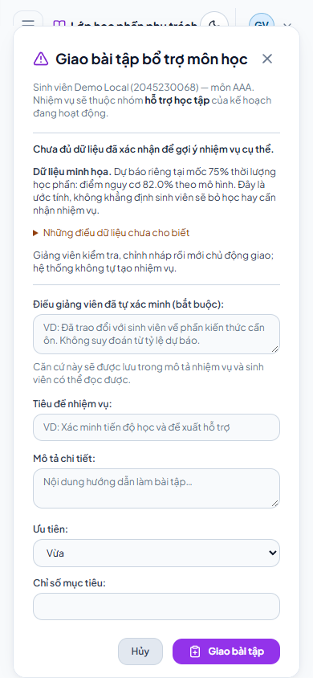
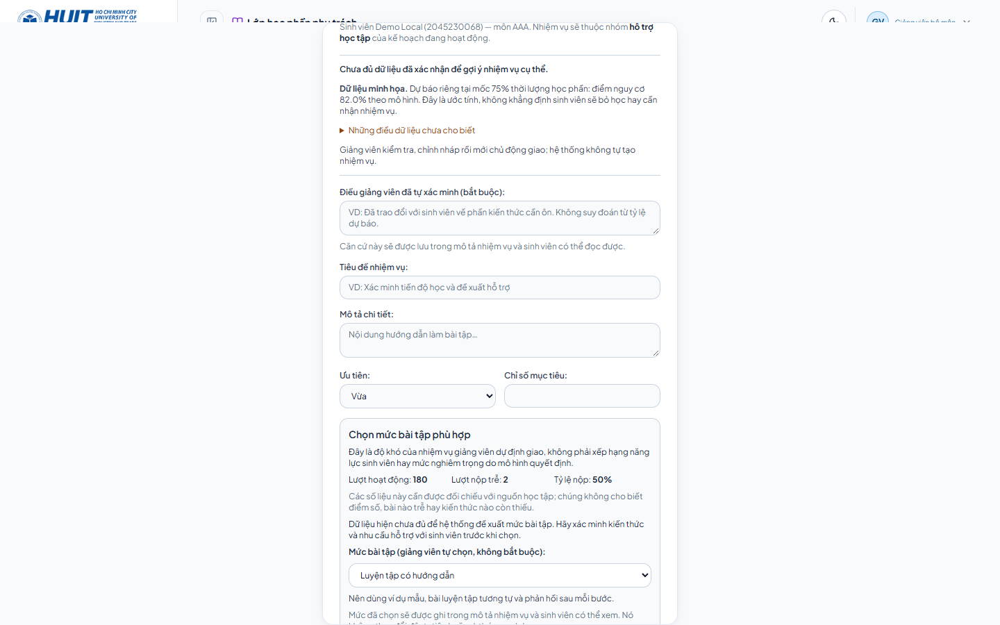
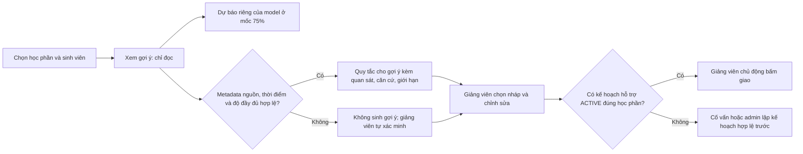

# Bàn giao tích hợp giao diện Nguyên và gợi ý giảng viên

> Nhánh `nguyengiabao`; giao diện nền từ `phantrongnguyen` tại `d180a07`. Ảnh chụp ngày 20/10/2026 trên dữ liệu **demo local**, không phải đo lường chất lượng mô hình hay dữ liệu LMS đã xác minh.

## Xem nhanh luồng trước và sau

| Bước | Giao diện gốc của Nguyên | Bản tích hợp |
| --- | --- | --- |
| 1. Bảng nguy cơ học phần |  |  |
| 2. Mở nhiệm vụ cho sinh viên |  |  |
| 3. Xem điều chưa biết | Chưa có bước riêng |  |
| 4. Màn hình nhỏ | Không chụp trong lần đối chiếu này |  |
| 5. Đối chiếu và chọn mức bài | Chưa có bước riêng |  |

**Giữ lại:** bố cục, bảng chọn lớp, bảng sinh viên và form soạn/giao bài của Nguyên. **Thêm:** nút xem gợi ý, phân biệt dự báo với căn cứ, giải thích dữ liệu thiếu bằng tiếng Việt, chọn gợi ý vào *nháp* rồi chỉnh sửa. Ở demo này API trả `insufficient_data`, nên không có gợi ý tự động; ảnh sau chỉ cho thấy thông báo thiếu dữ liệu và trường ghi điều giảng viên đã tự xác minh. Không chụp hay khẳng định luồng giao thành công bằng dữ liệu chưa xác minh.

## Xem chi tiết và chọn mức bài tập

Bản tích hợp có nút **Xem chi tiết** giữa **Hủy** và **Giao bài tập** trong form của Nguyên. Nút mở số liệu tổng hợp cần đối chiếu và cho giảng viên **tự chọn độ khó của nhiệm vụ**: củng cố nền tảng, luyện tập có hướng dẫn, vận dụng mở rộng hoặc chưa xác định. Đây không phải nhãn năng lực hay mức độ nghiêm trọng của sinh viên; model không tự gán mức. Dữ liệu chưa đủ thì phải xác minh trước khi giao. Mức đã chọn được ghi vào mô tả nhiệm vụ mà sinh viên đọc được, không đổi `priority` hoặc xác suất dự báo; không thêm cột database/API mới. Nếu sau này cần thống kê mức bài tập, phải thiết kế một trường có cấu trúc và migration riêng, không phân tích chuỗi mô tả.

## Điều kiện và ý nghĩa

- Tỷ lệ trên bảng là xác suất dự báo nhóm nguy cơ theo mô hình/ngưỡng, **không phải** mức độ nghiêm trọng, nguyên nhân cụ thể, hay quyết định giao nhiệm vụ. Bản demo có tỷ lệ 82% **giả lập**; không dùng để báo cáo hiệu quả LightGBM.
- API không suy ra bài nào thiếu, hạn nộp hay nguyên nhân từ các số tổng hợp. Quy tắc chỉ hoạt động khi `support_evidence` có nguồn, mốc 75%, thời điểm xác nhận có múi giờ và cờ đầy đủ phù hợp; không tự đặt cờ để ép có gợi ý.
- Khi chưa chọn gợi ý hoặc chưa có gợi ý, form bắt buộc ghi căn cứ đã **tự xác minh**; nội dung này đi vào mô tả nhiệm vụ, **sinh viên có thể đọc**. Giảng viên kiểm tra thông tin trước khi nhập, không ghi nhận định nhạy cảm hoặc chưa xác minh. Đây là kiểm tra ở UI, backend không thể chứng thực sự thật của nội dung tự khai. Quyền giao nhiệm vụ vẫn cần plan `ACTIVE` gắn đúng sinh viên và học phần.
- Tất cả gợi ý là tham khảo; nút chọn chỉ điền nháp. GET gợi ý không ghi dự báo, plan hay task. Không tự động tạo/giao nhiệm vụ.

## Thay đổi backend cần báo cho Nguyên

- `GET /api/v1/lecturer/courses/{presentation_id}/students/{student_id}/suggestions`: chỉ tài khoản giảng viên được phân công học phần, sinh viên phải thuộc học phần; trả trạng thái `available`, `abstained` hoặc `insufficient_data`, dự báo riêng, gợi ý kèm căn cứ và điều kiện có thể giao.
- `services/support_suggestions.py`: quy tắc dựa trên bằng chứng đã xác nhận, không đổi xác suất model thành mức độ nghiêm trọng hoặc suy đoán chi tiết bài tập. `repositories/academic_repo.py`: bảng nguy cơ dùng `null` thay vì số 0 khi không có snapshot; schema/type frontend cũng chấp nhận `null`.
- `apps/frontend/src/services/api.ts` dùng luồng xác thực và làm mới phiên của Nguyên. Bản merge cũng mang các thay đổi khác từ nhánh Nguyên: registry model, migration database, phân quyền, frontend session và nghiên cứu. Xem README gốc và `apps/backend/README.md` để triển khai/migrate; **không chạy migration vào database thật trước khi backup và đối chiếu**.
- Các thư mục nghiên cứu cũ `clht_code`, `code_dung_chung`, `ket_qua` và bản mới `research_code`, `shared_code`, `results` hiện **khác nội dung**; chưa xóa hay gộp tự động vì có nguy cơ mất kết quả. `notebooks/` và `outputs/` ngoài Git không được đụng tới.

## Kiểm thử và tiếp nhận

- Mở `http://127.0.0.1:5173/#lecturer`, đăng nhập tài khoản giảng viên demo local đã có. Theo `docs/local-role-testing.md` để thiết lập dữ liệu demo; không dùng nó làm dữ liệu thực.
- Kiểm tra bước 1: chọn lớp; người chưa có dự báo hiện `Chưa dự báo`, các chỉ số thiếu hiện dấu `—`. Bước 2: nhấn **Xem gợi ý**, đọc căn cứ/giới hạn. Bước 3: nhấn **Xem chi tiết** giữa **Hủy** và **Giao bài tập**, đối chiếu số liệu, chọn mức bài nếu đã có căn cứ. Nếu dữ liệu chưa đủ, nhập căn cứ tự xác minh, soạn/chỉnh nháp rồi mới bấm giao khi có plan đúng học phần. Không bấm giao trên dữ liệu giả nếu không muốn tạo task demo.
- Backend độc lập: `python -m pytest -q apps/backend/tests/test_support_suggestions.py`; PostgreSQL riêng: `python scripts/run_backend_tests.py -q -k 'CourseScopeTests or DatabaseContract'`. Runner tạo database `_test`, kiểm tra rollback; không thử trên database ứng dụng. Frontend: `npm run build --prefix apps/frontend` và `npm test --prefix apps/frontend`.
- Biểu đồ đánh giá model đã chốt ở `reports/model_final/figures/` (ma trận nhầm lẫn, ROC/PR, hiệu chuẩn, độ nhạy ngưỡng, so sánh validation, ablation). Đây là minh chứng *nghiên cứu* tách với ảnh luồng demo; README này không suy diễn độ tin cậy cá nhân từ các biểu đồ.
