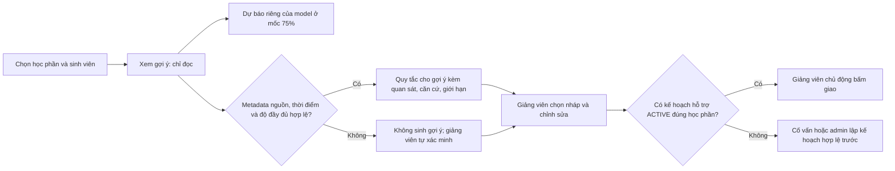

# Bàn giao app và gợi ý giảng viên — kết quả rà soát 20/10/2026

> Đây là đầu mối bàn giao của nhánh `nguyengiabao`. Mã nguồn được kiểm tra tại `7b5e785`; nhánh từ xa của Nguyên được fetch và đối chiếu tại `c7fa451`. **Các vấn đề trong lần rà đã được sửa và kiểm thử theo phạm vi nêu dưới đây; chưa chốt sẵn sàng dùng thực tế.** Các thay đổi sau `7b5e785` được bàn giao cùng tài liệu này trên nhánh `nguyengiabao`. Không đổi model, không tự merge nhánh và không tạo nhiệm vụ trên database app.

## 1. Kết luận đối chiếu với Nguyên

- Trước lần sửa này, frontend chỉ khác ba tệp: `SuggestionReview.tsx`, `LecturerPage.tsx` và `AppContext.tsx`. Lần này có thêm chỉnh **nội dung** `Footer.tsx` và `ContactPage.tsx` để bỏ tuyên bố chưa xác minh; không đổi layout, theme hoặc các trang sinh viên/cố vấn/quản trị. Đây là đối chiếu mã nguồn, không phải xác nhận mọi trang đã được bấm thử lại.
- Phần bổ sung tập trung vào luồng giảng viên: đọc dấu hiệu, xem căn cứ từng bài, đối chiếu giới hạn, chọn nháp và tự chọn mức bài tập. Không thay mô hình LightGBM đã chốt, không tự phân loại mức nghiêm trọng và không tự giao nhiệm vụ.
- Backend khác ở endpoint gợi ý, bộ quy tắc/kiểm tra metadata, test và tài liệu. Shared type thêm nguồn lịch sử, ngày tương đối và chi tiết bài. `AppContext` thêm mặc định API từ `VITE_API_BASE_URL`; giá trị đã lưu trong trình duyệt vẫn được ưu tiên.
- Hai nhánh không đồng nhất lịch sử: Nguyên có cập nhật tài liệu và đã xóa bản hướng dẫn/ảnh bàn giao cũ trên nhánh của mình. Không lấy việc giữ các tài liệu đó trên nhánh này làm lý do tự merge hoặc khôi phục chúng vào nhánh Nguyên.

## 2. Những gì đã kiểm tra trực tiếp

Môi trường giao diện: frontend `http://127.0.0.1:5174/#lecturer`, API thử riêng `http://127.0.0.1:8001`. Đây không phải kiểm thử triển khai production hay cài mới trên máy Nguyên.

| Thao tác / kiểm tra | Kết quả quan sát | Giới hạn |
| --- | --- | --- |
| Chọn lớp OULAD, mở gợi ý | Hiện 3/4 bài đến hạn chưa ghi nhận nộp, cửa sổ 30 ngày không có hoạt động và xác suất khoảng 98,9% | Một hồ sơ lịch sử; không chứng minh năng lực theo chủ đề hoặc hiệu quả hỗ trợ |
| Mở căn cứ và từng bài | Hiện bốn bài, ngày đến hạn/ngày nộp/điểm nếu có; nêu giới hạn dữ liệu | Không có rubric, hạn cá nhân hoặc lý do chưa nộp |
| Hồ sơ không có kế hoạch ACTIVE | Chỉ xem gợi ý, không có form giao bài | Hiện hướng dẫn trao đổi với cố vấn để lập/kích hoạt kế hoạch; chưa thử tạo plan OULAD |
| Lớp demo có kế hoạch, thiếu căn cứ | Form hiện trường tự xác minh; bấm giao khi để trống bị trình duyệt chặn | Số 82% demo được gắn nhãn minh họa ngay trong hộp; không gửi nhiệm vụ trên database app |
| Xem chi tiết / hủy | Mở phần tự chọn mức bài và đóng form được | Đã kiểm tra Tab/Escape và trả focus trong browser; chưa kiểm thử đầy đủ với trình đọc màn hình |
| Cửa sổ hẹp | Nội dung gợi ý vẫn đọc được; không ghi nhận tràn ngang trong trạng thái đã xem | Không phải ma trận kiểm thử đầy đủ mọi thiết bị |
| Bàn phím Escape trong hộp gợi ý | Đã đóng bằng Escape, focus chuyển vào hộp khi mở và quay về nút mở khi đóng | Đã thêm ngữ nghĩa dialog; chưa kiểm thử trình đọc màn hình |

## 3. Thay đổi bàn giao ngày 21/10/2026

- **Backend:** từ chối chi tiết bài thiếu khóa `submitted_day` hoặc metadata sai kiểu/mâu thuẫn, không suy diễn thiếu bài và không làm lỗi endpoint. Khi chi tiết không hợp lệ, số liệu tổng hợp đã xác nhận vẫn có thể được hiển thị với giới hạn tương ứng. Thêm test ca hợp lệ, thiếu khóa, kiểu sai, điểm mâu thuẫn và trùng ID. Không đổi artifact/model/ngưỡng dự báo, schema database hoặc hợp đồng API.
- **Giảng viên:** nhãn “Dữ liệu minh họa” ở ngay cạnh điểm demo; giữ **Tổng click** từ dữ liệu gốc, giải thích đây là số lượt tương tác đến mốc đánh giá, không phải thời gian học/kiến thức. “Chỉ số mục tiêu” có ví dụ kết quả có thể kiểm tra. Khi không có gợi ý, không còn hướng dẫn “chọn gợi ý”; khi thiếu plan, hướng dẫn liên hệ cố vấn. Dialog có nhãn cho công nghệ hỗ trợ, chuyển/giữ/hoàn focus và đóng bằng Escape.
- **Nội dung giới thiệu:** giữ bố cục của Nguyên nhưng thay tuyên bố tự động kê đơn, chứng nhận/tuân thủ, tích hợp LMS và thông tin hotline/SLA chưa được kiểm chứng bằng mô tả đúng phạm vi nghiên cứu. Biểu mẫu liên hệ/nhận tin chỉ minh họa, chưa kết nối dịch vụ và không được hứa đã gửi. Cần nhóm dự án xác nhận kênh liên lạc chính thức trước khi xuất bản.
- **Kiểm thử luồng:** bổ sung bài test trong PostgreSQL `_test` riêng: giảng viên giao nhiệm vụ vào đúng plan/học phần, sinh viên xem được và đánh dấu hoàn thành; xác nhận không lẫn học phần. Không giao task cho hồ sơ OULAD/demo trong database ứng dụng khi kiểm tra UI.

Các mức P2/P3 trong bản rà là mức ưu tiên sửa phần mềm, **không phải mức nghiêm trọng của sinh viên**. Vẫn phải xác minh dữ liệu HUIT, đánh giá model ngoài OULAD, tích hợp LMS, hiệu quả gợi ý với giáo viên thật và quyền riêng tư trước khi công bố hay triển khai thực tế. Số 82% demo không phải kết quả LightGBM; không tự động gán mức bài hoặc giao nhiệm vụ.

## 4. Kết quả test và giới hạn kết luận

- Sau sửa và bổ sung bài test luồng: `.venv/Scripts/python.exe scripts/run_backend_tests.py -q` đạt **139 test, 48 subtest**, 7 cảnh báo deprecation Pydantic; runner xác nhận 20 bảng không đổi sau rollback.
- Bài test luồng mới cũng chạy riêng với `-k lecturer_assignment_reaches_student`: **1 đạt**, 138 bài khác được bỏ qua; 20 bảng không đổi sau rollback.
- Frontend: `npm --prefix apps/frontend test` đạt **10 test**; `npm --prefix apps/frontend run build` thành công sau chỉnh sửa UI/nội dung. Hộp thoại được kiểm tra bàn phím thủ công, chưa có test browser tự động.
- Trong browser local: xem nhãn demo 82% và hướng dẫn khi thiếu gợi ý, hộp OULAD thiếu plan; kiểm tra Shift+Tab vòng về nút cuối, Escape đóng và trả focus về nút Xem gợi ý. Chưa gửi bài trên UI hoặc kiểm thử toàn diện bằng trình đọc màn hình.
- Chưa kiểm chứng parity mọi đặc trưng importer OULAD với pipeline nghiên cứu, hiệu lực model trên HUIT, hiệu quả can thiệp sư phạm hoặc tích hợp LMS thực tế. Không dùng một ca 98,9% làm chứng cứ đánh giá model.
## 5. Tài liệu nên dùng khi báo cáo và bàn giao

- [Hướng dẫn giảng viên hiện tại: bảy ảnh và luồng OULAD](lecturer-guide.md).
- [Model đã chốt, kết quả và giới hạn](../reports/model_final/MODEL_FINAL.md), cùng [bảy notebook nghiên cứu](../experiments/hco_vnls/notebooks).
- [README backend](../apps/backend/README.md): hợp đồng API, metadata OULAD, điều kiện database thử riêng và cách chạy test.
- [README gốc](../README.md): cài đặt và tổng quan. Các mục kiểm chứng cũ phải được đọc theo ngày và phạm vi, không dùng để ghi đè các vấn đề mới trong lần rà này.
- Các thư mục `notebooks/` và `outputs/` ngoài Git vẫn giữ nguyên; không dùng notebook Random Forest cũ làm bằng chứng cho LightGBM đang triển khai. Dữ liệu nguồn, thông tin đăng nhập và database không đưa lên Git.

## Phụ lục: đối chiếu lịch sử trước lần rà này

> Phần còn lại giữ ảnh và mô tả đợt tích hợp ban đầu, nền giao diện `phantrongnguyen` tại `d180a07`. Ảnh dùng **demo local**, không phải trạng thái OULAD mới nhất. Khi có khác biệt, dùng mục 1–5 và hướng dẫn hiện tại ở trên.

## Xem nhanh luồng trước và sau

| Bước | Giao diện gốc của Nguyên | Bản tích hợp |
| --- | --- | --- |
| 1. Bảng nguy cơ học phần |  |  |
| 2. Mở nhiệm vụ cho sinh viên |  |  |
| 3. Xem điều chưa biết | Chưa có bước riêng |  |
| 4. Màn hình nhỏ | Không chụp trong lần đối chiếu này |  |
| 5. Đối chiếu và chọn mức bài | Chưa có bước riêng |  |

**Giữ lại:** bố cục, bảng chọn lớp, bảng sinh viên và form soạn/giao bài của Nguyên. **Thêm:** nút xem gợi ý, phân biệt dự báo với căn cứ, giải thích dữ liệu thiếu bằng tiếng Việt, chọn gợi ý vào *nháp* rồi chỉnh sửa. Ở demo này API trả `insufficient_data`, nên không có gợi ý tự động; ảnh sau chỉ cho thấy thông báo thiếu dữ liệu và trường ghi điều giảng viên đã tự xác minh. Không chụp hay khẳng định luồng giao thành công bằng dữ liệu chưa xác minh.

## Xem chi tiết và chọn mức bài tập

Bản tích hợp có nút **Xem chi tiết** giữa **Hủy** và **Giao bài tập** trong form của Nguyên. Nút mở số liệu tổng hợp cần đối chiếu và cho giảng viên **tự chọn độ khó của nhiệm vụ**: củng cố nền tảng, luyện tập có hướng dẫn, vận dụng mở rộng hoặc chưa xác định. Đây không phải nhãn năng lực hay mức độ nghiêm trọng của sinh viên; model không tự gán mức. Dữ liệu chưa đủ thì phải xác minh trước khi giao. Mức đã chọn được ghi vào mô tả nhiệm vụ mà sinh viên đọc được, không đổi `priority` hoặc xác suất dự báo; không thêm cột database/API mới. Nếu sau này cần thống kê mức bài tập, phải thiết kế một trường có cấu trúc và migration riêng, không phân tích chuỗi mô tả.

## Điều kiện và ý nghĩa

- Tỷ lệ trên bảng là xác suất dự báo nhóm nguy cơ theo mô hình/ngưỡng, **không phải** mức độ nghiêm trọng, nguyên nhân cụ thể, hay quyết định giao nhiệm vụ. Bản demo có tỷ lệ 82% **giả lập**; không dùng để báo cáo hiệu quả LightGBM.
- API không suy ra từng bài từ số tổng hợp. Bản hiện tại chỉ hiển thị chi tiết bài khi có bản ghi nguồn đã đối chiếu; bộ demo trong phụ lục này không có các bản ghi đó. Quy tắc cần `support_evidence` có nguồn, mốc 75%, thời điểm xác nhận có múi giờ và cờ đầy đủ phù hợp; không tự đặt cờ để ép có gợi ý.
- Khi chưa chọn gợi ý hoặc chưa có gợi ý, form bắt buộc ghi căn cứ đã **tự xác minh**; nội dung này đi vào mô tả nhiệm vụ, **sinh viên có thể đọc**. Giảng viên kiểm tra thông tin trước khi nhập, không ghi nhận định nhạy cảm hoặc chưa xác minh. Đây là kiểm tra ở UI, backend không thể chứng thực sự thật của nội dung tự khai. Quyền giao nhiệm vụ vẫn cần plan `ACTIVE` gắn đúng sinh viên và học phần.
- Tất cả gợi ý là tham khảo; nút chọn chỉ điền nháp. GET gợi ý không ghi dự báo, plan hay task. Không tự động tạo/giao nhiệm vụ.

## Thay đổi backend cần báo cho Nguyên

- `GET /api/v1/lecturer/courses/{presentation_id}/students/{student_id}/suggestions`: chỉ tài khoản giảng viên được phân công học phần, sinh viên phải thuộc học phần; trả trạng thái `available`, `abstained` hoặc `insufficient_data`, dự báo riêng, gợi ý kèm căn cứ và điều kiện có thể giao.
- `services/support_suggestions.py`: quy tắc dựa trên bằng chứng đã xác nhận, không đổi xác suất model thành mức độ nghiêm trọng hoặc suy đoán chi tiết bài tập. `repositories/academic_repo.py`: bảng nguy cơ dùng `null` thay vì số 0 khi không có snapshot; schema/type frontend cũng chấp nhận `null`.
- `apps/frontend/src/services/api.ts` dùng luồng xác thực và làm mới phiên của Nguyên. Bản merge cũng mang các thay đổi khác từ nhánh Nguyên: registry model, migration database, phân quyền, frontend session và nghiên cứu. Xem README gốc và `apps/backend/README.md` để triển khai/migrate; **không chạy migration vào database thật trước khi backup và đối chiếu**.
- Các thư mục nghiên cứu cũ `clht_code`, `code_dung_chung`, `ket_qua` và bản mới `research_code`, `shared_code`, `results` hiện **khác nội dung**; chưa xóa hay gộp tự động vì có nguy cơ mất kết quả. `notebooks/` và `outputs/` ngoài Git không được đụng tới.

## Kiểm thử và tiếp nhận

- Mở `http://127.0.0.1:5173/#lecturer`, đăng nhập tài khoản giảng viên demo local đã có. Theo `docs/local-role-testing.md` để thiết lập dữ liệu demo; không dùng nó làm dữ liệu thực.
- Kiểm tra bước 1: chọn lớp; người chưa có dự báo hiện `Chưa dự báo`, các chỉ số thiếu hiện dấu `—`. Bước 2: nhấn **Xem gợi ý**, đọc căn cứ/giới hạn. Bước 3: nhấn **Xem chi tiết** giữa **Hủy** và **Giao bài tập**, đối chiếu số liệu, chọn mức bài nếu đã có căn cứ. Nếu dữ liệu chưa đủ, nhập căn cứ tự xác minh, soạn/chỉnh nháp rồi mới bấm giao khi có plan đúng học phần. Không bấm giao trên dữ liệu giả nếu không muốn tạo task demo.
- Backend độc lập: `python -m pytest -q apps/backend/tests/test_support_suggestions.py`; PostgreSQL riêng: `python scripts/run_backend_tests.py -q -k 'CourseScopeTests or DatabaseContract'`. Runner tạo database `_test`, kiểm tra rollback; không thử trên database ứng dụng. Frontend: `npm run build --prefix apps/frontend` và `npm test --prefix apps/frontend`.
- Biểu đồ đánh giá model đã chốt ở `reports/model_final/figures/` (ma trận nhầm lẫn, ROC/PR, hiệu chuẩn, độ nhạy ngưỡng, so sánh validation, ablation). Đây là minh chứng *nghiên cứu* tách với ảnh luồng demo; README này không suy diễn độ tin cậy cá nhân từ các biểu đồ.
