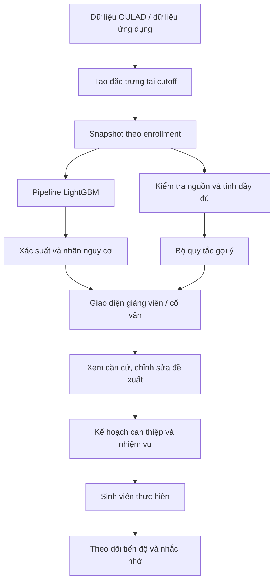
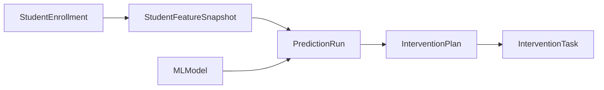

# Kiến trúc và cơ chế hoạt động của hệ thống gợi ý học tập

**Dự án:** EduRisk AI — KLTN 13.  
**Ngày đối chiếu mã nguồn:** 02/11/2026.  
**Phạm vi:** dữ liệu, mô hình dự báo, quy tắc gợi ý, quy trình can thiệp và công nghệ đang được sử dụng.

## 1. Mục tiêu và nguyên tắc thiết kế

Hệ thống hỗ trợ phát hiện nguy cơ học tập và đề xuất hướng hỗ trợ theo từng sinh viên trong từng học phần. Kết quả được trình bày để giảng viên/cố vấn xem xét, điều chỉnh và chuyển thành nhiệm vụ có thể theo dõi.

Kiến trúc kết hợp ba cơ chế:

1. **HCO–VNLS chọn đặc trưng** trong quá trình nghiên cứu và huấn luyện.
2. **LightGBM dự báo nguy cơ** từ dữ liệu học tập tại mốc quan sát.
3. **Bộ quy tắc tạo gợi ý**, sử dụng dấu hiệu học tập và điều kiện căn cứ; giảng viên/cố vấn quyết định hành động cuối cùng.

Nội dung gợi ý hiện được tạo từ điều kiện và mẫu nội dung viết sẵn. LightGBM không trực tiếp sinh văn bản chiến lược học tập. Hệ thống hiện chưa có mô hình học xếp hạng học liệu từ phản hồi người dùng hoặc LLM sinh kế hoạch tự do.

## 2. Kiến trúc tổng thể



Hệ thống có hai luồng tạo gợi ý:

| Luồng | Dữ liệu | Nơi xử lý | Mục đích |
| --- | --- | --- | --- |
| Dashboard nhập tay | Đặc trưng người dùng nhập hoặc chọn mẫu, nhãn và xác suất dự báo | Frontend TypeScript | Khám phá dữ liệu và minh họa hướng hỗ trợ |
| Giảng viên | Snapshot trong database, thông tin học phần và metadata xác nhận | Backend Python | Rà soát có căn cứ và hỗ trợ giao nhiệm vụ |

Luồng giảng viên trình bày dự báo và gợi ý trong cùng màn hình, nhưng đánh giá chúng riêng. Hàm `evaluate_suggestions(snapshot, presentation)` không nhận xác suất hay nhãn dự báo. Vì vậy, điều kiện của G01–G04 không phải là “chỉ chạy khi LightGBM trả nhãn nguy cơ”.

## 3. Dữ liệu và đơn vị cá nhân hóa

### 3.1. Sinh viên trong một học phần

Đơn vị cá nhân hóa là `StudentEnrollment`: một sinh viên đăng ký một lớp học phần. Snapshot, dự báo và kế hoạch được liên kết theo đơn vị này để tránh dùng nhiệm vụ hoặc dữ liệu của môn khác.



Một enrollment có thể có nhiều snapshot; một snapshot có thể có nhiều lần dự báo. API gợi ý lấy snapshot mới nhất và tìm dự báo gắn với chính snapshot đó. Kế hoạch ACTIVE được tìm theo đúng enrollment; điều kiện này không tự bảo đảm kế hoạch được tạo từ snapshot mới nhất.

### 3.2. Đặc trưng suy luận

Pipeline đang phục vụ sử dụng 17 đầu vào:

| Nhóm | Trường |
| --- | --- |
| Học phần và nhân khẩu học | `code_module`, `gender`, `highest_education`, `age_band` |
| Đăng ký học | `studied_credits`, `date_registration` |
| Click tích lũy | `total_clicks_to_t`, `clicks_resource_to_t`, `clicks_url_to_t` |
| Hoạt động | `active_days_to_t`, `active_day_ratio`, `days_since_last_activity` |
| Cửa sổ hoạt động | `clicks_recent_7`, `clicks_recent_30` |
| Nộp bài | `assessments_submitted_to_t`, `late_submissions_to_t`, `submission_rate` |

Backend ghép đặc trưng từ snapshot, hồ sơ sinh viên, enrollment và học phần. Pydantic và các kiểm tra nghiệp vụ kiểm soát miền dữ liệu; ví dụ tỷ lệ nằm trong [0, 1], số đếm không âm và số tín chỉ hợp lệ.

### 3.3. Cutoff và nguồn OULAD

Mô hình hiện dùng cutoff 75% thời lượng học phần:

```text
snapshot_day = floor(module_presentation_length × 0.75)
```

Ví dụ, học phần dài 200 ngày có mốc quan sát là ngày thứ 150. Cửa sổ 7/30 ngày đều kết thúc tại mốc này. Ngày ghi bản ghi vào database (`created_at`) không được mặc định là ngày quan sát.

Nguồn nghiên cứu gồm bảy bảng OULAD: `studentInfo`, `studentRegistration`, `courses`, `assessments`, `studentAssessment`, `studentVle`, `vle`. Dữ liệu OULAD dùng ngày tương đối với học phần; nhánh xử lý lịch sử kiểm tra metadata nguồn và checksum của bảy bảng trước khi chấp nhận dạng thời gian này.

Click không trực tiếp đo mức hiểu bài. Tín chỉ, mã môn và nhóm bằng cấp OULAD chưa có ánh xạ được kiểm chứng sang HUIT. Không dùng tên môn demo để khẳng định hai học phần tương đương.

## 4. Tầng nghiên cứu và lựa chọn đặc trưng

### 4.1. Vai trò của HCO–VNLS

HCO–VNLS tìm tập con đặc trưng trong giai đoạn huấn luyện. Mỗi phương án là một mask nhị phân; giá trị 1 giữ đặc trưng, giá trị 0 loại bỏ.

Hàm mục tiêu trong mã:

```text
fitness = alpha × AP_CV + (1 − alpha) × (1 − selected / total)
alpha = 0.85
```

`AP_CV` là Average Precision qua GroupKFold ba fold theo sinh viên. Thành phần đầu ưu tiên chất lượng phân loại; thành phần sau khuyến khích giảm số đặc trưng. Tại cấu hình thực nghiệm hiện hành, HCO–VNLS + LightGBM ở cutoff 75% chọn 17/38 đặc trưng gốc.

Các phiên bản HCO/VNLS trong mã nghiên cứu cần tiếp tục đối chiếu với công thức/tài liệu gốc trước khi khẳng định đóng góp thuật toán. Kết quả tái lập không tự xác nhận tính mới hoặc tính đúng đắn của tên gọi phương pháp.

### 4.2. Tiền xử lý và đánh giá

Nguồn nghiên cứu dùng pandas/NumPy và pipeline scikit-learn: xử lý thiếu cho biến số và biến phân loại, one-hot encoding, chuẩn hóa khi cấu hình bộ học yêu cầu. Pipeline được fit trong từng fold khi đánh giá lựa chọn đặc trưng.

Các tập được phân tách theo sinh viên để tránh cùng một sinh viên xuất hiện ở nhiều tập. Thực nghiệm gồm LightGBM, CatBoost, XGBoost; full features, HCO, VNLS, hybrid; nhiều seed, đối chứng mask ngẫu nhiên và ablation.

Runner trong `packages/ml` quản lý manifest, checksum, môi trường và đầu ra từng run. HCO–VNLS không chạy lại khi người dùng mở trang gợi ý; ứng dụng nạp artifact đã được đóng gói.

**Mã liên quan:** [optimizers.py](../../packages/ml/research_code/optimizers.py), [evaluation.py](../../packages/ml/research_code/evaluation.py), [models.py](../../packages/ml/research_code/models.py), [hướng dẫn pipeline](../../packages/ml/README.md).

## 5. Tầng dự báo nguy cơ

### 5.1. Luồng suy luận

1. Lấy model đang hoạt động từ registry và kiểm tra artifact/schema/metadata.
2. Ghép đủ 17 đặc trưng và sắp cột theo danh sách trong artifact.
3. Đưa DataFrame qua pipeline đã huấn luyện.
4. Lấy xác suất lớp có nhãn 1 từ `predict_proba()`.
5. So xác suất với threshold của artifact để xác định nhãn.
6. Với luồng database, lưu `PredictionRun` và ngữ cảnh suy luận.

```text
prediction = 1 nếu probability_risk >= artifact.threshold
prediction = 0 trong trường hợp còn lại
```

Threshold của artifact hiện là 0,5. `confidence` trong phản hồi dự báo là xác suất lớp nguy cơ, kể cả khi nhãn trả về bằng 0; không phải xác suất của lớp được chọn.

Ngữ cảnh lưu gồm đầu vào, danh tính/phiên bản model, checksum và các thông tin suy luận để truy vết. Snapshot chưa có dự báo được biểu diễn bằng trạng thái thiếu dự báo, không mặc định thành an toàn.

### 5.2. Giải thích kết quả mô hình

`explain_prediction()` dùng LightGBM `pred_contrib=True` trên dữ liệu đã tiền xử lý. Đóng góp của các cột one-hot được gộp về 17 trường đầu vào trên thang log-odds:

```text
margin = base_margin + tổng đóng góp đặc trưng
probability = sigmoid(margin)
```

Hàm kiểm tra xác suất tái dựng phải khớp dự báo được ghi nhận. API chỉ cố gắng giải thích sau khi kiểm tra ngữ cảnh dự báo và danh tính artifact; khi không xác minh được, phần giải thích có thể không có.

Giải thích model mô tả yếu tố làm tăng/giảm đầu ra của model. Nó không chứng minh nguyên nhân gây khó khăn học tập hoặc hiệu quả của một hành động can thiệp.

**Mã liên quan:** [prediction_service.py](../../apps/backend/services/prediction_service.py), [predictor.py](../../apps/backend/ml/predictor.py), [model_registry.py](../../apps/backend/services/model_registry.py), [explanation.py](../../apps/backend/ml/explanation.py).

## 6. Luồng gợi ý Dashboard nhập tay

`generateInterventions(features, atRisk, probability)` chạy ở frontend sau khi có kết quả dự báo. Hàm kiểm tra xác suất, số đếm, tỷ lệ và một số quan hệ dữ liệu trước khi áp dụng quy tắc.

| Quy tắc | Điều kiện | Hướng hỗ trợ |
| --- | --- | --- |
| `watch-moderate` | Nhãn dưới ngưỡng model, xác suất ≥0,30 | Trao đổi và theo dõi thêm |
| `maintain-performance` | Nhãn dưới ngưỡng model, xác suất <0,30 | Duy trì theo dõi theo yêu cầu học phần |
| `high-inactivity` | Có nguy cơ, không có hoạt động ≥14 ngày | Xác minh gián đoạn tương tác tại cutoff |
| `low-active-ratio` | Có nguy cơ, tỷ lệ ngày hoạt động <0,35 | Trao đổi về lịch học phù hợp |
| `no-submission` | Có nguy cơ, số bài đã nộp bằng 0 | Xác minh bài đến hạn và độ đầy đủ dữ liệu |
| `late-submission` | Có nguy cơ, đã nộp >0 và (tỷ lệ nộp <0,60 hoặc số bài trễ ≥2) | Đối chiếu hạn nộp và hỗ trợ quản lý thời gian |
| `drop-recent` | Có nguy cơ, click 30 ngày >0 và click 7 ngày < click 30 ngày /10 | Xác minh khác biệt tương tác |
| `general-consult` | Có nguy cơ và không khớp quy tắc nào trên | Đề nghị tư vấn 1–1 |

Nhánh dưới ngưỡng model trả về một gợi ý theo dõi rồi kết thúc. Nhánh có nguy cơ có thể trả nhiều gợi ý. Đầu vào không hợp lệ theo kiểm tra của hàm trả danh sách rỗng.

Ngưỡng 30%, 35%, 60%, 14 ngày và mức HIGH/MEDIUM/LOW là giả định minh họa của quy tắc, chưa được xác nhận là ngưỡng can thiệp tối ưu. Hai cửa sổ click chồng lấn không chứng minh xu hướng theo hai tháng độc lập. Gợi ý chưa tự tạo kế hoạch hoặc nhiệm vụ.

**Mã liên quan:** [recommendations.ts](../../apps/frontend/src/utils/recommendations.ts), [DashboardPage.tsx](../../apps/frontend/src/pages/DashboardPage.tsx).

## 7. Luồng gợi ý giảng viên có kiểm soát căn cứ

### 7.1. Lấy dữ liệu và kiểm tra quyền

Endpoint đọc gợi ý có đường dẫn tương đối:

```text
GET /courses/{presentation_id}/students/{student_id}/suggestions
```

Endpoint thuộc router giảng viên; đường dẫn đầy đủ phụ thuộc prefix khi đăng ký router. Backend kiểm tra giảng viên phụ trách học phần và sinh viên có enrollment trong lớp trước khi đọc dữ liệu.

Phản hồi tách riêng `prediction`, `prediction_explanation`, `suggestions`, `warnings`, `assessment_details`, `history` và `assignment`. GET không tạo kế hoạch hoặc nhiệm vụ.

### 7.2. Cổng kiểm tra căn cứ

Trước khi diễn giải dấu hiệu, `evaluate_suggestions()` kiểm tra:

- Snapshot ở `CUTOFF_75`, thời lượng học phần dương và `snapshot_day` khớp cutoff.
- Nguồn, thời điểm xác nhận có múi giờ và người xác nhận.
- `review_version`, phạm vi rà soát và `snapshot_sha256` khớp snapshot/học phần.
- Phạm vi `aggregate_only` chưa đủ để kết luận log nguồn đầy đủ.
- Dữ liệu `demonstration` hoặc `synthetic_demo` phải có cảnh báo minh họa.
- Với ngày lịch: ngày bắt đầu hợp lệ, bản ghi/xác nhận không trước cutoff; cutoff tương lai thì từ chối đề xuất.
- Với OULAD lịch sử: metadata thời gian tương đối và checksum nguồn đáp ứng kiểm tra riêng.
- Hai cờ `activity_complete` và `assessments_complete` được xét độc lập.

API dựa vào xác nhận có trách nhiệm; không tự kiểm toán toàn bộ log LMS gốc. Luồng rà soát trong `support_evidence.py` tạo snapshot mới, ghi người xác nhận và audit; không tự chạy dự báo hay tạo kế hoạch/nhiệm vụ.

### 7.3. Quy tắc hiện hành

Phiên bản quy tắc trong mã là `lecturer-support-1.1`.

| ID | Điều kiện chính | Kết quả và giới hạn |
| --- | --- | --- |
| `G01` | `assessments_complete=true`; danh sách bài có ID duy nhất, hạn/ngày nộp hợp lệ đến cutoff, điểm hợp lệ và số liệu khớp tổng hợp; có bài chưa ghi nhận nộp | Liệt kê dấu hiệu bài đến hạn chưa nộp để đối chiếu; chưa biết miễn bài, hạn cá nhân hoặc nguyên nhân |
| `G02_AGGREGATE` | Dữ liệu bài được xác nhận đầy đủ; `0 < late <= submitted`; số đếm/tỷ lệ hợp lệ | Đề nghị kiểm tra số liệu nộp trễ; khi thiếu chi tiết thì không định danh bài |
| `G03` | Log đầy đủ; total >0; click 7 ngày =0; click 30 ngày >0; không hoạt động ≥7 ngày; các cửa sổ nhất quán | Xác minh cách học ngoài LMS hoặc khó khăn truy cập tại cutoff |
| `G04` | Log đầy đủ; total >0; click 30 ngày =0; không hoạt động ≥30 ngày; các cửa sổ nhất quán | Xác minh cửa sổ 30 ngày; xét trước G03 để tránh lặp tín hiệu |

G01 và G02 có thể cùng xuất hiện. Với hoạt động, G03/G04 không kết luận sinh viên ngừng học hoặc bỏ học.

Mỗi gợi ý có `rule_id`, `title`, `observation`, `evidence`, `proposed_action`, `limitation`, `rule_version`. Các trường này là căn cứ giải thích quy tắc, khác với đóng góp đặc trưng của LightGBM.

### 7.4. Trạng thái trả về

| Trạng thái | Ý nghĩa |
| --- | --- |
| `available` | Có ít nhất một gợi ý đủ điều kiện |
| `insufficient_data` | Thiếu snapshot/metadata hoặc thiếu căn cứ cần thiết |
| `abstained` | Không đề xuất trong điều kiện hiện tại, ví dụ cutoff tương lai hoặc chưa có tín hiệu khớp quy tắc |

Không có gợi ý không chứng minh sinh viên không cần hỗ trợ. Có dự báo nguy cơ cũng không tự khắc phục được việc thiếu căn cứ để sinh gợi ý.

**Mã liên quan:** [support_suggestions.py](../../apps/backend/services/support_suggestions.py), [support_evidence.py](../../apps/backend/services/support_evidence.py), [lecturer.py](../../apps/backend/api/v1/endpoints/lecturer.py).

## 8. Từ gợi ý đến kế hoạch và nhiệm vụ

Giảng viên xem căn cứ, đưa đề xuất vào nháp, sửa tiêu đề/nội dung/mục tiêu/ưu tiên rồi chủ động giao. Cố vấn/admin tạo kế hoạch theo luồng nghiệp vụ; API đọc gợi ý không tạo plan giả để mở khóa giao nhiệm vụ.

Khi giao, backend kiểm tra phân công, enrollment và kế hoạch ACTIVE đúng sinh viên/học phần. Nếu payload dẫn chiếu gợi ý, backend kiểm tra lại snapshot mới nhất và đánh giá lại quy tắc; snapshot thay đổi hoặc gợi ý không còn hợp lệ thì trả lỗi 409.

Nhiệm vụ được lưu vào `InterventionTask`, gắn với `InterventionPlan` và ghi audit. Sinh viên xem/hoàn thành nhiệm vụ theo enrollment. Nhắc nhở hiện hỗ trợ trong ứng dụng; chưa có email/SMS hoặc thông báo khi đóng trang.

Hệ thống dùng trạng thái nhiệm vụ để theo dõi thực hiện. Chưa có cơ chế tự học lại chính sách gợi ý từ phản hồi hoàn thành nhiệm vụ được chứng minh trong luồng này.

## 9. Thành phần và công nghệ

| Thành phần | Công nghệ | Vai trò |
| --- | --- | --- |
| Frontend | React 18, TypeScript, Vite | Dashboard, trang theo vai trò, xem căn cứ, soạn/giao nhiệm vụ |
| Giao diện | Tailwind CSS, Lucide | Bố cục, màu sắc và biểu tượng |
| Backend | Python, FastAPI, Uvicorn | API, suy luận, quy tắc và nghiệp vụ |
| Hợp đồng dữ liệu | Pydantic | Kiểm tra và tuần tự hóa request/response |
| Database | PostgreSQL | Hồ sơ, enrollment, snapshot, dự báo, kế hoạch, nhiệm vụ, audit |
| ORM/driver | SQLAlchemy async, asyncpg | Truy vấn và giao dịch bất đồng bộ |
| Migration | Alembic | Quản lý thay đổi schema |
| Xác thực | JWT, python-jose, bcrypt | Danh tính người dùng và kiểm soát truy cập |
| ML | LightGBM, scikit-learn, pandas, NumPy, joblib | Tiền xử lý, dự báo, đánh giá và artifact |
| So sánh thực nghiệm | CatBoost, XGBoost | Đối chiếu bộ học trong nghiên cứu |
| Kiểm tra nguồn gốc | SHA-256, metadata, audit log | Phát hiện thay đổi và truy vết xác nhận/thao tác |
| Kiểm thử | pytest, PostgreSQL test, Node test, Playwright | Logic quy tắc, phân quyền, tích hợp và UI |
| Môi trường | Docker Compose | Tổ chức runtime và database local/kiểm thử |

Dependency ứng dụng được khai báo trong [backend requirements](../../apps/backend/requirements.txt), [frontend package.json](../../apps/frontend/package.json). Môi trường nghiên cứu có [requirements riêng](../../packages/ml/requirements.txt) và [lock file](../../packages/ml/requirements.lock.txt).

## 10. Ví dụ hoạt động

Giả sử một enrollment có snapshot cutoff 75%, nguồn đã xác nhận, log hoạt động đầy đủ và nhất quán:

```text
total_clicks_to_t = 500
clicks_recent_7 = 0
clicks_recent_30 = 40
days_since_last_activity = 10
```

G03 khớp và tạo đề xuất xác minh gián đoạn tương tác 7 ngày. Nếu LightGBM trả xác suất 0,72 với threshold 0,5, giao diện đồng thời hiển thị nhãn nguy cơ. Xác suất 0,72 không phải điều kiện kích hoạt G03 và không giải thích nguyên nhân mất tương tác.

Giảng viên kiểm tra lịch học và trao đổi với sinh viên; có thể sửa đề xuất thành một nhiệm vụ phù hợp. Chỉ khi có plan ACTIVE đúng enrollment và các kiểm tra backend đạt, nhiệm vụ mới được lưu.

Nếu cùng số liệu đó nhưng thiếu xác nhận nguồn, hệ thống trả `insufficient_data` thay vì dùng số liệu để tạo G03. Đây là ví dụ giả định giải thích logic, không phải kết quả thực nghiệm với sinh viên thật.

## 11. Mức cá nhân hóa và giới hạn bằng chứng

Cá nhân hóa hiện dựa trên dữ liệu riêng của sinh viên–học phần, dấu hiệu khớp quy tắc, kế hoạch riêng và sự điều chỉnh của người phụ trách. Hệ thống chưa có ánh xạ đầy đủ giữa bài đánh giá với chủ đề/rubric để chẩn đoán lỗ hổng kiến thức và tự chọn học liệu theo năng lực.

Ba loại kết quả cần được đánh giá riêng:

| Loại kết quả | Bằng chứng cần có | Trạng thái |
| --- | --- | --- |
| Chất lượng dự báo | Metric và giao thức chia tập/huấn luyện | Có thực nghiệm và tái chạy trên split OULAD lịch sử |
| Mức phù hợp của gợi ý | Giảng viên/cố vấn chấm tình huống, tính đúng và khả thi | Có công cụ/giao thức; chưa có bằng chứng đủ để kết luận chất lượng thực tế |
| Hiệu quả can thiệp | Theo dõi kết quả sau hỗ trợ và thiết kế so sánh phù hợp | Chưa chứng minh tác động nhân quả |

Lần tái chạy `rerun-20261025` cho artifact LightGBM cutoff 75% có accuracy test khoảng 86,19%, precision nguy cơ 91,23%, recall 65,70%, AP 0,881575 và ROC-AUC 0,904932. Đây là test lịch sử, không phải external holdout mới; vẫn bỏ sót 402/1.172 enrollment nguy cơ. Artifact tái chạy không thay thế artifact backend.

Hash rà soát hiện bao phủ các trường hành vi và ngữ cảnh snapshot/học phần trong `snapshot_digest()`, chưa bao phủ toàn bộ chi tiết bài trong metadata. Đồng thời, luồng inspection/review dùng ngày lịch còn có điểm cần thống nhất với nhánh OULAD ngày tương đối. Cần kiểm chứng các giới hạn này trước khi khẳng định cơ chế xác nhận bảo vệ toàn bộ căn cứ.

**Bằng chứng và kế hoạch:** [kết quả tái thực nghiệm](../../packages/ml/reports/rerun-20261025/README.md), [rà soát 22/10](../../reports/dailys/22-10-2026.md), [kế hoạch 25/10](../../reports/dailys/25-10-2026.md), [giao thức can thiệp](../../reports/evaluation/INTERVENTION_PROTOCOL.md).

## 12. Quan hệ với tài liệu khác

- [Quy tắc nghiệp vụ](../product/business-rules.md): định nghĩa dữ liệu, radar và các quy tắc tại mốc tài liệu cũ.
- [Nhật ký triển khai gợi ý giảng viên](../product/lecturer-suggestions-process.md): quyết định thiết kế theo từng giai đoạn.
- [Rà soát snapshot database](../database/database-snapshot-review.md): quy trình xác nhận nguồn.
- [Thiết kế database](../../database/database_design_plan.md): schema và quan hệ dữ liệu.
- [Báo cáo thực nghiệm](../../reports/evaluation/THESIS_EXPERIMENTS.md): đánh giá và giới hạn.

Một số tài liệu lịch sử ghi chưa có G01. Mã hiện tại đã có nhánh G01 khi chi tiết bài được kiểm tra hợp lệ; mô tả ở mục 7 phản ánh phiên bản mã được đối chiếu ngày 02/11/2026. Khi thay đổi quy tắc, cần đồng bộ tài liệu và kiểm thử liên quan.
