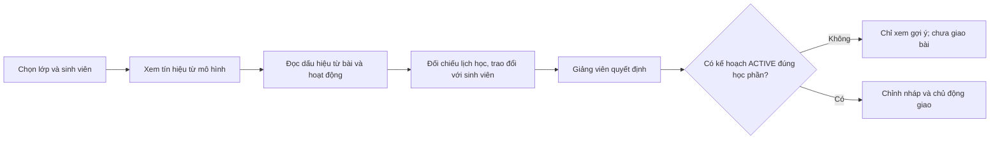

# Hướng dẫn xem gợi ý hỗ trợ sinh viên

Tài liệu này giới thiệu luồng giảng viên trên bản thử với một hồ sơ **OULAD lịch sử**. Ảnh là giao diện thật, nhưng không phải dữ liệu sinh viên HUIT hiện tại. Chú thích và mũi tên chỉ vị trí thao tác; con số trên ảnh không phải kết quả đánh giá hiệu quả mô hình. Bản thử không có kế hoạch hỗ trợ đang hoạt động nên chưa minh họa giao bài thành công.

## Luồng xử lý

Mô hình dự báo xác suất nguy cơ, **không** tự xác định điểm yếu theo chủ đề hoặc quyết định bài tập. Quy tắc hỗ trợ chỉ nêu các dấu hiệu có thể kiểm tra từ dữ liệu đã xác nhận; giảng viên đối chiếu với lịch bài, rubric và hoàn cảnh học tập trước khi hành động.

## Ảnh hướng dẫn

### Chọn lớp

Chọn lớp `AAA / OULAD_2013J` trong môi trường thử riêng, sau đó chọn hồ sơ lịch sử để xem gợi ý.

### Xem tổng quan gợi ý

Đọc kết quả dự báo và lưu ý về nguồn dữ liệu trước khi xem các dấu hiệu cụ thể.

### Nhận diện dấu hiệu

Giao diện nêu số bài đến hạn chưa ghi nhận nộp và hoạt động trên hệ thống ở mốc đánh giá; đây là tín hiệu cần xác minh, không phải kết luận về năng lực hay nguyên nhân.

### Kiểm tra trước khi hỗ trợ

Đối chiếu lịch bài, hỏi sinh viên và xác minh việc học ngoài hệ thống trước khi chọn phương án hỗ trợ.

### Giảng viên quyết định

Hệ thống không tự giao nhiệm vụ. Bản thử chưa có kế hoạch hỗ trợ `ACTIVE` đúng học phần nên chỉ xem gợi ý, không thực hiện giao bài.

### Xem căn cứ và giới hạn dữ liệu

Mở mục chi tiết để thấy nguồn, mốc quan sát và giới hạn suy luận. Xác suất cao của một hồ sơ lịch sử không chứng minh kết quả dự báo đúng trên sinh viên HUIT.

### Đối chiếu từng bài

Xem loại bài, ngày đến hạn tương đối, bản nộp và điểm nếu có. Trong ví dụ này, 1/4 bài đến hạn có bản nộp đến mốc, ba bài chưa ghi nhận nộp. Không có ánh xạ bài–chủ đề/rubric, hạn cá nhân hoặc miễn bài, nên chưa thể khẳng định sinh viên yếu kiến thức nào.

## Phạm vi bàn giao

- API gợi ý là chỉ đọc, có kiểm tra quyền giảng viên theo học phần; phần dự báo và quy tắc hỗ trợ tách nhau.
- Dữ liệu thử được trích từ bảy Parquet OULAD đến ngày tương đối thứ 201/268 và nạp vào database riêng có hậu tố `_oulad`. Không push dữ liệu nguồn, JSON ca thử, database hoặc thông tin đăng nhập.
- Một ca thử có xác suất mô hình khoảng 98,9%; đây **không** phải phép đo hiệu năng, chưa kiểm chứng parity đặc trưng với pipeline nghiên cứu và chưa kiểm định trên HUIT.
- Hướng dẫn chạy importer và hợp đồng API nằm ở [README backend](../apps/backend/README.md); tổng quan ở [README gốc](../README.md). Khi có dữ liệu HUIT, cần xác thực nguồn, thời điểm, quyền truy cập, lịch bài và rubric trước khi diễn giải thành điểm yếu hay đề xuất bài tập.
