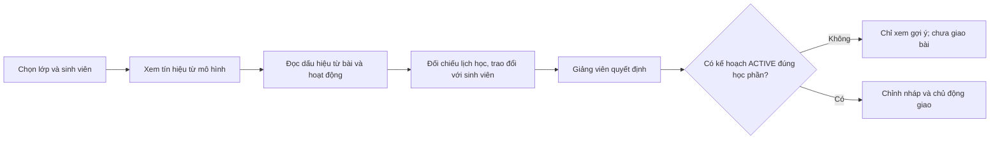

# Hướng dẫn xem gợi ý hỗ trợ sinh viên

Tài liệu này giới thiệu luồng giảng viên trên bản thử với một hồ sơ **OULAD lịch sử**. Bộ ảnh ghi lại một ca minh họa; môi trường thử local ngày 22/10/2026 đã có thêm một nhóm hồ sơ OULAD trong cùng học phần. Ảnh là giao diện thật, nhưng không phải dữ liệu sinh viên HUIT hiện tại. Chú thích và mũi tên chỉ vị trí thao tác; con số trên ảnh không phải kết quả đánh giá hiệu quả mô hình. Bản thử không có kế hoạch hỗ trợ đang hoạt động nên chưa minh họa giao bài thành công.

## Luồng xử lý



Mô hình dự báo xác suất nguy cơ, **không** tự xác định điểm yếu theo chủ đề hoặc quyết định bài tập. Quy tắc hỗ trợ chỉ nêu các dấu hiệu có thể kiểm tra từ dữ liệu đã xác nhận; giảng viên đối chiếu với lịch bài, rubric và hoàn cảnh học tập trước khi hành động.

## Giao diện xem gợi ý hiện tại

Hộp **Xem gợi ý** được chia thành bốn tab để giảng viên đọc theo thứ tự: **Tổng quan** (xác suất và các số liệu của đúng sinh viên đang chọn), **Dấu hiệu** (những việc cần kiểm tra), **Gợi ý & giao** (cách hỗ trợ; nháp/giao bài chỉ khi có kế hoạch hợp lệ) và **Căn cứ** (bài đánh giá, nguồn và giới hạn). Dashboard phân tích 17 đặc trưng vẫn giữ như bản của Nguyên; đó là biểu mẫu nhập thủ công, **không phải** dashboard tự động của sinh viên được chọn. Xác suất không quy định mức bài tập; giảng viên tự chọn mức nếu có căn cứ.

## Ảnh hướng dẫn

Các ảnh dưới đây ghi lại giao diện trước khi chia bốn tab; nội dung và luồng xử lý vẫn hữu ích nhưng vị trí các mục đã thay đổi theo mô tả trên. Cần chụp lại bộ ảnh khi chốt phiên bản trình bày.

### Chọn lớp

Chọn lớp `AAA / OULAD_2013J` trong môi trường thử riêng, sau đó chọn hồ sơ lịch sử để xem gợi ý.


### Xem tổng quan gợi ý

Đọc kết quả dự báo và lưu ý về nguồn dữ liệu trước khi xem các dấu hiệu cụ thể.


### Nhận diện dấu hiệu

Giao diện nêu số bài đến hạn chưa ghi nhận nộp và hoạt động trên hệ thống ở mốc đánh giá; đây là tín hiệu cần xác minh, không phải kết luận về năng lực hay nguyên nhân.


### Kiểm tra trước khi hỗ trợ

Đối chiếu lịch bài, hỏi sinh viên và xác minh việc học ngoài hệ thống trước khi chọn phương án hỗ trợ.


### Giảng viên quyết định

Hệ thống không tự giao nhiệm vụ. Bản thử chưa có kế hoạch hỗ trợ `ACTIVE` đúng học phần nên chỉ xem gợi ý, không thực hiện giao bài.


### Xem căn cứ và giới hạn dữ liệu

Mở mục chi tiết để thấy nguồn, mốc quan sát và giới hạn suy luận. Xác suất cao của một hồ sơ lịch sử không chứng minh kết quả dự báo đúng trên sinh viên HUIT.


### Đối chiếu từng bài

Xem loại bài, ngày đến hạn tương đối, bản nộp và điểm nếu có. Trong ví dụ này, 1/4 bài đến hạn có bản nộp đến mốc, ba bài chưa ghi nhận nộp. Không có ánh xạ bài–chủ đề/rubric, hạn cá nhân hoặc miễn bài, nên chưa thể khẳng định sinh viên yếu kiến thức nào.


## Phạm vi bàn giao

- API gợi ý là chỉ đọc, có kiểm tra quyền giảng viên theo học phần; phần dự báo và quy tắc hỗ trợ tách nhau.
- Dữ liệu thử được trích từ bảy Parquet OULAD đến ngày tương đối thứ 201/268 và nạp vào database riêng có hậu tố `_oulad`. Không push dữ liệu nguồn, JSON ca thử, database hoặc thông tin đăng nhập.
- Một ca thử có xác suất mô hình khoảng 98,9%; đây **không** phải phép đo hiệu năng, chưa kiểm chứng parity đặc trưng với pipeline nghiên cứu và chưa kiểm định trên HUIT.
- Hướng dẫn chạy importer và hợp đồng API nằm ở [README backend](../apps/backend/README.md); tổng quan ở [README gốc](../README.md). Khi có dữ liệu HUIT, cần xác thực nguồn, thời điểm, quyền truy cập, lịch bài và rubric trước khi diễn giải thành điểm yếu hay đề xuất bài tập.

## Danh sách nhiều sinh viên OULAD trên máy thử

Bảng cảnh báo của Nguyên vẫn hiển thị **toàn bộ sinh viên đã ghi danh vào học phần được chọn**, không chỉ các ca nguy cơ cao. Ngày 22/10/2026, database local `personalized_learning_oulad` có 70 hồ sơ lịch sử trong `AAA / OULAD_2013J`: 70 kết quả dự báo được suy luận bằng artifact đang chạy, 7 nhãn `HIGH_RISK` theo ngưỡng model 0,5. Database ứng dụng gốc `personalized_learning_db` vẫn chỉ có một hồ sơ demo và xác suất 82% của hồ sơ đó là số minh họa, không phải kết quả LightGBM. Những số đếm này là trạng thái **máy thử tại thời điểm kiểm tra**, không phải dữ liệu đóng gói trong Git hay số lượng của toàn bộ OULAD.

Nhóm minh họa gồm 30 mã hồ sơ đầu còn ghi danh tại mốc 75% và một mẫu giả ngẫu nhiên cố định (seed 42) gồm 45 hồ sơ đủ điều kiện trên toàn lớp; 6 mã trùng nhau và đã có một ca nạp trước. Không dùng nhãn kết quả cuối kỳ để chọn hồ sơ. Mẫu này **không phải mẫu đánh giá hiệu năng** và không đại diện cho sinh viên HUIT. Bảy file Parquet xử lý được kiểm tra SHA-256, lịch nộp và đặc trưng được đối chiếu trước khi nhập; mỗi ca giữ nguồn và mốc ngày tương đối trong snapshot. Chưa xác nhận parity đầy đủ giữa pipeline tạo Parquet và quy trình nghiên cứu, nên xác suất cá nhân chỉ là tín hiệu để giáo viên kiểm tra, không phải kết luận điểm yếu, kết quả cuối kỳ hay độ khó bài học.

Để chạy lại trên database thử riêng (không chạy trên database ứng dụng gốc), cần bảy Parquet OULAD trong `../data/processed`, schema đã migration và tài khoản giảng viên `GVDEMO01` được tạo trước. Python backend phải cài Parquet engine phù hợp với NumPy 1.26 (`pyarrow>=15,<20`; trên máy thử dùng 19.0.1). Ví dụ sau dùng URL riêng cho Python trên máy chủ host; thay mật khẩu placeholder bằng mật khẩu local, không đưa vào Git:

```powershell
.\.venv\Scripts\python.exe -m pip install "pyarrow>=15,<20"
$env:OULAD_DATABASE_URL = 'postgresql://postgres:<local-password>@127.0.0.1:5433/personalized_learning_oulad'
.\.venv\Scripts\python.exe scripts/load_oulad_cohort.py --parquet-dir ..\data\processed --database-url $env:OULAD_DATABASE_URL --lecturer-code GVDEMO01 --limit 45 --selection random --seed 42
# Xem kết quả dry run; chỉ khi đúng database _oulad mới thêm --apply vào cuối lệnh.
```

Importer lặp lại sẽ bỏ qua mã OULAD đã có; nếu nạp một ca lỗi thì các ca trước đã được commit và có thể chạy lại. Trước khi chuyển backend, sao lưu database thử. Để xem trên `http://127.0.0.1:5173/#lecturer`, đặt `DOCKER_DATABASE_URL` trong `.env` trỏ tới `postgres:5432/personalized_learning_oulad` (hostname của Docker, **khác** `127.0.0.1:5433` dùng trên host), rồi `docker compose up -d --no-deps --force-recreate backend`. Chọn `AAA / OULAD_2013J` và đăng nhập bằng giảng viên demo; giao diện mặc định chọn học phần có nhiều sinh viên nhất. Muốn trở về bản demo ban đầu, khôi phục riêng dòng `DOCKER_DATABASE_URL` trỏ tới `personalized_learning_db` và recreate backend. Không cần xóa database hoặc copy dữ liệu sang database gốc. Chưa có kế hoạch `ACTIVE` đúng học phần thì giảng viên xem gợi ý nhưng chưa giao nhiệm vụ.
