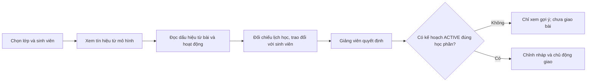
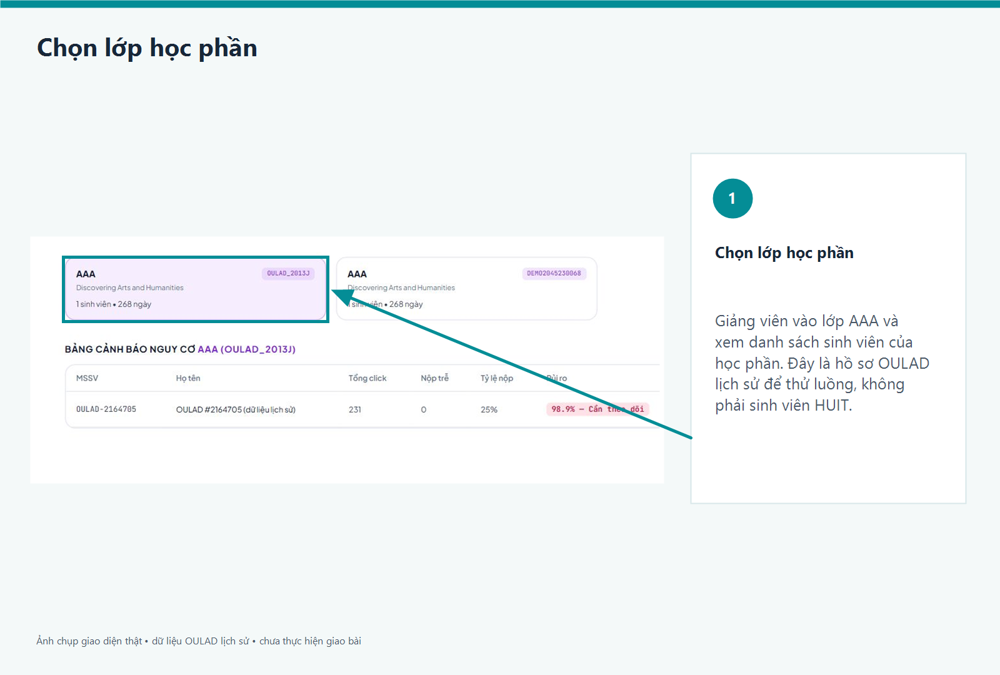
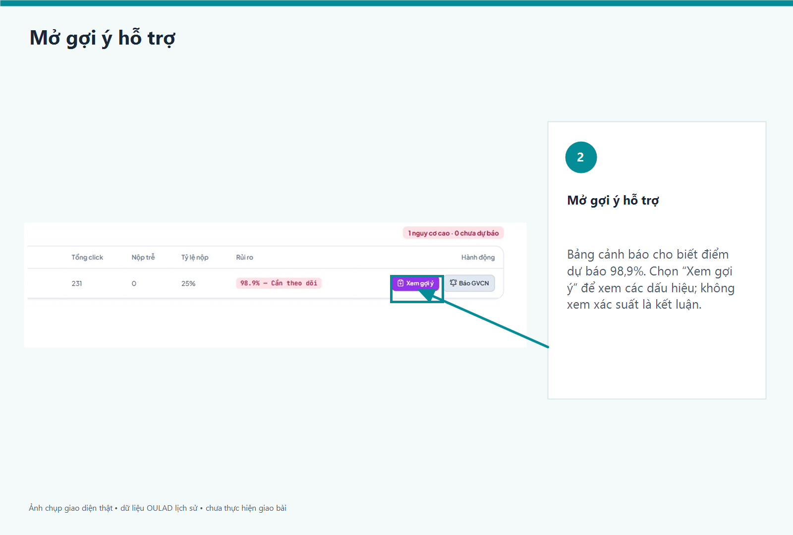
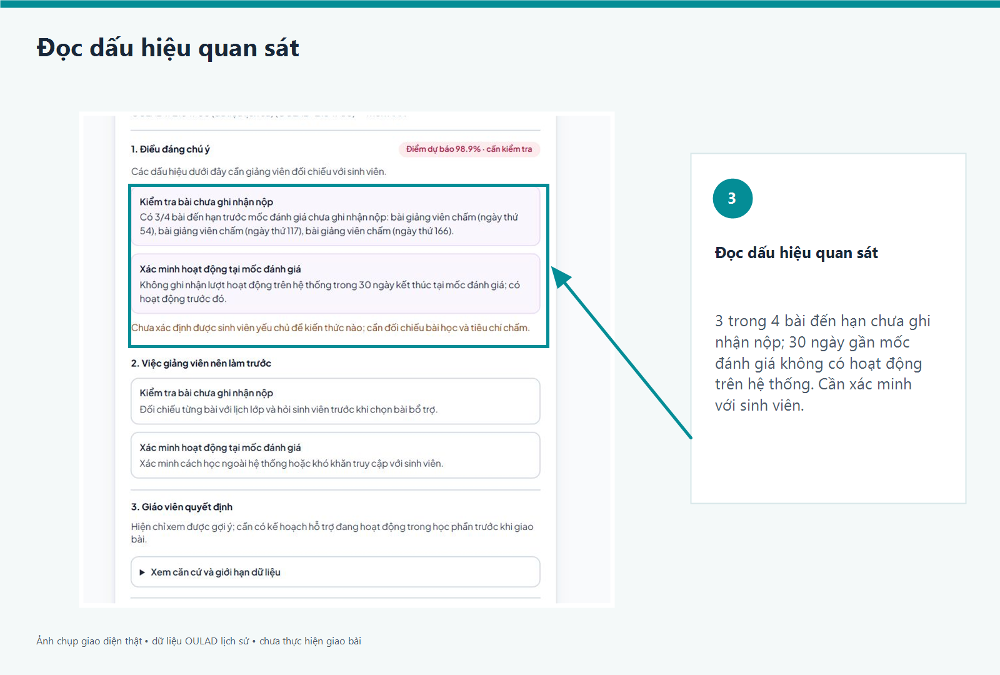
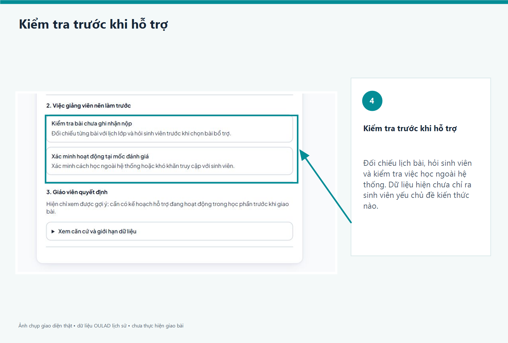
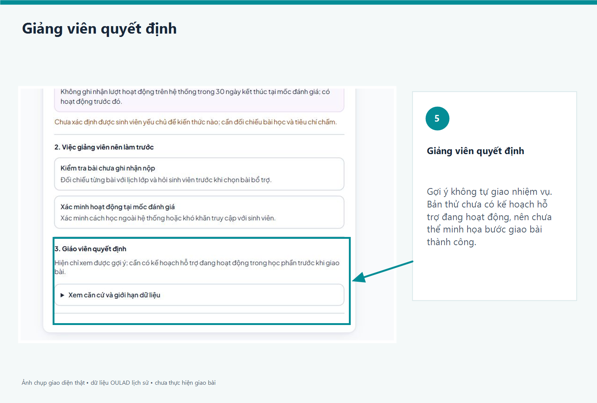
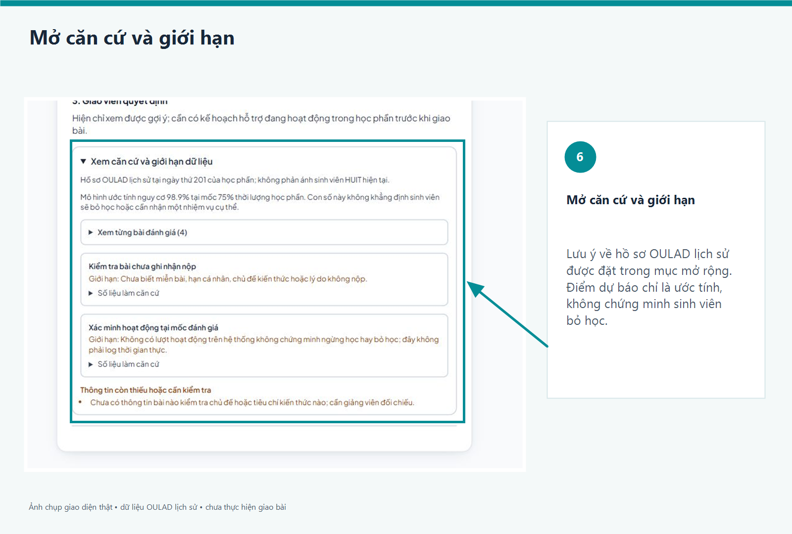
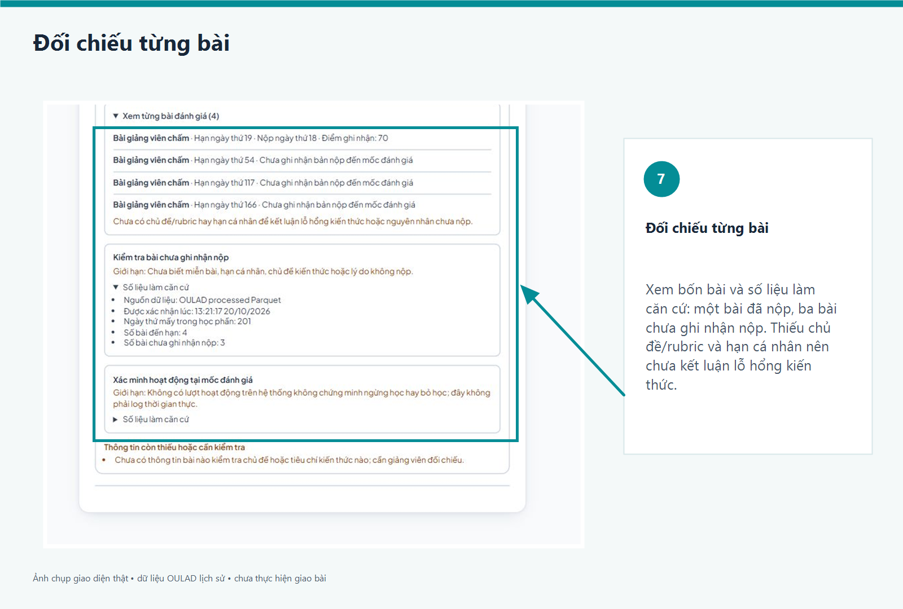

# Hướng dẫn xem gợi ý hỗ trợ sinh viên

Tài liệu này giới thiệu luồng giảng viên trên bản thử với một hồ sơ **OULAD lịch sử**. Bộ ảnh ghi lại một ca minh họa; môi trường thử local ngày 22/10/2026 đã có thêm một nhóm hồ sơ OULAD trong cùng học phần. Ảnh là giao diện thật, nhưng không phải dữ liệu sinh viên HUIT hiện tại. Chú thích và mũi tên chỉ vị trí thao tác; con số trên ảnh không phải kết quả đánh giá hiệu quả mô hình. Bản thử không có kế hoạch hỗ trợ đang hoạt động nên chưa minh họa giao bài thành công.

## Luồng xử lý



Mô hình dự báo xác suất nguy cơ, **không** tự xác định điểm yếu theo chủ đề hoặc quyết định bài tập. Quy tắc hỗ trợ chỉ nêu các dấu hiệu có thể kiểm tra từ dữ liệu đã xác nhận; giảng viên đối chiếu với lịch bài, rubric và hoàn cảnh học tập trước khi hành động.

## Giao diện xem gợi ý hiện tại

Bảng cảnh báo có tìm kiếm tên/MSSV, lọc mức nguy cơ và sắp xếp. Hộp **Xem gợi ý** có hai tab: **Thông tin & căn cứ** (xác suất và ngưỡng cảnh báo, chỉ số quan sát, biểu đồ đóng góp đã kiểm chứng, đủ 17 đầu vào, cách tính tỷ lệ bài nộp, từng bài đến hạn và nguồn dữ liệu) và **Gợi ý & giao bài** (dấu hiệu có căn cứ, hướng hỗ trợ, lịch sử, nháp do giảng viên chỉnh và quyết định giao khi có kế hoạch `ACTIVE` đúng học phần). Nếu không có kế hoạch, giảng viên vẫn chọn được gợi ý để xem nháp tham khảo, nhưng nút **Giao bài tập** bị khóa và giao diện nói rõ điều kiện còn thiếu; không tự tạo hay giao nhiệm vụ. Thanh tỷ lệ quan sát **không phải** tỷ lệ đóng góp vào xác suất. Biểu đồ đóng góp chỉ hiện khi lần dự báo được khớp và tính lại từ đúng artifact; nếu không thì ghi rõ chưa có giải thích kiểm chứng. Nếu có `inference_context` hợp lệ, 17 giá trị là đầu vào đã ghi cho lần dự báo; nếu không, tab nói rõ đó là snapshot/hồ sơ hiện lưu. Dashboard nhập thủ công dùng lại biểu đồ radar và hướng dẫn của nhánh Nguyên; đó không phải dashboard tự động của sinh viên. Xác suất không quy định mức bài tập.

## Ảnh hướng dẫn

Các ảnh dưới đây là bản lưu giao diện cũ trước khi chia tab, **không phản ánh bố cục hai tab hiện tại**. Chúng chỉ minh họa luồng nghiệp vụ và dữ liệu thử; cần chụp lại ảnh mới trước khi dùng để trình bày.

### Chọn lớp

Chọn lớp `AAA / OULAD_2013J` trong môi trường thử riêng, sau đó chọn hồ sơ lịch sử để xem gợi ý.



### Xem tổng quan gợi ý

Đọc kết quả dự báo và lưu ý về nguồn dữ liệu trước khi xem các dấu hiệu cụ thể.



### Nhận diện dấu hiệu

Giao diện nêu số bài đến hạn chưa ghi nhận nộp và hoạt động trên hệ thống ở mốc đánh giá; đây là tín hiệu cần xác minh, không phải kết luận về năng lực hay nguyên nhân.



### Kiểm tra trước khi hỗ trợ

Đối chiếu lịch bài, hỏi sinh viên và xác minh việc học ngoài hệ thống trước khi chọn phương án hỗ trợ.



### Giảng viên quyết định

Hệ thống không tự giao nhiệm vụ. Bản thử chưa có kế hoạch hỗ trợ `ACTIVE` đúng học phần nên chỉ xem gợi ý, không thực hiện giao bài.



### Xem căn cứ và giới hạn dữ liệu

Mở mục chi tiết để thấy nguồn, mốc quan sát và giới hạn suy luận. Xác suất cao của một hồ sơ lịch sử không chứng minh kết quả dự báo đúng trên sinh viên HUIT.



### Đối chiếu từng bài

Xem loại bài, ngày đến hạn tương đối, bản nộp và điểm nếu có. Trong ví dụ này, 1/4 bài đến hạn có bản nộp đến mốc, ba bài chưa ghi nhận nộp. Không có ánh xạ bài–chủ đề/rubric, hạn cá nhân hoặc miễn bài, nên chưa thể khẳng định sinh viên yếu kiến thức nào.



## Phạm vi bàn giao

- API gợi ý là chỉ đọc, có kiểm tra quyền giảng viên theo học phần; phần dự báo và quy tắc hỗ trợ tách nhau.
- Dữ liệu thử được trích từ bảy Parquet OULAD đến ngày tương đối thứ 201/268 và nạp vào database riêng có hậu tố `_oulad`. Không push dữ liệu nguồn, JSON ca thử, database hoặc thông tin đăng nhập.
- Một ca thử có xác suất mô hình khoảng 98,9%; đây **không** phải phép đo hiệu năng, chưa kiểm chứng parity đặc trưng với pipeline nghiên cứu và chưa kiểm định trên HUIT.
- Hướng dẫn chạy importer và hợp đồng API nằm ở [README backend](../apps/backend/README.md); tổng quan ở [README gốc](../README.md). Khi có dữ liệu HUIT, cần xác thực nguồn, thời điểm, quyền truy cập, lịch bài và rubric trước khi diễn giải thành điểm yếu hay đề xuất bài tập.

## Danh sách nhiều sinh viên OULAD trên máy thử

Bảng cảnh báo của Nguyên vẫn hiển thị **toàn bộ sinh viên đã ghi danh vào học phần được chọn**, không chỉ các ca nguy cơ cao. Ngày 22/10/2026, database local `personalized_learning_oulad` có 70 hồ sơ lịch sử trong `AAA / OULAD_2013J`: 70 kết quả dự báo được suy luận bằng artifact đang chạy, 7 nhãn `HIGH_RISK` theo ngưỡng model 0,5. Database ứng dụng gốc `personalized_learning_db` vẫn chỉ có một hồ sơ demo và xác suất 82% của hồ sơ đó là số minh họa, không phải kết quả LightGBM. Những số đếm này là trạng thái **máy thử tại thời điểm kiểm tra**, không phải dữ liệu đóng gói trong Git hay số lượng của toàn bộ OULAD.

Nhóm minh họa gồm 30 mã hồ sơ đầu còn ghi danh tại mốc 75% và một mẫu giả ngẫu nhiên cố định (seed 42) gồm 45 hồ sơ đủ điều kiện trên toàn lớp; 6 mã trùng nhau và đã có một ca nạp trước. Không dùng nhãn kết quả cuối kỳ để chọn hồ sơ. Mẫu này **không phải mẫu đánh giá hiệu năng** và không đại diện cho sinh viên HUIT. Bảy file Parquet xử lý được kiểm tra SHA-256, lịch nộp và đặc trưng được đối chiếu trước khi nhập; mỗi ca giữ nguồn và mốc ngày tương đối trong snapshot. Chưa xác nhận parity đầy đủ giữa pipeline tạo Parquet và quy trình nghiên cứu, nên xác suất cá nhân chỉ là tín hiệu để giáo viên kiểm tra, không phải kết luận điểm yếu, kết quả cuối kỳ hay độ khó bài học.

Để chạy lại trên database thử riêng (không chạy trên database ứng dụng gốc), cần bảy Parquet OULAD trong `../data/processed`, schema đã migration và tài khoản giảng viên `GVDEMO01` được tạo trước. Python backend phải cài Parquet engine phù hợp với NumPy 1.26 (`pyarrow>=15,<20`; trên máy thử dùng 19.0.1). Ví dụ sau dùng URL riêng cho Python trên máy chủ host; thay mật khẩu placeholder bằng mật khẩu local, không đưa vào Git:

```powershell
.\.venv\Scripts\python.exe -m pip install "pyarrow>=15,<20"
$env:OULAD_DATABASE_URL = 'postgresql://postgres:<local-password>@127.0.0.1:5433/personalized_learning_oulad'
.\.venv\Scripts\python.exe scripts/load_oulad_cohort.py --parquet-dir ..\data\processed --database-url $env:OULAD_DATABASE_URL --lecturer-code GVDEMO01 --limit 45 --selection random --seed 42
# Xem kết quả dry run; chỉ khi đúng database _oulad mới thêm --apply vào cuối lệnh.
```

Importer lặp lại sẽ bỏ qua mã OULAD đã có; nếu nạp một ca lỗi thì các ca trước đã được commit và có thể chạy lại. Trước khi chuyển backend, sao lưu database thử. Để xem trên `http://127.0.0.1:5173/#lecturer`, đặt `DOCKER_DATABASE_URL` trong `.env` trỏ tới `postgres:5432/personalized_learning_oulad` (hostname của Docker, **khác** `127.0.0.1:5433` dùng trên host), rồi `docker compose up -d --no-deps --force-recreate backend`. Chọn `AAA / OULAD_2013J` và đăng nhập bằng giảng viên demo; giao diện mặc định chọn học phần có nhiều sinh viên nhất. Muốn trở về bản demo ban đầu, khôi phục riêng dòng `DOCKER_DATABASE_URL` trỏ tới `personalized_learning_db` và recreate backend. Không cần xóa database hoặc copy dữ liệu sang database gốc. Chưa có kế hoạch `ACTIVE` đúng học phần thì giảng viên xem gợi ý nhưng chưa giao nhiệm vụ.

## Luồng xem dấu hiệu và giao bài (bản thử chưa bàn giao)

Màn **Xem gợi ý** tách dự báo, dữ liệu quan sát và quyết định của giảng viên. Tab **Thông tin & căn cứ** hiển thị đủ 17 đầu vào đã lưu cùng lần dự báo theo nhóm bài đánh giá (3), hoạt động (8), học phần và thông tin nền (6); có bộ lọc nhóm và danh sách từng bài đến hạn khi bản ghi đã xác nhận. Nếu chỉ có snapshot quan sát mà không khớp đầu vào dự báo, giao diện ghi rõ nguồn thấp hơn; nếu thiếu dữ liệu thì không thay bằng số 0. Biểu đồ đóng góp chỉ hiển thị khi giải thích riêng cho lần dự báo được kiểm chứng; đủ 17 thanh được chia nhóm, không chỉ lấy top 3 hay gán phần trăm nguyên nhân. Chỉ các gợi ý backend đủ điều kiện theo quy tắc mới có nút đưa vào nháp; các chỉ số còn lại là dữ liệu để đối chiếu, không tự động biến thành chẩn đoán hay nhiệm vụ.

Tab **Thông tin & căn cứ** mở mặc định khi xem hồ sơ; các chỉ số, từng bài và biểu đồ đóng góp nằm cùng tab, không cần chuyển sang tab giao bài để xem. Bảng ngắn đặt dữ liệu ghi nhận cạnh hướng hỗ trợ có quy tắc và nút xem/soạn; chọn một dòng thì mở chi tiết số liệu, giới hạn suy luận và bản soạn/giao bài ngay bên dưới. Không chọn sẵn một gợi ý thay giảng viên. Lịch sử giao theo dấu hiệu và chi tiết căn cứ mở khi cần. Bộ 17 đầu vào và từng bài đến hạn vẫn nằm trong tab đầu; tab giao bài có đường quay lại căn cứ.

Trong tab **Gợi ý & giao bài**, mỗi nhóm bài đến hạn, nộp trễ và hoạt động gần đây hiển thị giá trị quan sát. Nếu quy tắc đủ căn cứ, giáo viên thấy dấu hiệu, hỗ trợ tham khảo và các nhiệm vụ đã giao theo cùng quy tắc, rồi có thể chọn để điền nháp. Giáo viên chỉnh sửa nội dung, xác minh căn cứ và bấm **Giao bài tập**; hệ thống không tự giao. Một nhiệm vụ đã giao không biến mất khỏi danh sách khi tiếp tục xem gợi ý; trạng thái hoàn thành được đọc từ task của sinh viên.

API đọc `GET /lecturer/courses/{presentation_id}/students/{student_id}/suggestions` trả thêm `snapshot_id` và `history`. API giao bài `POST /lecturer/courses/{presentation_id}/tasks` có thể nhận `suggestion_snapshot_id`, `suggestion_rule_id`, `verified_basis`; khi chọn gợi ý, backend xác nhận snapshot mới nhất và quy tắc vẫn hợp lệ trước khi ghi task cùng vết audit. Task giao thủ công cũ vẫn được hỗ trợ. Chỉ những task được giao sau khi thêm audit mới có liên kết gợi ý trong lịch sử; các task trước đó không được suy đoán nguồn gốc. Giao bài vẫn yêu cầu plan `ACTIVE` đúng sinh viên/học phần.

Các nhóm và quy tắc này **không phải toàn bộ nguyên nhân dự báo của model 17 đặc trưng**, cũng không chứng minh một điểm yếu kiến thức. Biểu đồ đóng góp đã được tính cho bản ghi dự báo kiểm chứng, nhưng không có ánh xạ bài–chủ đề/rubric hay xác nhận hạn nộp cá nhân; vì vậy cần trao đổi và kiểm tra độc lập trước khi chọn mức bài. Dữ liệu OULAD lịch sử chỉ dùng minh họa luồng, không khẳng định kết quả với sinh viên HUIT.


## Giải thích riêng cho từng lần dự báo

Trong **Thông tin & căn cứ**, phần “Mô hình dựa vào những gì” vẽ biểu đồ thanh hai phía cho **đủ 17 đầu vào** của chính bản ghi dự báo: cam làm tăng điểm nguy cơ, xanh làm giảm. Ba nhóm “bài đánh giá”, “hoạt động”, “học phần và nền” chỉ là cách sắp xếp để đọc, **không phải ba nguyên nhân**. Các cột one-hot của mỗi trường được cộng về trường gốc; không dùng top 3, không tự gán 100% nguyên nhân. Giá trị thanh là đóng góp **log-odds**, không phải điểm phần trăm xác suất. Điểm nền của cây và tổng 17 đóng góp phải tái tạo xác suất đã lưu trong sai số 10⁻⁶. Điểm nền không phải tỷ lệ nguy cơ của toàn bộ sinh viên. Đây là giải thích hoạt động nội bộ của LightGBM cho một trường hợp, không chứng minh quan hệ nhân quả hay hiệu quả của một bài tập.

Backend chỉ tính khi lần dự báo có đủ đầu vào trong provenance, cùng ID/phiên bản/sha256/ngưỡng/mốc/lớp đích với model lưu trữ đã kiểm tra; xác suất tính lại từ đúng artifact cũng phải khớp bản ghi. Sai một điều kiện thì **không vẽ đóng góp**. Dấu hiệu quan sát từ từng bài, tổng nộp trễ, cửa sổ hoạt động được hiển thị riêng; quy tắc gợi ý vẫn chỉ dựa trên bằng chứng đủ điều kiện, không suy gợi ý trực tiếp từ độ dài thanh. Giảng viên chọn, sửa, và tự giao sau khi đối chiếu; vẫn cần kế hoạch hỗ trợ ACTIVE. Tuổi/giới tính/trình độ là đầu vào của model nghiên cứu, không phải căn cứ tự động để giao bài.

**Cách đọc độ dài và ngưỡng:** Ngưỡng cảnh báo (ví dụ 50% theo phiên bản model hiện dùng) áp dụng cho **xác suất cuối cùng**, không áp dụng cho một thuộc tính. Không có ngưỡng tuyệt đối để gọi đóng góp của từng thuộc tính là “cao” hay “thấp”. Trên mỗi hồ sơ, thước đo đối xứng quanh 0, lấy trị tuyệt đối đóng góp lớn nhất trong 17 đầu vào làm đầu mút; vì vậy hai sinh viên có thanh dài như nhau không nhất thiết có đóng góp bằng nhau. Rê chuột hoặc dùng Tab trên thanh để xem giá trị đầu vào lưu cùng lần dự báo, ý nghĩa dữ liệu, hướng và đóng góp log-odds. Độ dài và con số này không phải tỷ lệ phần trăm nguyên nhân, mức độ nghiêm trọng hoặc hiệu quả dự kiến nếu can thiệp.

Kiểm chứng: `apps/backend/tests/test_prediction_explanation.py` chạy trên artifact đang đóng gói với nhiều mẫu đầu vào; thử sai xác suất phải bị từ chối. Dữ liệu OULAD lịch sử chỉ minh họa, không suy kết quả triển khai HUIT hay kết luận điểm yếu theo chủ đề khi thiếu rubric/ánh xạ bài. Khi trình bày khóa luận, tách ba lớp: **mô hình dự báo**, **bằng chứng học tập quan sát**, **quyết định có xác minh của giảng viên**.
