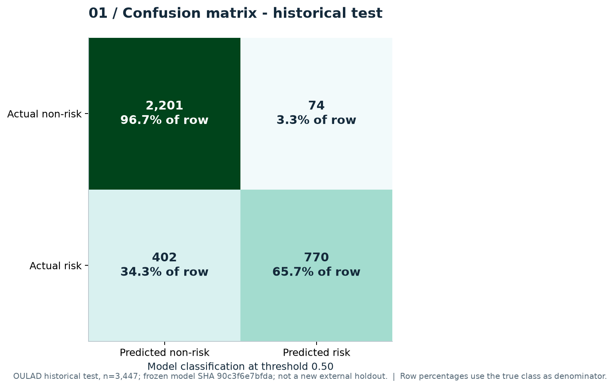
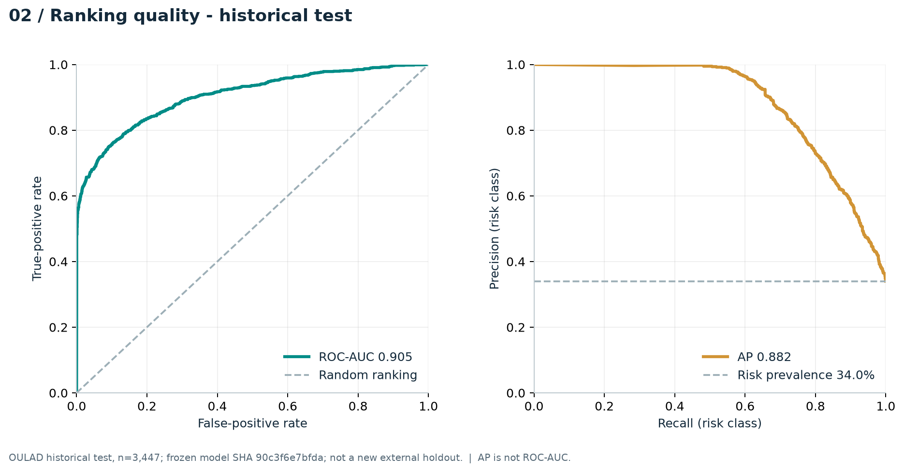
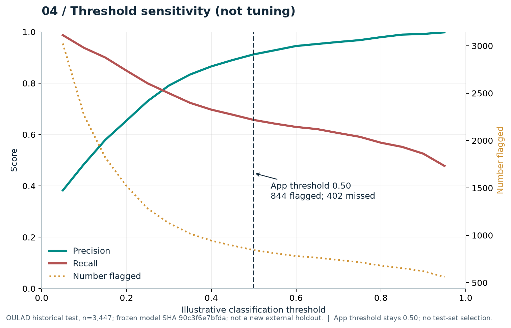
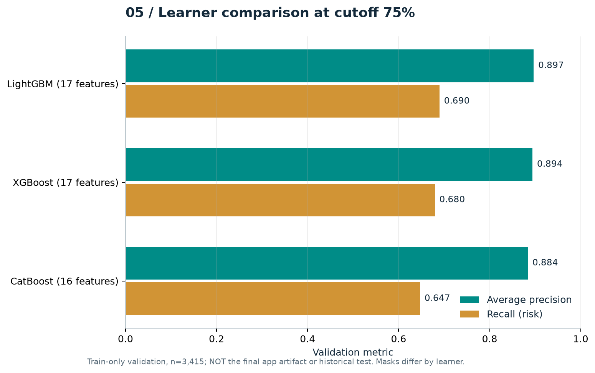
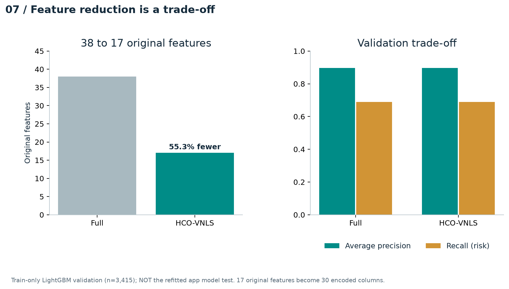

# Thực nghiệm và giới hạn kết luận — cập nhật 21/10/2026

## 1. Ba câu hỏi đánh giá

1. Model nhận diện nguy cơ Fail/Withdrawn trong OULAD ở mức nào?
2. Gợi ý quy tắc có đủ căn cứ, phù hợp và khả thi theo đánh giá giảng viên/cố vấn không?
3. Sau khi triển khai hỗ trợ, hành vi và kết quả học tập có thay đổi không, và thiết kế nghiên cứu có đủ sức quy thay đổi cho can thiệp không?

Hiện chỉ câu hỏi 1 có kết quả định lượng lịch sử. Câu hỏi 2 có bộ tình huống và phiếu đánh giá để thu thập, **chưa có người tham gia**. Câu hỏi 3 có giao thức theo dõi, **chưa có dữ liệu theo dõi can thiệp thực tế hoặc nhóm so sánh**. Kiểm thử phần mềm không trả lời thay câu hỏi 2/3.

## 2. Model, dữ liệu và cách chia tập

Artifact ứng dụng là HCO-VNLS chọn **17/38 đặc trưng gốc**, LightGBM 80 cây, cutoff 75%, threshold 0,50. SHA-256 model: `90c3f6e7bfdac2d9e62bcb836572f1a57c69fee3e4ef3dec22bd60b9850792db`. Giữ nguyên model, mask và threshold trong công việc này; không fit lại hoặc chọn threshold từ test.

| Tập | Lượt học lịch sử | Mục đích |
| --- | ---: | --- |
| Train | 16.297 | Tìm mask bằng CV theo nhóm sinh viên; fit model train-only |
| Validation | 3.415 | Báo cáo so sánh train-only; không coi là kết quả test của artifact refit |
| Train + validation | 19.712 | Fit artifact cuối sau khi khóa mask |
| Test lịch sử | 3.447 | Đánh giá artifact sau refit; không gọi là external holdout mới |

Đối chiếu mã gốc đã thực hiện:

- `shared_code/thuc_nghiem.py:chia_nhom` chia **ID sinh viên duy nhất**, seed 41, tỷ lệ nhóm 70/15/15; số lượt học giữa các tập có thể không đúng tuyệt đối tỷ lệ vì một sinh viên có nhiều lượt học.
- Notebook `05b_hco_vnls_lightgbm.ipynb` chỉ đưa train vào `MaskObjective`; `research_code/evaluation.py:group_cv_score` tạo pipeline trong từng fold GroupKFold và fit bằng dữ liệu fold train. Tiền xử lý nằm trong pipeline, không fit trên toàn test trước CV.
- Notebook `09_kiem_chung_dac_trung_hco_vnls.ipynb` dùng train cho tìm/ablation mask, validation để đối chiếu. Các kết quả validation đã được xem nhiều lần trong nghiên cứu nên không được trình bày như holdout độc lập mới.
- Notebook `10_dong_goi_model_hco_vnls_lightgbm_75.ipynb` kiểm tra các nhóm sinh viên không giao nhau, loại ID/nhãn/split khỏi mask, chỉ fit train + validation và giữ test riêng.

**Giới hạn kiểm chứng:** đây là đối chiếu source notebook, không phải chạy lại notebook huấn luyện. Dữ liệu OULAD thô có trong local nhưng tệp đặc trưng `du_lieu_cutoff_75.csv` được metadata tham chiếu và tệp dự đoán test lưu trữ không có ở đường dẫn đã công bố. Chưa tái kiểm chứng trực tiếp ID giữa các split của đúng tệp đã tạo artifact. Không tái tạo một bộ khác rồi gán kết quả cho model lịch sử.

Checksum metadata lịch sử dùng CRLF, checkout hiện tại dùng LF: bytes khác nhau nhưng chuyển riêng kết thúc dòng tái tạo đúng checksum cũ. Bộ kiểm tra được sửa để chấp nhận đúng hai biểu diễn LF/CRLF; thay nội dung, thêm khoảng trắng khác hoặc thay artifact vẫn bị từ chối. Không sửa checksum lịch sử để che khác biệt.

## 3. Kết quả dự báo lịch sử

Nguồn: [biên bản model](../model_final/MODEL_FINAL.md), [metric tổng hợp đã lưu](../model_final/verified_metrics.json). Lần rà soát này đối chiếu hash artifact, mask và tính lại metric suy ra từ confusion counts; **không tính lại AP/ROC-AUC từ dự đoán cấp dòng khi tệp đó chưa có**.

| Metric | Validation, train-only | Test lịch sử, artifact refit |
| --- | ---: | ---: |
| Accuracy | 0,8741 | 0,8619 |
| Precision nguy cơ | Xem bảng nghiên cứu train-only | 0,9123 |
| Recall nguy cơ | 0,6898 | 0,6570 |
| F1 nguy cơ | Xem bảng nghiên cứu train-only | 0,7639 |
| Average precision | 0,8968 | 0,8816 |
| ROC-AUC | Không dùng AP thay ROC-AUC | 0,9049 |
| Brier score | Không trộn với test | 0,1014 |

Confusion matrix ở threshold 0,50:

| Nhãn thực | Dự báo không nguy cơ | Dự báo nguy cơ |
| --- | ---: | ---: |
| Không nguy cơ | TN = 2.201 | FP = 74 |
| Nguy cơ | FN = 402 | TP = 770 |

Trong 1.172 lượt học nguy cơ thực, phát hiện 770 và bỏ sót **402 (34,3%)**. Trong 844 cảnh báo, có 74 báo nhầm. Precision cao đi cùng recall còn hạn chế; không chỉ dùng accuracy để kết luận hệ thống đủ bao phủ sinh viên cần hỗ trợ. Xác suất không đồng nghĩa chắc chắn trượt hoặc mức khẩn cấp sư phạm.







Các threshold khác chỉ minh họa đánh đổi số cảnh báo/precision/recall; **không dùng đồ thị test để chọn threshold mới**. Nếu cần thay ngưỡng, phải có tập hiệu chỉnh và thiết kế đánh giá riêng.





Giảm 38 xuống 17 đặc trưng là 55,3%, nhưng AP train-only validation của bộ chọn khoảng 0,8968 so với bộ đầy đủ 0,8970; recall cùng khoảng 0,6898. Không tuyên bố chọn đặc trưng làm tăng chất lượng vượt trội chỉ từ kết quả này. Xem thêm [phân bố lớp](../model_final/figures/00_split_and_classes.png), [calibration](../model_final/figures/03_calibration.png) và [ablation train-CV](../model_final/figures/06_feature_ablation.png).

## 4. Đánh giá chất lượng gợi ý — đã thiết kế, chưa thu thập

Luồng gợi ý giảng viên dùng quy tắc có bằng chứng, không phải model gợi ý được huấn luyện. [Bộ 10 tình huống](expert-cases.json) được tạo bằng mã quy tắc hiện tại và **đều là dữ liệu tổng hợp minh họa**. Bộ bao phủ G02/G03/G04, thiếu xác nhận, chỉ kiểm tra tổng hợp, xác nhận từng phần, mâu thuẫn số liệu và thay đổi sau xác nhận. Trường hợp từ chối là một phần của chất lượng gợi ý, không phải lúc nào cũng cần phát gợi ý.

Giao thức đề xuất:

- Mời 3–5 giảng viên/cố vấn phù hợp môn học, tự nguyện; đây là kế hoạch, chưa có lời mời hoặc đánh giá thực tế được thực hiện.
- Mỗi trường hợp có ít nhất hai người đánh giá độc lập. Đổi thứ tự trình bày, không hiển thị phần “purpose”/đáp án kiểm thử cho người chấm; dùng mã R01… và C01… thay thông tin cá nhân. [Bản dành cho người chấm](participant-cases.json) đã bỏ trường purpose.
- Thang 1–5 cho `grounding` (bám căn cứ), `appropriateness` (phù hợp trường hợp hoặc từ chối đúng), `feasibility` (khả thi), `clarity` (rõ ràng). 1: không phù hợp/không thể dùng; 3: cần chỉnh sửa đáng kể; 5: có thể dùng sau bước xác minh thường lệ. Điểm 2/4 nằm giữa các mức đó.
- Ghi ý kiến cần sửa, lý do với điểm ≤2 và quyết định dùng/sửa/không dùng trong phần nhận xét. Không biến điểm chuyên gia thành bằng chứng tác động học tập.
- Tổng hợp n người, n trường hợp và độ phủ trước khi tính điểm; báo cáo phân bố từng mức và nhận xét, không chỉ trung bình. Nếu chưa đủ hai lượt chấm/trường hợp thì ghi rõ phần còn thiếu; không gộp nhiều lượt của cùng người như nhiều chuyên gia.

[Phiếu trống](expert-ratings.template.json) có `ratings=[]`; [kết quả hiện tại](expert-summary.json) là **0 lượt chấm, 0 người chấm, điểm null**, chưa có kết luận chất lượng. Công cụ từ chối ID trùng, case không có trong bộ, điểm ngoài thang và điểm thấp thiếu giải thích.

```powershell
.venv/Scripts/python.exe scripts/recommendation_study.py
# Khi có phiếu thật được phép sử dụng, giữ tệp riêng ở .cache, không commit thông tin người tham gia:
.venv/Scripts/python.exe scripts/recommendation_study.py --ratings .cache/expert-ratings.json --output-dir .cache/expert-results
```

## 5. Theo dõi can thiệp và giới hạn nhân quả

Xem [giao thức quan sát](INTERVENTION_PROTOCOL.md). Chưa có dữ liệu theo dõi thực tế, không có nhóm so sánh và không điền kết quả giả vào bảng thực nghiệm. Việc API lưu/hoàn thành task trong kiểm thử chỉ chứng minh chức năng phần mềm.

Kết luận có thể bảo vệ hiện tại: model có khả năng nhận diện nguy cơ trên test OULAD lịch sử với đánh đổi đã nêu; hệ thống hỗ trợ ghi nhận bằng chứng và quyết định của giảng viên. Chưa thể kết luận gợi ý phù hợp HUIT đã được chuyên gia xác nhận, cải thiện học tập hoặc gây ra thay đổi kết quả.
