## 6.6. Cài đặt giao diện người dùng

Giao diện người dùng được xây dựng dưới dạng ứng dụng web bằng React và TypeScript, sử dụng Vite cho quá trình phát triển và đóng gói, kết hợp Tailwind CSS để tổ chức bố cục và định dạng thành phần. Việc cài đặt giao diện hướng tới hai nhóm nhu cầu: minh họa khả năng dự báo từ dữ liệu học tập và hỗ trợ các thao tác nghiệp vụ theo vai trò. Trên cơ sở đó, ứng dụng cung cấp không gian nhập liệu, trình bày kết quả phân tích và các màn hình quản lý, theo dõi nhiệm vụ gắn với từng nhóm người dùng.

Các màn hình được tổ chức trong thư mục `apps/frontend/src/pages`, trong khi những thành phần có thể dùng lại được đặt tại `components`. Lớp `services` đảm nhiệm giao tiếp với API và xử lý thông tin phiên; `AppContext` cung cấp trạng thái dùng chung như người dùng hiện hành, màn hình đang chọn, máy chủ API và lịch sử dự báo cục bộ. Cách tổ chức này giúp các trang chức năng tập trung vào trình bày và điều phối thao tác, đồng thời hạn chế việc lặp lại mã xử lý phiên hoặc lời gọi dịch vụ.

Giao diện được kết nối với backend FastAPI để sử dụng dữ liệu và kết quả suy luận thực của ứng dụng. Trong lần kiểm tra ngày 26/10/2026, frontend được truy cập qua `http://localhost:5173` ở lượt đầu và `http://127.0.0.1:5173` ở lượt bổ sung, còn backend tại `http://127.0.0.1:8000`. Dịch vụ kiểm tra sức khỏe phản hồi trạng thái hoạt động và xác nhận mô hình đã được nạp. Các giá trị trình bày trong tình huống Dashboard dưới đây là kết quả chạy trên bộ đầu vào tổng hợp minh họa, không đại diện cho hồ sơ sinh viên thực tế hoặc kết quả đánh giá chất lượng mô hình trên tập kiểm thử.

### 6.6.1. Giao diện chung và quản lý phiên

Màn hình đăng nhập là điểm truy cập đầu tiên khi ứng dụng chưa có người dùng hợp lệ trong trạng thái phiên. Biểu mẫu cho phép lựa chọn loại tài khoản trước khi nhập thông tin xác thực. Với sinh viên, trường định danh được hiển thị là mã số sinh viên; đối với giảng viên, cố vấn học tập và quản trị viên, biểu mẫu sử dụng email công tác. Sự thay đổi nhãn và cách nhập theo loại tài khoản giúp thống nhất thao tác giao diện với quy ước đăng nhập của backend. Trường mật khẩu có nút chuyển trạng thái ẩn hoặc hiện để người dùng kiểm tra nội dung khi cần.

Khi gửi yêu cầu đăng nhập, giao diện chuyển nút thao tác sang trạng thái đang xử lý và tạm thời vô hiệu hóa một số điều khiển liên quan. Sau khi nhận phản hồi thành công, dữ liệu tài khoản được ánh xạ sang cấu trúc người dùng của frontend và ứng dụng điều hướng tới không gian làm việc tương ứng. Quản trị viên được đưa tới trang quản lý tài khoản; các vai trò còn lại có trang cố vấn, giảng viên hoặc sinh viên theo cấu hình điều hướng. Thông báo phản hồi được trình bày bằng thành phần thông báo dùng chung, giúp người dùng nhận biết kết quả mà không phải rời khỏi màn hình hiện tại.

Màn hình xác thực có thẻ đăng ký tài khoản, tuy nhiên sự tồn tại của biểu mẫu này chưa đồng nghĩa ứng dụng mở đăng ký công khai. Theo cài đặt hiện hành, tài khoản được quản trị viên cấp qua phân hệ quản lý tài khoản; luồng đăng ký công khai hiển thị thông báo hướng dẫn liên hệ quản trị viên. Tương tự, liên kết hỗ trợ quên mật khẩu trên giao diện cần được diễn giải trong phạm vi chức năng thực có, không được xem như bằng chứng của một quy trình gửi email khôi phục đã hoạt động đầy đủ.

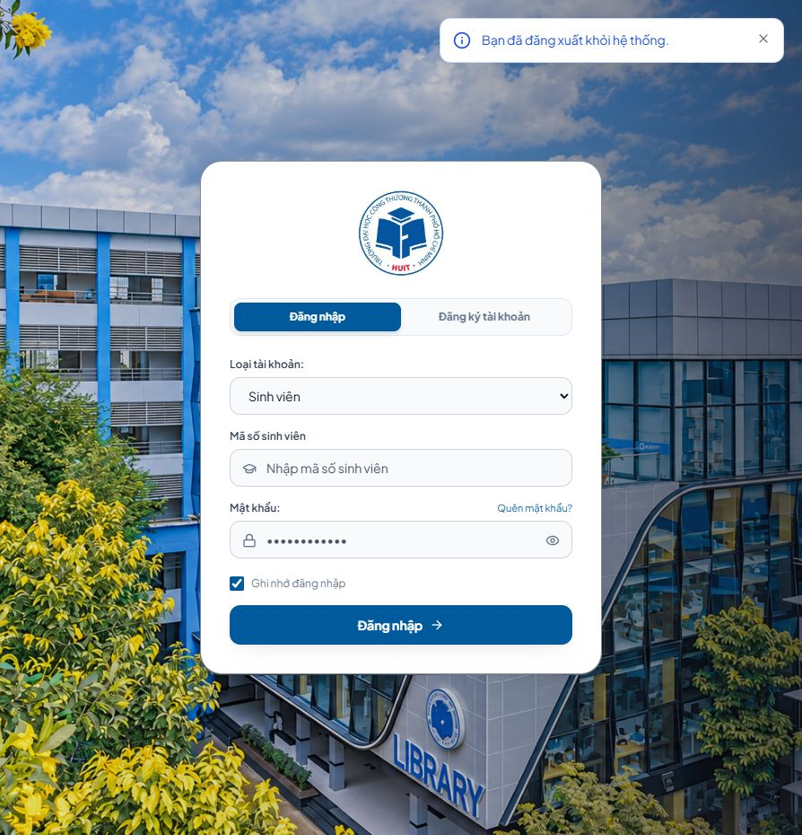

*Hình 6.6. Giao diện đăng nhập của ứng dụng trên môi trường local. Ảnh chụp ngày 26/10/2026, không chứa thông tin xác thực đã nhập.*

Sau khi đăng nhập, khung ứng dụng gồm thanh điều hướng bên, thanh công cụ phía trên, vùng nội dung và phần thông tin cuối trang. Menu chức năng được tạo theo vai trò, bên cạnh các mục dùng chung như Dashboard và hồ sơ cá nhân. Trên màn hình có chiều rộng lớn, thanh bên được bố trí cùng vùng nội dung và có cơ chế thu gọn. Khi không gian hiển thị hạn chế, nút mở menu cho phép truy cập điều hướng mà không duy trì một cột menu chiếm diện tích thường trực. Việc phân tách khung trang với nội dung giúp giữ cách tương tác nhất quán khi chuyển giữa các phân hệ.

Hồ sơ cá nhân được tổ chức thành các khối thông tin nhận diện, cập nhật thông tin liên hệ và thông tin tài khoản do hệ thống quản lý. Người dùng có thể điều chỉnh các trường được cho phép, trong khi email, vai trò và mã tài khoản được trình bày theo quyền quản lý của hệ thống. Thành phần ảnh đại diện hỗ trợ lựa chọn tệp, xem trước và gửi cập nhật qua backend; giao diện thông báo loại ảnh và giới hạn dung lượng được chấp nhận. Các trạng thái thay đổi dữ liệu, đang xử lý và phản hồi từ API được sử dụng để điều khiển nút lưu và thông báo kết quả.

Ứng dụng còn cung cấp chế độ hiển thị sáng và tối thông qua nút chuyển chủ đề ở màn hình xác thực và thanh công cụ. Lựa chọn chủ đề được quản lý bằng trạng thái ứng dụng và bộ nhớ trình duyệt theo cài đặt hiện hành. Đối với thông tin phiên, frontend phối hợp dữ liệu người dùng với các hàm lưu, lấy và xóa token trong lớp dịch vụ. Cơ chế hiển thị menu theo vai trò phục vụ điều hướng, còn quyết định cho phép truy cập dữ liệu vẫn phải được backend kiểm tra độc lập. Trong phạm vi phiên bản nghiên cứu, việc lưu token trong trình duyệt cần được đánh giá lại nếu triển khai ở môi trường có yêu cầu bảo mật cao hơn.

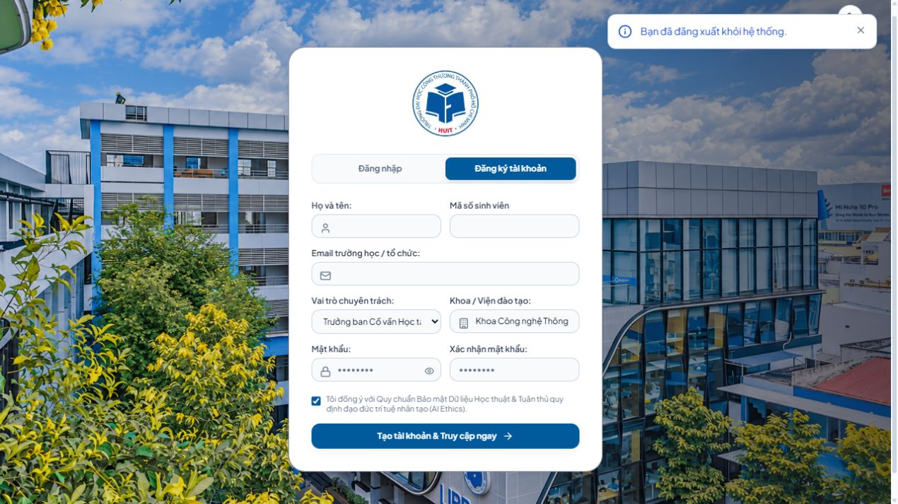

*Hình 6.7. Thẻ đăng ký đang hiển thị trên giao diện. Chức năng đăng ký công khai vẫn bị khóa theo xử lý hiện hành; ảnh không chứng minh tài khoản đã được tạo.*

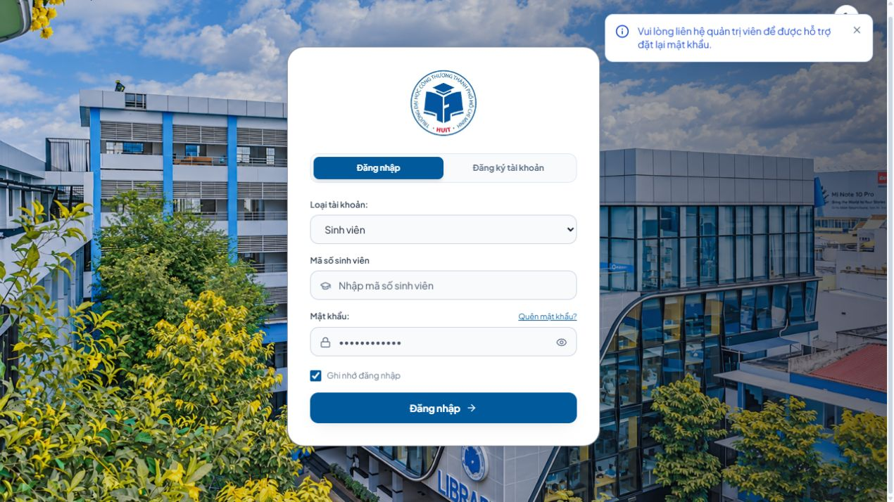

*Hình 6.8. Thông báo hướng dẫn người dùng liên hệ quản trị viên khi quên mật khẩu; chưa thực hiện quy trình gửi email khôi phục.*

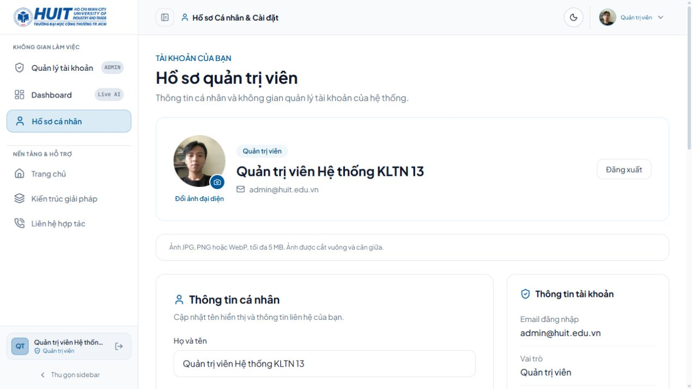

*Hình 6.9. Trang hồ sơ của tài khoản quản trị mẫu, gồm ảnh đại diện, thông tin cá nhân và các trường do hệ thống quản lý. Không lưu thay đổi trong lượt chụp.*

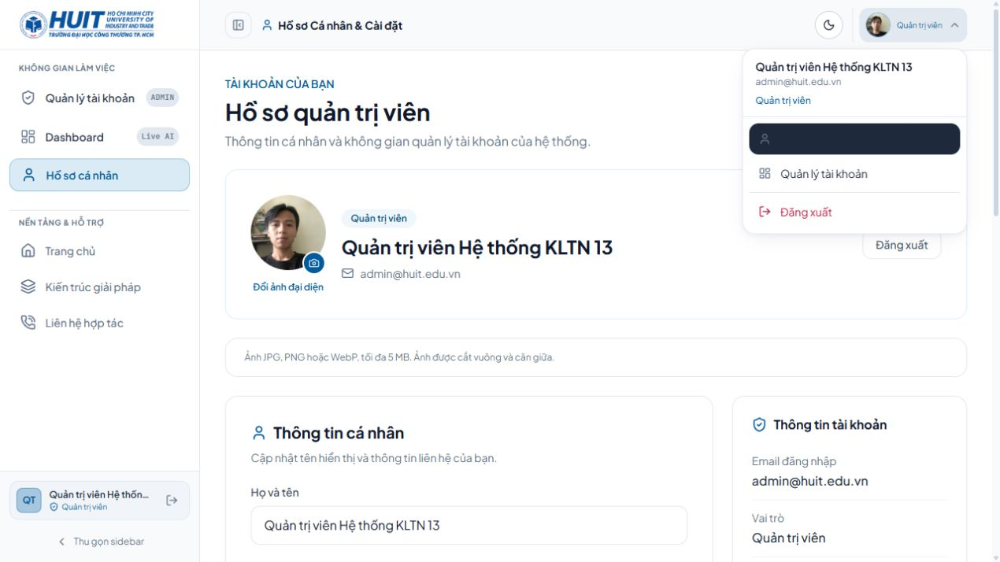

*Hình 6.10. Menu tài khoản với các lối tắt tới hồ sơ, không gian làm việc và đăng xuất.*

### 6.6.2. Giao diện nhập thông tin và dự báo minh họa

Dashboard cung cấp biểu mẫu nhập 17 đặc trưng đầu vào của mô hình tại mốc quan sát 75% thời lượng học phần. Các trường được chia thành ba nhóm: nhân khẩu và đăng ký với sáu trường, tương tác LMS/VLE với tám trường, bài nộp và đánh giá với ba trường. Cách phân nhóm giúp người dùng tiếp cận bộ đầu vào theo ý nghĩa dữ liệu thay vì xử lý một danh sách dài không có cấu trúc. Mỗi trường được gắn nhãn và thông tin hỗ trợ; các trường lựa chọn sử dụng danh sách giá trị, còn trường định lượng được cài đặt dưới dạng điều khiển số.

Các thuộc tính giới hạn nhỏ nhất, lớn nhất và bước nhập được truyền từ định nghĩa trường vào biểu mẫu. Nhờ đó, trình duyệt có thể phát hiện một số dữ liệu không phù hợp trước khi gửi yêu cầu. Tuy nhiên, kiểm tra tại giao diện chỉ là một lớp hỗ trợ người nhập; tính hợp lệ của request và các quan hệ giữa chỉ số vẫn cần được kiểm tra ở lớp xử lý tương ứng và backend. Những quan hệ như số bài trễ so với số bài đã nộp, hoặc số click trong các cửa sổ quan sát, cần được diễn giải theo hợp đồng dữ liệu thay vì chỉ dựa trên miền giá trị của từng ô riêng lẻ.

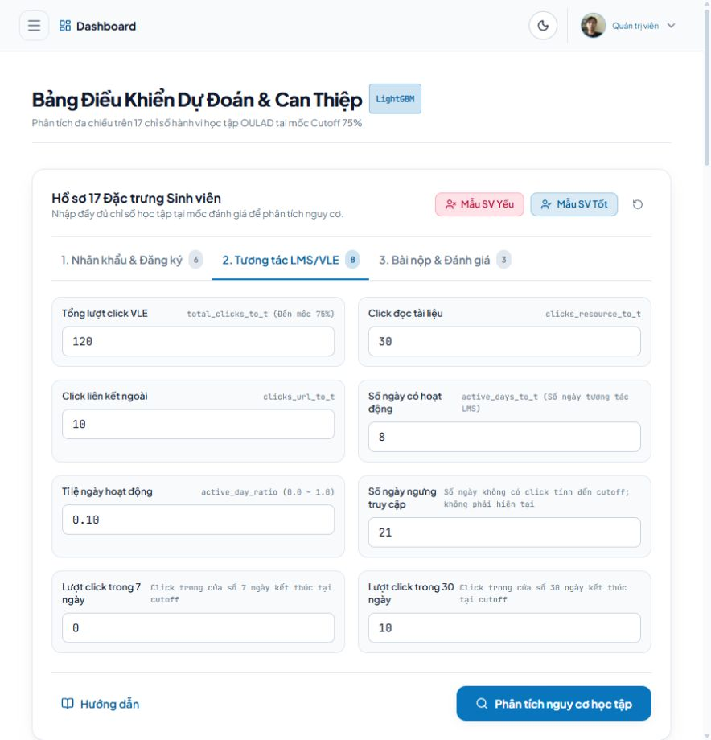

*Hình 6.11. Nhóm trường tương tác LMS/VLE trong biểu mẫu dự báo. Dữ liệu trong hình là bộ tổng hợp minh họa đã điều chỉnh để phù hợp bước nhập của form.*

Người dùng có thể nhập trực tiếp, nạp bộ giá trị minh họa hoặc khôi phục các trường về giá trị mặc định. Các nút mẫu hỗ trợ quá trình trình diễn và kiểm tra chức năng, không phải thao tác lựa chọn một hồ sơ thực đã được xác minh. Khi nhấn nút phân tích, giao diện chuyển sang trạng thái đang chờ, gửi dữ liệu tới API dự báo và cập nhật vùng kết quả sau khi nhận phản hồi. Trạng thái ban đầu được thể hiện bằng thông báo chờ phân tích, giúp phân biệt việc chưa gửi dữ liệu với một kết quả dự báo đã có.

Kết quả được trình bày bằng nhãn và đồng hồ nguy cơ, trong đó xác suất lớp nguy cơ được quy đổi sang phần trăm để thuận tiện quan sát. Trong tình huống đã kiểm tra, bộ dữ liệu tổng hợp sau điều chỉnh cho kết quả khoảng 90,8% và được giao diện xếp vào nhóm nguy cơ cao theo threshold của artifact. Giá trị này chỉ mô tả phản hồi của một yêu cầu minh họa. Nó không phải độ chính xác của hệ thống và không được sử dụng để kết luận về tình trạng của một cá nhân ngoài dữ liệu đang xét. Việc lựa chọn threshold và đánh giá mô hình thuộc quy trình thực nghiệm riêng.

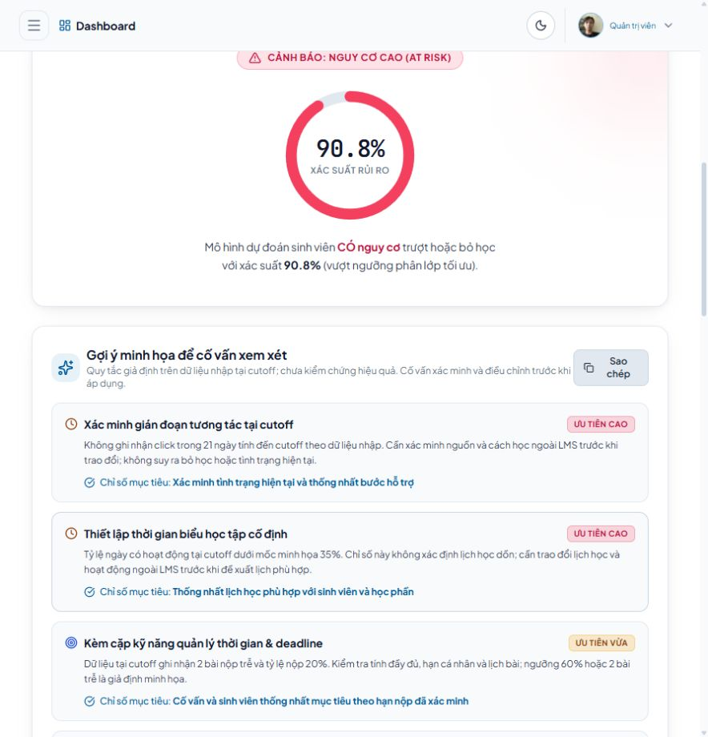

*Hình 6.12. Vùng kết quả của Dashboard trong tình huống minh họa. Các đề xuất được ghi là gợi ý để cố vấn xem xét; thao tác dự báo không tự tạo kế hoạch hỗ trợ.*

Cùng với xác suất, giao diện hiển thị các gợi ý quy tắc kèm mô tả tín hiệu, mức ưu tiên xem xét và mục tiêu trao đổi. Trong tình huống minh họa, nội dung đề xuất đề cập việc xác minh gián đoạn tương tác, trao đổi lịch học và kiểm tra tình hình nộp bài. Các đoạn giải thích nhắc người phụ trách đối chiếu nguồn và hoạt động ngoài LMS trước khi áp dụng. Nút sao chép hỗ trợ sử dụng lại nội dung khi trao đổi; thao tác này không thay thế bước tạo kế hoạch hoặc giao nhiệm vụ trong phân hệ nghiệp vụ.

Biểu đồ radar sáu chiều cung cấp một cách nhìn bổ sung về các chỉ số hành vi tại cutoff. Các chiều được đối chiếu với mốc tham khảo và đi kèm giá trị gốc, đơn vị cùng tỷ lệ so với mốc. Cách hiển thị này hỗ trợ nhận biết chỉ số cần xem xét nhưng không biến mốc tham chiếu thành phân vị thống kê hoặc thang đo năng lực đã được kiểm định. Các ngưỡng màu trên biểu đồ là quy ước trình bày; chúng không phải một bộ phân loại nguy cơ độc lập thay thế kết quả model.

Phía dưới Dashboard là bảng lịch sử đánh giá của tài khoản, cho phép tìm kiếm, xuất CSV và thao tác với bản ghi cục bộ. Theo cài đặt hiện tại, thành phần này lưu tối đa 50 kết quả gần nhất trong LocalStorage theo tài khoản. Vì vậy, lịch sử hiển thị tại Dashboard cần được phân biệt với lịch sử dự báo nghiệp vụ trong cơ sở dữ liệu. Việc xóa hoặc mất dữ liệu trình duyệt có thể ảnh hưởng phần lịch sử cục bộ; không thể xem nó như kho lưu trữ tập trung dùng chung giữa mọi thiết bị.

Bên cạnh tình huống nguy cơ cao, bộ ảnh được bổ sung trường hợp nạp “Mẫu SV Tốt” và gửi dự báo thành công. Giao diện trả xác suất nguy cơ khoảng 7,7%, thấp hơn threshold 0,50, đồng thời hiển thị nhãn “AN TOÀN: TIẾN ĐỘ TỐT” và gợi ý duy trì theo dõi kế hoạch học phần. Đây là nhãn của ứng dụng trên dữ liệu tổng hợp; xác suất thấp không bảo đảm sinh viên chắc chắn đạt học phần và không thay thế việc theo dõi dữ liệu thực tế. Việc trình bày đồng thời hai tình huống giúp minh họa sự thay đổi kết quả giao diện theo đầu vào, thay vì chỉ lựa chọn một trường hợp cảnh báo cao.

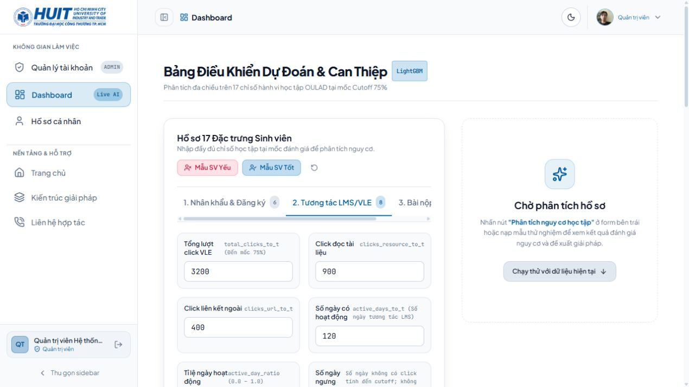

*Hình 6.13. Biểu mẫu sau khi nạp dữ liệu tổng hợp của mẫu sinh viên tốt, trước khi nhận kết quả dự báo.*

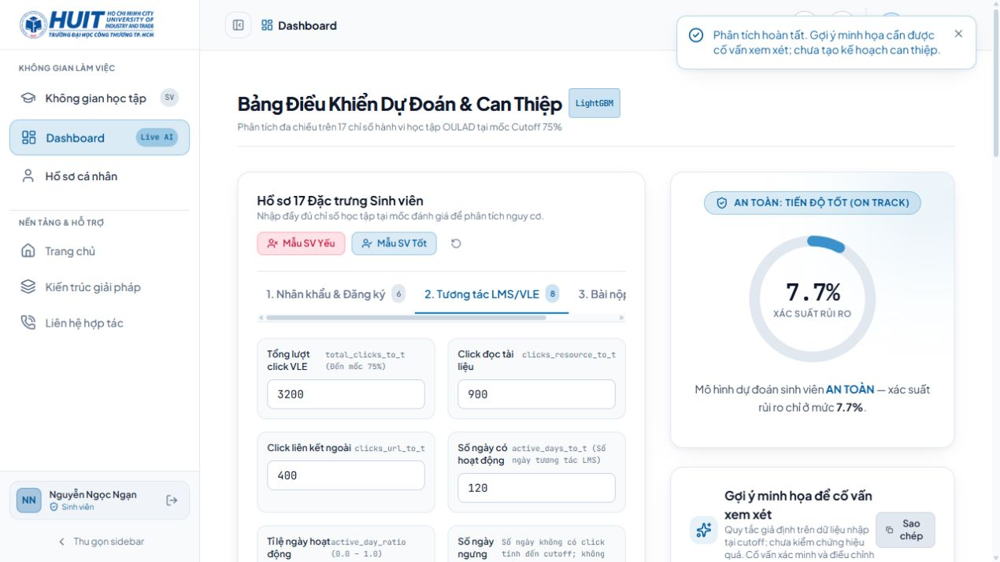

*Hình 6.14. Kết quả dự báo mẫu tốt với xác suất nguy cơ khoảng 7,7% và gợi ý tiếp tục theo dõi. Không phải kết quả đánh giá độ chính xác model.*

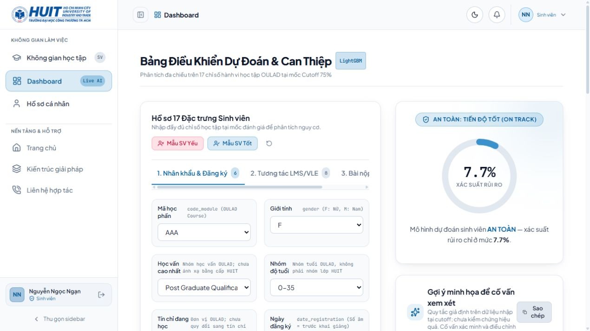

*Hình 6.15. Sáu trường nhân khẩu và đăng ký trong biểu mẫu đầu vào, bên cạnh kết quả dự báo trên mẫu tổng hợp.*

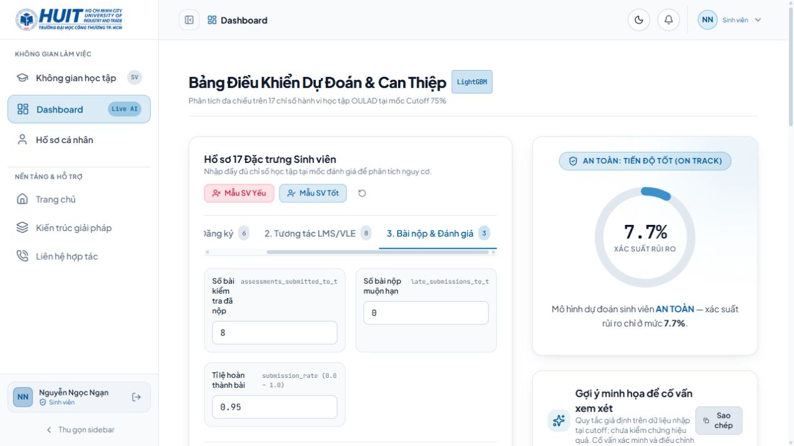

*Hình 6.16. Nhóm ba trường về bài đã nộp, bài trễ và tỷ lệ nộp; giá trị thuộc tình huống tổng hợp minh họa.*

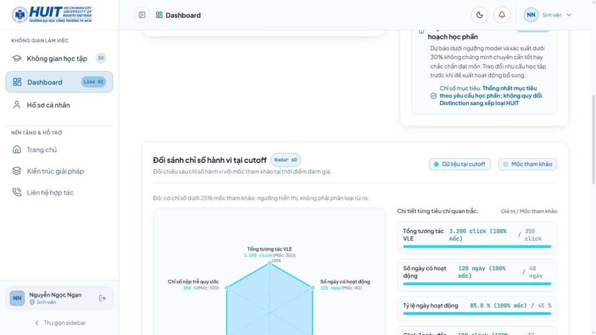

*Hình 6.17. Radar sáu chiều kèm các tỷ lệ so với mốc tham khảo. Đây là quy ước hiển thị, không phải phân vị hay thang năng lực đã kiểm định.*

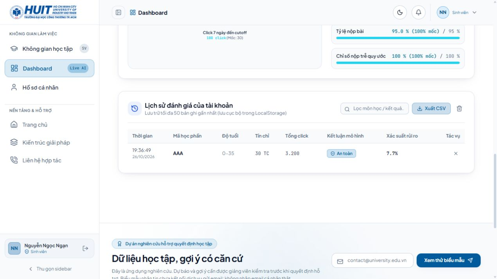

*Hình 6.18. Bảng lịch sử cục bộ theo tài khoản với tìm kiếm, nút xuất CSV và thao tác xóa. Không thực hiện xóa lịch sử trong lượt chụp bổ sung.*

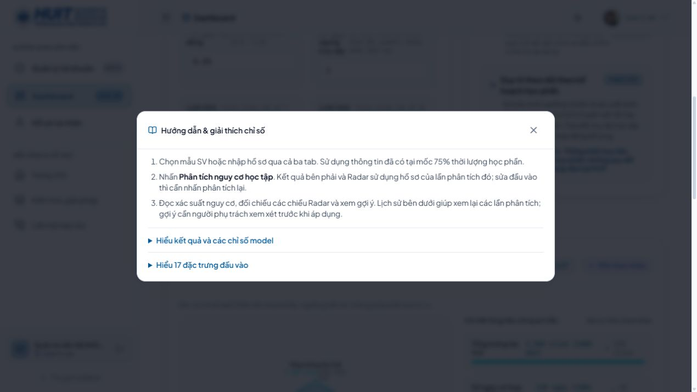

*Hình 6.19. Hộp thoại hướng dẫn nhập dữ liệu, đọc kết quả và giải thích chỉ số; các nhóm nội dung có thể mở rộng.*

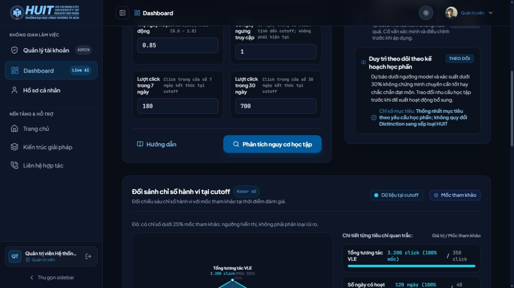

*Hình 6.20. Dashboard ở chế độ tối. Sau khi chụp đã khôi phục chế độ sáng trong phiên quan sát.*

### 6.6.3. Giao diện quản trị viên

Không gian quản trị được tổ chức quanh chức năng quản lý tài khoản. Màn hình danh sách trình bày thông tin nhận diện, mã sinh viên hoặc giảng viên nếu có, vai trò, trạng thái hoạt động và ngày cấp. Các nút thao tác được đặt cùng bản ghi để người quản trị xác định rõ đối tượng đang xử lý. Trong lần truy cập local, danh sách đã được tải từ backend và hiển thị được các tài khoản theo dữ liệu hiện có, xác nhận kết nối giữa thành phần danh sách và dịch vụ quản lý người dùng.

Khu vực tìm kiếm và bộ lọc cho phép thu hẹp các bản ghi đang xem theo thông tin tài khoản, vai trò và trạng thái. Giao diện cũng trình bày thông tin trang và các nút chuyển trang. Một điểm cần giữ đúng khi mô tả là bộ tìm kiếm và bộ lọc hiện được ghi rõ áp dụng trong trang dữ liệu hiện tại. Do đó, không diễn giải chúng thành một chức năng tìm kiếm toàn bộ cơ sở dữ liệu nếu backend và luồng giao diện chưa thực hiện phạm vi đó.

Thao tác cấp tài khoản mở hộp thoại nhập thông tin và lựa chọn vai trò. Các trường bắt buộc thay đổi phù hợp loại hồ sơ, chẳng hạn mã sinh viên đối với tài khoản sinh viên. Biểu mẫu có khu vực nhập mật khẩu ban đầu và hướng dẫn bàn giao cho người nhận. Trong lượt quan sát, hộp thoại đã được mở để kiểm tra cấu trúc rồi đóng mà không gửi dữ liệu. Việc xác nhận tài khoản mới được tạo thành công cần một ca kiểm thử riêng có kiểm soát đối với dữ liệu được phép thay đổi.

Danh sách còn cung cấp thao tác xem, sửa, đặt lại mật khẩu và thay đổi trạng thái tài khoản theo cài đặt. Các hành động tác động dữ liệu được tách khỏi thao tác tra cứu và cần được thực hiện trên đúng đối tượng. Giao diện hiện vô hiệu hóa một số thao tác đối với tài khoản quản trị đang sử dụng, chẳng hạn tự khóa trong danh sách. Những ràng buộc hiển thị này giúp giảm thao tác nhầm, đồng thời vẫn cần backend bảo đảm kiểm tra quyền và điều kiện nghiệp vụ.

Phạm vi giao diện quản trị trong mục này tập trung vào những chức năng thực sự được hiện thực trên trang tài khoản. Sự tồn tại của các API quản trị đào tạo, mô hình hoặc audit không được dùng để suy ra rằng mọi nghiệp vụ đó đều đã có màn hình hoàn chỉnh. Khi bổ sung các không gian quản trị khác, cần tiếp tục đối chiếu chức năng hiển thị với hợp đồng API và quyền truy cập tương ứng.

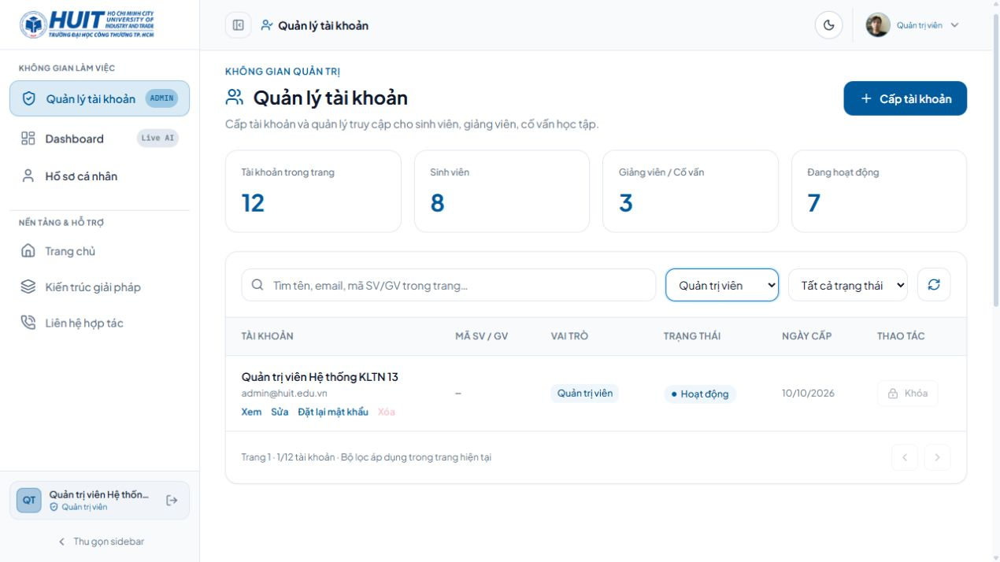

*Hình 6.21. Trang quản lý tài khoản đã lọc vai trò quản trị viên, minh họa danh sách, bộ lọc, tìm kiếm và phân trang mà không hiển thị toàn bộ danh sách sinh viên.*

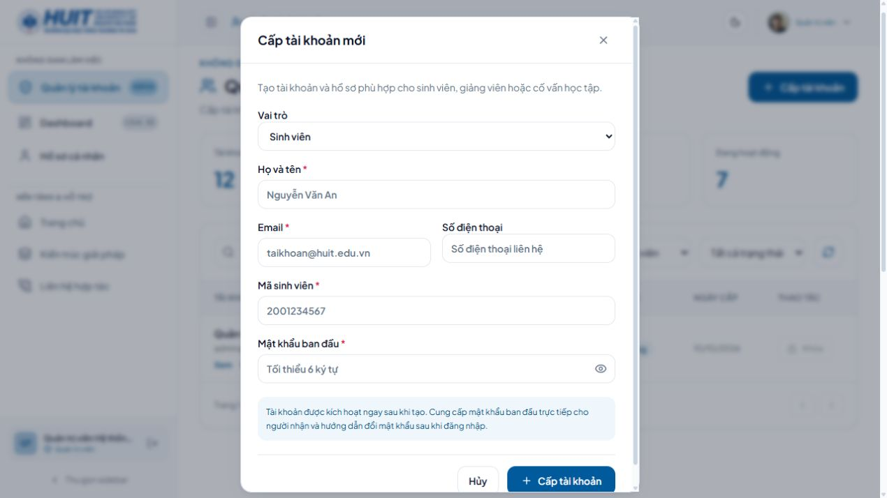

*Hình 6.22. Hộp thoại cấp tài khoản sinh viên có mã sinh viên và các trường bắt buộc; không nhập hoặc lưu tài khoản mới.*

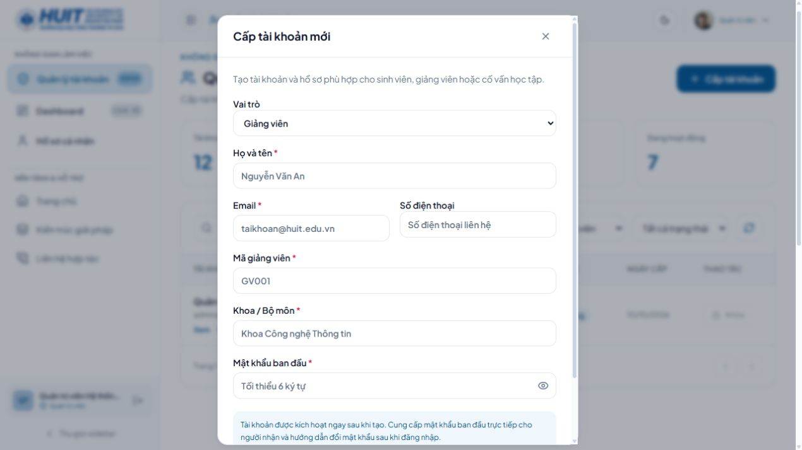

*Hình 6.23. Hộp thoại cấp tài khoản giảng viên bổ sung mã giảng viên và khoa hoặc bộ môn; chưa xác nhận tạo tài khoản.*

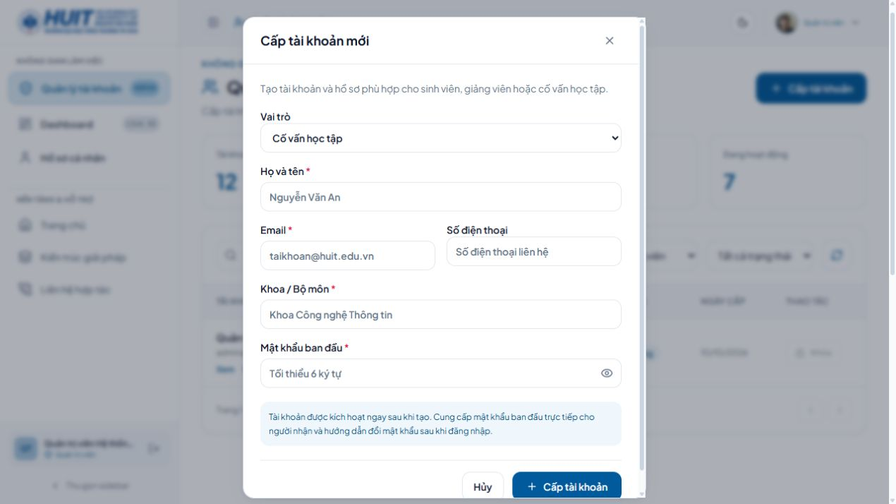

*Hình 6.24. Biểu mẫu cố vấn học tập với thông tin đơn vị; chỉ chuyển vai trò để quan sát cấu trúc trường.*

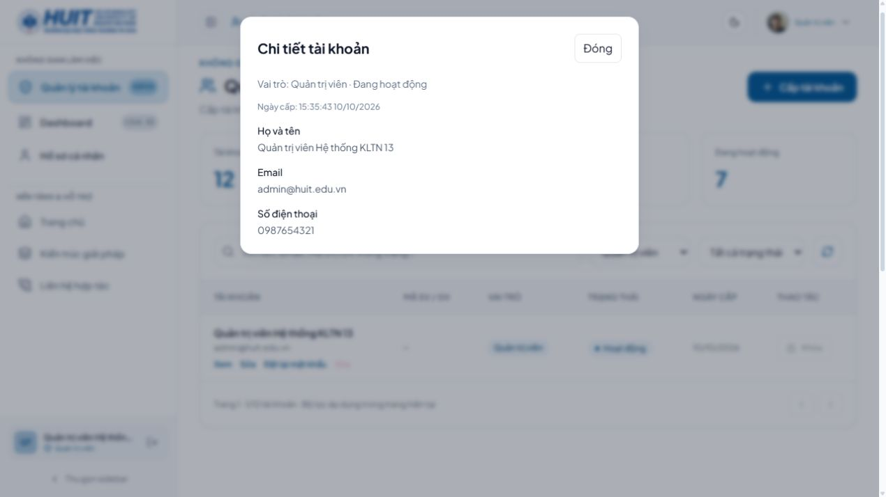

*Hình 6.25. Hộp thoại tra cứu thông tin tài khoản quản trị mẫu; thao tác xem không thay đổi bản ghi.*

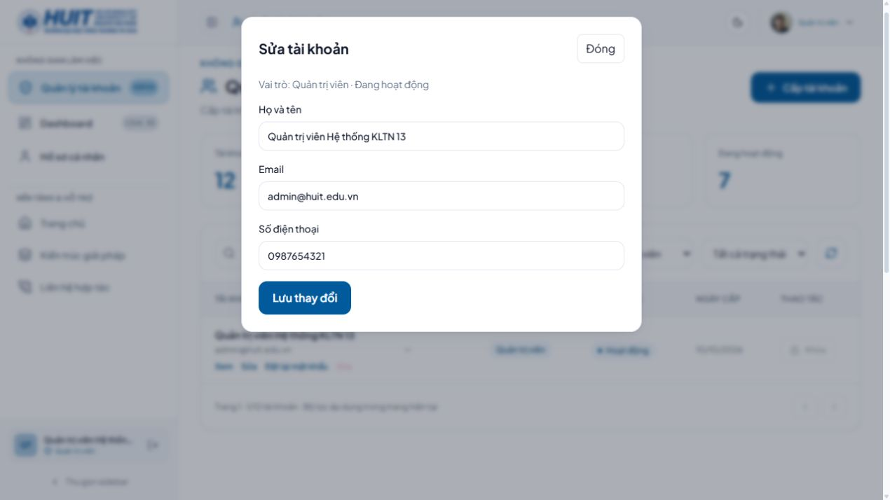

*Hình 6.26. Hộp thoại sửa tài khoản được mở để ghi nhận giao diện; đóng mà không bấm lưu.*

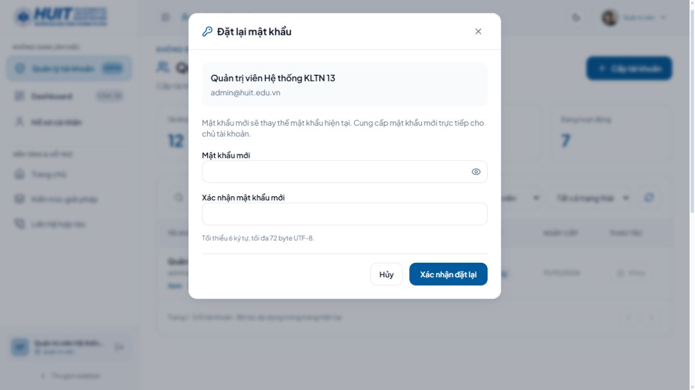

*Hình 6.27. Hộp thoại đặt lại mật khẩu ở trạng thái chưa nhập. Không nhập, xác nhận hoặc thay đổi mật khẩu trong quá trình chụp.*

### 6.6.4. Giao diện cố vấn học tập

Phân hệ cố vấn được cài đặt trong `AdvisorPage`, tổ chức dữ liệu theo lớp sinh hoạt và sinh viên thuộc phạm vi phụ trách. Các khối lựa chọn lớp tạo điểm vào cho việc xem danh sách sinh viên, giúp đặt hoạt động theo dõi trong ngữ cảnh quản lý cụ thể. Dữ liệu được lấy qua lớp dịch vụ dành cho cố vấn; giao diện không tự tạo phạm vi truy cập chỉ từ thông tin được lựa chọn trên trình duyệt.

Từ danh sách, luồng cài đặt cho phép truy vấn các học phần của sinh viên để lựa chọn đối tượng cần hỗ trợ. Việc gắn quyết định với học phần hoặc enrollment giúp phân biệt tình hình ở từng lượt đăng ký, thay vì sử dụng một đánh giá chung để áp dụng cho mọi môn. Các thông tin nguy cơ và chỉ số hành vi được sử dụng như đầu vào để cố vấn xem xét, không thay thế trách nhiệm đối chiếu tình hình học tập và nguồn dữ liệu.

Biểu mẫu lập kế hoạch can thiệp cho phép cố vấn xác định nội dung hỗ trợ và các nhiệm vụ liên quan theo cấu trúc nghiệp vụ hiện hành. Giao diện điều phối việc chọn sinh viên, học phần và dữ liệu cần thiết trước khi gửi yêu cầu tạo kế hoạch. Các trường hợp không có lớp, chưa có dữ liệu hoặc lỗi từ dịch vụ cần được thể hiện bằng trạng thái tương ứng, tránh tạo cảm giác sinh viên không có nguy cơ chỉ vì dữ liệu chưa được tải.

Vai trò của giao diện cố vấn là tạo một không gian theo dõi và tổ chức hỗ trợ, trong đó người sử dụng có thể kết nối kết quả phân tích với quyết định nghiệp vụ. Lượt đăng nhập bổ sung bằng tài khoản cố vấn đã tải được một lớp và một sinh viên thuộc phạm vi phụ trách. Giao diện ghi nhận sinh viên mới có dự báo cho hai trong ba học phần và hiển thị trạng thái “Chưa đủ dự báo”. Nút “Can thiệp” bị vô hiệu hóa với giải thích chỉ lập kế hoạch cho sinh viên nguy cơ cao. Ảnh vì vậy minh họa được cách thể hiện dữ liệu và điều kiện thao tác, nhưng chưa chứng minh việc tạo kế hoạch thành công; không thay đổi dữ liệu để ép mở biểu mẫu.

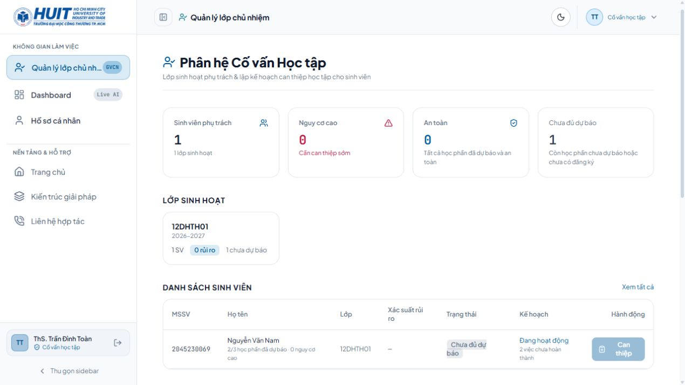

*Hình 6.28. Phân hệ cố vấn với lớp được phân công, thống kê nguy cơ và trạng thái chưa đủ dự báo; thao tác can thiệp bị khóa theo điều kiện hiện tại.*

### 6.6.5. Giao diện giảng viên

Phân hệ giảng viên được triển khai trong `LecturerPage`, cung cấp điểm vào theo lớp học phần được phân công. Màn hình có bảng cảnh báo nguy cơ và các thao tác để xem dữ liệu của sinh viên trong phạm vi học phần. Cách tổ chức này gắn việc xem xét gợi ý với bối cảnh giảng dạy, đồng thời tạo điều kiện đối chiếu tiến độ và bài đánh giá trước khi quyết định hỗ trợ.

Thành phần `SuggestionReview` tổ chức nội dung chi tiết thành hai thẻ ở phiên bản mã hiện hành: “Thông tin & căn cứ” và “Gợi ý & giao bài”. Thẻ thông tin tập trung dữ liệu ghi nhận, đầu vào model và các nội dung giải thích phù hợp. Thẻ hành động dành cho việc xem gợi ý và chuẩn bị quyết định giao nhiệm vụ. Việc tách hai vùng này giúp giữ được bước xem căn cứ trước khi thực hiện hành động; không mô tả số lượng thẻ theo một phiên bản cũ khi cấu trúc giao diện đã thay đổi.

Ở vùng thông tin, dữ liệu được chia nhóm và hỗ trợ biểu diễn bằng bảng hoặc biểu đồ theo loại căn cứ. Thành phần giải thích dự báo trình bày đóng góp của các đầu vào đối với kết quả model khi có dữ liệu giải thích hợp lệ. Những đóng góp này được diễn giải theo cơ chế mô hình và đơn vị đang sử dụng, không được đồng nhất với mức ảnh hưởng nhân quả của hành vi lên kết quả học tập. Việc một đầu vào đẩy dự báo về phía nguy cơ không đủ để kết luận thay đổi riêng đầu vào đó sẽ làm giảm khả năng trượt môn.

Thành phần rà soát snapshot cung cấp giao diện đọc dữ liệu từ database và ghi nhận phạm vi xác nhận theo hợp đồng nghiệp vụ. Tính đầy đủ của nguồn và tình trạng dữ liệu minh họa cần được hiển thị để giảng viên biết giới hạn sử dụng. Khi chưa đủ căn cứ, giao diện phải giữ thông tin về lý do không có gợi ý hoặc không thể thực hiện bước tiếp theo, thay vì diễn giải thành kết luận không cần hỗ trợ. Phạm vi phát hiện thay đổi căn cứ còn phụ thuộc cơ chế backend và cần được kiểm chứng riêng.

Khi có gợi ý phù hợp, giảng viên lựa chọn nội dung, điều chỉnh bản nháp và chủ động xác nhận giao nhiệm vụ. Bản nháp tạo khoảng chuyển giữa đề xuất tự động và hành động của người phụ trách, cho phép điều chỉnh cách diễn đạt và yêu cầu thực hiện theo học phần. Việc giao nhiệm vụ vẫn chịu điều kiện về enrollment, kế hoạch và quyền truy cập từ backend. Trong phạm vi mô tả giao diện, không coi việc hiển thị một nút giao bài là bằng chứng mọi tình huống đều đủ điều kiện ghi dữ liệu thành công.

Trong lượt quan sát bằng tài khoản giảng viên được cung cấp, lớp học phần AAA, đợt mở 2013J, hiển thị hai sinh viên cùng các điều khiển tìm kiếm, lọc mức cảnh báo và sắp xếp. Chi tiết sinh viên có thể mở được hai thẻ nghiệp vụ và biểu mẫu đọc snapshot. Ở hồ sơ được xem, nguồn chưa được xác minh đủ và chưa có kế hoạch hỗ trợ đang hoạt động phù hợp; ứng dụng vì vậy giữ trạng thái chưa có gợi ý đủ điều kiện và khóa nút giao bài. Việc từ chối ở đây là phản hồi theo điều kiện dữ liệu, không được mô tả thành một lượt giao nhiệm vụ đã hoàn thành.

Ngoài luồng gợi ý, giao diện có hộp thoại soạn cảnh báo học vụ tới cố vấn và các tùy chọn điều chỉnh mức bài tập khi soạn nháp. Bộ ảnh ghi nhận các điều khiển này ở trạng thái mở để quan sát. Không gửi cảnh báo, không xác nhận nguồn và không tạo nhiệm vụ trong quá trình bổ sung minh chứng.

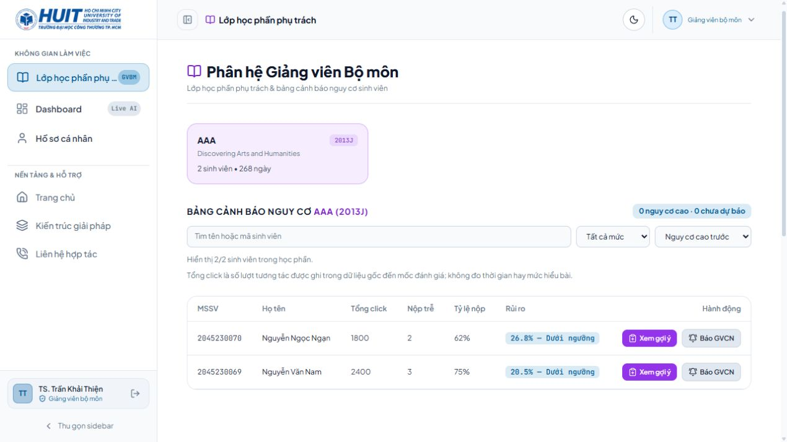

*Hình 6.29. Danh sách học phần phụ trách, bảng cảnh báo và điều khiển tìm kiếm, lọc, sắp xếp sinh viên.*

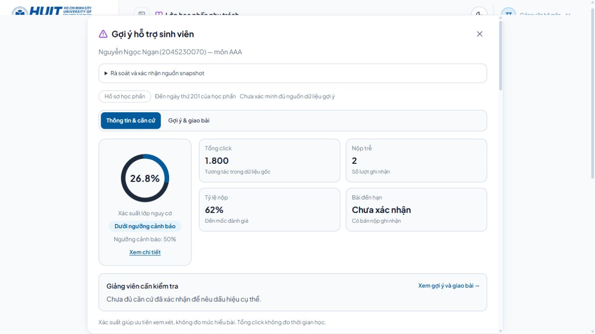

*Hình 6.30. Chi tiết hồ sơ học phần với nguy cơ, thông tin quan sát và trạng thái xác nhận nguồn.*

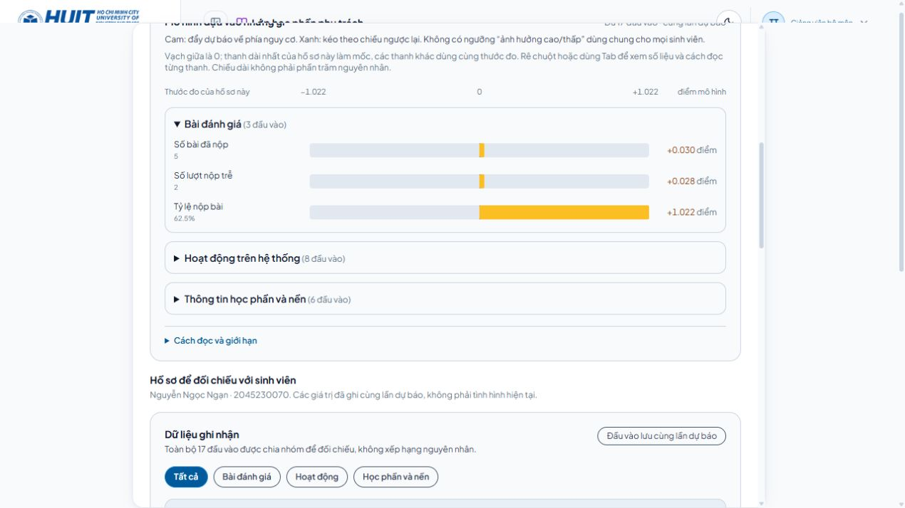

*Hình 6.31. Phần giải thích đóng góp đầu vào và dữ liệu học tập trong thẻ thông tin. Đóng góp model không được hiểu là ảnh hưởng nhân quả.*

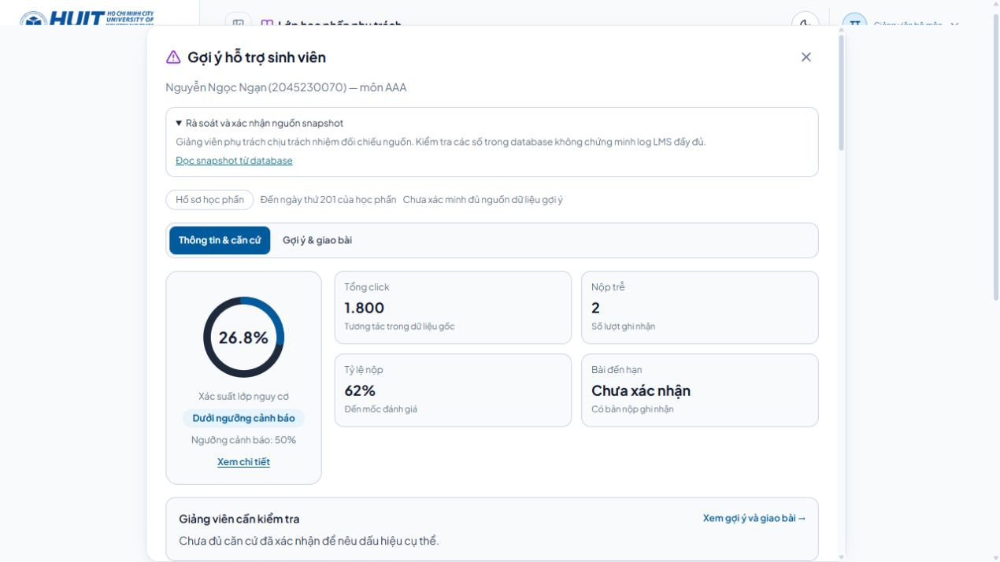

*Hình 6.32. Khối mở rộng cho thao tác đọc và rà soát nguồn; chưa tạo xác nhận dữ liệu.*

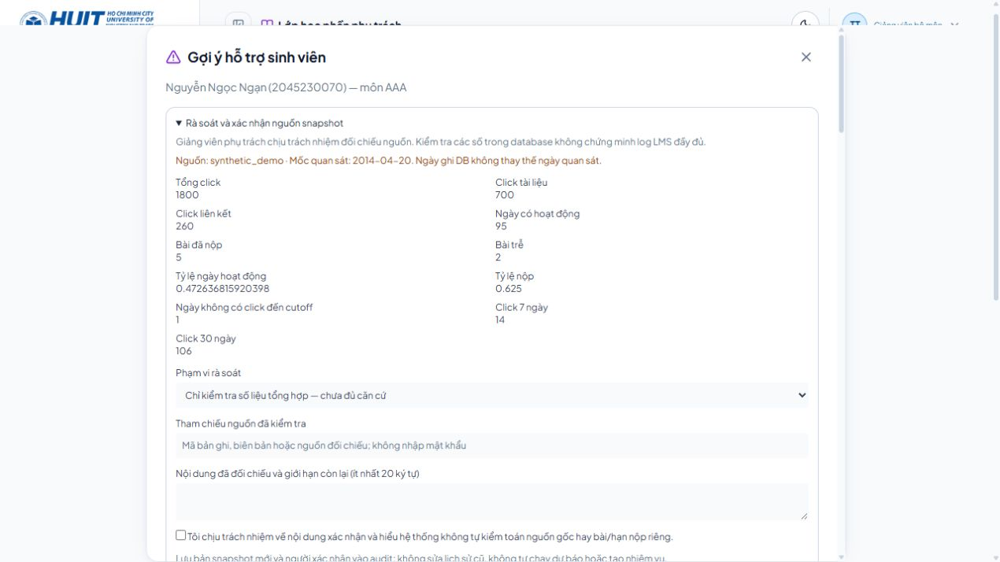

*Hình 6.33. Dữ liệu snapshot sau khi đọc từ database, phạm vi rà soát, tham chiếu nguồn và điều kiện lưu xác nhận.*

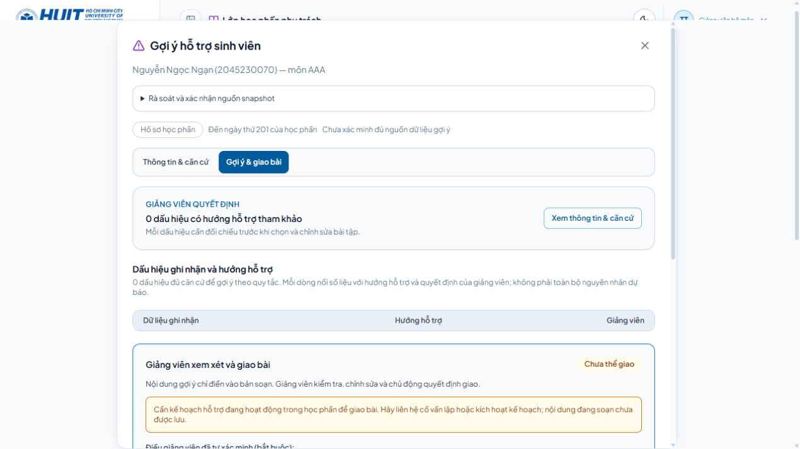

*Hình 6.34. Thẻ hành động thể hiện chưa có gợi ý đủ điều kiện và chưa thể giao do thiếu kế hoạch hỗ trợ phù hợp.*

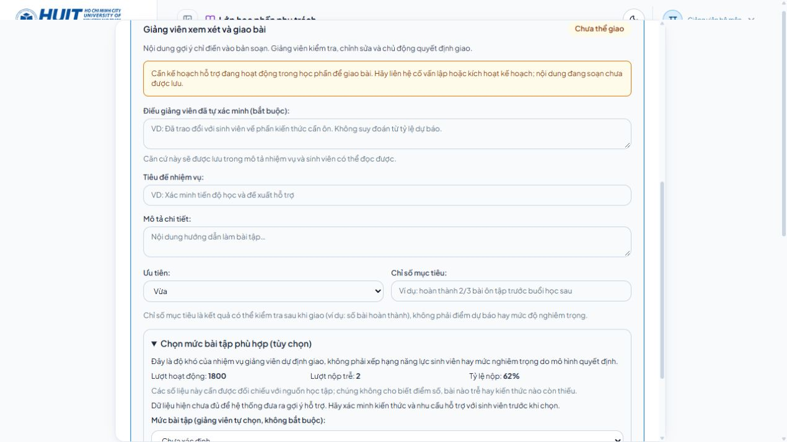

*Hình 6.35. Các trường soạn nháp, mức ưu tiên, chỉ số mục tiêu và tùy chọn mức bài tập. Không lưu hay giao nhiệm vụ.*

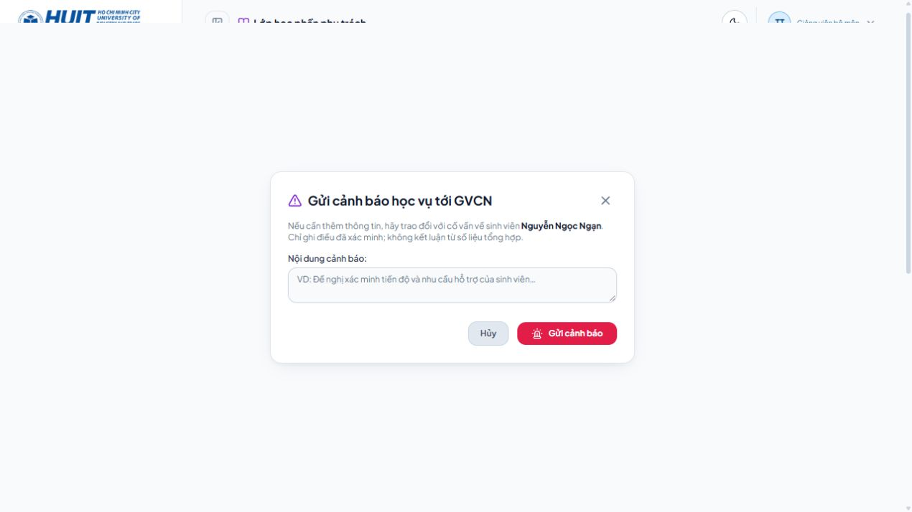

*Hình 6.36. Hộp thoại soạn cảnh báo học vụ tới GVCN; nội dung chưa nhập và chưa gửi.*

### 6.6.6. Giao diện sinh viên

Không gian sinh viên được cài đặt trong `StudentPage`, trình bày thông tin cá nhân và danh sách học phần để người học lựa chọn ngữ cảnh cần xem. Sau khi chọn một lượt học, giao diện phối hợp các yêu cầu lấy dự báo, radar, nhiệm vụ và yêu cầu trợ giúp theo enrollment tương ứng. Việc sử dụng cùng phạm vi lựa chọn cho các khối nội dung giúp hạn chế tình trạng người dùng xem nguy cơ của một học phần nhưng lại thao tác với nhiệm vụ của học phần khác.

Thông tin dự báo và chỉ số hành vi được tổ chức để người học nhận biết tình hình tại mốc quan sát, kèm nội dung gợi ý hoặc hướng dẫn theo khả năng của dữ liệu. Các trạng thái chưa có dự báo, dữ liệu thiếu hoặc không nhận được một thành phần phản hồi cần được diễn đạt rõ trên màn hình. Xác suất hiển thị vẫn là kết quả model trong phạm vi đầu vào; không được trình bày như xác nhận chắc chắn về kết quả học tập cuối cùng của sinh viên.

Khu vực nhiệm vụ phân biệt công việc đang thực hiện và công việc đã hoàn thành. Sinh viên có thể xem nội dung được giao và gửi yêu cầu cập nhật hoàn thành qua dịch vụ tương ứng. Sau phản hồi thành công, giao diện tải hoặc cập nhật lại dữ liệu để trạng thái hiển thị phù hợp bản ghi nghiệp vụ. Việc hoàn thành được hiểu là thông tin do quy trình phần mềm ghi nhận; đánh giá chất lượng thực hiện hoặc tác động học tập cần cơ chế và dữ liệu bổ sung.

Khu vực yêu cầu trợ giúp cho phép người học trao đổi nhu cầu hỗ trợ trong học phần đang chọn và xem các yêu cầu liên quan. Cơ chế nhắc nhở học phần được triển khai ở các thành phần giao diện dùng chung để hỗ trợ nhận biết nhiệm vụ cần chú ý; phạm vi này cần được phân biệt với dịch vụ gửi thông báo qua email hoặc một nền tảng ngoài ứng dụng. Hồ sơ cá nhân tiếp tục sử dụng cấu trúc chung nhưng trình bày mã sinh viên và các thông tin phù hợp vai trò.

Qua cách tổ chức các phân hệ, giao diện kết nối hoạt động dự báo với quá trình xem xét căn cứ và thực hiện nhiệm vụ theo trách nhiệm của người dùng. Giá trị của phần cài đặt nằm ở khả năng trình bày thông tin đúng ngữ cảnh và tạo các điểm thao tác có kiểm soát. Mức độ phù hợp của gợi ý, tính ổn định của các luồng nhiều vai trò và hiệu quả hỗ trợ học tập vẫn cần được đánh giá bằng các kịch bản và nguồn bằng chứng tương ứng.

Lượt đăng nhập sinh viên bổ sung đã tải được học phần AAA, đợt mở 2013J, với xác suất nguy cơ đang lưu khoảng 26,8% và nhãn an toàn theo ứng dụng. Kết quả này thuộc hồ sơ đang có trên môi trường local, khác với tình huống mẫu tốt 7,7% của Dashboard. Trong học phần được chọn chưa có nhiệm vụ đang chờ hoặc yêu cầu trợ giúp. Hộp thông báo cũng hiển thị không có nhiệm vụ cần nhắc; do đó ảnh ghi nhận được trạng thái rỗng, chưa kiểm tra được thao tác hoàn thành nhiệm vụ trên dữ liệu của tài khoản này.

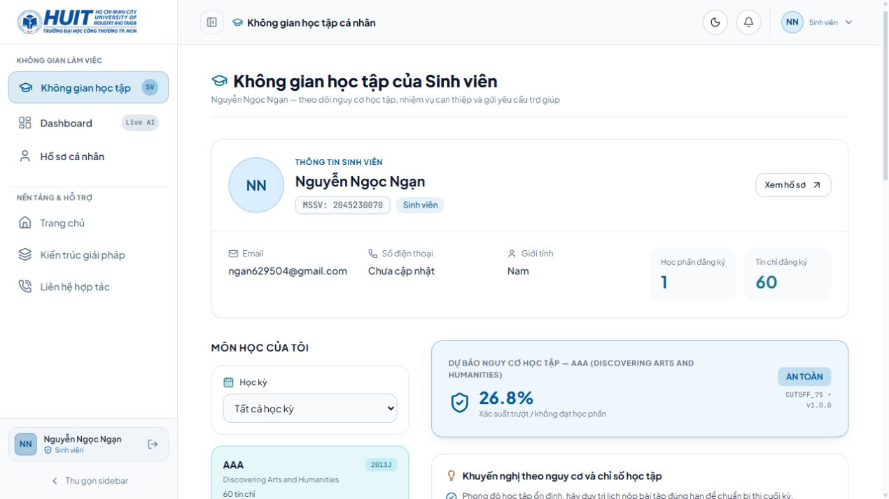

*Hình 6.37. Hồ sơ, học kỳ, học phần và kết quả dự báo đang có ở tài khoản được cung cấp; xác suất trong hồ sơ khoảng 26,8%.*

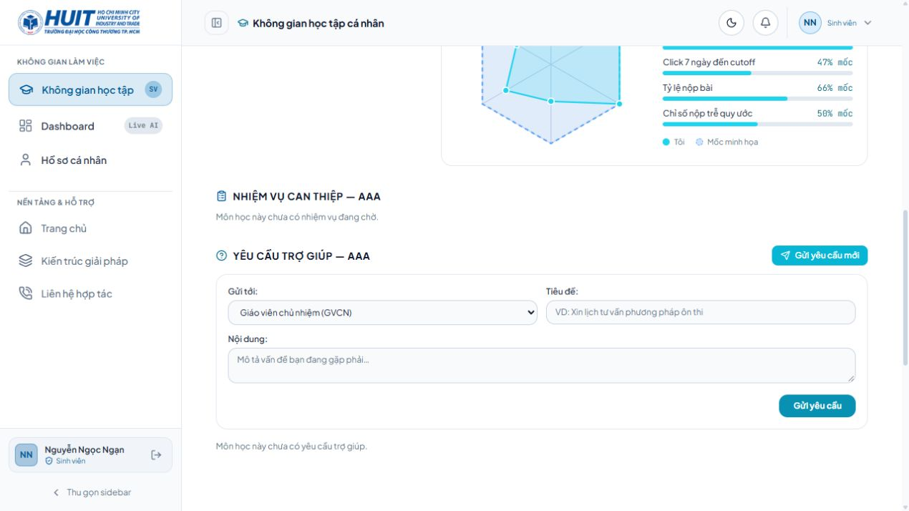

*Hình 6.38. Biểu mẫu chọn người nhận, tiêu đề và nội dung trợ giúp; chưa nhập nội dung hay gửi yêu cầu. Vùng nhiệm vụ hiện chưa có công việc đang chờ.*

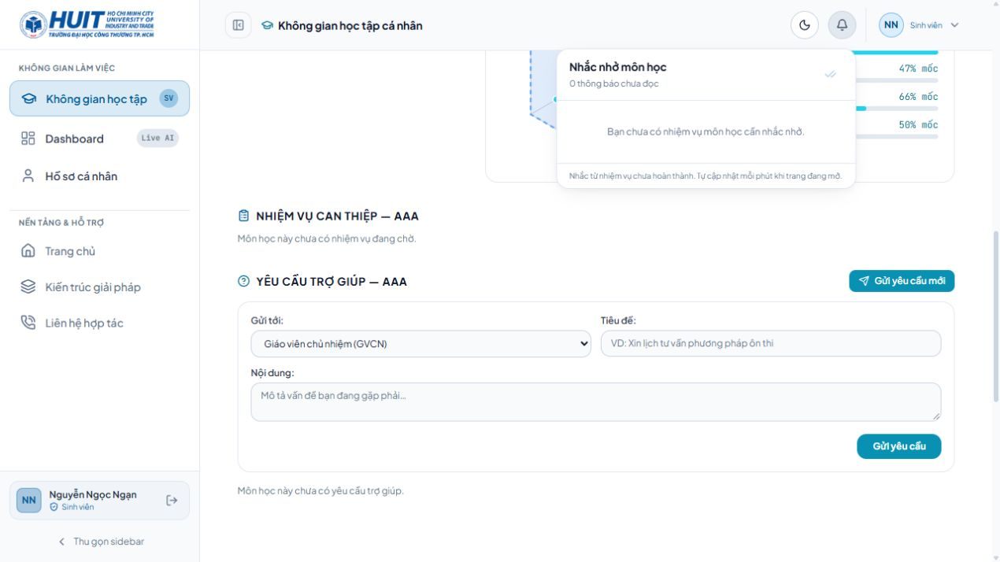

*Hình 6.39. Hộp nhắc nhở hiển thị không có nhiệm vụ cần nhắc trong tài khoản đang xem; chưa có dữ liệu để kiểm tra đánh dấu thông báo đã đọc.*

### 6.6.7. Giao diện trang chủ và điều hướng chức năng

Trang chủ giới thiệu mục đích hỗ trợ quyết định học tập và cung cấp hai điểm vào chính: Dashboard phân tích và trang kiến trúc giải pháp. Bên dưới phần giới thiệu, các khối chỉ số trình bày kết quả tham chiếu trên OULAD, kèm mô tả split và giới hạn để phân biệt validation lịch sử với kết quả của artifact sau fit lại. Nội dung trang giải thích vai trò HCO–VNLS trong lựa chọn đặc trưng, vai trò LightGBM trong dự báo và trách nhiệm của người phụ trách khi chuyển thông tin thành hoạt động hỗ trợ.

Chức năng phóng lớn bảng so sánh cho phép xem rõ số đặc trưng, Accuracy, Recall và AP của các cấu hình. Bảng này phục vụ tra cứu kết quả nghiên cứu đã lưu, không thực hiện huấn luyện hoặc đo lại model trong trình duyệt. Các thẻ điều hướng cuối trang tạo lối tắt tới Dashboard, hồ sơ, kiến trúc và liên hệ; chúng dùng chung cơ chế chuyển màn hình với menu bên.

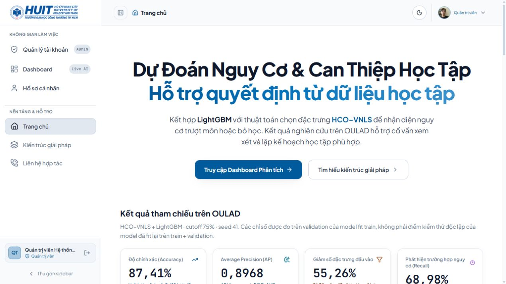

*Hình 6.40. Trang chủ giới thiệu bài toán, nút truy cập Dashboard và các kết quả tham chiếu có ghi phạm vi dữ liệu.*

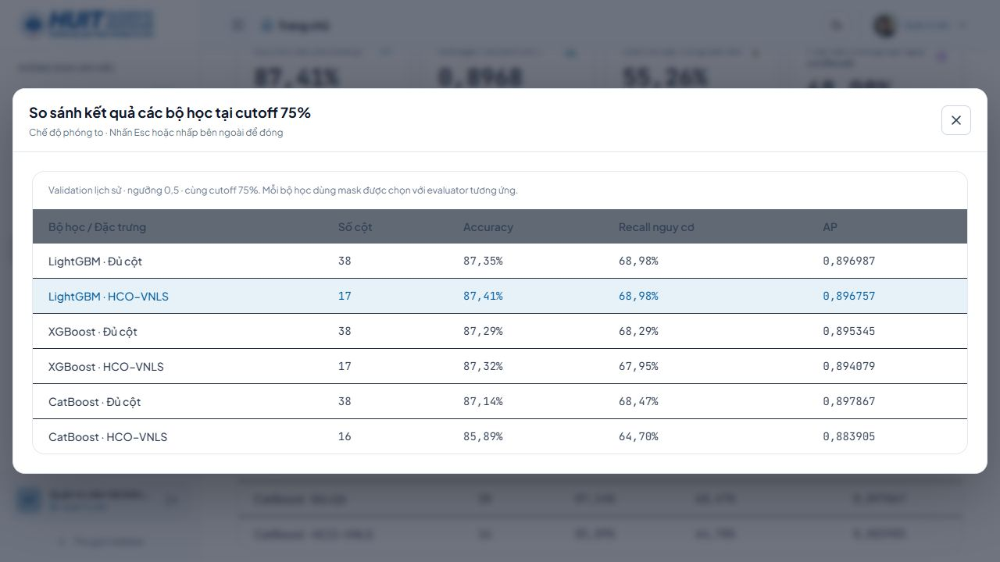

*Hình 6.41. Chức năng mở lớn bảng kết quả các bộ học tại cutoff 75%; các chỉ số thuộc validation lịch sử.*

### 6.6.8. Giao diện giới thiệu phương pháp và khám phá kết quả

Trang “Kiến trúc giải pháp” cung cấp nội dung giới thiệu HCO, VNLS và hàm đánh giá mask, đồng thời tổ chức các bảng, biểu đồ phục vụ đọc kết quả nghiên cứu. Các bộ chọn mốc quan sát, phương pháp chọn đặc trưng và bộ học giúp người sử dụng thay đổi cấu hình đang xem. Những điều khiển này lọc dữ liệu báo cáo đã tích hợp vào frontend, không phải lệnh thay đổi model đang phục vụ backend.

Các biểu đồ hỗ trợ xem so sánh chất lượng phân loại, đánh đổi số đặc trưng với AP, ma trận nhầm lẫn và sự khác biệt giữa hai cutoff. Mỗi biểu đồ có chế độ phóng lớn để đọc nhãn và giá trị. Khi diễn giải ma trận nhầm lẫn, giao diện nhấn mạnh đơn vị lượt đăng ký học phần; khi đối chiếu cutoff, thông tin quần thể thay đổi được nêu để tránh quy toàn bộ chênh lệch cho thời gian quan sát. Bảng ROC-AUC biểu diễn giá trị tổng hợp giữa cấu hình, không phải đường cong ROC được dựng từ xác suất từng mẫu.

Các khối giải thích chỉ số và giới hạn kết quả giúp đặt bảng số liệu vào đúng phạm vi. Phần độ phù hợp gợi ý được tách khỏi metric dự báo và nêu chưa có đánh giá tương ứng, tránh sử dụng Accuracy hoặc AP như bằng chứng trực tiếp của hiệu quả hỗ trợ học tập.

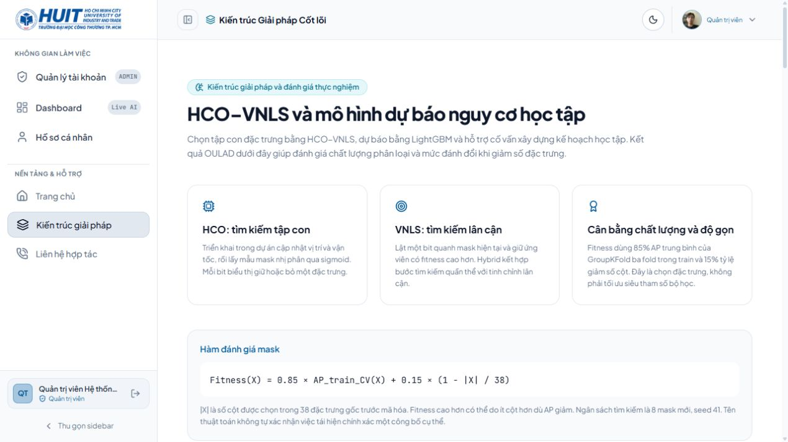

*Hình 6.42. Trang giới thiệu HCO–VNLS, LightGBM và hàm đánh giá tập đặc trưng.*

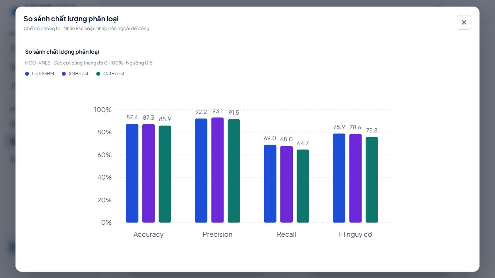

*Hình 6.43. Biểu đồ phóng lớn so sánh Accuracy, Precision, Recall và F1 của các bộ học theo cấu hình lựa chọn.*

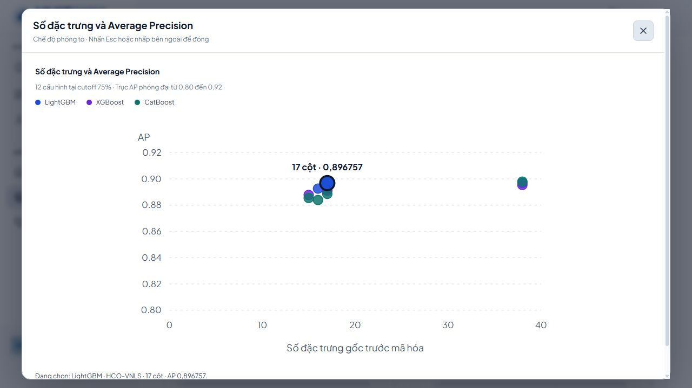

*Hình 6.44. Biểu đồ thể hiện quan hệ giữa số cột được giữ và AP của cấu hình đang xem.*

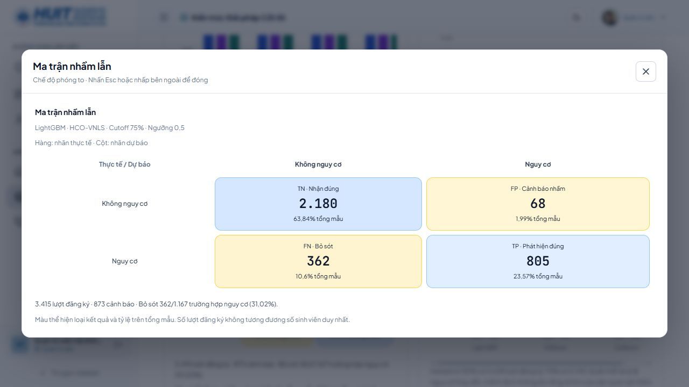

*Hình 6.45. Ma trận của cấu hình LightGBM hybrid trên validation lịch sử, không phải kết quả test của một yêu cầu người dùng mới.*

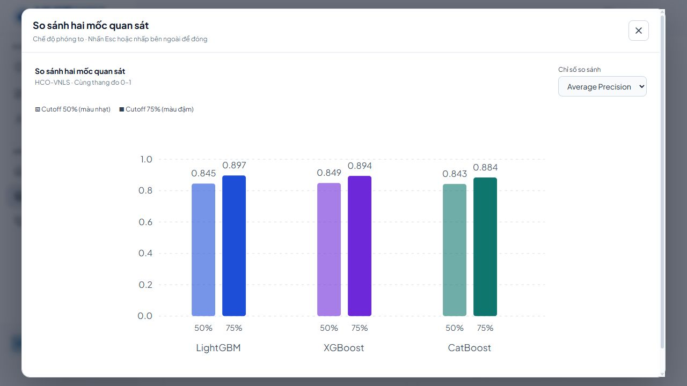

*Hình 6.46. So sánh AP giữa cutoff 50% và 75% với lưu ý quần thể đánh giá không hoàn toàn giống nhau.*

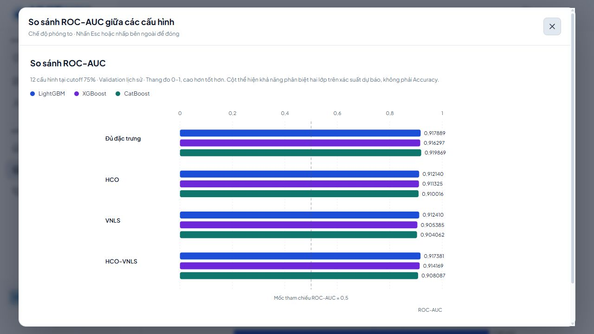

*Hình 6.47. Giá trị ROC-AUC tổng hợp theo bộ học và phương pháp chọn đặc trưng; không gọi là đường cong ROC.*

### 6.6.9. Giao diện liên hệ và hỗ trợ sử dụng

Trang liên hệ tổ chức thông tin hỗ trợ, biểu mẫu trao đổi và nhóm câu hỏi thường gặp. Các câu hỏi giải thích phạm vi tích hợp LMS, dữ liệu, triển khai và ý nghĩa cutoff. Cơ chế mở rộng câu trả lời giúp người sử dụng tra cứu mà không rời khỏi ứng dụng.

Trong phiên bản được quan sát, thông tin kênh liên hệ chính thức còn chưa thiết lập và biểu mẫu ghi rõ chưa kết nối dịch vụ gửi tin. Nút kiểm tra biểu mẫu chỉ phục vụ minh họa xử lý tại giao diện; sự hiện diện của các ô nhập không chứng minh hệ thống đã gửi email hay tạo yêu cầu bên ngoài. Biểu mẫu nhận tin cuối các trang cũng có giới hạn tương tự. Khi trình bày phạm vi triển khai, các chức năng này được ghi nhận là giao diện hỗ trợ và thông tin hướng dẫn, không phải dịch vụ liên lạc đã vận hành hoàn chỉnh.

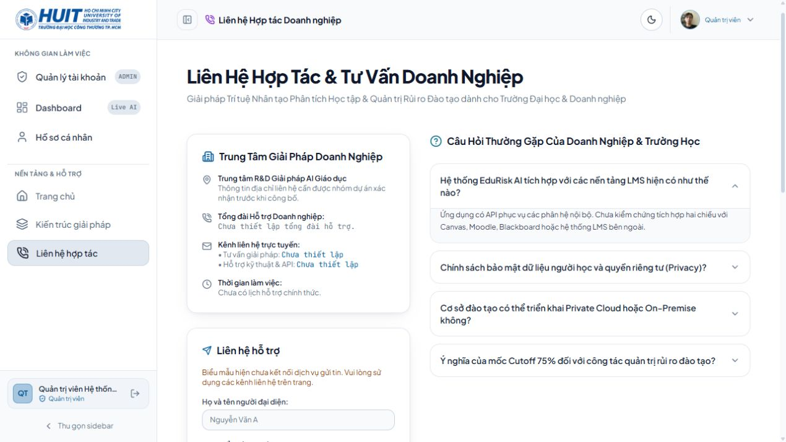

*Hình 6.48. Thông tin hỗ trợ, biểu mẫu chưa kết nối gửi tin và các câu hỏi thường gặp của ứng dụng.*

### 6.6.10. Đối chiếu mức bao phủ chức năng giao diện

Bộ minh chứng được tổ chức theo các trang và nhóm chức năng thực sự hiển thị trên website. Mở được màn hình hoặc hộp thoại được phân biệt với việc hoàn tất thao tác ghi dữ liệu. Các ảnh trạng thái rỗng, chưa đủ căn cứ và nút vô hiệu hóa được giữ lại vì chúng mô tả điều kiện sử dụng của chức năng, thay vì tạo thêm dữ liệu chỉ để có ảnh thao tác thành công.

| Nhóm chức năng | Minh chứng giao diện đã bổ sung | Phạm vi đã thực hiện |
| --- | --- | --- |
| Xác thực và phân quyền điều hướng | Đăng nhập, đăng ký, quên mật khẩu, menu tài khoản; truy cập đủ bốn vai trò | Đăng nhập/đăng xuất bằng tài khoản được cấp; không đưa thông tin xác thực vào nội dung |
| Hồ sơ và ảnh đại diện | Trang hồ sơ, trường được sửa và nút lựa chọn ảnh | Quan sát; không cập nhật thông tin hoặc tải ảnh mới |
| Giao diện chung | Menu theo vai trò, bố cục trang, chế độ sáng/tối | Chuyển trang và thử chủ đề; khôi phục chủ đề sáng |
| Dashboard | Ba nhóm trường, mẫu tốt/nguy cơ cao, kết quả, gợi ý, radar, lịch sử và hướng dẫn | Đã chạy dự báo tổng hợp; các số 7,7% và 90,8% là kết quả minh họa riêng |
| Lịch sử, CSV và sao chép | Điều khiển tìm kiếm, xuất CSV, sao chép, xóa bản ghi | Minh chứng vị trí chức năng; không tuyên bố đã kiểm chứng mọi thao tác xuất/xóa hoặc nội dung clipboard |
| Quản trị tài khoản | Danh sách/bộ lọc, cấp tài khoản theo ba vai trò, xem/sửa, đặt lại mật khẩu | Chỉ mở và đóng biểu mẫu; chưa ghi thay đổi tài khoản |
| Khóa, mở khóa và xóa tài khoản | Các nút thao tác và điều kiện bảo vệ tài khoản hiện hành trên danh sách | Không xác nhận thay đổi trạng thái hoặc xóa tài khoản |
| Giảng viên | Học phần, bảng cảnh báo, bộ lọc/sắp xếp, thông tin/căn cứ, đóng góp model, rà soát nguồn, bản nháp, cảnh báo GVCN | Đọc dữ liệu và mở các phần chi tiết; chưa xác nhận nguồn, giao bài hay gửi cảnh báo |
| Cố vấn | Lớp, sinh viên, tổng quan nguy cơ và nút can thiệp | Đã tải dữ liệu; lập kế hoạch chưa mở được do điều kiện hiện tại |
| Sinh viên | Học phần, dự báo/radar, nhiệm vụ, yêu cầu trợ giúp và thông báo | Đã mở các vùng thông tin; chưa có nhiệm vụ để thử hoàn thành, không gửi yêu cầu trợ giúp |
| Trang chủ | Giới thiệu, chỉ số tham chiếu, bảng so sánh và lối tắt | Đã mở trang và bảng phóng lớn |
| Trang giới thiệu | Các bộ lọc, bảng đánh giá, biểu đồ và hộp phóng lớn | Đã mở các loại biểu đồ; không huấn luyện lại hoặc thay model |
| Liên hệ và nhận tin | Trang liên hệ, FAQ, biểu mẫu minh họa | Giao diện chưa kết nối dịch vụ gửi tin; không gửi thông tin ra ngoài |

Những API backend chưa được đưa lên màn hình không được tính như một chức năng giao diện đã hoàn thiện. Các trường hợp cần dữ liệu hoặc điều kiện nghiệp vụ bổ sung vẫn phải có kịch bản kiểm thử riêng trước khi đánh dấu hoàn tất. Bộ ảnh hiện bao phủ các trang và nhóm điều khiển đã quan sát được, không thay thế kiểm thử toàn diện mọi nhánh thành công/thất bại của website.

---

### Ghi chú đối chiếu phục vụ hoàn thiện báo cáo

Phần này ghi nguồn kiểm tra khi biên tập, có thể chuyển sang phụ lục thay vì giữ trong thân luận văn.

| Nội dung | Bằng chứng trong lượt kiểm tra ngày 26/10/2026 | Giới hạn |
| --- | --- | --- |
| Backend | Health trả `status=ok`, `model_loaded=true`, cutoff 0,75 và threshold 0,50 | Không thay thế kiểm thử toàn bộ API |
| Frontend | Trang Vite trả HTTP 200 và hiển thị được màn hình đăng nhập | Dùng lại dịch vụ đang chạy đúng repository |
| Xác thực | Đăng nhập quản trị local thành công, menu đổi theo vai trò; đã đăng xuất sau khi kiểm tra | Lượt bổ sung đã đăng nhập trực tiếp đủ quản trị, giảng viên, cố vấn và sinh viên |
| Quản trị | Danh sách tải dữ liệu; mở/đóng hộp thoại cấp tài khoản | Không tạo, sửa, khóa, xóa hoặc đặt lại mật khẩu tài khoản |
| Hồ sơ | Mở được trang hồ sơ và các vùng thông tin/cập nhật | Không gửi thay đổi hồ sơ hoặc ảnh đại diện |
| Dashboard | Gửi đầu vào tổng hợp hợp lệ, nhận kết quả 90,8%, gợi ý và lịch sử cục bộ | Không phải đánh giá metric mô hình hoặc tác động học tập |
| Cố vấn, giảng viên, sinh viên | Đã đăng nhập theo từng vai trò, tải dữ liệu và chụp các trang/biểu mẫu thực tế; tiếp tục đối chiếu mã | Các thao tác ghi dữ liệu và nhánh bị khóa chưa được thực hiện |

**Vấn đề quan sát được:** bộ preset “Mẫu SV Yếu” đặt `active_day_ratio=0.12`, `clicks_recent_7=2` và `clicks_recent_30=15`, trong khi biểu mẫu lần lượt dùng bước nhập 0,05; 5; 10. Trình duyệt chặn gửi vì step mismatch. Để kiểm tra đường đi còn lại, lần chạy minh họa sử dụng các giá trị 0,10; 0; 10 tương ứng. Đây là điều chỉnh dữ liệu thử trên form, chưa sửa mã nguồn hoặc khắc phục preset. Do đó chưa thể mô tả nút mẫu này như một kịch bản chạy thành công ngay khi nạp dữ liệu.

**Điểm cần rà soát về diễn đạt:** kết quả hiện có cụm “ngưỡng phân lớp tối ưu”. Trong nội dung luận văn chỉ nên gọi là threshold đang dùng của artifact, trừ khi có giao thức lựa chọn ngưỡng chứng minh tính tối ưu theo một mục tiêu xác định. Các lần chạy minh họa đã thêm bản ghi vào lịch sử cục bộ theo tài khoản trong trình duyệt quan sát; lượt bổ sung chạy thêm mẫu tốt. Không giao nhiệm vụ hoặc lập kế hoạch hỗ trợ.

**Nguồn mã và tài liệu:**

- [Dàn ý Chương 5 và 6](dan_bai.md).
- [App.tsx](../../apps/frontend/src/App.tsx), [AppContext.tsx](../../apps/frontend/src/state/AppContext.tsx), [Sidebar.tsx](../../apps/frontend/src/components/common/Sidebar.tsx).
- [AuthPage.tsx](../../apps/frontend/src/pages/AuthPage.tsx), [ProfilePage.tsx](../../apps/frontend/src/pages/ProfilePage.tsx), [DashboardPage.tsx](../../apps/frontend/src/pages/DashboardPage.tsx).
- [FeatureForm.tsx](../../apps/frontend/src/components/dashboard/FeatureForm.tsx), [định nghĩa trường và preset](../../packages/shared/constants/fields.ts).
- [AdminUsersPage.tsx](../../apps/frontend/src/pages/AdminUsersPage.tsx), [AdvisorPage.tsx](../../apps/frontend/src/pages/AdvisorPage.tsx).
- [LecturerPage.tsx](../../apps/frontend/src/pages/LecturerPage.tsx), [SuggestionReview.tsx](../../apps/frontend/src/components/lecturer/SuggestionReview.tsx), [SnapshotEvidenceReview.tsx](../../apps/frontend/src/components/lecturer/SnapshotEvidenceReview.tsx).
- [StudentPage.tsx](../../apps/frontend/src/pages/StudentPage.tsx), [dịch vụ API](../../apps/frontend/src/services/api.ts), [quy tắc nghiệp vụ](../../docs/product/business-rules.md).

**Bổ sung nguồn đối chiếu:** [HomePage.tsx](../../apps/frontend/src/pages/HomePage.tsx), [AboutPage.tsx](../../apps/frontend/src/pages/AboutPage.tsx), [ContactPage.tsx](../../apps/frontend/src/pages/ContactPage.tsx) và [thành phần biểu đồ nghiên cứu](../../apps/frontend/src/components/evaluation/).

**Quy ước sử dụng ảnh:** ảnh được chụp từ giao diện thật trên môi trường local. Thông tin đăng nhập không được đưa vào tài liệu. Các tên/mã hồ sơ hiển thị thuộc dữ liệu local được chủ dự án cho phép truy cập trong lượt quan sát; cần rà soát, ẩn định danh khi sử dụng bản báo cáo ngoài phạm vi được phép. Không coi dữ liệu local là bằng chứng triển khai thực địa hoặc hiệu quả hỗ trợ học tập.
